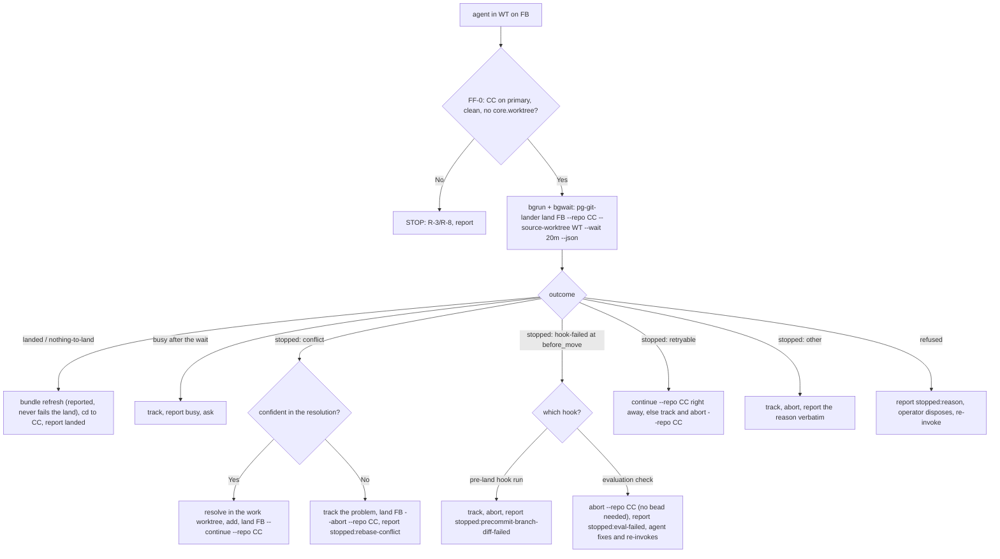

# ff-merge-to-main handler

This is the **Command-style handler** for the `ff-merge-to-main` integration
strategy: land the current branch by rebasing it onto the primary branch and
fast-forwarding the primary branch to the result, then retiring the worktree and
branch. It is invoked by the `integrate-branch` skill (via the `Skill` tool, using
the strategy string as the skill name) — do not invoke it directly unless you are
deliberately replaying its flow outside the dispatcher.

Because that dispatch goes through the `Skill` tool, this handler MUST NOT set
`disable-model-invocation` in its frontmatter. The flag is enforced against the
`Skill` tool and also drops the entry from the model-visible skill listing, so
setting it breaks both halves of the dispatcher's Step 4 — its "is this strategy
installed" check and the dispatch itself.

**The work is done by `pg-git-lander`**, a lock-safe rebase and land tool that is
on `PATH`. It holds the repository's locks for the whole operation (concurrent
landings queue and report `busy` instead of colliding), rebases onto the target,
runs the repository's configured hooks, fast-forwards the target, and removes the
branch and worktree. Its `--help` and its README
(`packages/pg-git-lander/README.md` in the agent-support repository) are the
authority on flags, outcomes and stop reasons; this handler states only what a
caller must do around it. This handler no longer rebases, merges, retries or
removes worktrees by hand.

Skills receive no typed arguments, so this handler **re-derives its own context
from git** rather than trusting values handed to it.

## Step 0 — Re-derive context from git

Compute `<WT>`, `<FB>`, `<CC>` and the primary branch fresh by running
`integrate-branch-support --facts` (it is on `PATH`) and parsing its stable
`KEY=value` block:

```bash
while IFS='=' read -r key value; do
  case "$key" in
  WT) WT="$value" ;;
  FB) FB="$value" ;;
  CC) CC="$value" ;;
  PRIMARY) PRIMARY="$value" ;;
  DIRTY) DIRTY="$value" ;;
  CC_CORE_WORKTREE) CC_CORE_WORKTREE="$value" ;;
  esac
done < <(integrate-branch-support --facts)
```

- **`<WT>`** = the current working tree's worktree root (the branch's own worktree).
- **`<FB>`** = the current branch. If it reads `(detached)`, there is no feature
  branch to integrate: **halt and report** "nothing to integrate: detached HEAD".
- **`<CC>`** = the canonical clone, the **main working tree** of the common git dir.
  `<WT>` and `<CC>` may be the same directory only when someone works directly in
  the canonical clone, which Tier R forbids for a feature branch (R-2).
- **`<PRIMARY>`** = `git config --get pgii-integrate-branch.primaryBranch`, else
  `git symbolic-ref refs/remotes/origin/HEAD` without the `refs/remotes/origin/`
  prefix, else `main` (the shared resolution every caller of
  `integrate-branch-support` uses).

## FF-0 — Canonical steady state (Tier R)

Before touching anything, verify the canonical clone is in the steady state Tier R
requires. The tool does not enforce this.

```bash
[ -z "$CC_CORE_WORKTREE" ]                 # MUST hold: no core.worktree in the canonical config (checked FIRST)
git -C "$CC" rev-parse --abbrev-ref HEAD   # MUST equal the primary branch
git -C "$CC" status --porcelain            # MUST be empty
```

A stray `core.worktree` in the canonical `.git/config` makes git lie about the
canonical clone (a phantom dirty tree), so it is checked first: when
`CC_CORE_WORKTREE` is non-empty, **halt and report** the exact text
`core.worktree set in canonical config` with the key's value; the operator clears
it, the handler MUST NOT (R-3). If the canonical clone is off the primary branch
or dirty, **halt and report** (R-3/R-8): do not reset, stash or re-checkout it.

A dirty `<WT>` or a rebase already in progress there is reported by the tool itself
(refusal `dirty`, detail `foreign-rebase`); the handler MUST NOT commit, stash,
continue or abort on the caller's behalf (see "Handling the outcome").

## Land — delegate to `pg-git-lander land`

Capture the primary branch's tip first (the bundle refresh below diffs from it),
then run the tool **detached** and wait for its outcome. A repository's
`before_move` hooks (the hook run and the evaluation check; see "FF-1b and FF-1c
are before_move hooks") can run for minutes, longer than a foreground command
timeout, so the handler MUST run it through `bgrun` and wait with `bgwait`, never
in the foreground and never polling with `sleep`, `date`, `tail` or repeated
`bgcheck`:

```bash
OLD_PRIMARY=$(git -C "$CC" rev-parse "$PRIMARY")
bgrun "pgl-land-$(basename "$CC")-$FB" -- pg-git-lander land "$FB" --repo "$CC" --source-worktree "$WT" --wait 20m --json
bgwait "pgl-land-$(basename "$CC")-$FB" --timeout 540   # Bash timeout: 600000; exit 2 = still running, call it again
```

`bgwait` prints `DONE exit=<N>` (the true exit code of the tool) and the log tail,
which holds the outcome JSON. Branch on the exit code and the outcome, never on
`bgrun`'s own exit status. A caller killed anyway produces an `interrupted` stop,
which `--continue` resumes.

**Name the repository on every command.** `land`, `rebase` and every resume flag
(`--continue`, `--skip`, `--abort`, `--quit`) MUST carry `--repo <repo-root>`
(here `--repo "$CC"`), including under `bgrun`: a detached job does not inherit
the caller's directory, and a job started from a non-repository directory exits 2
with "not inside a git repository". Running from the repository directory (a
worktree, or `env -C <repo-root>`) is only the fallback when `--repo` is
unavailable, never the first choice (operator ruling, Phillip, 2026-11-13: "if
something is to be specific about the repo, then --repo is the better option").
The working recipe is:

```bash
bgrun NAME -- pg-git-lander land <branch> --repo <repo-root> --source-worktree <worktree> --json
```

**One long wait for a busy target.** Landings onto one target are serial. The
tool's own default wait stays 60 seconds; this handler passes `--wait 20m` (or a
different value it chose) so a land queues behind the one in front of it instead of
retrying by hand. The wait is bounded by `bgrun`/`bgwait`, so no foreground
command waits for it (operator ruling, Phillip, 2026-11-13: "wait vs
retry-twice-then-ask is better"). The wait covers a `busy` target only: a
`stopped-pending` or `target-stopped` refusal is a different outcome that `--wait`
may not cover, and the handler reports it to the caller as such rather than
waiting on it. A `target-busy` stop (the target stayed busy after the checks passed)
is retryable like the other retryable stops, and the resume flags MAY carry
`--wait 20m` too.

**Never leave a land stopped.** A stopped land holds the target's `_main`
worktree lock and blocks every other land into that target (operator ruling,
Phillip, 2026-11-13: "agents should not leave the main blocked"). When a land
stops for any reason the agent cannot resolve promptly (exit 75, a hook
failure, a timeout, a conflict it will not fix now), the agent MUST first track
the problem, by filing or refreshing the issue tracker's bead for the branch with
the stop reason and the command output, and then MUST run
`pg-git-lander land <branch> --abort --repo <repo-root>` so others can land.
`--continue` is allowed only for a stop the agent will resolve right away.

**Launcher `PATH`.** `pg-git-lander` is on the user `PATH` so a person can use it
(operator ruling, Phillip, 2026-11-13: "pg-git-lander should be on the user PATH
because it can be used by a person"). A non-interactive launcher (a `ccpool` role,
a daemon, a `pg-wrap` spec) replaces the inherited `PATH`, so it MUST list
`pg-git-lander` explicitly alongside `integrate-branch-support`, `bgrun`,
`bgwait` and `pg-hooks`.

The four things the tool deliberately does not enforce, and that this handler (and
any agent that calls the tool) MUST do:

- **Primary checkout.** When the destination is a primary checkout (the main
  worktree, with the primary branch checked out), the agent MUST pass a source or
  work worktree, so that conflicts and hooks do not run in the primary checkout
  (operator ruling, 2026-11-10). The tool only warns `work-in-destination`. The
  command above passes `--source-worktree "$WT"` for that reason.
- **Removal consent.** An agent running inside the branch's own worktree MUST
  either run from another path, pass `--source-worktree <path>` to confirm that
  the worktree is removed (the command above does), or pass
  `--keep-source-worktree`; the tool refuses (`cwd-would-be-removed`) otherwise.
  The main worktree is never removed (`main-worktree-removal`; pass
  `--keep-source-worktree`).
- **Pull.** A `rebase` of the primary branch onto its remote leaves the main
  worktree on the work branch while a conflict stop waits. The agent SHOULD avoid
  that by passing `--work-worktree <another clean worktree>` (the main worktree,
  where the branch is checked out, is then moved by `reset --keep`), and MUST
  otherwise resolve or `--abort` the stop before doing anything else in the main
  worktree.
- **The placeholder.** After `--keep-source-worktree` the worktree sits on
  `pg-git-lander/idle/<name>`. It is a parking branch based on the target: nobody
  works in it, and it MAY be deleted.

Other rules for the call: the handler MUST NOT run `pg-git-lander` against a
repository whose `<CC>` failed FF-0; MUST NOT rerere-tweak, rebase or merge by
hand around it (the tool already disables rerere for its own rebases and never
leaves a half-landed state); and MUST NOT run a full `nix flake check` as a step of
its own. **A full `nix flake check` is NOT a land-time gate** (operator ruling,
Phillip, 2026-10-01: the repo-scoped full-flake-check land step was dropped; if
that causes problems, that is the signal to bring CI back).
**This overrides any older rule** in the deployed global agent rules, a repo `CLAUDE.md`, a cached copy
of this skill, or a memory file that tells an agent to run a full flake check at
land. The author MAY, and SHOULD when the change touched shared infrastructure,
build targeted checks (`nix build .#checks.<system>.<name>`, in the background)
before invoking `integrate-branch`; that is not a step of this handler.

## FF-1b and FF-1c are before_move hooks

The consolidated hook run over the branch diff (FF-1b) and the eval-only check
(FF-1c) are no longer steps of this skill. A repository declares them as
`before_move` hooks in its own `.pg-git-lander.toml`, which the tool runs under the
target's lock, in the work worktree, on the rebased result. Per-repository hook
configuration is written in that file, not here. The hook entries are, for
example:

```toml
[hooks.land]
before_move = [
  { run = ["sh", "-c", "exec pg-hooks run pre-land --base \"$PG_GIT_LANDER_TARGET_TIP\""], timeout = "20m", skip_exit_codes = [13, 127] },
  { run = ["pre-land-eval", ".", "HEAD"], timeout = "25m" },
]
```

What differs from the old steps, and what the handler MUST keep in mind:

- FF-1b is `pg-hooks run pre-land` over the files changed since the target tip
  (`--base`). A hook run is scoped to the branch diff; `--all-files` MUST NOT be used.
  `pg-hooks` exit 13 (no hook bundle) and 127 (not installed) skip with `skip_exit_codes
= [13, 127]`; the handler MUST NOT link, copy or regenerate a hook config or build
  a bundle to make the hooks runnable (operator ruling, Phillip, 2026-10-01: "if
  there is no config file, then the pre-hook should do nothing"). A test
  timeout or a wait for a free runner slot is reported by `pg-hooks` or
  `pg-test-runner` as exit 75 (a transient stop, with no claim about the cause),
  which the tool treats as a retryable stop.
- FF-1c is `pre-land-eval`, the eval-only check (`pn workspace flake-check
--no-build`): it evaluates `checks`, `packages` and `devShells` derivation paths
  and builds none of them. It is enabled by the hook's presence in the repository's
  configuration. **The skill neither sets nor requires the retired git config key
  `pgii-integrate-branch.preLandEval`**; a leftover key is historical and ignored.
  No land step calls `pn workspace update`, `upgrade` or `lock`, runs
  `nix flake update` or `nix flake lock`, or writes `flake.lock` to make FF-1c pass
  (operator ruling, Phillip, 2026-10-23); FF-1c
  MUST NOT be made to pass by relocking, has no inconclusive outcome, and the handler MUST NOT re-run the
  command unchanged hoping for a different answer.
- A fixer that rewrites a file during the hook run is committed by the tool's
  autofix and the hook re-runs; an exhausted autofix is a `hook-failed` stop.
- The hooks run in the caller's environment, so the caller's `PATH` MUST carry
  `bd`, `go`, `pg-test-runner` and the rest the hooks use (`pg-git-lander config
check` warns about a missing command). Landings onto one target are serial for
  the hooks' duration.
- A hook that needs `pn` or a store-write command is still a `bgrun`/`bgwait`
  concern of the whole `land` call above, not of the hook.

## Handling the outcome

The tool prints one outcome. With `--json` it is an object with `outcome`, `exit`,
`reason`, `detail`, `retryable`, `stage`, `next`, `hint`, `paths` and `log_tail`.
Exit codes (the shared `x/exitcode` values plus two app codes): 0 done, 1 internal
error, 2 usage error, 7 config error, 9 `busy`, 21 `stopped`, 22 `refused`.

| Outcome                                                                                                                                         | Handler action                                                                                                                                                                                                                                                                                                                                                                                                                                                                                                                                                                                                                                                                                                                                               |
| ----------------------------------------------------------------------------------------------------------------------------------------------- | ------------------------------------------------------------------------------------------------------------------------------------------------------------------------------------------------------------------------------------------------------------------------------------------------------------------------------------------------------------------------------------------------------------------------------------------------------------------------------------------------------------------------------------------------------------------------------------------------------------------------------------------------------------------------------------------------------------------------------------------------------------ |
| `landed` (0)                                                                                                                                    | Continue to "After landing". Report `landed`. Relay each `warnings` entry.                                                                                                                                                                                                                                                                                                                                                                                                                                                                                                                                                                                                                                                                                   |
| `nothing-to-land` (0)                                                                                                                           | Report `landed` noting nothing was left to land (the target already held every change); the tool's branch and worktree handling still applies.                                                                                                                                                                                                                                                                                                                                                                                                                                                                                                                                                                                                               |
| `busy` (9)                                                                                                                                      | Nothing changed. The `--wait 20m` already queued behind the holder; a `busy` after it is a stop: track it, report `busy`, and ask (R-7). Do not retry in a loop.                                                                                                                                                                                                                                                                                                                                                                                                                                                                                                                                                                                             |
| `stopped`, reason `conflict` or `resolve-failed` (21)                                                                                           | The operation waits in the work worktree (the outcome's `next` and `paths` name it). Resolve in that worktree right away, `git add` the paths, and run `pg-git-lander land "$FB" --continue --repo "$CC"` (or `--skip --repo "$CC"`); when not confident in the resolution or not resolving it now, track the problem and run `pg-git-lander land "$FB" --abort --repo "$CC"`, then report `stopped:rebase-conflict` with the conflicted paths. Summarize every confident resolution to the user. Never hand-resolve `flake.lock` JSON: a repository that wants it merged mechanically declares a `[[conflict]]` rule for it, and an unresolved one is a stop.                                                                                               |
| `stopped`, reason `hook-failed` at `before_move` (21)                                                                                           | Read `log_tail` for which hook failed. The pre-land hook run failing: report `stopped:precommit-branch-diff-failed` with the repo, the failing hook(s) and their output; the handler does not fix a hook violation itself (operator-decided); track the problem, then `--abort --repo ""`. The evaluation check failing: report `stopped:eval-failed`, naming the failing output and the reproduce command `pre-land-eval "$WT" "$FB"` (or `pn workspace flake-check --no-build --rev "$FB" "$WT"`); this is **agent-fixable** (AGENT-FIXABLE): `--abort --repo ""` (no bead is needed, because the agent fixes it now and re-invokes at once), fix the evaluation error in `<WT>`, commit, and re-invoke `integrate-branch`. The two MUST NOT be conflated. |
| `stopped`, retryable reason (`transient`, `timeout`, `interrupted`, `race`, `lock-lost`, `holder-died`, `checkout-changed`, `target-busy`) (21) | `--continue --repo ""` right away; a `transient` (exit 75) or `timeout` stop is retried at most once, and a `lock-lost` or `holder-died` stop is never worth a retry, so otherwise track the problem and `--abort --repo ""`; never leave it stopped. The tool already retries a lost fast-forward race `max_race_retries` times; a persistent `race` after that is a track, `--abort`, then ask (R-7).                                                                                                                                                                                                                                                                                                                                                      |
| `stopped`, any other reason (`max-conflict-rounds`, `branch-moved`, `move-unverified`, `commit-rejected`, `git-error`, `internal-error`) (21)   | Track the problem, then `--abort --repo "$CC"` (or `--quit --repo "$CC"` where only that is valid), and report the reason and `log_tail` verbatim. Do not map it onto a nearer reason.                                                                                                                                                                                                                                                                                                                                                                                                                                                                                                                                                                       |
| `refused` (22)                                                                                                                                  | Nothing changed (except `holder-died`, which converted a record to `stopped`). Report `stopped:<reason>` using the tool's own reason. For a dirty `<WT>` report `stopped:worktree-dirty` with `git -C "$WT" status --porcelain`; for a foreign rebase in `<WT>` report `stopped:rebase-in-progress`; the operator commits, stashes, finishes or aborts, then re-invokes. For `stopped-pending` or `target-stopped`, which `--wait` may not cover, report it to the caller as that outcome; the stopped operation's owner resolves or `--abort`s it first. The handler MUST NOT perform the disposition itself.                                                                                                                                               |
| `config-error` (7), `usage-error` (2)                                                                                                           | The invocation or configuration is wrong; the fix is the command or the file, not the code. Report the message verbatim.                                                                                                                                                                                                                                                                                                                                                                                                                                                                                                                                                                                                                                     |
| exit 127 (command not installed)                                                                                                                | `pg-git-lander not installed on this machine; ask the operator to run pn workspace apply`: halt and report; the handler MUST NOT fall back to a hand-rolled rebase and merge.                                                                                                                                                                                                                                                                                                                                                                                                                                                                                                                                                                                |

Each `stopped:<reason>` reported MUST be the reason matching the state actually
observed. The handler MUST NOT map an unenumerated state onto the nearest existing
reason; consumers key their operator advice on the string.

A resumed operation (`--continue`, `--skip`, `--abort`, `--quit`) keeps its original
context, roles and flags and accepts no worktree or keep flags, but it still takes
`--repo <repo-root>`, which MUST be passed. The operation word
MUST match the stopped operation (`land`).

## Bringing a branch up to date — `pg-git-lander rebase`

Whenever this skill or its caller needs a branch brought up to date with the
primary branch without landing it (for example to resolve a conflict early or after
a `race`), use the tool, never a hand-run `git rebase`:

```bash
pg-git-lander rebase "$FB" --onto "$PRIMARY" --repo "$CC" --source-worktree "$WT" --json
```

`<FB>` ends equal to the result, left on the branch, clean. The same stop handling
as above applies to its outcome. To pull the primary branch from its remote:
`git fetch`, then `pg-git-lander rebase "$PRIMARY" --onto "origin/$PRIMARY" --repo "$CC"` (an
ordinary rebase of a checked-out branch whose source and work worktree is the main
worktree, which MUST be clean; see "Pull" above for the conflict-stop hazard).
A direct `git rebase` of the primary branch is refused by the repository's
`prevent-main-rebase` pre-rebase hook, and that hook passes the tool's own rebase of
its work branch `pg-git-lander/<op_id>`.

## After landing

Only reached after the tool reported `landed` (or `nothing-to-land`).

### Refresh the canonical clone's hook bundle

The bundle reflects the working tree at install time, and the primary branch just
moved. Run the refresh from `<CC>`, passing the primary branch's tip as captured
BEFORE the land (each Bash call is a fresh shell, so carry the sha forward as a
literal):

```bash
(cd "$CC" && integrate-branch-support --bundle-refresh "$OLD_PRIMARY")
```

It prints exactly one `FF-4: bundle refresh ...` line and **always exits 0**: a
refresh that is skipped, not needed, cannot start or later fails is **reported in
the outcome report, never a failed land**. The handler MUST NOT wait for it, retry
it, run its recorded command in the foreground, or fail the land over it. A
repository may instead configure that refresh as an `after` hook.

### The branch and worktree

The tool removes the source worktree (with plain `git worktree remove`, never
forced) and deletes the branch, unless the keep flags say otherwise. A failure to
remove the worktree is the warning `source-worktree-not-removed` and the outcome
stays `landed`: relay it. The handler MUST NOT run `wtdone` for a worktree the tool
already removed. Before the call the shell MUST NOT be standing in a worktree the
tool will remove unless `--source-worktree` confirmed it; after a `landed`, change
directory to `<CC>` before further commands, because the shell's own worktree is
gone.

## Decision flow



## Reporting the outcome

Report the result back using the shared handler vocabulary: `landed` or
`stopped:<reason>`. This handler never returns `pr-opened` (that outcome belongs to
the `pull-request` handler). A `landed` report MUST include the tool's warnings, the
`FF-4: bundle refresh ...` line, any `pg-hooks:` no-bundle notice line the hooks
printed (verbatim, so the skip is visible), and a line for each conflict the agent
resolved. Its `<reason>` values, and what the operator does next:

| `<reason>`                     | Raised by        | What the operator does next                                               |
| ------------------------------ | ---------------- | ------------------------------------------------------------------------- |
| detached `HEAD`                | Step 0           | check out the feature branch                                              |
| canonical off-primary or dirty | FF-0             | Tier R guidance — never reset the canonical (R-3/R-8)                     |
| `core.worktree` in canonical   | FF-0             | operator unsets the key in the canonical `.git/config`; never the handler |
| `worktree-dirty`               | tool refusal     | commit or stash in `<WT>`, then re-invoke                                 |
| `rebase-in-progress`           | tool refusal     | finish or abort **that** rebase in `<WT>`, then re-invoke                 |
| `rebase-conflict`              | conflict stop    | resolve the conflict, then re-invoke                                      |
| `precommit-branch-diff-failed` | before_move hook | fix the hook violation (every repo with a hook bundle), then re-invoke    |
| `eval-failed`                  | before_move hook | agent-fixable: fix the evaluation error in `<WT>`, commit, then re-invoke |
| tool reason (any other)        | the tool         | as the outcome's `hint` and `next` say                                    |
| `busy` or race retry limit hit | the tool         | re-run once concurrent landings settle                                    |

## Rules this handler enforces (Tier R, RFC 2119)

- The handler MUST re-derive `<WT>`, `<FB>`, `<CC>` and the primary branch from git
  itself rather than trusting caller-supplied values.
- The handler MUST halt and report, not work around, if `<CC>` is off the primary
  branch or dirty at FF-0 (R-3, R-8), and MUST check `CC_CORE_WORKTREE` before
  `<CC>`'s `status` (reporting `core.worktree set in canonical config`, never clearing
  the key itself).
- On a detached `HEAD` the handler MUST halt and report "nothing to integrate".
- The handler MUST land through `pg-git-lander land` and MUST NOT fall back to a
  hand-run rebase and merge, nor to a plain non-fast-forward merge.
- The handler MUST run `land` detached (`bgrun`) and wait with `bgwait`.
- The handler MUST pass a source or work worktree so conflicts and hooks do not run
  in a primary checkout, MUST confirm removal consent (`--source-worktree` or
  `--keep-source-worktree`), and MUST resolve or `--abort` a pull's conflict stop
  before using the main worktree.
- The handler MUST NOT set or require `pgii-integrate-branch.preLandEval`.
- The handler MUST NOT run a full `nix flake check`, or halt on one, as a step of
  its own, and MUST NOT relock (`pn workspace update`, `upgrade`, `lock`,
  `nix flake update`, `nix flake lock`) to make a hook pass.
- The handler MUST NOT improvise when a hook command is missing (exit 127): record
  the notice line and continue only where the configuration says so
  (`skip_exit_codes`); no substitute check, no `prek run --all-files`.
- The handler MUST NOT itself commit, stash, discard or abort whatever blocked a
  refused operation; that disposition belongs to the operator. It MAY `--abort` or
  `--continue` an operation it started.
- The handler MUST NOT remove, reset, or otherwise mutate `<CC>` beyond what the
  tool does and the bundle refresh (which writes only under `<CC>`'s
  `.git/pg-hooks`).
- The handler MUST pass `--repo <repo-root>` on `land`, `rebase` and every resume
  flag, and MUST wait with one `--wait 20m` under `bgrun`/`bgwait` rather than
  retrying a busy target by hand; it MUST stop and ask (R-7) after a `busy` or
  `race` that outlasts the wait.
- The handler MUST NOT leave a land stopped: it MUST first track the problem in
  the issue tracker (the bead for the branch) and then run
  `pg-git-lander land <branch> --abort --repo <repo-root>`, unless it resolves the stop right away with `--continue`.
- A non-interactive launcher that runs this handler MUST list `pg-git-lander` on
  its `PATH` explicitly.
