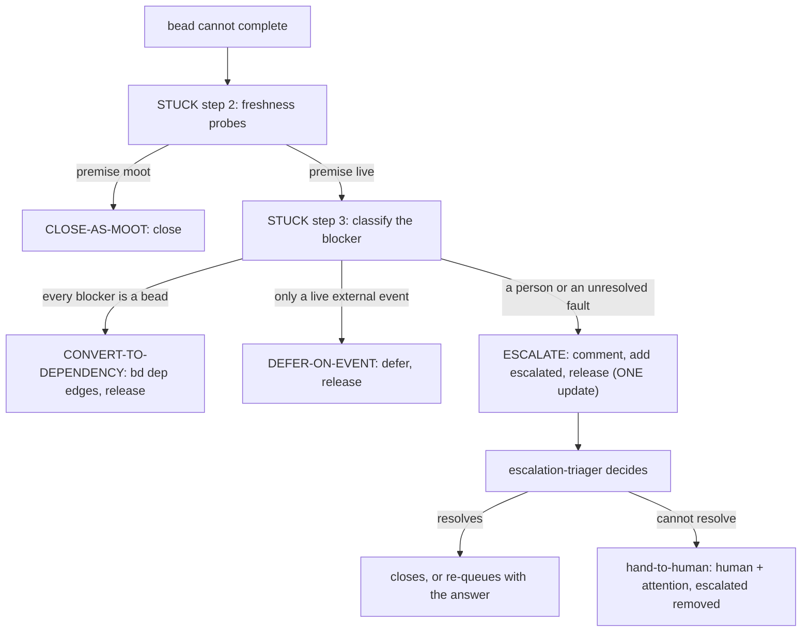

# drain-stuck

You were invoked from a drain session (/drain-beads, or a drain worker applying
pb:drain-one) holding a claimed bead it cannot complete. Required context from the caller: the bead id (<id>), the session
actor id (ID), the worktree/branch location, and what was tried. Every `bd`
write below passes `--actor "ID"`.

`<work-branch>` is the branch the caller passes (default `drain/<id>`). If the skill text
you hold ends with `skill content truncated for compaction`, or you cannot quote the step
you need, Read this file's path in full before acting. A container hit under release
policy `park` skips STUCK steps 1, 3 and 4 and takes CONTAINER PARK at the end of this file.

An agent that cannot finish a bead ESCALATES; it does not hand the bead to a person.
`escalated` means "an agent hit a problem and the escalation-triager should look at it".
The triager resolves it, or hands what it cannot resolve to the operator with the
`hand-to-human` command (`human` + `attention`, `escalated` removed, one call). This
skill MUST NOT write `human` or `attention` on a stuck bead and MUST NOT run
`hand-to-human` itself (`beads-lifecycle` LV-1..LV-4; vocabulary page
`docs/guides/bead-label-vocabulary.md` in `nix-agent-support`; ADR 0107). Work through
STUCK in order; it exits by exactly one of: ESCALATE (labeled `escalated`, findings
commented, claim released in the same update), CLOSE-AS-MOOT, CONVERT-TO-DEPENDENCY, or
DEFER-ON-EVENT. Whatever the exit, the claim is RELEASED or the bead CLOSED before you
return — never return still holding a claim in a state this skill does not define.



## STUCK — cannot complete a claimed bead (LAST RESORT: escalate)

Escalating is the LAST RESORT, for work that an agent cannot move forward — never a
generic "not workable right now" park. Do NOT use it merely because final acceptance
needs the change deployed (that is the drain loop's POST-DEPLOY VERIFICATION GATE
section's job — run pb gate attach-verified-child there, not here), and do NOT use it
because ANOTHER BEAD must finish first (that is a DEPENDENCY — step 3). A blocker that
only a PERSON can clear (D-1) is still escalated, not labeled `human`: the triager reads
your findings and decides whether the bead goes to the operator.

Triggers: underspecified / needs a human decision; the pre-apply gates cannot be
made to pass; landing returns a GENUINE `stopped:<reason>` (not a transient ff-race
or rejected non-ff push); a post-deploy gate could not be attached; repeated failed
attempts.
NOT a trigger: "another bead has to land first".

Step 1 only PRESERVES the work; the escalation that goes to the triager is the
COMMENT + `escalated` label in steps 6–7. Steps 2 and 3 stand between the two
deliberately, and each has its OWN exit that is not an escalation: a bead whose premise
the probes prove MOOT leaves via **CLOSE-AS-MOOT**, a bead whose live blockers
are all OTHER BEADS leaves via **CONVERT-TO-DEPENDENCY**, and a bead whose only
live blocker is a LIVE EXTERNAL EVENT that no person or bead can force leaves via
**DEFER-ON-EVENT**. Reaching step 4 means an agent cannot clear the blocker (a person
may hold it, or the cause is not yet known).

1. PRESERVE the change (do NOT discard it). KEEP the isolated worktree/branch while it holds
   anything — do NOT clean it up; leaving the work in place IS the preservation. (The ONE
   exception is an isolation that holds NOTHING: **RECLAIM** below removes it just before the
   claim is released.) If the WIP commits cleanly, commit
   it on branch `<work-branch>` with a `WIP (parked): <id> <why>` message; if
   pre-commit hooks block the commit, leave the changes uncommitted in the retained
   worktree (do NOT use `--no-verify`).
2. FRESHNESS CHECK — re-verify the bead's PREMISE against CURRENT reality BEFORE you
   write any escalation comment or apply any label. The bead body is a snapshot from FILING
   time and the reason you are stuck may already be answered: in one pass over the
   parked queue, 5 of 9 beads were already resolved or void. Follow the
   `beads-lifecycle` skill's `Premise Freshness` rules (F-1..F-10) and run the NAMED PROBES from F-3 — one per
   external referent this bead names — keeping each decisive output verbatim:
   - `landed?` / `pushed?` / `patch-identical?` for commits and parked branches;
     `path-exists?` / `symbol-shape?` for the files, modules, and symbols the bead's
     steps or design edit; `ticket-open?` for external tickets; `sibling-open?` for
     referenced beads; `next-free-id?` for any "next free" number the bead recorded.
   - **Before treating a description that reads as an open question ("DECISION NEEDED",
     "a person must choose", "operator: pick (a) or (b)") as still live, run `own-decision-recorded?`
     (F-10) against THIS bead's own `acceptance_criteria` field and its comments — in that
     order — BEFORE anything else in this step.** A recorded operator decision in either place
     makes the description's question-framing STALE even though its raw text still poses the
     question: the bead is ORDINARY WORK, not a fresh human question, and this step MUST NOT
     route it to an escalation on that already-answered question (provenance: `tc-uqw6s` —
     `tc-oyp6`, `tc-ts8f`, `tc-ldoz`, `tc-a8f8s` were each released with the decision already
     recorded, then re-parked as `human` within hours on the strength of the stale description
     text alone).
   - An earlier REVIEW of this bead's plan is NOT a freshness signal (F-6). A reviewed
     snapshot ages exactly as fast as the snapshot, so "already reviewed" / "looks
     plan-ready" MUST NOT stand in for running the probes.
   - An unresolvable probe (`exit 128`, missing repo, referent too vague to probe) reads
     as STILL LIVE, never as moot (F-4).
   - Premise STILL LIVE → continue to step 3, and carry this line into the step-6
     comment so the next reader inherits the check:
     `FRESHNESS: <ISO date> — <probe>=<decisive output>; <probe>=<decisive output> ⇒ premise LIVE`
     If the bead names no external referent, record that instead (F-5):
     `FRESHNESS: <ISO date> — no external referent named ⇒ nothing to re-verify`
   - Premise PROVABLY MOOT → this bead is answered, not blocked. Do NOT escalate it and do
     NOT label it `escalated` or `human`: go to **CLOSE-AS-MOOT** below.

3. CLASSIFY THE BLOCKER — is a PERSON the blocker, is it ANOTHER BEAD, or is it a LIVE EXTERNAL EVENT neither one can force? This is NOT a binary, and it is the branch BEFORE the escalation, not a check inside it: drain excludes every `escalated` and `human` label from its claim query, so an escalation hides the bead from the queue that would work it AND spends the triager (and, if it cannot resolve the bead, the operator). If you are waiting on another bead, nobody has anything to answer and the tracker can express the wait exactly; if you are waiting on the world (a metric that has not yet fired, a window that has not yet occurred), nobody has anything to answer either. Full contract: the `beads-lifecycle` skill's `Blocker Modeling` rules (**D-1..D-10**).
   - Name every live blocker, then ask of each: could a PERSON clear this now with a
     decision, an input, an approval, or an out-of-band action? Or must ANOTHER BEAD
     finish first? Step 2's `sibling-open?` probe already answers the second half for
     every bead this one names — REUSE those readings rather than inventing a parallel
     check: `bd show <sib> --json | jq -r '(if type=="object" and has("data") then .data else . end)[0].status'`. `open` / `in_progress` /
     `blocked` ⇒ a live blocker. `closed` ⇒ NOT a blocker at all, so it MUST NOT get an
     edge; if every named bead reads `closed`, the reason you were stuck has already
     died — go back to step 2 and re-read the premise.
   - A bead you WISH existed is not a dependency. If the blocking work has no bead, the
     bead you hold is underspecified or needs a decision — that is a HUMAN blocker. MUST
     NOT invent a placeholder bead to depend on (**D-1**).
   - EVERY live blocker is a bead → go to **CONVERT-TO-DEPENDENCY**. Do NOT write a
     PRECONDITION block, do NOT touch the repeat counter, and do NOT apply `escalated`
     or `human`: steps 4–9 are the escalation path and you are not on it. A prose
     PRECONDITION is for a condition the tracker CANNOT express; this one it can, and
     prose about it would rot exactly as **P-1** describes while the graph would not.
   - ANY live blocker needs a PERSON, or you cannot tell what the blocker is → continue to
     step 4 (ESCALATE; the triager decides whether a person is needed). If some blockers are ALSO
     beads, this is the MIXED case: do CONVERT-TO-DEPENDENCY's step 1 for the bead half
     first, then come back here and finish the escalation (**D-7**).
   - The ONLY live blocker is a LIVE EXTERNAL EVENT or OBSERVATION — something that
     occurs on its own schedule and that NEITHER a person NOR another bead can make
     happen sooner (a metric that has not yet fired naturally, a window that has not
     yet occurred) → this is NOT a person blocker (**D-10**): go to **DEFER-ON-EVENT**
     below. Do NOT let this fall through to step 4 by elimination merely because it
     failed the ANOTHER-BEAD test above — that fallthrough is exactly the defect
     `pg2-yanwe` traced to `pg2-b48eq` re-acquiring `human` on every park (before this skill escalated instead) despite its
     own standing "no human decision required" ruling.

4. NAME THE PRECONDITION — only when the escalation is blocked on something that must
   become TRUE before the bead is workable (skip it for an underspecified /
   decision-needed escalation). What you write here becomes an INSTRUCTION to a later
   agent and keeps being obeyed long after the implementation it describes has been
   refactored, so it MUST be drift-detectable:
   - `PRECONDITION:` MUST state an OBSERVABLE OUTCOME — something a reader can run
     and see ("`nb` run from a subdirectory opens the Gradle ROOT project"). It MUST
     NOT state a MECHANISM ("`nb` is a function defined in `~/.zshrc`"): the next
     refactor makes a mechanism claim permanently false, and every later reader then
     concludes "not applied yet" and re-escalates forever.
   - `PRECONDITION-KEY:` MUST be a short kebab slug naming that OUTCOME, not this
     attempt — `nb-opens-gradle-root`, never `nb-check-2` — so a later escalation blocked
     on the SAME thing produces the SAME key. Step 5 counts these.
   - `DERIVED-FROM:` MUST cite the commit and the file(s) you actually read to write
     the line (`<repo>@<sha> — <path>`), so a later reader can re-derive it and see
     the drift.
   - The failure branch MUST be bounded. MUST NOT write "if not yet applied, re-escalate
     or wait" with no limit — step 5 IS the limit.

5. DETECT A REPEAT — before commenting, check whether this bead was already escalated
   on the same precondition:

   ```bash
   bd show <id> --json --include-comments | jq -r '(if type=="object" and has("data") then .data else . end)[0] | (.comments // [])[].text' | rg -o 'PRECONDITION-KEY: .*'
   ```

   (`--include-comments` is load-bearing: plain `bd show --json` omits the comments and
   reports only `comment_count`, so the probe would never find a prior key. The prelude is the
   **J-1** unwrap, valid under the `{"data":[…]}` envelope and for the bare array alike.
   `comments` is `null` on a bead with none, hence the `// []`; empty output — `rg` exit 1 —
   means no prior key, NOT a failure.)
   - The key you are about to write is ABSENT → ordinary escalation (step 6a).
   - The key is ALREADY PRESENT — this would be the SECOND escalation on the same unmet
     precondition → the precondition itself is the suspect, not the world: escalate
     it as stale (step 6b + step 7b). There is NO third escalation on one key.
   - The bead ALREADY carries the `stale-precondition` label → an earlier staleness
     escalation was released without resolving it. Write NO precondition block at
     all: comment plainly what you observed, escalate again (step 7a), and leave
     `stale-precondition` in place so it stays visible as unresolved.

6. COMMENT what you tried, why you couldn't finish, what a reader (the triager, then
   possibly the operator) needs to move it, and where the work is preserved. Either form
   MUST carry the step-2 `FRESHNESS:` line. Write the comment BEFORE the label (step 7), so
   the findings are already on the bead when the triager is dispatched. Name the concrete
   question, input, approval or action a PERSON would have to supply, or write
   `NEEDS: unknown` when you could not tell; the triager uses it to choose between
   answering, closing, re-queueing and a hand-off to the operator.

   **6a — ordinary escalation**, carrying the step-4 block when there is a precondition:

   ```bash
   bd comment <id> "stuck: <what you tried / why>. ESCALATED to the escalation-triager. Work preserved on branch <work-branch> in <repo>.
   NEEDS: <the decision, input, approval or action a person would have to supply, or: unknown>
   FRESHNESS: <ISO date> — <probe>=<decisive output> ⇒ premise LIVE
   PRECONDITION: <observable outcome that must hold before this is workable>
   PRECONDITION-KEY: <stable-outcome-slug>
   DERIVED-FROM: <repo>@<sha> — <path(s) you read>" --actor "ID"
   ```

   **6b — staleness escalation** (step 5 found the key). Say it is a repeat, point at
   the provenance to re-derive, and record what you ACTUALLY observed — do NOT
   restate the old precondition as though it were fresh:

   ```bash
   bd comment <id> "stuck (SUSPECTED STALE PRECONDITION): SECOND escalation on PRECONDITION-KEY <slug>, so the precondition may be unsatisfiable rather than merely unmet. Re-derive it from its provenance (<repo>@<sha> — <path>) against CURRENT source before acting on it. Observed now: <what you ran and saw>. FRESHNESS: <ISO date> — <probe>=<decisive output> ⇒ premise LIVE. Do NOT re-escalate on this key. ESCALATED to the escalation-triager. Work preserved on branch <work-branch> in <repo>." --actor "ID"
   ```

7. RECLAIM (below), then ESCALATE AND RELEASE in ONE `bd update` (B-1, B-2, B-3): add `escalated` (the single
   canonical label for "an agent hit a problem and the triager should look at it", LV-1),
   set `--status open` and clear the assignee in the SAME call, so there is no window in
   which the bead is `open`, unlabeled AND unblocked (a peer drain session would claim it).
   Every label of the `escalated` and `human` sets is excluded from the drain claim and
   termination queries, so the bead stays out of the drain pool until the triager acts.
   Reaching here means step 3 found a PERSON in the way or an unresolved fault — if it
   did not, you are on the wrong path. The step-1 worktree/branch stays where it is.
   MUST NOT add `human` or `attention` here, and MUST NOT run `hand-to-human`: only the
   triager hands a bead to the operator (LV-1, LV-3).

   **7a — ordinary escalation:**

   ```bash
   bd update <id> --add-label escalated --status open --assignee "" --actor "ID"
   ```

   **7b — after a 6b staleness escalation** — both labels in ONE call, so the triager
   and, later, the unblocker recognize the class mechanically instead of re-reading the churn
   (`stale-precondition` survives the hand-off to the operator):

   ```bash
   bd update <id> --add-label escalated,stale-precondition --status open --assignee "" --actor "ID"
   ```

8. READ BACK (BF-4): confirm the escalation landed before you return —

   ```bash
   bd show <id> --json | jq -r '(if type=="object" and has("data") then .data else . end)[0] | "\(.status) assignee=\(.assignee // "") labels=\((.labels // []) | join(","))"'
   ```

   The line MUST read `open assignee= labels=...escalated...`. If it does not, repeat 7 once;
   never leave the bead `in_progress` or labeled neither `escalated` nor `human`.

9. Do NOT clean up a preserved worktree/branch that holds work (RECLAIM, before step 7,
   removed it only if it held nothing). Done — return to the caller. The triager
   (the `escalated` queue) takes it from here; the caller MUST NOT re-claim it.

## RECLAIM (an idle isolation, before the claim is released)

Operator ruling (Phillip, 2026-10-22, bead `pg2-v3hsj`, verbatim): "if the worktree has no
changes, then remove it and add a note to each bead that a clean up pass ran and since there were
no changes, the work tree was removed. the branch can remain, but have a bunch of worktrees doing
nothing is wasteful."

This is a Guard Clause on every exit that releases the claim while leaving the bead unlanded:
ESCALATE (STUCK step 7), CONVERT-TO-DEPENDENCY (step 3), DEFER-ON-EVENT (step 4), and `pb:drain-one`'s
STAMP REFUSAL. CLOSE-AS-MOOT has its own isolation check (its step 4), and CONTAINER PARK has no
isolation, so neither runs this. A coordinated workforest set is out of scope: skip RECLAIM for a
bead isolated as a set.

- The agent MUST run it BEFORE the release call, with its shell's working directory OUTSIDE the
  worktree (`wtdone`'s liveness guard refuses a worktree the calling shell stands in):

  ```bash
  pb drain reclaim --bead <id> --repo <abs-canonical-clone-path> --actor "ID" [--branch <work-branch>]
  ```

  `--branch` is needed only when `<work-branch>` is not `drain/<id>`.

- The tool decides, never the agent: it removes the worktree (through `wtdone`, never forced) ONLY
  when `git status --porcelain` is empty AND the branch has zero commits the primary branch lacks,
  and then adds the clean-up note to the bead itself. Reading `outcome=`: `removed` (worktree gone,
  bead noted; `wtdone` also deletes the zero-commit branch, which loses nothing and which
  `pb drain isolate` recreates on resume), `kept-dirty`, `kept-commits` and `none` (all left exactly
  as found, no note).
- The agent MUST NOT add its own note, and MUST NOT remove a worktree by hand, whatever the
  outcome. A WIP commit from STUCK step 1 makes the branch `kept-commits`, so a parked bead with
  real work is never touched.
- A non-zero exit MUST NOT block the release: exit 1 means the worktree is still in place (for
  example `wtdone` refused because a process is anchored in it) and no note was written, so
  carry on and mention it in the return; exit 4 means the worktree WAS removed but the note failed,
  so post the note text from the error with `bd comment <id> "<note>" --actor "ID"`.

## CLOSE-AS-MOOT (STUCK step 2 disproved the premise)

Reached ONLY from a FRESHNESS CHECK whose probes decisively answered the bead's own
question. The bead is not blocked — it is ANSWERED, so escalating it would put a
non-question in front of the triager and the operator. Close it instead. But a moot bead is not
worthless: stale work often contains a PREDICTION about the code, and a blind close
throws that away (F-7). EXTRACT first, close second.

1. READ the stale work before discarding it — the bead's description/design, its
   comments, and any WIP commit on `<work-branch>`. You are looking for a claim it makes
   that CURRENT source VIOLATES: a defect it predicted, or a decision it called
   load-bearing that the shipped version skipped. Blind-closing is forbidden.

2. EXTRACT any such claim as its own bead BEFORE closing, so the link survives:

   ```bash
   bd create "<the prediction, restated as the defect it predicts>" \
     -d "Extracted from <id> while closing it as moot. The stale work claimed <X>; CURRENT source violates it: <probe>=<decisive output> / <path:line>." \
     --deps "discovered-from:<id>" --actor "ID" --json
   # capture the new id as <extracted>
   ```

3. RECORD the check on the bead, then CLOSE — the recorded probe output IS the
   justification, so it MUST be verbatim, not paraphrased:

   ```bash
   bd comment <id> "FRESHNESS: <ISO date> — <probe>=<decisive output verbatim> ⇒ premise MOOT. Superseded by <what superseded it>. Extracted: <extracted> (or: nothing extractable)." --actor "ID"
   bd close <id> --reason "moot on re-verification: <probe>=<decisive output>; superseded by <what>; extracted <extracted>" --actor "ID"
   ```

4. The isolation — do NOT delete unlanded work. Check whether anything would be lost (`<primary>` is the repo's primary branch: `git config pgii-integrate-branch.primaryBranch`, else `git symbolic-ref refs/remotes/origin/HEAD`, else `main`):

   ```bash
   git -C <worktree-path> status --porcelain; git -C <repo> cherry -v <primary> <work-branch>
   ```

   BOTH empty → nothing to lose → CLEANUP as in the `done` path. EITHER non-empty →
   LEAVE the worktree/branch in place and file the follow-up rather than orphan it. This is
   the ENTRY point for the `worktree-review` label, so it MUST carry that label ALONGSIDE
   `human` — `/unblock-human-beads` triages on the label, and a `worktree-review`-only bead
   would not carry the human label the person queue selects on (W-1). This is one of two places
   this skill writes `human` directly, and it is deliberate: the follow-up is NEW planned
   operator work (a keep-or-discard ruling on an isolation artifact; LV-2), not a stuck bead,
   so it carries `human` ONLY, never `attention`, and does not go through the triager.
   Record the entry marker at birth (W-2); `bd create` defaults to P2 and
   promotes nothing, so use the no-promotion form:

   ```bash
   bd create "worktree-review: reconcile leftover isolation for <id> (closed as moot)" \
     --labels human,worktree-review --defer +7d --deps "discovered-from:<id>" \
     --notes "[worktree-review $(date +%F)] Leftover isolation from <id>: branch <work-branch> in <repo>. Unlanded: <git cherry output>. Dirty: <git status --porcelain output>. A person must rule on keep vs discard. No promotion (priority left at P2)." \
     --actor "ID"
   ```

   Whoever later adjudicates that isolation MUST remove the label and restore the recorded
   priority in the same update that releases or closes the bead — the
   `beads-lifecycle` skill's `Worktree-Review Label Lifecycle` rules (W-1..W-8) are the label's full contract, and
   `/unblock-human-beads`' RELEASE / CLOSE steps are where it is carried out. Drain itself
   never adjudicates isolation: such a bead is substrate-class and never enters drain's queue.

   **The asymmetry with `/unblock-human-beads` is DELIBERATE, not an oversight.** That command has
   a class-1a carve-out: it MAY tear down an isolation autonomously, with no operator prompt, when
   losslessness is MECHANICALLY PROVEN in that same session (clean `git status --porcelain`, and
   every commit on the branch landed or patch-identical to one that is). **This command gets NO
   such carve-out and MUST NOT be given one.** Drain runs UNATTENDED, so a proof cannot be
   inherited — a reading is valid only for the instant it was taken (**F-1**), a peer session may
   commit into that worktree between the probe and the teardown, and there is no operator to fall
   back to when a leg reads ambiguously; `/unblock-human-beads` runs with a person in the session.
   The only isolation drain ever retires is the one IT created for the bead it currently holds,
   after that bead's own work LANDED (FINISH step 7) — never an adjudication of someone else's.

5. Done — return to the caller.

## CONVERT-TO-DEPENDENCY (STUCK step 3 found the blocker is another bead)

Reached when EVERY live blocker is another bead. The bead is not waiting on a person, so
it MUST NOT be labeled `escalated` or `human`: the tracker can express this wait exactly, and unlike a
label a dependency edge clears ITSELF. Full contract: the `beads-lifecycle` skill's
`Blocker Modeling` rules (**D-1..D-10**).

1. WIRE one edge per live blocker, FIRST — while the bead is still `in_progress` and
   owned by you, so `bd ready` excludes it and the write lands in a window no peer can
   observe (**D-5**). Prefer the FLAG form: the first id is the BLOCKED bead, the second
   is the BLOCKER, and the bare positional form reads identically written either way
   round, so it is where a reversal hides:

   ```bash
   bd dep add <id> --blocked-by <blocker-id>   # once per blocker; <id> depends on <blocker-id>
   bd dep list <id>                            # CONFIRM each blocker echoes back "(open) via blocks"
   ```

   Leave the type at its default `blocks`. `discovered-from` does NOT gate readiness
   (**D-3**), so the `--deps "discovered-from:<id>"` form used elsewhere in the drain
   loop is the WRONG tool here — it would leave the bead drain-claimable while genuinely
   blocked. Do NOT pass `--no-cycle-check`: a cycle makes BOTH beads permanently unready
   (**D-4**).

2. COMMENT what you found, carrying the step-2 `FRESHNESS:` line. Write NO `PRECONDITION`
   block — the graph IS the precondition, and prose restating it would rot exactly as
   **P-1** describes:

   ```bash
   bd comment <id> "not stuck on a person: blocked on <blocker-id>[, <blocker-id>…], now wired as bd dependencies instead of an escalation. No human input is needed to move this — it returns to the drain queue by itself when the last blocker closes. Work parked on branch <work-branch> in <repo>.
   FRESHNESS: <ISO date> — sibling-open?=<status per blocker> ⇒ premise LIVE
   BLOCKED-BY-BEADS: <blocker-id>[, <blocker-id>…]" --actor "ID"
   ```

3. RECLAIM (below), then RELEASE in ONE call — no `escalated` or `human` label, `status=open`,
   assignee cleared (**B-2**, **B-3**, **D-6**). `--remove-label human` belongs in this same call whenever the bead
   already carries it (from an earlier park) — a safe no-op otherwise:

   ```bash
   bd update <id> --remove-label human --status open --assignee "" --actor "ID"
   ```

   `open`, NOT `blocked`: readiness is DERIVED from the graph, so the bead is already
   absent from `bd ready` with no stored flag needed — and when the last blocker closes it
   re-enters drain's queue on its own, with nobody having to remember to re-open it. A
   stored `blocked` status is a value nothing recomputes, so it would strand the bead
   after the dependency resolved.

4. Do NOT clean up a preserved worktree/branch that holds work — the work resumes there once the
   blockers clear (RECLAIM, at step 3, removed it only if it held nothing). Done — return to
   the caller.

**MIXED blocker (a bead AND a person) — both apply; do not let either fall through**
(**D-7**). Do step 1 above for the bead half, then go BACK to STUCK step 4 and finish the
escalation, because a person may hold part of the answer. Which of two shapes
you have decides where the question goes, and the escalation (or, for a new decision bead,
the `human` label) MUST sit on the bead that actually HOLDS the question:

- **The question is only answerable AFTER the blocker lands** → ESCALATE THIS bead
  (steps 4–8: `escalated`, never `human`). State the consequence in the step-6 comment, because it is not obvious:
  `bd ready` excludes blocked beads, so the bead is now absent from BOTH queues until its
  blockers clear, and only then resurfaces in the triager's `bd ready --label escalated`
  queue. That is CORRECT — the question was not yet answerable — and it is why the comment
  must name the question (the `NEEDS:` line), so the triager inherits it rather than
  re-deriving it.
- **The question is answerable NOW and independent of the blocker** → do NOT bury it
  behind the edge. File it as its OWN `human` bead with no blockers and depend on THAT, so
  the operator sees it immediately; THIS bead then takes the pure conversion path above and
  carries no label of its own (this is the `pg2-l3vdz` shape — the driver held the deps, the
  sub-beads held the questions). That decision bead is NEW planned operator work (LV-2): it
  carries `human` ONLY, never `attention`, and is filed for the operator directly, not
  routed through the triager (the second deliberate direct `human` write of this skill;
  ruling recorded in ADR 0107, bead `pg2-zpj6z`):

  ```bash
  bd create "<the decision or input a person must supply>" --labels human \
    --deps "discovered-from:<id>" --actor "ID" --json
  # capture the new id as <question>, then wire it as a blocker like any other:
  bd dep add <id> --blocked-by <question>
  ```

## DEFER-ON-EVENT (STUCK step 3 found the blocker is a live external event, not a person or a bead)

Reached when the ONLY live blocker is something that happens on its own schedule and that
NEITHER a person NOR another bead can make happen sooner (**D-10**) — a metric that has not
yet fired naturally, a live window that has not yet occurred. The bead is not waiting on a
decision; it is waiting on the WORLD, so neither `escalated` nor `human` MUST be applied here:
either label would put a non-question in front of the triager and the operator on every single
re-park, which is the exact defect
`pg2-yanwe` traced to `pg2-b48eq` re-acquiring `human` at least three times across
2026-07-21..09-22 despite its own 2026-07-21 comment already ruling "No human decision
required".

1. NAME THE PRECONDITION exactly as STUCK step 4 — the observable event/outcome that must
   occur before this is workable — with its `PRECONDITION-KEY` and `DERIVED-FROM`.
2. DETECT A REPEAT exactly as STUCK step 5. Ordinary case (key absent, or key present but the
   event genuinely still has not occurred) → continue below. If the SAME key already appears
   from an earlier escalation or defer, that is a signal the CHECK itself — not the world — may be wrong (a
   renamed metric, a wrong PromQL, a daemon that no longer emits it): that genuinely IS worth a
   person's judgment, so escalate it via STUCK's step 6b/7b (`escalated,stale-precondition`) instead
   of continuing here. Do not let an event-gated bead re-park on the same unresolved key a third
   time with no one ever looking at it.
3. COMMENT what you tried and why the event has not yet occurred, carrying the STUCK step 2
   `FRESHNESS:` line and the step-1 PRECONDITION block:

   ```bash
   bd comment <id> "stuck (event-gated, not human-gated): <what you tried / observed>. The blocker is a live external event/observation, not a person or another bead — see beads-lifecycle D-10. Parked on branch <work-branch> in <repo>.
   FRESHNESS: <ISO date> — <probe>=<decisive output> ⇒ premise LIVE
   PRECONDITION: <observable outcome that must occur before this is workable>
   PRECONDITION-KEY: <stable-outcome-slug>
   DERIVED-FROM: <repo>@<sha> — <path(s) you read>" --actor "ID"
   ```

4. RECLAIM (below), then DEFER, with NO `human` label — remove it in the SAME call if the
   bead already carries it from an earlier, mis-applied park:

   ```bash
   bd update <id> --defer +7d --remove-label human --status open --assignee "" --actor "ID"
   ```

   `+7d` matches the re-check window used elsewhere in this family (`/unblock-human-beads`'
   own `planning-session-required` defer); shorten it if the event is expected sooner. `--defer`
   is what keeps this out of `bd ready`, not a label — it clears itself on the date with no one
   having to remember to remove anything, and it never reaches `/unblock-human-beads`'
   `--label human` queue at all.

5. Do NOT clean up a parked worktree/branch that holds work — the work resumes there once the
   event has occurred (RECLAIM, at step 4, removed it only if it held nothing). Done — return
   to the caller.

## CONTAINER PARK (a container hit under release policy `park`)

The heading keeps its historic name; the exit is an ESCALATION (step 7a), because under
release policy `park` no path may leave the bead `open`, unclaimed and ready, and
`escalated` is what keeps it out of the router's drain-ready query.

Reached ONLY when `pb:drain-one`'s container probe fired and the caller's release policy
is `park`: the caller passes the probe evidence (which check fired, the note verbatim or the
child ids, statuses and priorities, and the container's own priority). A container-parent has
no work of its own, so the other exits do not fit. CONVERT-TO-DEPENDENCY would read the open
children as "every live blocker is a bead" and wire the D-9 deadlock (a parent blocked by its
own child). DEFER-ON-EVENT and any other defer hide the whole subtree (**D-9**). CLOSE-AS-MOOT's
isolation steps do not apply. So:

1. Run step 2 FRESHNESS with the children-state probe only
   (`bd list --parent <id> --status all -n 0 --json`, plus the `sibling-open?` reading per
   child). SKIP steps 1, 3 and 4, and the CONVERT-TO-DEPENDENCY, DEFER-ON-EVENT and
   CLOSE-AS-MOOT exits. Run step 5's repeat detection against
   `PRECONDITION-KEY: container-not-retyped`.
2. Write the 6a comment with the probe evidence and the `FRESHNESS:` line. Do NOT include the
   branch or worktree sentence, and do NOT name a pg-router branch or a worktree path. End it
   with what removes the bead from the drain-ready query (`bd update <id> -t epic`, close it, or
   drop `has-acceptance-criteria`) and carry `PRECONDITION-KEY: container-not-retyped`, so a
   SECOND escalation takes step 5's repeat-key path (6b/7b: `escalated,stale-precondition`)
   instead of ping-ponging with the triager's re-queue or `/unblock-human-beads`' RELEASE.
3. Then 7a (`--add-label escalated`, released in the same call) and 8 (READ BACK). Apply NO
   defer and NO `bd dep` edge (**D-9**). Done — return to the caller.
