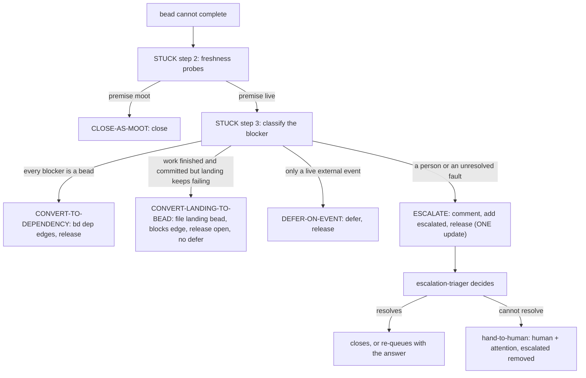

# drain-stuck

You were invoked from a drain session (/drain-beads, or a drain worker applying
pb:drain-one) holding a claimed bead it cannot complete. Required context from the caller: the bead id (<id>), the session
actor id (ID), the worktree/branch location, and what was tried. Every `bd`
write below passes `--actor "ID"`.

`<work-branch>` is the branch the caller passes (default `drain/<id>`). If the skill text
you hold ends with `skill content truncated for compaction`, or you cannot quote the step
you need, Read this file's path in full before acting. A container hit under release
policy `park` skips STUCK steps 1, 3 and 4 and takes CONTAINER PARK at the end of this file.

The text of every exit but ESCALATE lives in `references/` next to this file (named at
each exit below). Read the exit's file in full BEFORE acting on it: an exit whose text you
have not read MUST NOT be improvised.

An agent that cannot finish a bead ESCALATES; it does not hand the bead to a person.
`escalated` means "an agent hit a problem and the escalation-triager should look at it".
The triager resolves it, or hands what it cannot resolve to the operator with the
`hand-to-human` command (`human` + `attention`, `escalated` removed, one call). This
skill MUST NOT write `human` or `attention` on a stuck bead and MUST NOT run
`hand-to-human` itself (`beads-lifecycle` LV-1..LV-4; vocabulary page
`docs/guides/bead-label-vocabulary.md` in `nix-agent-support`; ADR 0107). Work through
STUCK in order; it exits by exactly one of: ESCALATE (labeled `escalated`, findings
commented, claim released in the same update), CLOSE-AS-MOOT, CONVERT-TO-DEPENDENCY,
CONVERT-LANDING-TO-BEAD, or DEFER-ON-EVENT. Whatever the exit, the claim is RELEASED or the bead CLOSED before you
return — never return still holding a claim in a state this skill does not define.



## STUCK — cannot complete a claimed bead (LAST RESORT: escalate)

Escalating is the LAST RESORT, for work that an agent cannot move forward — never a
generic "not workable right now" park. Do NOT use it merely because final acceptance
needs the change deployed (that is the drain loop's POST-DEPLOY VERIFICATION GATE
section's job — run pb gate attach-verified-child there, not here), and do NOT use it
because ANOTHER BEAD must finish first (that is a DEPENDENCY — step 3). A blocker that
only a PERSON can clear (D-1) is still escalated, not labeled `human`: the triager reads
your findings and decides whether the bead goes to the operator.

Triggers: underspecified / needs a human decision; the pre-apply gates cannot be
made to pass; landing returns a GENUINE `stopped:<reason>` (not a transient ff-race
or rejected non-ff push); a post-deploy gate could not be attached; repeated failed
attempts.
NOT a trigger: "another bead has to land first".

Step 1 only PRESERVES the work; the escalation that goes to the triager is the
COMMENT + `escalated` label in steps 6–7. Steps 2 and 3 stand between the two
deliberately, and each has its OWN exit that is not an escalation: a bead whose premise
the probes prove MOOT leaves via **CLOSE-AS-MOOT**, a bead whose live blockers
are all OTHER BEADS leaves via **CONVERT-TO-DEPENDENCY**, and a bead whose only
live blocker is a LIVE EXTERNAL EVENT that no person or bead can force leaves via
**DEFER-ON-EVENT**. Reaching step 4 means an agent cannot clear the blocker (a person
may hold it, or the cause is not yet known).

1. PRESERVE the change (do NOT discard it). KEEP the isolated worktree/branch while it holds
   anything — do NOT clean it up; leaving the work in place IS the preservation. (The ONE
   exception is an isolation that holds NOTHING: **RECLAIM** below removes it just before the
   claim is released.) If the WIP commits cleanly, commit
   it on branch `<work-branch>` with a `WIP (parked): <id> <why>` message; if
   pre-commit hooks block the commit, leave the changes uncommitted in the retained
   worktree (do NOT use `--no-verify`).
   When the stuck reason is a lander `stopped:<reason>`, run `pg-git-lander status --json
--repo <canonical-root>` and resolve any stopped operation for `<work-branch>` BEFORE
   releasing the claim: `pg-git-lander land <work-branch> --continue --repo <canonical-root>`
   if its cause is fixed, else `--abort` (which restores the source branch; a stopped
   operation leaves the worktree on a `pg-git-lander/<op>` branch by design). If `--abort`
   cannot be run, the escalation comment MUST carry the exact commands `pg-git-lander land
<work-branch> --continue --repo <canonical-root>` and `pg-git-lander land <work-branch>
--abort --repo <canonical-root>`. See `drain-one/references/land.md`.
2. FRESHNESS CHECK — re-verify the bead's PREMISE against CURRENT reality BEFORE you
   write any escalation comment or apply any label. The bead body is a snapshot from FILING
   time and the reason you are stuck may already be answered: in one pass over the
   parked queue, 5 of 9 beads were already resolved or void. Follow the
   `beads-lifecycle` skill's `Premise Freshness` rules (F-1..F-10) and run the NAMED PROBES from F-3 — one per
   external referent this bead names — keeping each decisive output verbatim:
   - `landed?` / `pushed?` / `patch-identical?` for commits and parked branches;
     `path-exists?` / `symbol-shape?` for the files, modules, and symbols the bead's
     steps or design edit; `ticket-open?` for external tickets; `sibling-open?` for
     referenced beads; `next-free-id?` for any "next free" number the bead recorded.
   - **Before treating a description that reads as an open question ("DECISION NEEDED",
     "a person must choose", "operator: pick (a) or (b)") as still live, run `own-decision-recorded?`
     (F-10) against THIS bead's own `acceptance_criteria` field and its comments — in that
     order — BEFORE anything else in this step.** A recorded operator decision in either place
     makes the description's question-framing STALE even though its raw text still poses the
     question: the bead is ORDINARY WORK, not a fresh human question, and this step MUST NOT
     route it to an escalation on that already-answered question (provenance: `tc-uqw6s` —
     `tc-oyp6`, `tc-ts8f`, `tc-ldoz`, `tc-a8f8s` were each released with the decision already
     recorded, then re-parked as `human` within hours on the strength of the stale description
     text alone).
   - **`triager-answer-applies?`** Read this bead's comments (`bd show <id> --json
--include-comments`, J-1 unwrap, or plain `bd show <id>`). If a comment starting
     `TRIAGER-ANSWER:` is newer than the latest earlier `stuck:` comment and answers the finding
     you are about to escalate, you MUST NOT re-escalate on that finding unless the step-6
     comment carries a line `ANSWER-DOES-NOT-APPLY: <why the TRIAGER-ANSWER does not resolve
this finding>` that cites the answer and what you did with it. Without that line, follow
     the answer (return to the work) instead of escalating. The triager may re-queue a bead
     only once, so an unexplained second escalation costs an operator hand-off.
   - An earlier REVIEW of this bead's plan is NOT a freshness signal (F-6). A reviewed
     snapshot ages exactly as fast as the snapshot, so "already reviewed" / "looks
     plan-ready" MUST NOT stand in for running the probes.
   - An unresolvable probe (`exit 128`, missing repo, referent too vague to probe) reads
     as STILL LIVE, never as moot (F-4).
   - Premise STILL LIVE → continue to step 3, and carry this line into the step-6
     comment so the next reader inherits the check:
     `FRESHNESS: <ISO date> — <probe>=<decisive output>; <probe>=<decisive output> ⇒ premise LIVE`
     If the bead names no external referent, record that instead (F-5):
     `FRESHNESS: <ISO date> — no external referent named ⇒ nothing to re-verify`
   - Premise PROVABLY MOOT → this bead is answered, not blocked. Do NOT escalate it and do
     NOT label it `escalated` or `human`: go to **CLOSE-AS-MOOT** below (Read `references/close-as-moot.md` first).

3. CLASSIFY THE BLOCKER — is a PERSON the blocker, is it ANOTHER BEAD, or is it a LIVE EXTERNAL EVENT neither one can force? This is NOT a binary, and it is the branch BEFORE the escalation, not a check inside it: drain excludes every `escalated` and `human` label from its claim query, so an escalation hides the bead from the queue that would work it AND spends the triager (and, if it cannot resolve the bead, the operator). If you are waiting on another bead, nobody has anything to answer and the tracker can express the wait exactly; if you are waiting on the world (a metric that has not yet fired, a window that has not yet occurred), nobody has anything to answer either. Full contract: the `beads-lifecycle` skill's `Blocker Modeling` rules (**D-1..D-10**).
   - Name every live blocker, then ask of each: could a PERSON clear this now with a
     decision, an input, an approval, or an out-of-band action? Or must ANOTHER BEAD
     finish first? Step 2's `sibling-open?` probe already answers the second half for
     every bead this one names — REUSE those readings rather than inventing a parallel
     check: `bd show <sib> --json | jq -r '(if type=="object" and has("data") then .data else . end)[0].status'`. `open` / `in_progress` /
     `blocked` ⇒ a live blocker. `closed` ⇒ NOT a blocker at all, so it MUST NOT get an
     edge; if every named bead reads `closed`, the reason you were stuck has already
     died — go back to step 2 and re-read the premise.
   - A bead you WISH existed is not a dependency. If the blocking work has no bead, the
     bead you hold is underspecified or needs a decision — that is a HUMAN blocker. MUST
     NOT invent a placeholder bead to depend on (**D-1**).
   - EVERY live blocker is a bead → go to **CONVERT-TO-DEPENDENCY** (Read `references/convert-to-dependency.md` first). Do NOT write a
     PRECONDITION block, do NOT touch the repeat counter, and do NOT apply `escalated`
     or `human`: steps 4–9 are the escalation path and you are not on it. A prose
     PRECONDITION is for a condition the tracker CANNOT express; this one it can, and
     prose about it would rot exactly as **P-1** describes while the graph would not.
   - ANY live blocker needs a PERSON, or you cannot tell what the blocker is → continue to
     step 4 (ESCALATE; the triager decides whether a person is needed). If some blockers are ALSO
     beads, this is the MIXED case: do CONVERT-TO-DEPENDENCY's step 1 for the bead half
     first, then come back here and finish the escalation (**D-7**).
   - The work is DONE and COMMITTED on `<work-branch>` and the only thing left is landing it,
     which keeps failing for a reason that is not a defect in the diff (`stopped:ff-race-retry-limit`
     after the re-dispatch bound, `stopped:precommit-branch-diff-failed` or `stopped:eval-failed`
     not caused by the diff, a pre-land hook timeout at its cap, host load) → go to
     **CONVERT-LANDING-TO-BEAD** (Read `references/convert-landing-to-bead.md` first). Check this case BEFORE the live-external-event case below: a
     persistent landing obstacle is NOT a live external event, and finished-unlanded work MUST NOT
     be deferred (operator ruling, Phillip, 2026-11-11, quoted in that section).
   - The ONLY live blocker is a LIVE EXTERNAL EVENT or OBSERVATION — something that
     occurs on its own schedule and that NEITHER a person NOR another bead can make
     happen sooner (a metric that has not yet fired naturally, a window that has not
     yet occurred) → this is NOT a person blocker (**D-10**): go to **DEFER-ON-EVENT**
     below (Read `references/defer-on-event.md` first). Do NOT let this fall through to step 4 by elimination merely because it
     failed the ANOTHER-BEAD test above — that fallthrough is exactly the defect
     `pg2-yanwe` traced to `pg2-b48eq` re-acquiring `human` on every park (before this skill escalated instead) despite its
     own standing "no human decision required" ruling.

4. NAME THE PRECONDITION — only when the escalation is blocked on something that must
   become TRUE before the bead is workable. Read `references/escalate-precondition.md` in
   full before this step and before step 5; it holds steps 4 and 5 verbatim.

5. DETECT A REPEAT — before commenting, check whether this bead was already escalated
   on the same precondition. The probe and what each of its outcomes means are in
   `references/escalate-precondition.md`: Read it in full before taking this step.

6. COMMENT what you tried, why you couldn't finish, what a reader (the triager, then
   possibly the operator) needs to move it, and where the work is preserved. Either form
   MUST carry the step-2 `FRESHNESS:` line. Write the comment BEFORE the label (step 7), so
   the findings are already on the bead when the triager is dispatched. Classify the
   finding and write exactly one `NEEDS:` line, in this one vocabulary:
   - `NEEDS: SCOPE: <what must be split or re-curated, and where the seam is>` when the
     work is too big for one session or under-scoped. Agents can fix this (the triager
     routes it to the split disposition), so a person is NOT asked. If the packet is
     oversized, say so with `SCOPE:` and name the seam; MUST NOT frame budget or splitting
     as a question. When two or more packets of one docket have been escalated as oversize
     or under-scoped, state that docket-wide pattern in the same `SCOPE:` comment (the
     docket and the other packets) so the triager can weigh a docket reconcile
     (`plan-decompose` `references/reconcile.md`) instead of splitting one packet.
   - `NEEDS: DECISION: <the question a person must answer>` when a person must choose
     between designs, supply an approval, an input or an action. Only this form is a
     candidate for the person queue.
   - `NEEDS: unknown` when you could not tell which. A worker MUST NOT write a free-form
     NEEDS (for example "a scoping decision"): the triager reads it literally.

   The triager uses the form to choose between split, answering, closing, re-queueing
   and a hand-off to the operator.

   **6a — ordinary escalation**, carrying the step-4 block when there is a precondition:

   ```bash
   bd comment <id> "stuck: <what you tried / why>. ESCALATED to the escalation-triager. Work preserved on branch <work-branch> in <repo>.
   NEEDS: SCOPE: <what must be split or re-curated and where the seam is> | NEEDS: DECISION: <question a person must answer> | NEEDS: unknown
   FRESHNESS: <ISO date> — <probe>=<decisive output> ⇒ premise LIVE
   PRECONDITION: <observable outcome that must hold before this is workable>
   PRECONDITION-KEY: <stable-outcome-slug>
   DERIVED-FROM: <repo>@<sha> — <path(s) you read>" --actor "ID"
   ```

   **6b — staleness escalation** (step 5 found the key). Say it is a repeat, point at
   the provenance to re-derive, and record what you ACTUALLY observed — do NOT
   restate the old precondition as though it were fresh:

   ```bash
   bd comment <id> "stuck (SUSPECTED STALE PRECONDITION): SECOND escalation on PRECONDITION-KEY <slug>, so the precondition may be unsatisfiable rather than merely unmet. Re-derive it from its provenance (<repo>@<sha> — <path>) against CURRENT source before acting on it. Observed now: <what you ran and saw>. FRESHNESS: <ISO date> — <probe>=<decisive output> ⇒ premise LIVE. Do NOT re-escalate on this key. ESCALATED to the escalation-triager. Work preserved on branch <work-branch> in <repo>." --actor "ID"
   ```

7. RECLAIM (below), then ESCALATE AND RELEASE in ONE `bd update` (B-1, B-2, B-3): add `escalated` (the single
   canonical label for "an agent hit a problem and the triager should look at it", LV-1),
   set `--status open` and clear the assignee in the SAME call, so there is no window in
   which the bead is `open`, unlabeled AND unblocked (a peer drain session would claim it).
   Every label of the `escalated` and `human` sets is excluded from the drain claim and
   termination queries, so the bead stays out of the drain pool until the triager acts.
   Reaching here means step 3 found a PERSON in the way or an unresolved fault — if it
   did not, you are on the wrong path. The step-1 worktree/branch stays where it is.
   MUST NOT add `human` or `attention` here, and MUST NOT run `hand-to-human`: only the
   triager hands a bead to the operator (LV-1, LV-3).

   **7a — ordinary escalation:**

   ```bash
   bd update <id> --add-label escalated --status open --assignee "" --actor "ID"
   ```

   **7b — after a 6b staleness escalation** — both labels in ONE call, so the triager
   and, later, the unblocker recognize the class mechanically instead of re-reading the churn
   (`stale-precondition` survives the hand-off to the operator):

   ```bash
   bd update <id> --add-label escalated,stale-precondition --status open --assignee "" --actor "ID"
   ```

8. READ BACK (BF-4): confirm the escalation landed before you return —

   ```bash
   bd show <id> --json | jq -r '(if type=="object" and has("data") then .data else . end)[0] | "\(.status) assignee=\(.assignee // "") labels=\((.labels // []) | join(","))"'
   ```

   The line MUST read `open assignee= labels=...escalated...`. If it does not, repeat 7 once;
   never leave the bead `in_progress` or labeled neither `escalated` nor `human`.

9. Do NOT clean up a preserved worktree/branch that holds work (RECLAIM, before step 7,
   removed it only if it held nothing). Done — return to the caller. The triager
   (the `escalated` queue) takes it from here; the caller MUST NOT re-claim it.

## RECLAIM (an idle isolation, before the claim is released)

Read `references/reclaim.md` in full before taking this step.

## CLOSE-AS-MOOT (STUCK step 2 disproved the premise)

Read `references/close-as-moot.md` in full before taking this exit.

## CONVERT-TO-DEPENDENCY (STUCK step 3 found the blocker is another bead)

Read `references/convert-to-dependency.md` in full before taking this exit.

## CONVERT-LANDING-TO-BEAD (STUCK step 3 found finished work that cannot be landed)

Read `references/convert-landing-to-bead.md` in full before taking this exit.

## DEFER-ON-EVENT (STUCK step 3 found the blocker is a live external event, not a person or a bead)

Read `references/defer-on-event.md` in full before taking this exit.

## CONTAINER PARK (a container hit under release policy `park`)

Read `references/container-park.md` in full before taking this exit.
