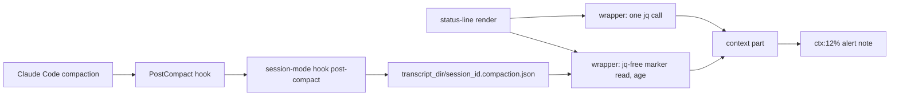

# A compaction leaves a marker file beside the transcript, and the status line shows it

**Status**: Accepted (extends 0019 and 0021; resolves `pg2-thkh0`)
**Date**: 2026-10-14
**Deciders**: Phillip Green II

## Context

Right after a compaction the status line showed `0%` context together with the red over-200k alert
glyph. The two readings contradict each other. Claude Code reports a literal `used_percentage` of
`0` (not `null`) with no input tokens yet, while `exceeds_200k_tokens` is cached against the last
assistant message, which survives a partial compaction until the next API response.

The status line also had no way to say that a compaction just happened. The compaction boundary is
NOT on disk when the `PostCompact` hook runs, the status line MUST NOT read the transcript on each
render (the one-`jq`-call discipline of ADR 0019), and `session_id` is identical before and after a
compaction, so neither the id nor the transcript path signals it.

The plan is `docs/superpowers/plans/2026-10-13-status-line-compaction-awareness.md`.

## Decision

1. **The marker file is the contract between the writer and the reader.** The writer is
   `session-mode hook post-compact` (package `session-mode`, registered as a `PostCompact` entry
   without a matcher in the `pb` plugin's `hooks/hooks.json`). The reader is the status-line
   wrapper (`home/programs/claude-status-line/compaction-status.bash`). They share no code and no
   runtime; only the file's path and shape bind them.
2. **Path.** `<transcript_dir>/<session_id>.compaction.json`, where `<transcript_dir>` is
   `${transcript_path%/*}` taken from the hook payload.
3. **Shape.** One compact JSON object on one line, mode `0600`, written atomically through
   `session_mode_write_atomic`: `{"ts":<epoch seconds>,"trigger":"manual|auto|unknown"}`. `ts` is
   the hook's own clock. `trigger` is the payload's `trigger` when it is `manual` or `auto`, else
   `unknown`: the hook firing is the signal, so an absent or invalid `trigger` still writes the
   marker. There is NO `count` field, and `compact_summary` MUST NOT be stored. Tokens are out of
   scope because the boundary entry is not on disk when the hook runs.
4. **The extension is `.json`, never `.jsonl`.** The marker is a rewritten record, not an
   append-only log, and `.jsonl` is what pa-monitor treats as a transcript. `IsStatusSiblingFile`
   in pa-monitor also excludes the `.compaction.json` suffix, mirroring `.session-mode.json`
   (ADR 0021 section 2). No pa-monitor enumerator can see the file today (they all require
   `.jsonl`, and the session-record scan reads `~/.claude/sessions`, not the projects directory),
   so this is a defensive guard, not a correctness fix.
5. **The writer MUST be inert outside a real transcript directory.** It MUST do nothing and exit 0
   when `session_id` or `transcript_path` is empty or the transcript directory does not exist; it
   MUST NOT call `session_mode_state_dir`, MUST ignore `SESSION_MODE_STATE_DIR`, and MUST NEVER
   create the directory (the `$PWD`-derived fallback plus `mkdir -p` would invent phantom project
   directories under `~/.claude/projects`). It MUST print nothing to stdout (PostCompact stdout is
   echoed into the user-visible compaction message), MUST always exit 0, and MUST be fast, because
   hooks are awaited inside compaction.
6. **`PostCompact` and not `SessionStart` with matcher `compact`.** The `SessionStart` hook may
   fire for subagent compactions, which share the parent `session_id`, and its stdout is injected
   into model context. The `SessionStart` payload key that carries the start reason is `source`
   (ADR 0071 previously said `session_start_reason`; corrected there).
7. **The reader MUST be jq-free and validating.** `read_compaction_marker PATH NOW` plucks `ts`
   with pure bash from one tiny file; `ts` MUST be a positive integer (cf. ADR 0021 on bug
   #52326); a missing, unreadable, zero-byte or malformed file yields nothing; a negative age
   (clock skew) is clamped to `0`. Helpers MUST use `local`, because the lib is inlined at the
   wrapper's top level.
8. **Display.** The wrapper exports `CLAUDE_SL_COMPACT_AGE` (whole seconds) ONLY while the age is
   below the window `phillipgreenii.programs.claude-code.status-line-compaction-window-s` (default
   `1800`; `0` disables the display, not the hook; `CLAUDE_SL_COMPACT_WINDOW` is the runtime seam).
   `mkWrapperScript` gained the argument `compactWindow ? 1800` beside `reserve`. The context part
   appends a dim `<glyphCompact><age>` note (`<1m`, `Nm`, `Nh`) inside the same segment, never as a
   separate segment, and never a running count.
9. **The settling placeholder needs no hook.** The wrapper's single `jq` call exports
   `CLAUDE_SL_CONTEXT_SETTLING`, `true` ONLY when `used_percentage == 0` AND (`current_usage` is
   not an object OR its input-side token sum is `0`). The context part prints a dim `ctx:...`
   placeholder and NO alert glyph while it is `true`. The alert MUST NOT be suppressed by any
   percentage-to-token inference, because on a 1M window `exceeds_200k_tokens` can legitimately be
   true at 25%.

## Consequences

- There is no cleanup: markers accumulate beside transcripts, exactly like `.session-mode.json` and
  `.status.jsonl`. Whether Claude Code's retention cleanup removes sibling files is unconfirmed.
- `session_id` is stable across compaction, so a session that is resumed under its old id can show
  a stale marker's note until the window ends. The note is a hint, not an audit record.
- A crash between the temporary-file write and the rename can leave a `.session-mode.tmp.XXXXXX`
  dotfile in the transcript directory. It is never `.jsonl` and is harmless; this is accepted.
- The only way to stop the writer is to remove the `hooks.json` entry; the window option disables
  only the display.
- Whether `PostCompact` fires on the installed build, the real `trigger` value, and the real
  zero-percent `current_usage` shape are unverified until the post-apply verification bead;
  deterministic behavior is covered by the in-repo bats tests and the pa-monitor truth table.
