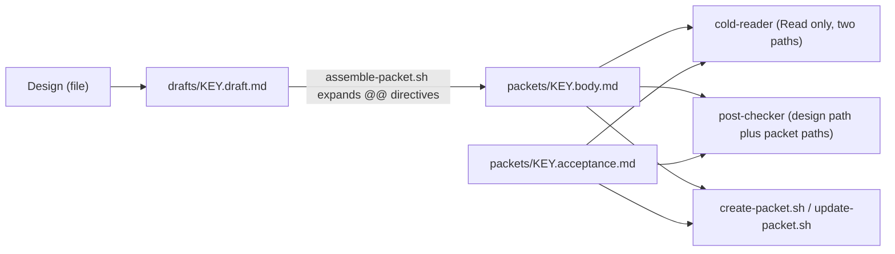

# plan-decompose waits for Agent children by ending the turn and hands sub-agents files, not text

**Status**: Accepted (extends 0058; resolves `pg2-nb8lf`, the record step of the plan-decompose speedup)
**Date**: 2026-10-14
**Deciders**: Phillip (operator rulings 2026-10-13, quoted below); recorded by the drain worker that dispatched `pg2-nb8lf`.

## Context

A `plan-decompose` or `phase-decompose` run is the slowest unattended job in this repository. The
measurement behind this ADR (session transcripts of every `plan-decompose:*` subagent, 2026-10-12
and 2026-10-13) is in the plan's Evidence section:
`docs/superpowers/plans/2026-10-13-plan-decompose-speedup.md`. The plan is the source for every
figure here. Its findings, in the order the decisions below answer them:

- Median wall time was 49 minutes for `plan-decomposer` and 51 minutes for `phase-decomposer`.
- A decomposer that dispatched an Agent child polled for it with fixed sleeps, because its brief
  said "never end your turn" or "keep calling tools". Agent calls are asynchronous: the child
  reports later, and a task notification resumes the parent. The polling added dead time after
  each child had already finished.
- Sub-dispatch prompts were regenerated by the model as output (about 350 characters per second),
  whether they carried a whole packet to a cold-reader or a whole design to the post-checker.
- 44 percent of cold-read verdicts were `executable: no`, and about two thirds of those cited files
  the reader had been told it could not open. The verdict largely measured the reader's restrictions,
  not the packet.
- Curation spent a large share of its time writing text that already existed: whole design sections and
  table rows copied by hand into packets, and acceptance blocks repeated in the packet body.
- The skill file loaded on every `decompose` run carried two modes (`reconcile`, `report`) it never
  runs, and restated the curation-stamp rule six or more times.

The operator approved the plan on 2026-10-13 (Fixes 1, 2, 3 and 4, "as we have discussed"). Rulings
that shape individual decisions are quoted under each decision. The work landed as one bead per
step: `pg2-kcwi3` (P1), `pg2-47tth` (P2), `pg2-7eath` (P3a), `pg2-0bc0f` (P3b), `pg2-ltvod` (P4),
`pg2-2npcm` (P5), `pg2-3gizb` (P6) and this ADR (P7, `pg2-nb8lf`). A re-measurement after
`pn workspace apply` is its own bead (P8, `pg2-8k0fo`). The medium binding that the packet scripts
implement is ADR 0058.

## Decision

All rules use RFC 2119 language. They bind the three orchestrator agents (`plan-decomposer`,
`phase-decomposer`, `epic-decomposer`) and the `plan-decompose` skill and its helper scripts, under
`claude-marketplace/plan-decompose/`.

### 1. A decomposer waits for Agent children by ending its turn (P2, `pg2-47tth`)

1. When an Agent call's result says "Async agent launched", the decomposer MUST wait for the child
   by ending its turn while at least one child is still running. Each child's report resumes it.
2. A decomposer MUST NOT poll for a child: no sleep or `tail -f` waits, no loops over its output
   or transcript, no `Monitor`.
3. A decomposer MUST dispatch independent children in one turn. When resumed while other children
   of the same round are still running and there is nothing to act on, it MUST end the turn again
   with one line and no tool calls, and act on the round once every report is in.
4. A decomposer MUST NOT end a turn to wait when no child is running.
5. The contract text MUST appear verbatim ("Waiting for sub-agents") in all three orchestrator
   agent files. Three short copies are deliberate: each file is that agent's system prompt and is
   in force before any skill loads.
6. The contract overrides brief wording such as "never end your turn" or "keep calling tools". That
   wording is about backgrounded shell commands, which wait through `bgwait` for a `bgrun` job or `Monitor` for any other
   backgrounded command (that rule is unchanged). `claude-marketplace/pb/skills/drain-one/references/`
   `rules.md` and `delegate.md` are scoped accordingly, so a drain brief MUST NOT tell a decomposer
   to keep working while its Agent children run.

### 2. A sub-dispatch passes file paths, never pasted content (P3a and P3b, `pg2-7eath`, `pg2-0bc0f`)

1. A sub-dispatch whose input is a design or a packet MUST name the input by absolute file path and
   MUST NOT carry the text in the prompt. This covers the cold-reader, the
   `semantic-post-checker`, the `phase-split-reviewer` and the `plan-sanity-check` fallback
   reviewer. `phase-plan-verifier` keeps its design text inline (its prompt is small, and reading a
   chunked design from the medium adds risk), so it is the deliberate exception.
2. One scratch layout holds the files. `drafts/<key>.draft.md` (may hold `@@` directives) is
   assembled into `packets/<key>.body.md`, and acceptance criteria are written to
   `packets/<key>.acceptance.md`. `packets/` MUST NOT hold a draft. The same two packet files feed
   `create-packet.sh` and `update-packet.sh` (`--body-file`, `--acceptance-file`), the cold-reader
   and the post-checker, so every consumer judges the stored text.
3. The post-checker's round 1 input is the design file path, the explicit packet path pairs, the
   planned ordering inline and the repo roots. Round 2 and later input is an excerpt file holding
   only the design sections the prior round cited plus every section cited by an in-scope packet (built with `assemble-packet.sh`), the touched
   packets plus their direct planned-ordering neighbours, the ordering inline and the repo roots.
   A round MUST NOT re-send the full design or the full packet set.
4. A design stored in the medium MUST be written to a file once per run and that file reused by
   every step.
5. The "prompt byte-length" metric becomes "input bytes = prompt plus referenced files", so the
   by-reference change does not make a run look cheaper than it was.

The operator approved the post-checker, phase-split-reviewer and sanity-check-fallback extensions
on 2026-10-13 ("Post-checker (Recommended), Phase-split-reviewer, Sanity-check fallback").

### 3. A cold-reader treats a file the packet names as available (P3a, `pg2-7eath`)

Operator ruling (Phillip, 2026-10-13): "treat named files as available."

1. The `cold-reader` agent (`agents/cold-reader.md`, `model: haiku`, `tools: Read`) MUST read
   exactly the two files its dispatch names, the packet body file and its acceptance file, and
   nothing else, including any path the packet itself names.
2. Anything the packet says a named file holds MUST count as present. The reader MUST NOT list "I
   would need to read X" as missing when the packet names X. It MUST flag only what the text leaves
   unstated: a signature, a threshold, a path, a command, an expected result, a definition, or a
   sibling packet's Consumes/Produces shape the text does not pin down.
3. The reader MUST report fully in one turn and dispatch nothing. Its output format
   (`executable`, `missing`, `unpinned-assumptions`) is unchanged.

### 4. A whole verbatim excerpt comes from a command, not from the model (P4, `pg2-ltvod`)

Operator ruling (Phillip, 2026-10-13): "if there are exerpts which are exactly the same, we should
do that with a command."

1. A verbatim whole design section or table row in a packet MUST come from an `assemble-packet.sh`
   directive: `@@file <path>`, `@@design-section [--quote] <heading path>` or `@@design-table-row
<heading path> | <first-cell text>`. Verbatim sentences inside curated prose stay hand-written.
2. A line that is not one of those three exact prefixes MUST pass through byte-for-byte, diff hunks
   included, and expanded text MUST NOT be re-scanned, so directive-looking text inside an excerpt
   stays inert.
3. A section is the text up to the next heading of any level, without its heading line, ending in
   a `[design: <heading path>]` line, so the citation rule and reconcile's mechanical affectedness
   test keep working. `@@file` MUST be refused (exit 3) outside the git toplevel. Exit codes: 3 not
   found, 4 ambiguous heading, 2 usage, 1 generic. The output file MUST be written only on success.
4. Sizing (step 4) and the pre-filter (step 5) run on the assembled body, never the draft.

### 5. Acceptance criteria live only in the acceptance field, and content updates have their own script (P5, `pg2-2npcm`)

Operator ruling (Phillip, 2026-10-13): "only the aceptance field needs to hold the acceptance."

1. A packet's acceptance criteria MUST be stored only in the acceptance field. The implementer's
   single `bd show` read still covers them, because `bd show` prints that field.
2. A shared guard (`scripts/lib/acceptance-guard.bash`, one implementation) MUST refuse a body
   (exit 3, no bd call) that contains an "Acceptance criteria" heading followed by a checklist, or
   two or more whole acceptance lines as whole lines. A single matching line passes (an acceptance
   criterion MAY restate one verbatim Binding decision). The guard MUST fail closed.
3. `create-packet.sh` MUST run the guard before `bd create`.
4. Rewriting an already-created packet's content MUST go through `update-packet.sh`: one `bd update
<id> --body-file <file>` (plus `--acceptance` when an acceptance file is given), behind the same
   guard run against the given acceptance file or the stored one. It is a separate script so that
   "MUST NOT call `create-packet` again for an existing packet" stays literally true. It MUST
   reject every flag it does not list, and it MUST NOT touch metadata, labels, status, creation or
   deferral, so a restamp stays its own explicit `--set-metadata` call under the "Curation stamp"
   rule.
5. Consequence: a reconcile that re-curates an old packet which carries a duplicated acceptance
   block MUST drop the duplicate.
6. The approver models both new scripts (`pg2-3gizb`, P6): `assemble-packet.sh` and
   `update-packet.sh` have schemas beside `create-packet.sh` in `pluginScriptSchemas`. The approver
   abstains on the absolute-path call form for every one of the three scripts alike (measured
   2026-10-14), so the two new scripts MUST keep the same verdict `create-packet.sh` has.

### 6. The skill is split so a `decompose` run loads only what it runs (P1, `pg2-kcwi3`)

Operator ruling (Phillip, 2026-10-13): "split the skill as necessary, refactor it so that we aren't
duplicating thing so much."

1. `skills/plan-decompose/SKILL.md` MUST hold only what a `decompose` run needs: Concepts, Medium
   binding, Metadata keys, Packet anatomy, mode `check`, mode `decompose`, Helper scripts,
   Sub-dispatch templates, Consumers and Usage. Sub-dispatch templates live there, not in an agent
   file, because `phase-decomposer` runs `decompose` inline and never loads `plan-decomposer.md`.
2. Mode `reconcile` and mode `report` MUST live in `skills/plan-decompose/references/reconcile.md`
   and `references/report.md`, read only when that mode runs. The binding's amend-design,
   restamp and metrics operations MUST live in
   `skills/plan-decompose-beads/references/reconcile-and-report.md`.
3. Each rule MUST have one canonical statement, with a one-line pointer elsewhere (curation stamp,
   RESUME dedup, the `pd_*` metadata meanings). Agent charters keep identity, actor, report shape
   and the section 1 contract, and drop restated skill rules.
4. A bead or ruling id cited in the skill text MUST stay greppable. Incident narratives are reduced
   to the rule plus an id parenthetical.
5. Mode `decompose` step numbers MUST NOT change, because other documents cite them.
6. The split is behavior-neutral: the packet anatomy, the citation rule, HELD-until-verified,
   release-as-a-set, the abort path and the loop bounds are unchanged.

## Consequences

- A decomposer's wall time falls by the wait overshoot, the model-written sub-dispatch text and the
  hand-copied excerpts. No target number is set here. The measurement against the plan's Evidence is
  `pg2-8k0fo` (P8), which MUST run after `pn workspace apply`, because skills are served from the
  nix store and are live only after an apply.
- The cold-read `no` rate is expected to drop, because it no longer counts a file the reader was
  forbidden to open. P8 compares it with the 44 percent measured before.
- A decomposer needs a working file layout (`drafts/`, `packets/`, `excerpts/`) and the assembled
  file, not the draft, is what every later step reads.
- A design excerpt can no longer be silently reworded: a verbatim section is a directive, so a
  drift between a packet and its design shows up as a mechanical difference, not a paraphrase.
- `update-packet.sh`'s narrow flag surface means a content fix and a restamp are two calls. That is
  deliberate: it keeps the stamp write-once rule reviewable in one place.
- Existing dockets and packets are not migrated. A packet that already repeats its acceptance block
  is left alone until a reconcile re-curates it.
- Not decided here, and recorded in the plan's Excluded section: parallel curation (4C, operator:
  "we can try the other fixes first"), per-packet cold-read during curation (4D), re-reading only
  materially changed packets, and by-reference input for `phase-plan-verifier`.
