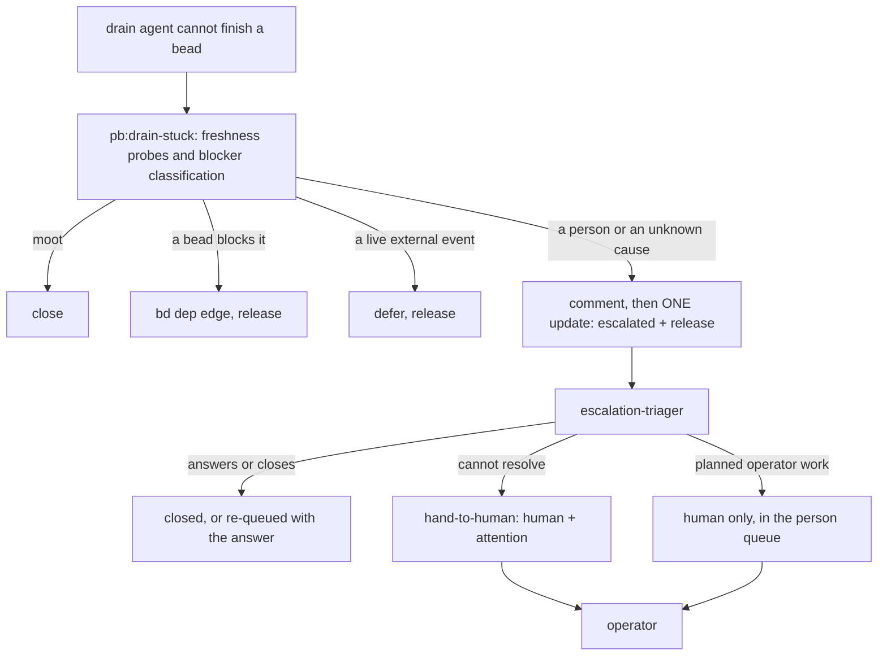

# pb:drain-stuck escalates instead of parking for a person

**Status**: Accepted (extends [0105](0105-bead-label-vocabulary-for-escalation-and-operator-attention.md) and [0089](0089-drain-roles-apply-the-shared-pb-drain-one-skill.md); resolves `pg2-zpj6z`)
**Date**: 2026-10-22
**Deciders**: Phillip Green II (operator ruling, 2026-10-21, recorded on `pg2-ikkpk`); design call (remove versus update) by the implementing agent

The key words MUST, MUST NOT, SHOULD, SHOULD NOT and MAY in this record are to be read as in RFC 2119.

## Context

Until now a drain agent that could not finish a bead parked it for a person itself, by adding
`human` (`pb:drain-stuck`, step 7). That is a second path to the operator that bypasses the
escalation-triager. The operator ruled on 2026-10-21 (recorded on `pg2-ikkpk`): an agent with a
problem escalates (label `escalated`, with the findings), the triager decides, and only what the
triager cannot resolve reaches the operator as `human` + `attention`. ADR 0105 defined the
vocabulary and the `hand-to-human` command. This record applies it to the drain skills, and
records the remove-versus-update decision the bead left to the agent.

## Decision

1. **Update `pb:drain-stuck`; do not remove it.** Only its person-park exit changes. The skill
   still exits by exactly one of ESCALATE, CLOSE-AS-MOOT, CONVERT-TO-DEPENDENCY or
   DEFER-ON-EVENT. ESCALATE replaces PARK: the agent writes one comment (findings, the
   `FRESHNESS:` probe output, a `NEEDS:` line naming what a person would have to supply, and the
   preserved branch), then ONE `bd update --add-label escalated --status open --assignee ""`
   (`beads-lifecycle` LV-7, B-1 to B-3), then reads the bead back. It never writes `human` or
   `attention` on the stuck bead and never runs `hand-to-human`.
2. **The triager prompts own the person decision.** Both escalation-triager prompts gain a
   "stuck work beads" section: recognise a drain escalation, answer or close it when the
   evidence allows, re-queue it at most once, and otherwise hand it to the operator with
   `hand-to-human` (`human` + `attention`). A bead that is itself planned operator work (a verify,
   checkpoint, decision or handoff bead) is left for the person queue with `human` only.
3. **`escalated` keeps a bead out of every agent queue.** The drain claim and termination queries,
   the router's drain-ready query and the unstick DRAINABLE and LIVE computations already exclude
   both label sets (ADR 0105). The close-or-release completion of the ccpool handler counts an
   open, unassigned bead carrying `escalated` as a worker's own release, so a worker that
   escalated is not struck as an unclaimed end.
4. **Beads an agent files FOR the operator stay `human` only.** A decision bead (the mixed-blocker
   case of `pb:drain-stuck`), the leftover-isolation `worktree-review` follow-up, a verification
   child and the phase-plan-verifier's open-question bead are planned operator work (LV-2). They
   are new beads, not stuck ones, so they carry `human` and never `attention`, and they do not go
   through the triager. A conformance test lists exactly these direct writes.

## Why update, not remove

What `pb:drain-stuck` adds beyond the triager is everything that has to happen inside the drain
session, while it still holds the claim and the worktree:

- **It preserves the work.** It commits the WIP to the work branch (or leaves it in the retained
  worktree) and keeps the isolation. The triager runs without that worktree.
- **It releases atomically.** The label and the claim release go in one update (B-1 to B-3), so no
  peer drain session sees the bead `open`, unlabeled and unblocked, and the router does not
  re-offer it within a minute.
- **It runs the cheap mechanical exits first.** A moot premise closes (F-1 to F-10), a bead
  blocker becomes a `bd dep` edge (D-1 to D-10), a live external event becomes a defer (D-10).
  The triager reaches its beads through `pg-connector issue` only (show, comment, update, close),
  with no `bd dep` and no worktree, so removing the skill would push these conversions onto a
  slower, more expensive session that cannot do them, or drop them.
- **It records the findings the triager reads.** The `FRESHNESS:` line, the `PRECONDITION`,
  `PRECONDITION-KEY` and `DERIVED-FROM` block and the repeat detection (a second escalation on the
  same key is escalated as a suspected stale precondition) are what stop a stuck bead from looping
  between the drain pool and the triager.

Removing the skill would also leave `pb:drain-one` with no defined exit for a bead it cannot
finish. Only the person-park exit was the defect, so only that exit changes.

## Consequences

### Positive

- One path reaches the operator for a stuck bead, and only a bead the triager could not resolve
  carries `attention`.
- A stuck bead cannot be re-claimed by a drain session: `escalated` is excluded everywhere.
- The triager gets the findings and the question (`NEEDS:`) in a form it can act on.

### Negative

- Every stuck bead now costs a triager session before a person sees it. The triager can answer or
  close some, which is the point, but a plain needs-a-decision bead pays the extra step.
- A re-queue by the triager can send a bead back to the drain pool. The triager prompts bound it:
  at most one re-queue per bead, never for a bead carrying `stale-precondition`, and only with the
  answer written into the bead's description or acceptance criteria (F-10).
- `bead-grooming` now escalates a bead whose acceptance criteria need a decision, instead of
  labeling it `human`, so the triager sees grooming questions too.

## Alternatives Considered

### Remove `pb:drain-stuck`

Rejected for the reasons above: it is the only place the worktree, the claim and the mechanical
exits meet. Without it the exits move to the triager, which lacks the access.

### Route the decision beads and the worktree-review follow-up through the triager too

Rejected: they are new beads filed for the operator, so there is nothing for the triager to
resolve first. The default of `pg2-zpj6z` (human only, no `attention`) stands.

### Let the stuck agent run `hand-to-human` directly when it knows a person is needed

Rejected by the operator ruling and by `beads-lifecycle` LV-3: only the triager hands a bead on, so
the attention list means "an agent asked and nothing resolved it".

## Related Decisions

- [0105](0105-bead-label-vocabulary-for-escalation-and-operator-attention.md): the vocabulary, the
  two label sets and `hand-to-human`.
- [0089](0089-drain-roles-apply-the-shared-pb-drain-one-skill.md): the drain roles and the
  `pb:drain-one` outcome contract, whose PARK exit is now ESCALATE.
