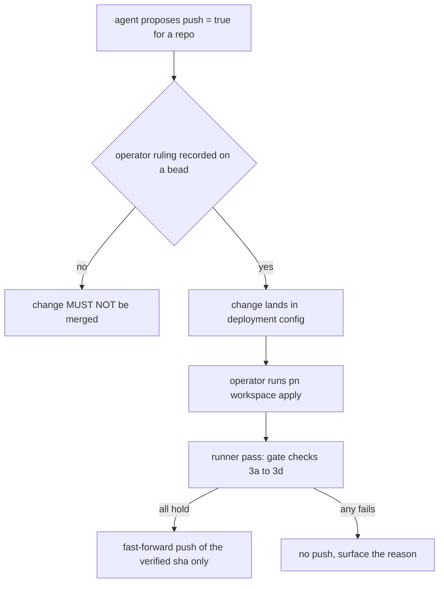

# An operator-enabled unattended runner may publish within a defined scope

**Status**: Proposed (amends the wording of rule U-5 of the global agent rules; becomes Accepted when the operator rules on decision D1 of the async runners design, recorded on `pg2-na2nr`)
**Date**: 2026-10-23
**Deciders**: phillipg

This ADR is filed with the design `docs/superpowers/specs/2026-10-23-pg-router-async-runners-design.md`
(origin: `pg2-na2nr`) so that the implementation beads can cite it by number. It decides nothing by
itself: a Proposed ADR authorizes no push. The key words MUST, MUST NOT, SHOULD, SHOULD NOT and MAY in
this record are to be read as in RFC 2119.

## Context

Rule U-5 of the global agent rules reads: "MUST NOT `git push`, `pn workspace push|update|apply`, or
invoke `/pn-workspace-sync` or `/pn-workspace-update` on own initiative to clear unpushed work;
REPORTING is in scope, PUBLISHING is not." It was written for agent sessions, and its stated reason is
that discharging unpushed landing debt is outward-facing and operator-authorized.

The design `pg2-na2nr` evaluates three pg-router-managed background runners. One of them, the
autosyncer, publishes: it pushes a repo's primary branch to its remote so that the cost of publishing
is not felt in a session. On 2026-10-23 the unpublished debt is 8 + 1 + 48 + 70 + 0 + 181 + 0 = 308
commits across the seven workspace repos (`git rev-list --left-right --count origin/main...main` in
each canonical clone; 0 behind in all seven), so a push is the whole value of that runner.

Three facts make a plain reading of U-5 inadequate for such a runner:

1. A pg-router role is a program started by a daemon, not an agent session acting "on own
   initiative". Read literally, U-5 does not bind it. Relying on that gap would let any script that
   an agent edits publish without the operator ever deciding, which is exactly what U-5 exists to
   prevent. A publisher MUST therefore be authorized explicitly, not by omission.
2. Authority should come from something an agent cannot change on its own. Enabling the runner
   happens in operator-owned deployment configuration that only takes effect at `pn workspace apply`,
   which U-5 and the system-activation rule already reserve to the operator.
3. A narrower precedent exists. The 2026-10-22 operator ruling in the script-first routing design
   (decision D5) lets a script role push a rebased PR branch with `--force-with-lease` only, from the
   role's own worktree, never the base branch. It is recorded in a design spec, not an ADR, and it
   covers PR branches, not the primary branch.

The rest of the guard rails already exist and are not changed here: R-1 to R-3 (the canonical clone
stays on its primary branch and clean), FF-0a and FF-2b of the land skill, HK-2 (no git hook invokes
nix), and the workspace policy that `main` has no branch protection.

## Decision

1. **A runner is a publisher only by operator authorization recorded in deployment configuration.**
   The runner `pg-repo-runner` MAY push, and only for a repo whose entry in the operator-owned module
   option `repos.<name>.push` is `true`. The default is `false` for every repo. An agent MAY propose
   turning it on in a change but MUST NOT merge that change without an explicit operator ruling
   recorded on a bead (S-2 form: who, when, verbatim), and MUST NOT run `pn workspace apply` or
   `pn workspace update` to make it take effect (U-5 and the activation rule stand).
2. **Scope of a permitted push.** A runner push MUST be exactly
   `git -C <canonical clone> push origin <sha>:refs/heads/<primary branch>`, where `<sha>` is the
   primary-branch tip for which a `green` verdict exists in the verdict store. It MUST NOT:
   use `--force`, `--force-with-lease`, a `+` refspec, `--delete`, `--mirror` or `--tags`; name any
   ref other than the primary branch; pass `--no-verify`; or invoke `pn workspace push`,
   `pn workspace update` or `pn workspace apply`.
3. **Gate.** The push MUST NOT run unless all of these hold in the same pass: (a) a `check` verdict
   `green` exists for exactly `<sha>`; (b) `<sha>` is the current primary tip; (c) the canonical clone
   is in steady state (primary branch checked out, clean, no rebase, merge or cherry-pick in
   progress, no `core.worktree`); (d) `origin/<primary>` is an ancestor of `<sha>`, so the push is a
   fast-forward. If (d) fails the repo is diverged: the runner MUST NOT rebase, reset or force, and
   MUST surface the divergence.
4. **Allow-list and exclusions.** The runner MUST act only on keys of the workspace's
   `pn-workspace.toml` and MUST refuse a path whose real path is not `<workspace root>/<key>`. A repo
   outside the workspace, including the employer's private monorepo, MUST NOT be configured.
5. **Kill switches.** The runner MUST stop publishing on any of: the pg-router `SYSTEM_PAUSE` gate
   (default gate blocking, no code), a `push.disabled` file in its state directory, or `push = false`.
   Each takes effect on the next pass without a restart.
6. **First enablement.** The first pass for a newly enabled repo SHOULD run in dry-run mode, logging
   the commit range it would push, and the operator SHOULD review that range before the dry-run flag
   is removed. This matters because the first push of a repo that is far ahead (181 commits in the
   largest case today) is a deliberate publication.
7. **Audit.** Every push MUST write one record (repo, remote, old and new remote sha, verdict
   reference, time) to the runner's run log and emit it as a structured log line.
8. **Proposed replacement wording for U-5**, to be applied by the operator to the global rules (this
   ADR does not edit any rules file):

   > **U-5** An agent session MUST NOT `git push`, `pn workspace push|update|apply`, or invoke
   > `/pn-workspace-sync` or `/pn-workspace-update` on own initiative to clear unpushed work;
   > REPORTING is in scope, PUBLISHING by an agent session is not. The one exception is the push step
   > of the operator-enabled `pg-repo-runner`, within the scope of this repo's ADR 0108. An agent
   > MUST NOT enable that step, widen its scope, or run it by hand to clear unpushed work.
   > (U-1..U-4, U-6: the wrap-up skill.)

9. **The 2026-10-22 PR-branch push ruling is unchanged.** It is cited as precedent for an
   operator-authorized unattended push and is neither widened nor narrowed by this ADR.

## Consequences

### Positive

- The runner's authority is explicit, per repo, default off, and changeable only through an operator
  step, so the property U-5 protects (publishing is the operator's decision) is preserved.
- The scope is narrow enough to review in one place: one ref, one refspec shape, fast-forward only,
  gated on a recorded verdict.
- The same record gives a future unattended publisher (for example a PR-branch runner) a model to
  cite without reopening U-5.

### Negative

- A second place now describes who may push, and the global rule text and this ADR can drift. The
  replacement wording in decision 8 names this ADR so the link is explicit.
- A push does not relock sibling flake inputs, so a consumer's published lock can lag its siblings
  until `pn workspace push` is run by the operator or a session. The gate makes this safe (a consumer
  that does not build from its locked inputs is not pushed) but not complete.
- Pushing a green tip also publishes its ancestors, including an intermediate red commit that a later
  commit fixed forward.

### Neutral

- If the operator declines D1, the autosyncer is built report-only (fetch, fast-forward, drift
  surfacing) and this ADR is Rejected; nothing else in the design depends on it.

## Alternatives considered

- **Treat a daemon as outside U-5 with no record.** Rejected: authority by omission, and any agent
  that can edit the script could widen it.
- **Run `pn workspace push` unattended.** Rejected for the first version: it commits relock changes
  onto the canonical `main`, which races landings (the land skill honors no lock the runner could
  take) and widens the scope to every repo at once.
- **A per-session operator confirmation for each push.** Rejected: it keeps the cost in the session,
  which is the problem the runners exist to remove.
