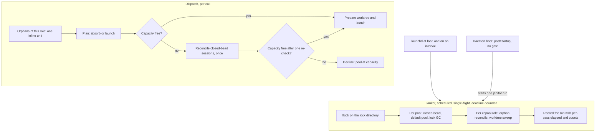

# ccpool handler hygiene moves to a janitor, dispatch reconciles on capacity pressure, and the postStartup gate is removed

**Status**: Accepted (operator ruled 2026-10-30 on the plan and on the recommendation to approve the dispatch-time-behavior change; ruling quoted verbatim in the Operator rulings section; amends 0083, 0084 and 0085; epic `pg2-fx5x0l`)
**Date**: 2026-10-30
**Deciders**: Phillip Green II

## Context

The `pg-router-handler-ccpool` handler runs five housekeeping passes inline before EVERY dispatch
(the closed-bead reconcile, the role-scoped orphan reconcile, the default-pool stale-session pass,
the worktree-keyed sweep of leaked per-bead worktrees, and the lock-file garbage collection) and once
per role at daemon boot. At boot the router holds each role's first dispatch behind that role's
`postStartup` hook for up to five minutes. That per-role dispatch gate was never written into the
behavior docs; it is documented below, because this ADR removes it.

Observed on 2026-10-30:

- Four worktree roles hit the five-minute cap at one boot, and at an earlier boot the same roles took
  2 minutes 42 seconds to 4 minutes 13 seconds.
- A worktree the sweep keeps because it is dirty (entries 37112, 9873 and 19256) is re-examined with
  `git status` on every dispatch and every boot: 304, 508 and 271 "keeping it" lines. The per-pass cap
  of five counts removals, not candidates examined, and the sweep has no deadline.
- Only the closed-bead reconcile is frequently productive (339 dispatch-time and 51 boot-time hits).
  The leaked-worktree (3), stale-lock (17) and orphan (0) finds are rare.
- The host load average was 80 to 140 at times, so every extra `git status` and pool listing is
  expensive.

### The per-role dispatch gate, as it exists today

The long-running daemon does not run the `postStartup` hooks one after another. It runs one goroutine
per enabled role and wraps the handler client so that a role's FIRST dispatch waits for that role's
own hook. The wait ends when the hook returns, fails, or reaches a five-minute timeout; it never waits
for another role's hook, and producers never wait. The reason is that the ccpool handler's boot-time
reconcile closed sessions whose bead had closed before that role's new dispatches started. If shutdown
is requested while a hook runs, the gate stays closed. The wire contract (`handler.postStartup`) does
not mention the gate; it is a daemon-internal ordering.

### Citation rule

This ADR cites an owning repository by name unless the target is another ADR in this directory, and
names a section by its prose heading.

## Operator rulings

Operator rulings (Phillip, 2026-10-30), recorded verbatim.

On the dispatch-time behavior change. The operator was given the plan and a recommendation to approve
superseding four rules: the dispatch-time closed-bead reconcile (`INV-CCH-14`), the dispatch-time
worktree scan (`INV-CCH-19`), the lock-file garbage collection (`INV-CCH-24`), and the `postStartup`
dispatch gate. The reply, verbatim:

> proceed, don't worry about linux machine support for the handler/daemn

On orphans, verbatim, recorded in the plan's Phase 4 section:

> do the orphan processing as one unit of work before

On metrics, verbatim, recorded in the plan's metrics section:

> A for metrics is fine

The three rulings mean: (1) the four rules above are superseded as this ADR decides; (2) orphan
handling stays inline as ONE unit of work before the capacity check, so the orphan clause of
`INV-CCH-18` is KEPT; (3) the janitor's metrics use option A, a generic gauge-emit command in
`ccpool`, and the handler gains no OpenTelemetry code; and (4) the handler and the janitor are not
required to run on Linux or under systemd.

## Decision

1. **Hygiene moves to a janitor.** A new subcommand `janitor` of `pg-router-handler-ccpool`, run on a
   schedule by a launchd job (Scheduled Reaper pattern), performs the hygiene passes once per
   interval: per pool, the closed-bead reconcile, the default-pool stale-session pass and the lock
   garbage collection; per ccpool role, the orphan reconcile and the worktree-keyed sweep. It is
   single-flight (a non-blocking `flock`; a second run exits 0 saying it is already running), bounded
   by a wall-clock deadline (Bulkhead pattern), de-duplicated per pool, and best effort (one pass that
   errors does not stop the rest). It is a handler subcommand and NOT a pg-router command role,
   because a command role would put hygiene behind the router's pause gate, cost a query process and
   a handler process per tick, and need wrap-spec upkeep for no benefit. The router core stays
   ignorant of handler kinds (`GOAL-MIN-1`, `DEC-WIRE-3`).

2. **Dispatch becomes Admission Control.** A dispatch no longer runs the closed-bead reconcile, the
   default-pool pass, the worktree sweep or the lock garbage collection before its capacity check.
   When the pool is full and no usage limit is in force, the dispatch runs the closed-bead reconcile
   once and re-checks capacity once; if the pool is still full it declines exactly as before (exit
   9, the same decline reason, only the detail text says a reconcile was tried). The decline-time
   reconcile is rate-limited per pool so a saturated pool does not pay the pass on every re-offer.

3. **Orphans stay inline as one unit.** Before the capacity check a dispatch still handles every
   orphan of its own role, unchanged in semantics, using the one pool listing the plan also uses.
   The "Not covered, accepted: an orphan is handled only when its OWN role next dispatches" caveat is
   REMOVED, because the janitor now handles the orphans of every ccpool role too.

4. **The `postStartup` gate is removed.** The router no longer holds a role's first dispatch behind
   its `postStartup` hook and the five-minute timeout is deleted. The hooks still run once per role
   at boot, concurrently and without gating dispatch. The handler's `postStartup` no longer sweeps:
   it validates the request, starts one janitor run without waiting for it (the single-flight lock
   makes a duplicate harmless, and a daemon restart does not rerun a launchd job), and replies `ok`.
   The wire contract of `handler.postStartup` is unchanged.

5. **A transitional switch.** The handler launch-config key `inlineSweeps` (default `true`) keeps
   today's dispatch behavior until the janitor is verified live; the dispatch change reads it. The
   switch and its `true` branch are deleted in a final step.

6. **Scope.** The janitor and the handler are darwin-only for now: there is no Linux or systemd
   consumer, no systemd timer, and no Linux cross-build requirement (operator ruling above).

Design patterns: Admission Control (a dispatch reconciles only under capacity pressure), Scheduled
Reaper with a Single-Flight lock (the janitor), Bulkhead (the deadline and per-role sub-budget),
Negative Cache with a time to live (the decline-time reconcile stamp).

## What this supersedes, amends and leaves alone

| Rule                                                                                                                                         | Effect                                                                                                                                                                                         |
| -------------------------------------------------------------------------------------------------------------------------------------------- | ---------------------------------------------------------------------------------------------------------------------------------------------------------------------------------------------- |
| 0083, Decision item "before checking capacity a dispatch handles every orphan of its own role"                                               | KEPT as is (operator ruling on orphans). Only its "Not covered, accepted" caveat is removed                                                                                                    |
| 0083's lease and per-session lock, the orphan guards                                                                                         | unchanged; the janitor reuses them                                                                                                                                                             |
| 0084, "before checking capacity a dispatch scans the worktree directory"                                                                     | superseded: the janitor runs the scan; a dispatch keeps only a check of its own bead's leaked worktree before preparing it. The guards, the per-bead lock and the removal bounds are unchanged |
| 0085, the dispatch-time reclaim of a spared session ("the next dispatch of the same role reclaims", "the dispatch-time reconcile purges it") | amended: the janitor, or a dispatch at capacity pressure, purges it                                                                                                                            |
| `INV-CCH-14`'s dispatch-time closed-bead reconcile                                                                                           | superseded: capacity pressure plus the janitor                                                                                                                                                 |
| `INV-CCH-19`'s dispatch-time worktree scan                                                                                                   | superseded: the janitor                                                                                                                                                                        |
| `INV-CCH-24`'s dispatch-time lock garbage collection                                                                                         | superseded: the janitor                                                                                                                                                                        |
| The router's per-role `postStartup` dispatch gate and its timeout                                                                            | removed                                                                                                                                                                                        |
| 0065, 0082, 0072, 0089, 0094, 0097                                                                                                           | note-only edits, no decision change                                                                                                                                                            |

## Consequences

- A dispatch pays only for what it needs. A role's first dispatch after a boot is no longer delayed
  for minutes by hygiene it did not need.
- Closed-bead sessions can hold a pool slot until the next janitor run or until a dispatch finds the
  pool full. The capacity-pressure reconcile bounds the visible effect to one extra pass on a
  decline-bound dispatch.
- With the gate gone, what protects a role's first post-boot dispatch is: the capacity-pressure
  reconcile (stale closed-bead sessions), the inline orphan unit, the janitor's run at load, and one
  janitor run started by the handler's `postStartup`.
- The janitor is a new scheduled job and a new thing to watch. A heartbeat gauge emitted through a
  generic `ccpool` command and alert rules on it are part of the program (epic `pg2-fx5x0l`); the
  handler gains no OpenTelemetry code.
- An orphan of a role whose own dispatch never runs is now reclaimed by the janitor rather than left
  until `ccpool`'s idle timeout.
- Rollback: set `inlineSweeps` back to `true`, or disable the janitor option; the gate removal is the
  only non-flag change and is a plain revert.

## Related

Amends 0083, 0084 and 0085. Note-only edits to 0065, 0082, 0072, 0089, 0094 and 0097. Behavior docs
edited in the same change: the invariants, interfaces and journeys of `packages/pg-router-handlers`
and its `pg-router-handler-ccpool` set, and `packages/pg-router`'s `interfaces.md`, `invariants.md`,
`docs/decisions/wire.md` and `docs/decisions/role.md`.
