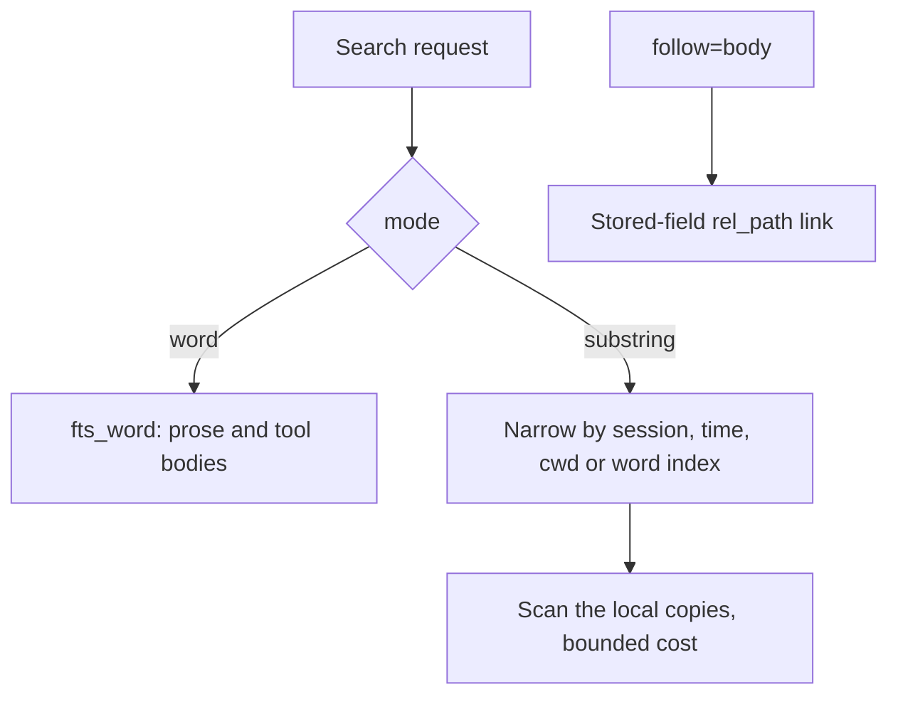

# pg-claude-code-recorder: tool input and output go to the word index, and substring search scans the copies

**Status**: Accepted (operator ruling, Phillip, 2026-11-03, "A+B"; supersedes the earlier deferral of the substring-search question)
**Date**: 2026-11-03
**Deciders**: phillipg

## Context

The recorder's `index.db` held two full-text indexes. Prose (user and assistant text, thinking, summaries) goes
to the word index `fts_word`. Opaque fields (tool input JSON, tool result bodies, saved tool-result file bodies,
pasted contents) go to the trigram index `fts_tri`, which serves `mode=substring` (a literal, case-sensitive
phrase of at least 3 characters, re-verified against the copy). `mode=word` never reaches tool bodies.

The investigation `packages/pg-claude-code-recorder/docs/investigations/2026-11-03-index-db-size.md` (the
"finding") measured where the 30.65 GB live file goes. On the live file, `fts_tri` is 16,729,579,520 bytes (the
finding's "Exact bytes per object" table), 91.6 percent of the FTS bytes. The finding prices a word index over
the same opaque bodies at about 3.36 GB, saving 13.37 GB (its "Re-priced variants (live)" table), and names the
choice a product ruling for the operator. The ratio behind that price (0.201) comes from a synthetic fixture and
the finding says it MUST be re-measured on a sample of live bodies, because live bodies were 1.25 to 2.8 times
heavier than the fixture's.

A read-only study of every recorder client found no shipped client that calls `mode=substring` over tool
bodies. The only documented use is an ad hoc example (a literal flag such as `--no-verify`) and the recorder's
own `follow=body`, which matches a body's `rel_path` against `tool_result.body` through the trigram index.
The request counter records the operation but not the mode, so live per-client search counts were not available
to the study; that remains open and does not block this decision.

## Decision

The ruling, verbatim (Phillip, 2026-11-03, answering the options for supporting agents and pg-connector without
the trigram index): **"A+B"**, where:

- **A**: tool input and output go to the word index (the finding's price: about 3.4 GB, case-insensitive
  tokens, AND of terms, quoted phrase).
- **B**: `mode=substring` is served by scanning the recorder's copies, narrowed by session, time, cwd or the
  word index, with a bounded cost.

Policy:

1. Opaque fields (tool input, tool result bodies, saved tool-result file bodies, pasted contents) MUST be
   indexed in the word index, and the trigram index over them MUST NOT exist in the new schema.
2. `mode=substring` MUST stay on the wire and MUST be answered by scanning the copies. A substring request
   SHOULD be narrowed by session, time range or cwd, or by candidates from the word index, and its cost MUST be
   bounded (a request that would exceed the bound MUST fail or truncate visibly, not silently run unbounded).
3. `follow=body` MUST resolve through a stored-field link (the body's `rel_path` is already a stored field)
   and MUST NOT depend on the trigram index.
4. The trigram index over tool bodies MUST be dropped in the next rebuild, the schema v3 rebuild.
5. The copies MUST stay local to the recorder host, because substring search reads them.

Implementation is separate work, in three parts: substring over the copies, scoped and bounded; `follow=body`
through the stored-field link; and indexing tool bodies in the word index with `fts_tri` dropped from the new
schema. This ADR does not change code.

## Rejected options

- **Keep the trigram index.** It preserves case-sensitive literal substring search over tool bodies at the price
  of about 16.8 GB of the file (the finding's calibrated estimate; 16.73 GB measured live). No shipped client
  was found that needs it, and keeping it leaves the rebuilt file needing a second volume (the finding's
  end-state arithmetic: about 25.5 GB after a dense rebuild versus about 12.1 GB with the word index).
- **Trigram with `detail=column`.** The finding measures it at 0.430 of the trigram size on the fixture, but
  SQLite FTS5 rejects phrase queries under it (`fts5: phrase queries are not supported`), and the recorder's
  substring path is a quoted phrase, so it is not a drop-in and breaks the very queries it exists to serve.
- **A word index with `detail=none`.** Smaller still (the finding's 0.099 ratio) but with no phrase queries; not
  chosen, since the ruling keeps quoted-phrase search over tool bodies.

## Consequences

- Search over tool bodies is a new capability for `mode=word`: it does not exist today, because tool bodies
  are only in the trigram index.
- Tokenization splits on punctuation. A query containing punctuation (a flag like `--no-verify`) becomes the
  phrase of its tokens ("no verify"), is case-insensitive, and can match more than the literal text.
- An exact-punctuation or partial-token (mid-word) lookup MUST use `mode=substring`, which scans the copies. It
  is slower than an index probe, unranked, and only as fast as its narrowing allows.
- The copies are now a query dependency, not only a rebuild source: they MUST stay on local disk, and a client
  of a recorder whose copies are gone gets no substring answer.
- The file shrinks by about 13.4 GB at the finding's price (16.73 GB x 0.201 = 3.36 GB, saving 13.37 GB), a
  figure that MUST be re-checked against a sample of live bodies before relying on it.
- Mid-word search over prose is not provided by `fts_word` and is not decided here; a phase that needs it
  decides it separately.
- This decision is carried out by the schema v3 rebuild; until that rebuild runs, the trigram index exists.
