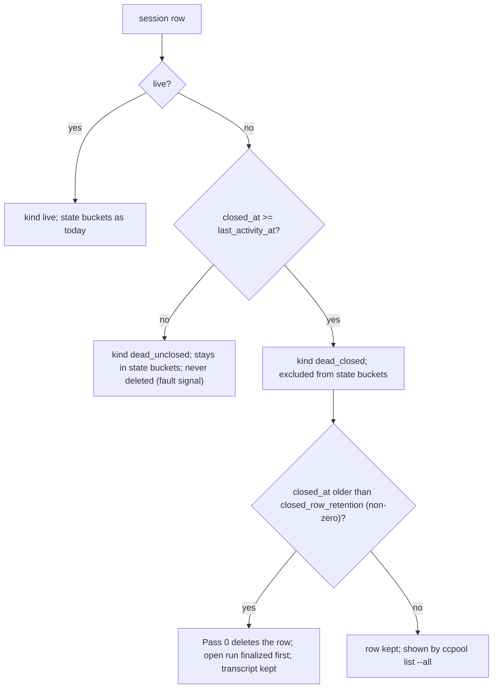

# ccpool: closed stays derived, closed dead rows are deleted after a retention, and the state metric excludes them

**Status**: Proposed (agent-proposed design requested by the operator on 2026-11-04, awaiting operator review; builds on 0015, 0072 and 0086)
**Date**: 2026-11-04
**Deciders**: Phillip Green II (review pending)

## Context

A pool store keeps rows for sessions that are no longer live. On 2026-11-04 most of them were
rows whose dispatch failed: the pg-router handler closes such a session (`close_reason` `handler`,
`closed_at` set) but does not delete the row, and reap Pass 0 keeps a dead row for as long as its
transcript exists (the session is still resumable). The rows keep their last observed state, so a
row closed after its dispatch failed still reads `state=working`, with `closed_at` later than
`last_activity_at`. Three things follow:

- the rows accumulate in every pool, because nothing deletes a row that has a transcript;
- `ccpool_session_states{state="working",live="false"}` counts them, so it cannot separate a row
  nobody dealt with (a real fault) from a row ccpool or an operator already closed;
- the only way to read "this row is finished" is to compare two timestamps.

The settled rules this builds on:

- ADR 0015: ccpool records session facts, not work judgments. Reap never rewrites a stored state,
  and a close does not fabricate one.
- ADR 0086: "closed" is derived, not stored. A row is closed when `closed_at >= last_activity_at`
  (the `closedSinceActivity` helper in `packages/ccpool/internal/session/reap.go`), because
  `close_reason` and `closed_at` are never cleared on resume. A closed dead `needs_input` row
  leaves the `needs_input` count.
- ADR 0072: the cap counts only live, non-preserved rows (`countedSessions`), so dead rows already
  cost no capacity. `ccpool list --all` already shows retention-hidden rows with a `CLOSE_REASON`
  column (`packages/ccpool/cmd/ccpool/list.go`). Neither is changed here.

## Decision

1. **D1: closed stays derived; no state is rewritten.** Reap MUST NOT rewrite a stored state, and
   reconcile MUST NOT move a dead `working` or `ready` row to `errored`. A row is closed when
   `closed_at >= last_activity_at`, the rule ADR 0086 already uses for `needs_input`, and it
   applies to a row in any state. A resume that moves `last_activity_at` past `closed_at` makes the
   row open again.
2. **D2: Pass 0 deletes a dead closed row after a retention.** A new pool setting
   `pool.closed_row_retention` in the pool's `config.toml` defaults to `7d`; `0` disables the rule.
   Pass 0 MUST delete a row that is not live and closed (`closedSinceActivity`) once `closed_at` is
   older than the retention. Before deleting it Pass 0 MUST finalize the row's open run, as the
   phantom-row path already does, and MUST re-read the row under the per-id lock and delete only if
   it is still dead, still closed and still past the retention. The transcript is not touched, so
   the conversation stays recoverable from Claude's own store. Three kinds of row are exempt:
   - a dead row nobody closed (dead-but-working, dead-but-ready), because it is the real fault
     signal and MUST NOT be hidden by deletion;
   - a dead `needs_input` row that nobody closed, which keeps the ADR 0086 path (closed by the TTL
     backstop, then deleted by this rule once the retention has passed since that close);
   - any live row.
3. **D3: the state metric excludes closed dead rows, and a records gauge counts kinds.**
   `ccpool_session_states` MUST exclude every closed dead row from its state buckets, generalizing
   ADR 0086's `needs_input`-only rule, so `state="working",live="false"` counts only dead rows
   nobody closed. A new per-pool gauge MUST count records by kind: `live`, `dead_closed` and
   `dead_unclosed`. The gauge name is chosen when it is built. A suggested, not required, alert is
   `dead_unclosed > 0` for 1h.

## Consequences

- D1 keeps the store a log of facts: a consumer that wants "finished" reads the derived rule, not a
  rewritten state, and ADR 0015 is unchanged.
- D2 and D3 are NOT yet realized in code; the behavior docs record them in the realization-gap
  register until they are built. Until then dead closed rows still accumulate and still inflate the
  `working,live=false` bucket.
- A pool that wants the old keep-forever behavior sets `closed_row_retention = "0"`.
- Deleting a row drops the `external_id` to `claude_session_id` map for it. That is acceptable
  here because the row was closed by ccpool or an operator at least the retention ago, and the
  transcript is left alone. ADR 0086 rejected purging a dead `needs_input` row for the same reason;
  the difference is that this rule applies only after a close and a long wait, and never to an
  unclosed row.
- The 7d default is a starting value, not a measurement.
- Rejected: moving a dead `working` or `ready` row to `errored` on reconcile. It fabricates a state
  (ADR 0015) and a live-looking turn that merely lost its session is not an error ccpool observed.
- Rejected: deleting dead-but-unclosed rows after a timeout. It would hide the fault the
  `dead_unclosed` kind exists to surface.
