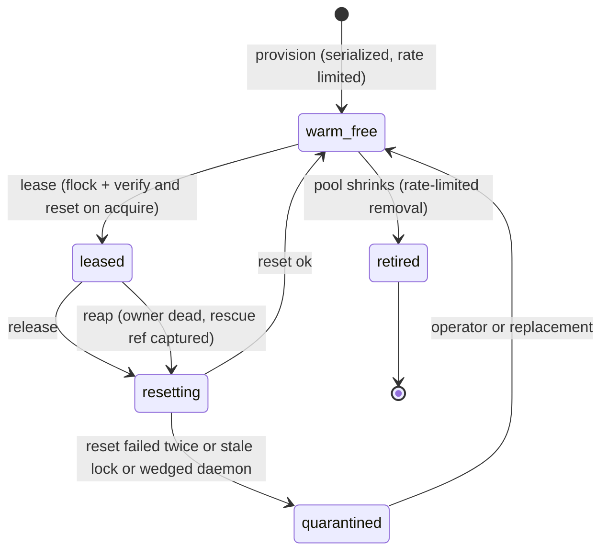

# Build a checkout pool that resets monorepo worktrees in place, staged behind a real-monorepo measurement

**Status**: Proposed (agent-proposed decision requested by the operator's follow-up to the rate-limited teardown stopgap, awaiting operator review)
**Date**: 2026-11-05
**Deciders**: Phillip Green II (review pending)

## Context

Every ccpool dispatch in `worktree` isolation does one full `git worktree add` and, after the
session, one full removal. On 2026-11-04 two monorepo worktrees were deleted file by file: about
284,000 `unlink` and `rmdir` calls in a 553-second capture, each one a filesystem event for every
listener, which saturated `fseventsd`. The stopgap (a trash rename, then rate-limited batches, with
the worktree's fsmonitor daemon stopped first) landed separately. It spreads the removal burst but
does not remove it, and creation is untouched. This ADR records the follow-up the stopgap deferred:
pool the checkouts (Object Pool with a Lease) so most removals and creations never happen.

Two spikes supply the evidence (scratch reports, 2026-11-04, under the operator's
`~/.cache/cow-spike/cowspike-report.md` and `~/.cache/pool-spike/poolspike-report.md`; neither is in
the repository, so the numbers are restated here).

### Measured: delete cost is method-independent (clone spike, 100,000-file fixture, case-sensitive APFS)

| Operation                          | Events  | fseventsd cpu-s |
| ---------------------------------- | ------- | --------------- |
| `git worktree add -b`              | 111,179 | 8.3             |
| `git worktree remove --force`      | 111,012 | 7.8             |
| `rm -rf` of a clone                | 111,056 | 7.0             |
| `find -delete`                     | 110,853 | 8.4             |
| `mv` to same-volume trash          | 2       | 0.3             |
| later `rm -rf` of the trashed tree | 111,056 | 8.2             |

- Per-file event rate: 111,012 / 100,000 = 1.11 events per file for a removal; 111,179 / 100,000 =
  1.11 for a create.
- No delete method emits fewer events. A rename only moves the burst.
- fseventsd CPU per event, 50,000-file run on a quieter host: 1.85 to 1.91 cpu-s / about 55,000
  events = 34 to 35 us with no listener (the report rounds to 33), and 2.56 to 2.70 cpu-s / about
  55,000 = 47 to 49 us with one listener. Scaled to 284,000 events: 284,000 x 33 us = 9.4 cpu-s and
  284,000 x 48 us = 13.6 cpu-s.
- Per-file `cp -c -R` clones emit 312,397 events per 100,000 files (3.1 per file), worse than a
  worktree. Only a single `clonefile(2)` of a whole directory emits 3 events, and a clone still
  pays the full removal burst later.

### Measured: reset in place against create plus remove (pool spike, 10,001-file fixture, fsmonitor on)

Medians of three repetitions on a host at load average 76 to 208, so absolute times are inflated and
noisy; the ratios are indicative only.

| Operation                                  | Median (s) |
| ------------------------------------------ | ---------- |
| `worktree add -b`                          | 2.35       |
| first `status` after create                | 0.84       |
| `worktree remove --force` plus `branch -D` | 1.30       |
| reset: `checkout -f -B` plus `clean -fdx`  | 0.55       |
| first `status` after reset                 | 0.06       |

- Today's lifecycle: 2.35 + 0.84 + 1.30 = 4.49 s. Pooled lease: 0.55 + 0.06 = 0.61 s. Ratio
  4.49 / 0.61 = 7.4 (fsmonitor off: (2.13 + 0.33 + 2.75) / (0.47 + 0.18) = 5.21 / 0.65 = 8.0).
- Inode operations per lease at this scale: create plus remove = 2 x 10,001 = 20,002. A reset touches
  the dirty set only: 500 rewritten + 700 unlinked + 1,200 files of branch delta = about 2,400.
  20,002 / 2,400 = 8.3 times fewer.
- The fsmonitor daemon survived every reset (next status 0.06 s), so a slot keeps its daemon warm;
  the 0.84 s first-status cost is paid once per slot, not once per lease.

### Extrapolation to the monorepo (labelled as an extrapolation, not a measurement)

The monorepo has about 215,000 files. Linear scaling from the figures above:

- Events per bead today: 215,000 files x 1.11 x 2 (create plus remove) = 477,300. fseventsd CPU:
  477,300 x 33 us = 15.8 cpu-s to 477,300 x 48 us = 22.9 cpu-s per bead, almost all in two bursts.
- Events per pooled lease: the dirty set and branch delta do not grow with repo size, so about
  2,400 x 1.11 = 2,664 events and 2,664 x 48 us = 0.13 cpu-s. Ratio 477,300 / 2,664 = 179. If the
  lease base is far from the slot's current commit the branch delta grows and the ratio shrinks.
- Time: create plus first status plus remove scales to about 97 s (the spike's own linear figure), a
  lower bound because the monorepo has larger files and a post-checkout hook.

### What the evidence does not show

- Nothing was measured on the real monorepo. The 10,001-file run was under heavy host load, n = 3.
  The 50,000-file attempt was abandoned because create took 122 s then 1,012 s on a contended host.
- The post-checkout hook cost per reset (about 2 minutes per `checkout -B` in the old figure, never
  re-timed since the devbox step was removed) and which ignored files must survive a reset are unknown.
- The event win rests on events being proportional to touched paths, which the clone spike measured
  for deletes and creates, and which the pool spike inferred (by operation count, not by an
  FSEvents counter) for resets.

## Decision

1. **D1: Build the checkout pool.** A pool of long-lived linked-worktree slots, leased to a dispatch
   and reset in place on release, replaces create plus remove as the default for monorepo
   `worktree` isolation. The reasoning is structural, not only numeric: with a pool, event volume
   follows the dirty set instead of the repository size (about 179 times fewer events per bead at the
   monorepo's size, by the extrapolation above), and the 7.4-fold wall-clock saving is measured.
2. **D2: Stage it behind a real-monorepo measurement.** The first work item measures create, reset
   and remove on the real monorepo (fsmonitor on, with and without the hook, off-peak, `fseventsd`
   CPU captured). Its results decide the pool size, the keep list of ignored files, and whether the
   hook runs on reset. The build proceeds past that item only if reset on the monorepo is cheaper
   than create plus remove on the same host by a clear margin (the decision threshold is 3 times on
   wall-clock and 10 times on events; the spike's 7.4 and 179 leave room for the gap to narrow).
   If it fails the threshold, this ADR MUST be superseded rather than ignored.
3. **D3: Keep the stopgap.** The rate-limited, listener-aware removal stays as an independent
   safeguard: it protects slot replacement, quarantine reaping, the shrink path and every unpooled
   caller (drain workers, interactive tools).
4. **D4: Do not build the copy-on-write clone store now, but keep the seam.** A `Provisioner`
   interface (Strategy) decouples slots from linked worktrees so a `clonefile` store can be added
   later. Reasons to defer: a per-file `cp` clone emits 3.1 events per file against 1.11 for a
   worktree; a directory `clonefile` emits 3 events but each clone is a full independent `.git`
   whose first `git status` re-hashes every file (19.8 s against 0.93 s warm at 100,000 files unless
   `core.checkStat=minimal` and `core.trustctime=false` are set), and it still pays the whole removal
   burst when it is eventually deleted. The pool already avoids the removal; a clone only speeds
   slot creation, which the pool does once per slot.
5. **D5: Invariants carried into the design.** The pool keeps every existing teardown guard, with
   "remove" replaced by "reset": purge deferred until the lease is released or the slot is
   quarantined, orphan reconcile, the worktree-keyed sweep guards, husk and stale `index.lock`
   handling, and the free-space floor. Additional rules the build MUST honour: a slot is leased to
   one owner by an exclusive per-slot flock (the kernel frees it when the owner dies); the slot is
   verified and reset on acquire as well as on release; dirty state of a dead owner is captured to a
   rescue ref before a reset, and a slot is quarantined, never deleted, when that fails;
   `core.fsmonitor` stays on (operator ruling, 2026-10-05); an exhausted pool declines with
   `busy`/`pool-exhausted` and never falls back to an unpooled worktree; slots are `git worktree
lock`ed and excluded from the sweep and audit tools; anything keyed by working directory also
   keys by lease id.

## Decomposed plan

Work items, in dependency order. Sizes are S/M/L only.

| #   | Item                                                                                                                                                          | Size | Depends on |
| --- | ------------------------------------------------------------------------------------------------------------------------------------------------------------- | ---- | ---------- |
| 1   | Measure create, reset and remove on the real monorepo (D2 gate); decide size, keep list, hook policy                                                          | M    | none       |
| 2   | Behavior doc for the checkout pool: stories, invariants, lease API, failure modes; settle the open questions below                                            | M    | 1          |
| 3   | Slot store, lease flock and state records (library, fake-clock tests, no git yet)                                                                             | M    | 2          |
| 4   | Worktree `Provisioner` and the reset sequence (bounded hermetic git, stale-lock and wedge handling, real git fixture tests)                                   | L    | 3          |
| 5   | Lease, renew, release and reap CLI, including rescue-ref capture                                                                                              | M    | 4          |
| 6   | ccpool handler `pool` isolation type: two-phase teardown through release, orphan and sweep integration, `pool-exhausted` decline, lease id in the environment | L    | 5          |
| 7   | Teach the worktree-keyed sweep and the audit and disk-reclaim tools that locked pool slots are not abandoned                                                  | S    | 6          |
| 8   | Metrics, dashboard and alert rules (leaked slots, quarantined slots, exhaustion, reset latency, daemons against slots)                                        | M    | 6          |
| 9   | Cold start and throttled prewarm honouring the free-space floor                                                                                               | S    | 6          |
| 10  | Recorder and transcript attribution keyed by lease id as well as path                                                                                         | M    | 6          |
| 11  | Optional: copy-on-write `Provisioner` spike, compared against item 1's numbers                                                                                | M    | 4, 1       |

Open questions for the operator, to settle in item 2: is the lease keyed by session id or bead id
(concurrent roles on one bead need distinct slots, today they share one directory); which ignored
files survive a reset (`.flox`, `.envrc.local`); whether the post-checkout hook may be skipped on
reset; and whether interactive tools may lease or only automated roles.

## Consequences

- Steady-state dispatch creates and removes nothing; fseventsd load follows the dirty set. Disk
  becomes a bounded, steady cost: at the code's measured about 12 GiB per checkout, a 6-slot pool is
  6 x 12 = 72 GiB, instead of unbounded transient growth.
- The pool becomes admission control: pool size SHOULD be at least the session cap or sessions wait
  for slots.
- Fsmonitor daemons are bounded at one per slot, ending orphan accumulation.
- New correctness surface: lease and reset errors, path-keyed assumptions (transcripts, process-cwd
  guards), and slot hygiene. Mitigated by reset-on-acquire, quarantine instead of delete, and the
  attribution item.
- The numbers above for the pool come from a loaded host, a 10,001-file fixture and n = 3. They
  justify starting, not sizing; item 1 replaces them.
- Rejected: status quo plus the stopgap alone. It still creates 215,000 x 1.11 = about 239,000 events
  per bead and keeps a deferred-delete queue as a new leak surface.
- Rejected for now: per-task copy-on-write clones as the checkout mechanism (D4).
