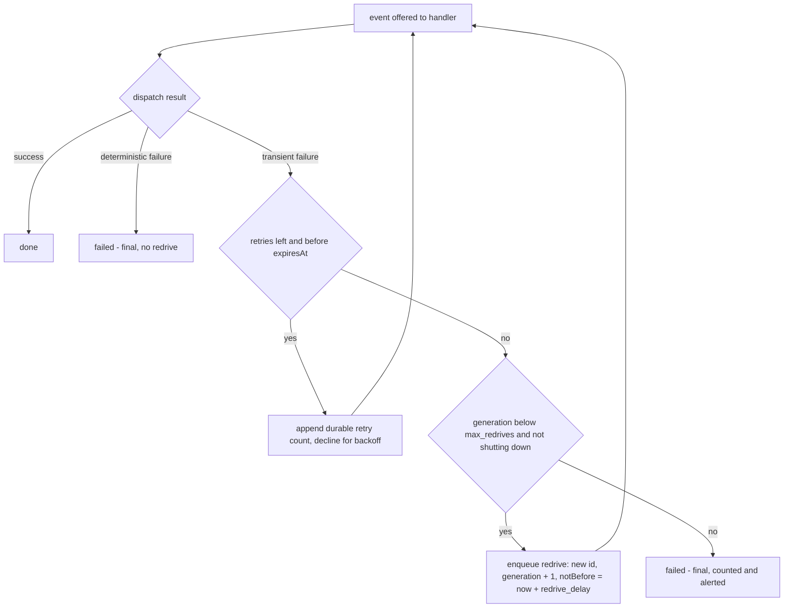

# pg-router persists the retry count and redrives a transiently failed event a bounded number of times

**Status**: Proposed (agent-proposed design, pending operator ratification; the operator MAY overturn it before any code is written; amends `DEC-EVENT-1` and `DEC-RETRY-2` in `packages/pg-router/docs/decisions`)
**Date**: 2026-11-05
**Deciders**: Phillip Green II (review pending)

## Context

A pull source that emits one event per entity change (the `pr.changed` lane is the example) hands
the event to a command role. The role MAY opt in to a bounded re-run of a transiently failed
dispatch (`DEC-RETRY-2`: `max_dispatch_retries`, hard cap 3, never past `expiresAt`). Two gaps
remain after the retry window was widened from 10 minutes to 6 hours on 2026-10-29.

**Gap 1: the retry count is in memory.** `retryLedger` (`internal/orchestrator/retry.go`) counts
re-runs per event id in a map. `DEC-EVENT-1` keeps "no attempt history" on disk, so a restart
starts every count over, still bounded by `expiresAt`. A restart is not rare for the failures the
retry exists for: the `killed` class is a dispatch killed under host overload, and the daemon is
itself a candidate victim of the same overload. A poisoned event that kills the daemon is re-run
from zero after every restart until `expiresAt`, which at 6 hours is a long time to keep killing a
host.

**Gap 2: an exhausted event gets no later chance.** An event whose retries are spent, or whose
window closed while the failure was still transient, ends `failed` and is dropped. The source
(`pg-router-source-pg-connector changes <type>`) emits one event per change row and advances the
connector's consumer cursor when it reads, so nothing re-emits the lost event's own signal (for
example a draft toggle) until the entity changes again. An operator investigation on 2026-10-30
measured the effect over the 10-minute window: of 210 changes that hit a transient exit, 50 later
succeeded, 4 ended after two or three warnings and 156 had one warning and nothing after
(50 + 4 + 156 = 210). The 6-hour window closes most of that, but not the case where the backend
stays unavailable for longer than the window. The existing alert (a `pr.changed` failed-dispatch
count of 3 or more in an hour) tells a person; it recovers nothing.

### Facts this decision rests on

- The queue is durable and ordered, delivers at-least-once, and replays its log on start
  (`DEC-EVENT-2`). It is the one place that already survives a restart.
- Expiry is an absolute instant, and the attempt-time check is stateless (`DEC-EVENT-1`). The
  reason it gave for keeping no attempt history was that a per-handler counter "would have had to
  persist across restarts to mean anything, which is durable state bought for no behavioral gain".
  Gap 1 is the behavioral gain it did not find.
- `DEC-EVENT-5` rejected a durable record per offer: the 2026-10-13 decline storm made 302 offers in
  65.55 minutes (3,933 s), one per 13.0 s on one lane. A retry is scheduled far more rarely than an
  offer, and only for a transient class, so a record per scheduled retry is a different cost class.
- The queue has no "not before" gate: `at` stamps the source, and `expiresAt` is only an upper bound.
- A handler is already required to be idempotent (`INV-EVT-2`), and the retry opt-in already
  forbids a role whose handler is unsafe to run twice.

## Decision

1. **D1: Persist the retry count, written only when a retry is scheduled.** When
   `shouldRetry` takes a retry for an `(event, handler)`, the core MUST append one durable record
   carrying the new count (Write-Ahead Log entry in the existing queue log, replayed with the
   event). On start the ledger MUST be rebuilt from replay, so a restart no longer resets the count.
   The core MUST NOT write a record for a decline, a busy offer, or a first attempt, and MUST NOT
   persist anything for a deterministic failure. The record is dropped with the event on eviction
   or compaction, so the ledger holds only events still waiting on a retry (the in-memory bound it
   has today). The stateless expiry check is unchanged. The count is bounded by the role's
   `max_dispatch_retries`, itself capped at 3 by validation.
2. **D2: The router redrives, not the source.** When an event of an opted-in role ends `failed`
   because its retries are spent or its window closed on a **transient class**
   (`killed`, `deadline`, `unavailable`), the core MAY enqueue one **redrive**: a fresh copy of the
   same event (Dead Letter Channel with a bounded Redelivery, owned by the component that already
   owns the retry clock). The source cannot do it: it neither sees the dispatch outcome nor holds
   a cursor it could rewind without replaying unrelated changes.
3. **D3: A redrive is opt-in, delayed, new-windowed, and generation-bounded.**
   - A role carries `max_redrives` (0 = off, the default, so every existing role is unchanged),
     hard-capped at 2 by configuration validation, and a `redrive_delay` (default 1 hour).
   - The redrive carries a generation number (original = 0), written on the event itself, so it is
     durable with no second ledger. The core MUST NOT redrive an event whose generation equals
     `max_redrives`.
   - The redrive has a new id (the original id plus a generation suffix, so de-duplication does not
     absorb it), a new `expiresAt` of its `notBefore` plus the source's window, and a fresh retry
     count of 0.
   - The core MUST add an optional absolute `notBefore` instant to the event, and the queue MUST
     treat an event as not eligible for any offer before it (same absolute-instant style as
     `DEC-EVENT-1`; no duration, no clock origin). Without it a redrive would land inside the same
     outage that exhausted the original.
   - A **deterministic** failure, a shutdown hand-back and a successful dispatch MUST NEVER be
     redriven. A redrive MUST NOT be enqueued while the run is shutting down.
   - The core SHOULD skip a redrive when a later event for the same entity (the id part before the
     `@` suffix) has already been accepted, since the handler works from current state and the
     redrive would be a no-op dispatch.
4. **D4: The safe bound.** The attempts for one original event are bounded by
   `(1 + max_redrives) x (1 + max_dispatch_retries)`, which with the hard caps is
   (1 + 2) x (1 + 3) = 12 attempts, and by the wall-clock bound
   `(1 + max_redrives) x window + max_redrives x redrive_delay`, which with a 6 hour window, two
   redrives and a 1 hour delay is 3 x 6 + 2 x 1 = 20 hours. The shipped pr-change role
   (`max_dispatch_retries` 2) with one redrive is (1 + 1) x (1 + 2) = 6 attempts over
   2 x 6 + 1 = 13 hours. Neither bound depends on process lifetime, because every counter in it is
   durable (D1, D3). A poisoned event therefore cannot loop: a deterministic failure stops at once,
   a transient one stops at the generation cap, and a restart cannot extend either.
5. **D5: It stays observable.** A redrive increments
   `pg_router_dispatch_redrives{role,class}` (exported with the usual `_total` suffix) and is logged
   in the event log with its generation. The terminal failure of the **last** generation is the one
   that counts toward `pg_router_dispatch_failed_total` and the existing failed-dispatch alerts, so
   a recovered redrive is one event, not two pages (the same rule `DEC-RETRY-2` applies to a recovered
   retry). A redrive record that cannot be written is logged and counted as a normal terminal failure.
6. **D6: `retryWindow` is not raised.** The window the source stamps (6 hours in the shipping
   deployment) is unchanged by this decision; the redrive is how an outage longer than one window
   is covered, with a bound stated in D4.

### The amendment to `DEC-EVENT-1`

`DEC-EVENT-1` keeps its decision (expiry is an absolute instant; the attempt-time check is
stateless) and its consequence that the default event is born expired. This ADR amends one
sentence of its reasoning and one of `DEC-RETRY-2`'s bullets, recorded as proposed notes in both
entries until ratified:

- "No attempt history" narrows to: the core keeps **no per-offer or per-decline history**. It
  persists exactly two bounded values, the retry count written when a retry is scheduled and the
  redrive generation carried by the event.
- `DEC-RETRY-2`'s "the count is in memory only ... a restart starts it over" is replaced by the
  durable count of D1.

## Alternatives considered

- **Persist nothing, only redrive.** Rejected: leaves a restart-loop of poisoned events running to
  `expiresAt`, and makes the redrive generation the only durable bound.
- **Persist every attempt** (the memento `DEC-EVENT-5` rejected). Rejected for the same reason it
  was there: one fsynced write per offer. D1 writes only when a retry is scheduled.
- **Source-side re-emit** (the connector or source keeps a not-yet-acknowledged set and re-emits
  after the window). Rejected: the source does not observe dispatch outcomes, and acknowledging
  them would add a back channel from the router to every source. The router already owns the
  retry clock, and ADR 0077's ruling that pg-router owns every clock points the same way.
- **Rewind the consumer cursor** on a failure. Rejected: it replays unrelated changes and breaks
  the one-event-per-change contract.
- **Raise the window further.** Out of scope by the operator's ruling, and it only moves the loss
  point while holding the per-handler FIFO head longer (`DEC-EVENT-2`).
- **Redrive indefinitely until success.** Rejected: unbounded, and a poisoned event would
  never leave. The generation cap is the point.
- **Alert only** (status quo). Rejected as the whole answer: it informs but recovers nothing; it
  stays as the backstop when the last generation fails.

## Consequences

- Queue log gains two record kinds: a retry-count record and a redrive enqueue (the latter is an
  ordinary event with a generation and `notBefore`). The event schema gains `notBefore` and
  `generation`, both optional, so an older producer and every existing deployment are unchanged.
- Replay, compaction and eviction MUST handle the retry-count record, and a count whose event is
  gone MUST be dropped.
- Role configuration gains `max_redrives` and `redrive_delay`; defaults keep every role as it is.
- A redrive of a lane that is rate-limited adds at most one extra serialized dispatch per failed
  event per generation, spaced by `redrive_delay`, so it cannot amplify a host-overload storm
  faster than the existing retry spacing.
- The decision is reversible: with `max_redrives` at 0 the behavior is today's, plus the durable
  count, which only ever lowers the number of attempts.

## Operator ratification

Pending. Until ratified no code changes, and the two decision entries carry only a pointer to this
record.
