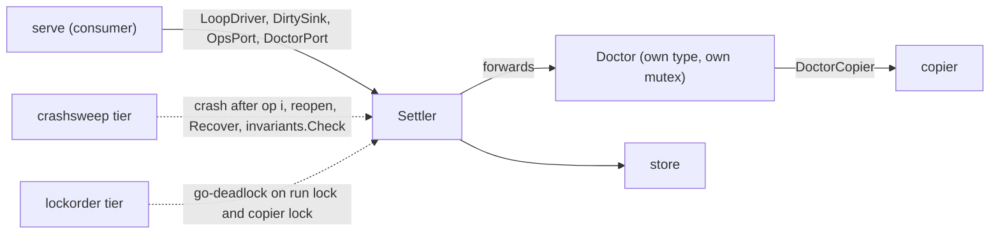

# pg-claude-code-recorder: the settle stage is split into components behind consumer-side interfaces and proven by crash injection

**Status**: Accepted (operator-approved plan, 2026-11-10: `docs/superpowers/plans/2026-11-10-settle-split.md`)
**Date**: 2026-11-11
**Deciders**: Phillip Green II

## Context

The `internal/settle` package of `pg-claude-code-recorder` grew into one `Settler` type that owned
settling, removal, extraction, the doctor, the schedule and the gauges. Three problems followed:

- The daemon (`internal/serve`) depended on the whole concrete `Settler`, so a test of the daemon could
  only fake a tick by substituting function values.
- A data race came from one job (the doctor) reading another job's per-tick cache. Nothing in the
  structure made that dependency visible.
- The crash-safety claim (a crash at any point loses nothing) was tested at 15 hand-placed fault points
  (`faults.At`), not at every file-system operation, and lock order (run lock, then copier lock) was a
  comment, not a check.

## Decision

1. **Components behind consumer-side interfaces.** Each job that has its own state and lifecycle MUST be
   its own type with narrow, explicit dependencies. A consumer MUST declare the interface it needs, in
   the consumer's package, and MUST NOT import a producer's concrete type for that purpose.
   `internal/serve` declares `LoopDriver`, `DirtySink`, `OpsPort` and `DoctorPort`; `*Settler` satisfies
   them implicitly. The `Doctor` is its own type with its own mutex, constructed from `DoctorDeps` and a
   `DoctorCopier` interface, and it MUST NOT take the run lock. Decision logic that needs no state (the
   schedule, the removal rate limit, the check and stage-gate predicates, the work-set composition) SHOULD
   be a pure function with its own unit tests. Further extraction (a remover, a scheduler, a reporter)
   MUST be justified by measured cost or remaining pain, not done by default.
2. **Fakes are held to the real store's contract.** A fake store (or any fake of a component with
   persistent semantics) MUST pass a contract suite that is also run against the real store. A test
   MUST NOT rely on a fake whose behaviour the real implementation has not been shown to share. No such
   fake exists yet; this rule applies to the first one that is added.
3. **Behavior-preserving moves.** A move MUST be mechanical, and a test edit that a move forces MUST be a
   separate commit from the move. The invariants the plan lists (write order in byte and clone mode,
   `Recover` under the run lock, removal order, the six `Hooks` and the 15 `faults.At` points) MUST be
   preserved.
4. **Proof tiers beyond the unit tier.** Each tier below MUST NOT run in the unit gate (it sits behind a
   build tag and its own nix check, `phillipg-nix-repo-base` ADR 0024):

   | Tier            | Build tag    | What it proves                                                                                                                                                                                                                                                                                                                          | Nix check                                  |
   | --------------- | ------------ | --------------------------------------------------------------------------------------------------------------------------------------------------------------------------------------------------------------------------------------------------------------------------------------------------------------------------------------- | ------------------------------------------ |
   | Crash injection | `crashsweep` | Each scenario (settle in clone and byte mode, removal, extract, doctor repair) is run once under `fsx.Recorder` to count its N file-system operations. For each i in 1 to N the run stops after operation i, a second variant also drops unsynced writes, then the store is reopened, `Recover` runs, and `invariants.Check` MUST pass. | `pg-claude-code-recorder-crashsweep-tests` |
   | Model-based     | `crashsweep` | A `pgregory.net/rapid` state machine over tick, wake, remove, extract, doctor, dirty, crash and reopen checks `invariants.Check` after each step and shrinks a failure.                                                                                                                                                                 | `pg-claude-code-recorder-crashsweep-tests` |
   | Lock order      | `lockorder`  | `go-deadlock` wraps the run lock and the copier lock in test builds only, and fails on an inversion of "run lock, then copier lock" and on `Dirty` or `LiveChanged` taking the run lock.                                                                                                                                                | `pg-claude-code-recorder-lockorder-tests`  |

   A change that adds a file-system operation to a settle scenario SHOULD be covered by the crash sweep
   without a new fault point, because the sweep covers every operation. The `faults.At` points stay for
   targeted tests.

## Consequences

- The daemon's tests depend on four small interfaces, and the doctor can be constructed in a test from
  narrow dependencies.
- The crash-safety claim is checked at every file-system operation of each scenario, not only at the
  named points; the new tiers cost build tags and two on-demand nix checks, and add the third-party
  modules `pgregory.net/rapid` and `github.com/sasha-s/go-deadlock` (test builds only).
- The unit tier is not shown to be slower: the settle package took 47.47 s after the split against an
  18.62 s baseline from before it, but the two runs were measured under host-load noise (the later one
  at about 2.4 times the load), so no regression is shown and none is ruled out. A re-measure on a quiet
  host MUST be the check before the claim is relied on (see the verification record in the plan).
- A future fake store carries the cost of a contract suite, which is the price of trusting the fake.
