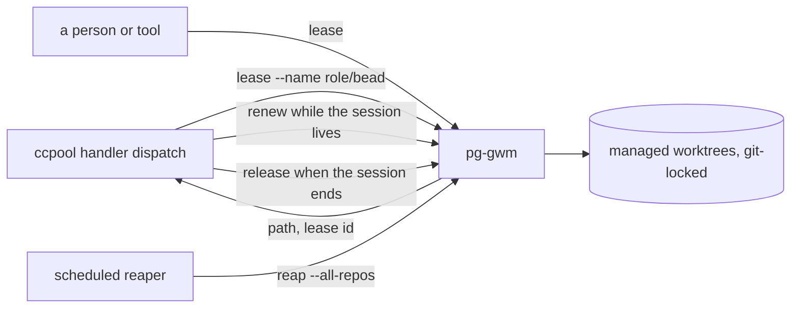

# pg-gwm owns managed worktrees and replaces pg-checkout-pool; the ccpool handler stops creating and sweeping its own

**Status**: Proposed (design ruled by the operator 2026-11-14; one open question in the behavior set remains; amends 0084 and 0117)
**Date**: 2026-11-14
**Deciders**: Phillip Green II

## Context

The `pg-router-handler-ccpool` handler creates a per-bead worktree at `<worktree dir>/<bead>` for every
role with worktree isolation. The directory is shared by the handler as a whole, while each role has its
own session pool. Cleanup is spread over the dispatch's own teardown, the closed-bead reconcile, the
orphan reconcile and the janitor's worktree-keyed sweep (0084, 0117). None of them owns the worktree: the
sweep sees only its own role's pool, so after a session of another pool was reclaimed from under a live
process (October 2026), a live-process probe (`lsof -d cwd`) was added and later shared by four removal
paths. An operator trace on 2026-11-04 counted 443 `lsof` launches in 92.45 minutes from the handler
(443 / 92.45 = 4.8 a minute), in bursts of up to 68 a minute.

The operator ruled on 2026-11-13 that a pool that does not own a worktree should not clean it up:
either the pool owns its worktrees, or a separate abstraction owns them and is responsible for cleanup.

A worktree pool already existed: `pg-checkout-pool` (epic for the large monorepo's checkout cost),
built with leases, slots reset in place, rescue refs and a copy-on-write provisioner seam, but used by
no role. Its lease was keyed on the owner's session id, it excluded people, and it was tied to agent
sessions.

## Decision

1. **A generic worktree manager, `pg-gwm` (pg-git-worktree-manager), replaces `pg-checkout-pool`** by
   rename and reshape, not as a second package. Its contract is the behavior set
   `docs/behavior/pg-gwm/`. A requester (person, tool or agent) leases a worktree of the repository at
   its current directory or `--repo`, and is told the path; it never chooses one. A lease has an
   owner, a name unique among valid and expired leases, metadata and an optional expiry (none by
   default). Renew (by lease id or name), release (refused while dirty), `expire`, `info`, `list`, `preserved` and `reap` make
   up the rest. Text output in a terminal, JSON otherwise.
2. **The manager is the only thing that removes a managed worktree.** Liveness is the lease's expiry
   alone; the manager runs no process probe. A reclaim under a live process means the requester failed
   to renew (operator ruling, 2026-11-14).
3. **Per-repository policy**: `min`, `max`, `reuse-reclaimed-worktrees`, `clean-reused-worktree`,
   name templates fed by a slot index, a keep list and a hook policy. A fixed pool of four is reuse on
   with `min = max = 4`.
4. **Dirty work is never lost**: before any reclaim, a dirty worktree's changes (untracked included) are
   committed to `pg-gwm/dirty-reaped-<timestamp>-<branch>-<name or lease id>`.
5. **Managed worktrees carry a git worktree lock** whose reason starts with `pg-gwm`, which stops
   `git worktree remove` and `prune` and tells every other tool to leave them alone.
6. **A scheduled reaper** runs `pg-gwm reap --all-repos`; a lease reclaims at most one candidate when it
   needs one and never runs a full reap.
7. **The ccpool handler becomes a requester.** Every role with worktree isolation runs
   `pg-gwm lease --name <role>/<bead> --or-renew --ttl <T> <branch arguments>` with the session and role
   in the metadata, so a redispatch gets the same worktree back in one step. The name is the place; the
   handler passes the branch explicitly (for example `pg-router/<bead>`, created with `-b` from the
   base it uses today), and a role that only reads another role's branch passes `--detach <branch>`,
   because git lets only one worktree hold a branch. It MUST pass a time to live (never the `none`
   default), renew by lease id alongside its supervision lease (every third of the TTL), and release
   when the session ends. A session that ends with unsaved work is not released: the handler expires
   the lease (`pg-gwm expire`), and the next reap preserves the work on a `pg-gwm/dirty-reaped-…`
   branch. The handler no longer creates
   `<worktree dir>/<bead>` or runs the worktree-keyed sweep, the leftover-directory reclaim or the
   live-process probe. The `checkout-pool` isolation type folds into this.
8. **Rollout**: no role uses `pg-checkout-pool` today, so there is no staged migration; the rename ships
   enabled (operator ruling, 2026-11-14: "just do it. and enable it.").

Design patterns: Lease (time-bounded ownership with renewal), Object Pool (reuse with a minimum and a
maximum), Scheduled Reaper, Single Owner of a resource's lifecycle, Template Method for naming.

## What this supersedes, amends and leaves alone

| Rule                                                                                                          | Effect                                                                                  |
| ------------------------------------------------------------------------------------------------------------- | --------------------------------------------------------------------------------------- |
| 0084, the worktree-keyed sweep and its guards                                                                 | superseded once the handler leases from `pg-gwm`: the handler owns no worktree to sweep |
| 0117, the janitor's per-role worktree sweep                                                                   | superseded the same way; the janitor's session passes are unchanged                     |
| `pg-router-handlers` `INV-CCH-15` and `INV-CCH-19`, and the worktree clauses of `INV-CCH-14` and `INV-CCH-18` | to be rewritten in the change that moves the handler: removal becomes a release         |
| `pg-checkout-pool` behavior set (`INV-POOL-*`)                                                                | replaced by `docs/behavior/pg-gwm/`; the superseded rulings are listed in its README    |
| The handler's `bead-worktree` and `path` isolation types                                                      | unchanged (they create and remove nothing)                                              |

## Consequences

- One owner per worktree; no cross-pool visibility is needed and the `lsof` launches end with the probe.
- People and tools other than the router get the same managed worktrees and the same cleanup.
- A requester that stops renewing loses its worktree at the next reap, with its changes preserved on a
  branch. That is the accepted trade for removing the probe.
- The rename touches the metrics names, the alert rules and the exporter's launchd label; they move
  with the package in one change.
- One open question (whether `renew` may remove an expiry) is recorded in the behavior set and blocks
  only its own clause; a cost measurement on the large monorepo sets one default.

## Related

Amends 0084 and 0117. Behavior set: `docs/behavior/pg-gwm/`. The handler's behavior set
(`packages/pg-router-handlers/docs/behavior/`) is edited when the handler moves.
