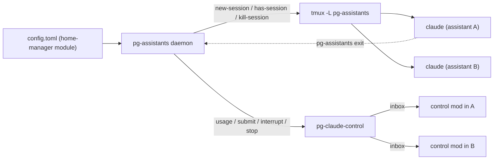

# pg-assistants is a minimal supervisor for permanent Claude Code assistants

**Status**: Accepted (design approved by the operator, Phillip, 2026-11-16, after two review rounds;
the rulings it rests on are quoted where they apply)
**Date**: 2026-11-17
**Deciders**: Phillip Green II

## Context

The operator wants a few "permanent" assistants, each looking after one area on its own. A Claude
Code session cannot run forever: its context fills, and with auto-compact on, the engine summarises
the conversation in ways nobody controls. What is wanted instead is a chain of ordinary interactive
sessions in one working directory: each session works, keeps its own notes in that directory and
exits before its context fills, and the next session picks up from the notes. The identity and
duties of an assistant live in that directory's `AGENTS.md` / `CLAUDE.md`, not in any tool.

Nothing found on 2026-11-16 does the whole job:

- ccmux keeps tmux sessions alive with a heal loop, but resumes one conversation instead of
  recycling sessions, and is a foreign runtime (TypeScript and Bun) with the whole ladder still to
  write.
- Claude Code's own background supervisor (`claude --bg`, `claude respawn`) restarts a crashed
  session but has no config, no tmux and no context recycling, and stops a session that is idle
  for about an hour, which works against a permanent assistant.
- ccpool (this repo) runs pools of worker sessions for dispatched work. Its model (a lease per
  piece of work, a pool, a handler) does not fit an assistant that is never dispatched, and taking
  it as a dependency would couple the two tools' release cycles.

## Decision

1. **A separate minimal daemon.** `packages/pg-assistants` is a small Go program with two parts: a
   config listing the assistants, rendered by `home/programs/pg-assistants`, and a daemon that
   keeps each enabled assistant running and makes each session stop before it uses too much
   context. It MUST NOT grow into an orchestrator: no work queue, no task routing, no LLM calls,
   and no knowledge of what an assistant does. Messaging, permissions, MCP configuration,
   self-update and per-assistant quota are out of scope.
2. **ccpool is not a dependency; two of its pieces move to `x`.** Operator ruling, 2026-11-16: the
   tmux client becomes `x/tmux` and the folder-trust writer `x/claudetrust`, so pg-assistants does
   not make a second copy. Moving ccpool onto them is a separate follow-up.
3. **One session per assistant, on a dedicated tmux server.** Each assistant runs in the session
   named by its `id` on `tmux -L pg-assistants`, with the daemon's own `tmux.conf` (only
   `remain-on-exit on`, so a dead pane keeps its exit status and output until the daemon has read
   it). Targets are exact (`=<id>`). The operator attaches with `pg-assistants attach <id>`.
4. **The daemon never types into a pane.** Every action on a session goes through
   `pg-claude-control` (`usage`, `submit`, `interrupt --reply`, `stop`), whose control mod is
   default-enabled through the marketplace; tmux is used only to start, observe and, as the last
   resort, kill a session.
5. **A session is recycled through a ladder.** Each session has one ladder of three rungs (nudge,
   interrupt, kill); a rung fires once, even when its action fails, and the ladder only moves up.
   The meter ladder's target is the highest rung any meter reaches: the context fill
   (`tokens / limit`, with the assistant's points) and the account's 5-hour and 7-day blocks (with
   `[blocks]`' points). `grace.interrupt` after a nudge and `grace.kill` after an interrupt move it
   up anyway, because a meter may stop growing. An assistant with `enabled = false`, and a session
   no valid config entry supervises (an orphan), runs the disabled ladder: a nudge on the first
   tick, then the same two time steps. The priority is an exit request, then disabled or orphan,
   then the meters; a change of ladder keeps the rung and its clock. A session that was never
   nudged is left alone while it is idle.
6. **Each assistant has its own reconcile pass, at its own `tick`.** Not running and enabled: start
   it, unless a block is at or above its nudge point and has not reset, or the assistant is in
   crash backoff; a missing `cwd` stops the start and is retried every tick without growing the
   backoff. After a requested exit the next session starts on the next tick (operator ruling,
   2026-11-16, verbatim: "restart on next tick. if a particular agent can't handle on its own to
   poll or wait, then the config for it could use a different timer interval"). A session that ends
   within `restart.min_uptime` without having asked to exit doubles the backoff. A start whose
   control mod has not answered `usage` within `restart.start_timeout` is killed and counts as a
   crash. A session found alive at the daemon's first tick is adopted and its ladder starts over.
7. **An assistant asks to stop with `pg-assistants exit`.** A session cannot type `/exit` into
   itself, so it runs `pg-assistants exit` from its Bash tool; the command writes an exit request
   in the state directory, pre-allowed by an exact `--allowed-tools` rule, and the daemon then runs
   a graceful `pg-claude-control stop --escalate`. The request survives a daemon restart.
8. **Assistants are isolated from each other.** There is one goroutine per assistant and one per
   orphan, and each makes every tmux and `pg-claude-control` call for its own session. Shared state
   (the block readings and the status board) is mutex-guarded memory, and no lock is held across
   I/O, with one stated exception: writes to `.claude.json` are serialised, because its
   read-merge-rename takes no lock. Every external call has its own deadline, derived from the tick
   context: tmux 10 s; `usage`, `submit`, `interrupt` and `stop --signal` 15 s; a graceful stop
   `grace.kill` plus 15 s. One tick is bounded by its `tick` plus `grace.kill` plus 30 s. A panic in
   one loop is recovered, logged and the loop restarted after the crash backoff. Cancellation runs
   only through the context from `x/lifecycle`, whose named loops (`assistant:<id>`,
   `orphan:<name>`) make a shutdown overrun name what hung.
9. **Sessions run with the operator's own environment.** Operator ruling, 2026-11-16, verbatim:
   "the agents should start up using the same bash PATH as i would have, no additional
   restrictions". claude starts through the operator's login shell as an interactive login shell
   (`<shell> -l -i -c 'exec "$@"'`), and the daemon itself runs through it as a login shell
   (`-l`), so both see the same `PATH` and every `home.sessionVariables` entry. The environment is
   not filtered. The tmux server keeps the environment of the daemon that started it, including
   the run-once guards its login shell exported, so every session starts with those guards (and
   the daemon's own variables) set empty, listed in the config's `blank_env`: its login shell then
   runs the startup files again instead of inheriting what the server froze at its start. A change
   of the session variables restarts the daemon. Auto-compact is turned off for the session only
   (`DISABLE_AUTO_COMPACT=1`), and Claude's child-session markers are blanked.
10. **A daemon restart does not kill the assistants.** The launchd agent sets
    `AbandonProcessGroup`, the daemon leaves its sessions running on shutdown, and the next daemon
    adopts them. A hash of the rendered config rides in the agent's environment, so a config change
    restarts the daemon and nothing else.
11. **The config is checked strictly at build time and per assistant at run time.**
    `pg-assistants config check`, run on the rendered file during the build, fails on any problem.
    The daemon starts no assistant that breaks a rule and runs the rest; a bad global field falls
    back to its default and is reported. Only an unreadable file or a bad `[paths]` entry stops the
    daemon.

## Consequences

- **The chain of sessions is the only continuity.** An assistant carries nothing from one session
  to the next except what it wrote in its directory, so its `AGENTS.md` MUST tell it to keep notes,
  to run `pg-assistants exit` on its own as its last action when nudged or done, and never to wait
  for input (nobody is attached). The package README ships a copy-paste block for it.
- **Auto-compact is off, so `limit * kill` MUST be strictly below the model's context window.** A
  full session fails with "prompt is too long" instead of compacting, so a kill point at or past
  the window could never fire. The window comes from a table of exact model ids in the package with
  no family fallback (which would over-size an unknown model and accept an unreachable kill point),
  so an unknown model needs an explicit `context.window`, and the table needs refreshing when
  models change. At run time a window the engine reports that differs from the configured one is
  logged as `window_mismatch`.
- **"Every exported I/O function takes `ctx` first" means process I/O.** Calls that start a process
  or talk to a server (tmux, `pg-claude-control`, the supervisor's actions) take a context first
  and run under a deadline; local file helpers (`Flush`, `ReadStatus`, `config.Load`, the exit
  request and trust helpers) take none.
- **A slow, broken or misconfigured assistant delays only itself.** A graceful stop blocks its own
  loop for up to `grace.kill` plus 15 s; every other loop keeps ticking.
- **Sessions inherit the operator's login shell.** They see what an interactive terminal sees only
  where home-manager manages that shell's startup files; a startup file that waits for input
  stalls the start, which the start timeout catches. The daemon runs under `-l`, not `-i`, so a
  variable set only in an interactive startup file can differ between the daemon and the sessions;
  `status` shows the daemon's effective `PG_CLAUDE_CONTROL_STATE_DIR` and `CLAUDE_CONFIG_DIR`.
- **Folder trust is written by `pg-assistants trust`.** An untrusted directory stops claude on its
  trust dialog before any hook runs, so the control mod never loads. The module runs
  `pg-assistants trust` for every assistant directory at activation (best effort), and the daemon
  checks before each start and writes it again when it is missing, because Claude's own rewrites of
  `.claude.json` can lose the activation's write. Trust is keyed by the directory with its symlinks
  resolved, as Claude looks it up (on macOS `/tmp` is `/private/tmp`), and two `cwd` values that
  resolve to the same directory count as one directory.
- **`tmux new-session -c` silently falls back to `$HOME` for a missing directory**, which is the
  wrong directory and an untrusted one. The daemon therefore checks `cwd` before every start; a
  `cwd` MUST NOT contain `#` (tmux expands a format there), and no value that reaches tmux as an
  argument may end in `\;`.
- **The control plugin is required.** The module asserts that `pg-claude-control` is enabled and
  that its plugin is not overridden off; without the mod every start stalls.
- **A session stuck on a permission prompt or a question while never nudged is not detected.** It is
  idle and left alone; a nudged one that does not exit is moved up by the time steps.
- **Uninstalling needs one manual step.** `AbandonProcessGroup` keeps the sessions alive by design,
  so turning the module off leaves them running until `tmux -L pg-assistants kill-server`.
- **Linux has no supervisor on day 1**; the module warns and registers nothing.
- **No metrics, dashboard or alert rules on day 1.** The events log (`events.jsonl` in the state
  directory) and `status.json` are the record; wiring them into the observability stack, and a
  per-assistant quota over the recorder, are follow-ups.
