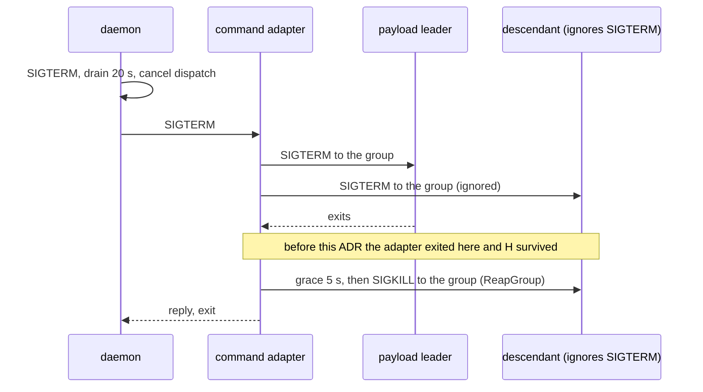

# A command role's payload ends with its daemon; the cancel path reaps the whole payload group

**Status**: Proposed (the decider has not ruled; amends 0085 only if accepted)
**Date**: 2026-11-20
**Deciders**: Phillip Green II

## Context

Operator question (2026-11-19): can children be signaled to stop or restart when their daemon
changes? A long-running repo verification outlived a daemon replacement by about five hours.

ADR 0085 spares only roles that declare `survives_shutdown`, the ccpool session roles. A command
role (the repo verification role is one) is by design cancelled: the daemon waits the drain share
of its shutdown deadline (20.14 s at the default 53 s deadline), cancels the dispatch context, the
core sends SIGTERM to the adapter (`internal/wireclient`), and the command adapter stops the
payload's process group, SIGTERM then SIGKILL after `CancelGrace` (5 s). Handler children share
the daemon's process group and the launchd job sets `AbandonProcessGroup`, so launchd never kills
them: only the router's own cancel path can end them. The launchd restart trigger is the
stable-path indirection of `phillipgreenii-nix-personal` ADR 0049 (the wrapper store path embedded
in the job changes on an apply).

So the question is why the intended cancel left a payload alive.

## Diagnosis

A live capture of the stuck process (ppid, pgid, start time against the daemon start) was not
possible: no such process existed when this was investigated, and the live daemon was not touched.
The diagnosis rests on code and a hermetic real-process test, and the live part stays unproven.

Candidate (1), the daemon hard-exits (`shutdown_overrun`) before the cancel reaches the adapter:
**not supported**. The hard exit closes the parent-death pipe (`PG_ROUTER_PARENT_DEATH_FD`), which
cancels the adapter's context through the same path, so a hard exit and a graceful cancel end in
the same adapter code.

Candidate (3), the per-(role, event) lock on the payload's fd 3 outlives the adapter: **true but
not the cause of survival**. It only makes the new daemon's redelivery decline as busy while a
payload lives (`INV-CMA-11`); it cannot keep a payload alive.

Candidate (2), the payload group got SIGTERM but something in it ignored it or left the group:
**supported, in one concrete form that is a bug in our code.** `procenv.Group` sends SIGTERM to
the group and schedules the escalating SIGKILL with a timer inside the adapter process. The
adapter returns as soon as the group leader exits, which is immediately for a leader that dies on
SIGTERM, and exits with it, so the timer never fires. A descendant in the group that ignores
SIGTERM (or traps it and keeps going) and holds no inherited pipe, so that `cmd.Output` does not
wait for it, is left running. The integration test added with this ADR reproduces exactly that:
a leader that exits on SIGTERM and a descendant started under `trap '' TERM` stayed alive after the
daemon stop (the test failed at 32 s), while a plain sleeping leader ended within the drain
(20.2 s, the existing cancel path works for it).

Still unproven without a live capture: whether the stuck `nix flake check` was this shape (a
helper that ignores SIGTERM after the verification script exits) or a helper that left the group
altogether (`setsid`; Nix runs builders in their own sessions). The second shape is not fixable by
any signal sent to the payload's group, and a wall-clock cap or a process-tree reaper is the only
remedy for it.

## Options

| Option                                                                                                     | What it does                                                                             | Pros                                                                                    | Cons                                                                                                        |
| ---------------------------------------------------------------------------------------------------------- | ---------------------------------------------------------------------------------------- | --------------------------------------------------------------------------------------- | ----------------------------------------------------------------------------------------------------------- |
| (e) Fix the cancel path: reap the whole group before the adapter returns                                   | After the leader is waited, wait for the group, SIGKILL it after the grace, then return  | Small, in the code that already owns the contract; no new mechanism; the test proves it | Does not help a helper that left the group, or a payload that is simply slow when no daemon change happens  |
| (f) A lock-holding child detects a superseded daemon, or the new daemon takes over or kills a stale holder | The lock (or a stamp) lets a payload or the new daemon notice a replacement              | Covers an orphan whose adapter is already gone                                          | The child must cooperate (nix does not); the new daemon killing by pid risks pid reuse; a new mechanism     |
| (c) A per-job wall-clock cap                                                                               | The payload gets a maximum run time, enforced by its runner or the adapter               | Bounds every runaway, including group escapes and hangs unrelated to restarts           | Does not answer "stop on daemon change"; the cap value is a policy choice; owned by the runner's own change |
| (a) A generation stamp file the child can read                                                             | The daemon writes a generation; a child compares its start generation to the current one | Works across a daemon death                                                             | Needs every payload to poll it; an environment variable is weaker (strict base env roles drop it)           |
| (b) A shutdown signal to children                                                                          | The daemon signals payloads at shutdown                                                  | Immediate                                                                               | Duplicates the SIGTERM the cancel already sends and the parent-death pipe; same cooperation problem as (f)  |

## Decision (proposed)

Adopt (e) now and (c) beside it; do not build (f), (a) or (b).

1. **A command role's payload MUST NOT survive its daemon's replacement.** A command role MAY NOT
   declare `survives_shutdown`; ADR 0085 stays as it is for the ccpool session roles, and this ADR
   states the boundary it left implicit: only a role that can be absorbed by redelivery may
   survive, and a command payload cannot be absorbed (its redelivery declines as busy), so it
   would only be an orphan holding a lock.
2. **The adapter's cancel path ends the whole payload group.** After a cancelled payload's leader
   is waited, the adapter waits up to the 5 s grace for the group to vanish, then SIGKILLs the
   group, before it returns and exits (`procenv.ReapGroup`, called from the lock-passing
   `RunEnvFiles`). Implemented with this ADR.
3. **The runner of a long job SHOULD cap it with a wall-clock limit** (option (c), owned by the
   runner's own work item), because a payload that escapes its group, or hangs without any daemon
   change, is outside what the cancel path can reach.
   Implemented in `pg-repo-runner`: `nix flake check` runs under a wall-clock cap
   (`thresholds.check_timeout`, default 3600 s), stored as a red verdict marked `timedOut`.
4. **The log carries a distinct field** when a dispatch is interrupted by the daemon stopping:
   `interrupted_by=daemon_shutdown` on the orchestrator's "dispatch cut short by shutdown" line,
   so an apply that interrupts a dispatch is findable and distinct from a handler failure.

Why not the others: (f), (a) and (b) all need the payload's cooperation or a new cross-process
channel, and the dominant long job here (`nix flake check`) cannot be asked to poll a stamp. The
existing SIGTERM, parent-death pipe and the group reap already cover every case where the adapter
can reach the payload; what they miss is covered by the cap.

## Consequences

- A restart ends every command payload's group within drain plus 5 s, whatever its descendants do
  with SIGTERM. A payload that left its group (`setsid`) is still not reached; the cap in the
  runner is its bound.
- The cut-short event is re-offered by the next daemon, as today.
- Opt-in test: `TestShutdown_PayloadGroupEndsWithinDrainPlusGrace` (`//go:build integration`, in
  `packages/pg-router/cmd/pg-router`, run by `integration-checks.pg-router-integration-tests`; it
  is not a `checks` attribute).
- Post-deploy: after the next daemon replacement with a long command payload running, capture its
  process group and confirm it is gone within the drain plus 5 s; a survivor with a different
  process group id answers the open question above.
