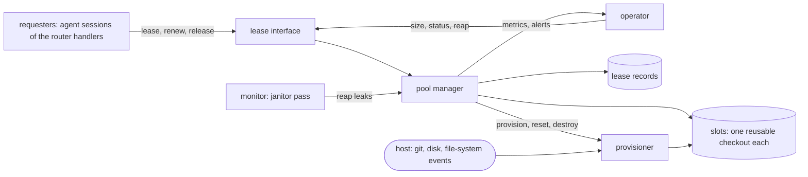

# pg-checkout-pool — behavior docs

The checkout pool hands out reusable, already-warm working checkouts of a repository to the automated
sessions that need one, and takes them back by resetting them in place instead of deleting them. Today
every dispatch creates a full checkout of a very large repository and deletes it afterwards, which
floods the file-system event service with hundreds of thousands of events per dispatch. The pool keeps
a bounded set of slots for the whole of their life, so a lease costs a reset sized by what the session
changed and not by the size of the repository. It is a new package at `packages/pg-checkout-pool` in
this repo and is generic: it MUST contain no organization identifiers, and a deployment supplies
configuration (repositories, keep lists, sizes) only.

This set describes intended behavior only, at product level: actors, stories, journeys and invariants,
with no implementation detail below that floor. A behavior change to the product MUST edit these docs in
the same change. Its source is the pool research report of 2026-11-04 (the proposed design, section
"Proposed design") and the copy-on-write clone measurements of the same date; they are cited as "Pool
report" and "Clone report". The invariants keep the numbering the Pool report gave them (`INV-POOL-1` to
`INV-POOL-19`); the two operator rulings that added invariants take the next numbers (`INV-POOL-20`, `INV-POOL-21`,
`INV-POOL-22`).

## Place in the product

A requester only ever asks the pool for a checkout at a commit and gives it back. The pool manager owns
every slot, every lease and every reset. The provisioner is the one place that knows what a slot is made
of, so a different backing store can replace it without touching the rest.

## Goals

- **`GOAL-POOL-CHEAP-LEASE`** <!-- uuid: eb6ad21a-e58a-4865-9644-942388d88cce --> — A steady-state lease MUST cost a reset sized by what the previous
  session changed, and MUST create and delete no whole checkout. _(Pool report, "The churn problem in
  code terms" and "Measured reset against create".)_
- **`GOAL-POOL-NEVER-LOSE-WORK`** <!-- uuid: 5afa51eb-37bf-43a3-9203-1d53aa98fd8c --> — A session's committed and uncommitted work MUST never be destroyed
  while its owner may still be alive. _(Pool report, `INV-POOL-7`.)_
- **`GOAL-POOL-BOUNDED`** <!-- uuid: 63aef5e7-714c-4429-8af1-0b2598724744 --> — The pool MUST be bounded in slots, in disk and in daemons, and MUST
  be the admission control for checkouts. _(Pool report, "Pool sizing against disk".)_
- **`GOAL-POOL-SELF-HEALING`** <!-- uuid: adb70240-5836-4a53-850b-bb4be1c613a3 --> — A leaked, interrupted or damaged slot MUST be found and handled
  without anyone deleting a directory by hand. _(Pool report, "Crash recovery".)_

## Actors

- **`ACTOR-REQUESTER`** <!-- uuid: 7504469b-0c2b-4c62-8f05-18a06dc58ea1 --> — an agent session of an automated role (a router handler's dispatch, a
  review role) that needs a clean checkout of a repository at a commit. It leases a slot, runs in it and
  releases it. In the first version only agent sessions are requesters (`INV-POOL-21`).
- **`ACTOR-OPERATOR`** <!-- uuid: dbc04f6b-3b39-4f58-b069-3be6e325bfd3 --> — the person who owns the machine. Sizes the pool, reads the alerts, and
  decides what to do with a quarantined slot or a slot held for them.
- **`ACTOR-MONITOR`** <!-- uuid: c23e1e85-f1b4-4019-b1b7-2c384856fdc5 --> — the janitor pass that finds leaks and interrupted resets and reclaims
  them under the same guards as every other actor.
- **`ACTOR-HOST`** <!-- uuid: 8faa31f3-2eaa-4b19-94bc-1dfe3a088853 --> — the machine environment: git itself, the disk, the process table and the
  file-system event service. It is not under the product's control, and the product's guarantees are
  stated against its failures (a full disk, a wedged git daemon, a killed process).

## Glossary

The terms this set owns. Every doc reuses them and MUST NOT redefine them.

| Term            | Meaning                                                                                                                                  |
| --------------- | ---------------------------------------------------------------------------------------------------------------------------------------- |
| Pool            | The bounded set of slots of one machine, with the manager that leases, resets and reaps them                                             |
| Slot            | One reusable checkout of one repository that exists for the whole of its life and is leased to one owner at a time                       |
| Lease           | The temporary, exclusive right of one owner to use one slot, with an expiry that the owner renews                                        |
| Owner           | The party holding a lease: the session id of an agent session (the same external session id the router handler's session record carries) |
| Lease record    | The stored description of a lease: owner, work item hint, repository, commit, branch, times, state. Never the source of liveness         |
| Affinity hint   | The work item an owner names with its request so the pool can prefer the slot last used for it; never part of the lease's identity       |
| Lease branch    | The branch a slot has checked out while leased, so commits made in a lease live on a ref and survive a reset                             |
| Reset           | Bringing a slot to the requested commit with a clean tree, in place, without deleting its directory                                      |
| Keep list       | The ignored paths of a repository that a reset leaves in place; every other ignored file is cleaned                                      |
| Rescue ref      | A ref the pool writes to preserve the uncommitted tracked changes of a dead owner before resetting its slot                              |
| Provisioner     | The part that creates, resets and destroys a slot's backing store; the pool manager assumes nothing about what that store is             |
| Quarantine      | Taking a slot out of rotation with its directory kept intact and an alert raised                                                         |
| Warm slot       | A free slot whose checkout and file-system watch state are already built, so the next lease pays no creation cost                        |
| Leak            | A lease whose owner is gone and whose expiry has passed, so the slot is held by nobody                                                   |
| Exhausted pool  | A pool at its maximum size with every slot leased                                                                                        |
| Realization gap | Settled intended behavior the product has not yet built; recorded in the register below                                                  |

## The docs

| Doc                                    | Covers                                                                                                                    | Pool report |
| -------------------------------------- | ------------------------------------------------------------------------------------------------------------------------- | ----------- |
| [`lease-api.md`](lease-api.md)         | Who may lease, what a lease is keyed by, acquire, renew, release and reap, affinity, exhaustion, attribution of a session | (d)         |
| [`slot-reset.md`](slot-reset.md)       | What a slot is, the reset, the keep list, the hook policy, rescue of a dead owner's work, the backing-store seam          | (c), (d)    |
| [`failure-modes.md`](failure-modes.md) | Crash recovery, damaged slots and quarantine, bounded git, sizing and growth, existing safety guards, metrics and alerts  | (a), (d)    |

## Interfaces

| Interface         | Defined in                             | Boundary                                                                                  | Counterparty (kind)       | Participation |
| ----------------- | -------------------------------------- | ----------------------------------------------------------------------------------------- | ------------------------- | ------------- |
| `INTF-POOL-LEASE` | [`lease-api.md`](lease-api.md)         | Lease, renew, release, status and reap in; lease results and a distinct error catalog out | `ACTOR-REQUESTER` (actor) | essential     |
| `INTF-POOL-OPS`   | [`failure-modes.md`](failure-modes.md) | The metrics and alerts the pool emits; the status view an operator reads                  | `ACTOR-OPERATOR` (actor)  | optional      |
| `INTF-POOL-HOST`  | [`slot-reset.md`](slot-reset.md)       | The repository operations, disk readings and daemon state the pool relies on, in and out  | `ACTOR-HOST` (actor)      | essential     |

## Invariants

The invariants are numbered `INV-POOL-1` to `INV-POOL-22`, in RFC 2119 language:

- `INV-POOL-2`, `INV-POOL-3`, `INV-POOL-13`, `INV-POOL-14`, `INV-POOL-17`, `INV-POOL-18`, `INV-POOL-20` and `INV-POOL-21` are in
  [`lease-api.md`](lease-api.md).
- `INV-POOL-1`, `INV-POOL-4`, `INV-POOL-5`, `INV-POOL-6`, `INV-POOL-7`, `INV-POOL-11`, `INV-POOL-15` and `INV-POOL-19` are in
  [`slot-reset.md`](slot-reset.md).
- `INV-POOL-8`, `INV-POOL-9`, `INV-POOL-10`, `INV-POOL-12`, `INV-POOL-16` and `INV-POOL-22` are in
  [`failure-modes.md`](failure-modes.md).

### Operator rulings and where they are stated

All four rulings below are SETTLED. Operator ruling (Phillip, 2026-11-07): "i agree with your
recommendations", accepting the agent recommendation of 2026-11-06 on the four open questions the Pool
report listed. They are no longer open questions.

| Ruling                                                                                                                                                                                                                                 | Stated in                    |
| -------------------------------------------------------------------------------------------------------------------------------------------------------------------------------------------------------------------------------------- | ---------------------------- |
| The lease key is the session id; the work item id is an affinity hint in the lease record only                                                                                                                                         | `INV-POOL-20`, `INV-POOL-18` |
| `.flox` and `.envrc.local` survive a reset and every other ignored file is cleaned; the keep list is per repository, the ZR default is exactly those two, and a measurement MAY extend it                                              | `INV-POOL-4`                 |
| The post-checkout hook is skipped on reset-in-place for ZR (for that one command only, never persisted) and run in full once at slot creation; the default stays skip only if a measurement shows a clean tree and an intact keep list | `INV-POOL-15`                |
| Agent sessions only in the first version; interactive sessions do not lease                                                                                                                                                            | `INV-POOL-21`                |
| `core.fsmonitor` stays on in a pooled monorepo slot (operator, 2026-10-05)                                                                                                                                                             | `INV-POOL-11`                |

## Scope

**Extent (in)** — leasing a slot to an agent session and taking it back; the lease's key, expiry,
renewal and release; resetting a slot in place to a requested commit, including what ignored state
survives and when the repository's post-checkout hook runs; preserving a dead owner's work; refusing
when the pool is exhausted; recovering from a crashed owner, an interrupted reset and a damaged slot;
bounding the pool in slots, disk and daemons; and the metrics and alerts that show the pool working.

**Extent (out)** — leasing to interactive human sessions (excluded in the first version by `INV-POOL-21`);
the router handler's own isolation modes other than the pooled one; how a session is run or judged; a
copy-on-write backing store, which the provisioner seam admits and a later change supplies; the alert
rules' exact expressions and dashboards, the test plan and the packaging, which are the design's and the
deployment's.

**Floor** — the set speaks in slots, leases, owners, the keep list, reset, quarantine and the
provisioner, and in the repository operations that are themselves the product's behavior (a clean of
ignored files, a skipped hook). It never names a file layout, a storage format, a locking primitive or
a system call, and it never fixes a number that is a tuning constant rather than a configured default or
a rule.

## Open questions

- **`OQ-POOL-MEASURE`** <!-- uuid: e6851d5d-17a4-4536-af4f-4bbb66863e07 --> — What are the measured costs of create, reset and remove on the real
  monorepo, and do they confirm the defaults? The measurement decides the pool's default size, the reset
  duration that raises an alert, and whether the ZR keep list needs more than its two paths (`INV-POOL-4`,
  `INV-POOL-15`, `INV-POOL-12`, `INV-POOL-22`). Owner: the measurement work item. Blocks: the sizing default and the
  reset alert threshold only; every other rule here stands without it.
- **`OQ-POOL-SESSION-CAP`** <!-- uuid: e707e6ad-4006-42a9-8c8b-dd36695ca2bf --> — Is pool size required to be at least the router handler's session
  cap, or may sessions wait on slots by design? The Pool report says it SHOULD be at least the cap
  (`INV-POOL-12`, `INV-POOL-13`); the operator has not ruled whether waiting is acceptable at the cap. Owner:
  operator. Blocks: the pool-exhausted alert wording only.

## Realization gaps

This set's **realization-gap register**: intended behavior that the product does not yet deliver, one
row per gap, each keyed by the element it is against. The package does not exist yet, so the rows name
the foundations; every other element is built on them.

| Element       | Intended                                                                            | Where the implementation stands                                                            |
| ------------- | ----------------------------------------------------------------------------------- | ------------------------------------------------------------------------------------------ |
| `INV-POOL-1`  | A slot is a checkout that lives for the whole of its life and is reset, not deleted | The package does not exist; the router handler creates and removes a checkout per dispatch |
| `INV-POOL-2`  | One exclusive owner per slot, enforced independently of the record                  | No lease mechanism exists for checkouts                                                    |
| `INV-POOL-20` | The lease key is the owner's session id                                             | Checkouts are keyed by the work item id                                                    |
| `INV-POOL-21` | Only agent sessions lease                                                           | Interactive tools create their own checkouts                                               |
