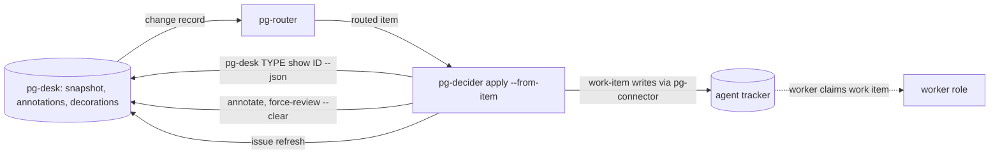

# pg-decider — behavior docs

`pg-decider` decides which work items an entity's current state calls for, and applies them. It
lives at `packages/pg-decider` in this repo and is generic: it MUST contain no organization
identifiers; a deployment repo supplies configuration and role wiring only.

This set describes intended behavior only, at product level: stories, journeys and invariants, with
no implementation detail below that floor. It lands in the same change window as the decider it
describes, and a behavior change to the decider MUST edit these docs in the same change.

## Place in the flow

Three tools cooperate, and each owns one concern:

- **pg-desk** holds the state (the entity snapshot, the annotations and the decorations). It decides
  nothing about what work should exist.
- **pg-router** delivers: it routes a changed entity to the decider as an item. It stays generic
  and names no concrete tool or entity rule.
- **The decider** decides and applies: it reads the entity's composite view, works out the work
  items that view calls for, and writes them to the agent tracker.

A decider's write produces a change record that routes back to it. Because a decider is idempotent
(re-running on an unchanged view writes nothing), the next run produces no actions and the loop ends.

For a PR the role does not call the decider directly: it runs the composed command `pg-pr-change`, which
hydrates the PR with `pg-desk pr refresh` and then decides it, under a per-PR lock (see
[`pr-change.md`](pr-change.md)).

## Actors

| Actor       | Interest                                                                              |
| ----------- | ------------------------------------------------------------------------------------- |
| Operator    | Runs `plan` to see what the decider would do and why; reads the audit trail           |
| pg-router   | Hands the decider a routed item that names the entity; it never decides what to apply |
| Worker role | Claims the work items the decider creates and does the work they describe             |
| Reviewer    | Reads the audit comment on a work item to learn which rule wrote it and why           |
| Tracker     | The source of truth for work items; the decider never rolls a tracker write back      |
| pg-desk     | Serves the view the decider reads and stores the annotations the decider writes       |

## The docs

| Doc                                      | Covers                                                                                                                  |
| ---------------------------------------- | ----------------------------------------------------------------------------------------------------------------------- |
| [`work-items.md`](work-items.md)         | The work-item contract: the kinds, the bead shapes, the dedup key, the same-context rule, the rule conditions           |
| [`plan-and-apply.md`](plan-and-apply.md) | `pg-decider plan` and `apply`, exit codes, precedence, skip reasons, audit, failure escalation, run counters            |
| [`config.md`](config.md)                 | The decider configuration file: location, format and keys                                                               |
| [`pr-change.md`](pr-change.md)           | `pg-pr-change`, the composed command: per-PR lock, hydrate then decide, delivery key, run record, exit codes            |
| [`backfill.md`](backfill.md)             | `pg-pr-backfill`, the backfill driver: the set, the paced run, the plan summary, the flip marker, the listing of writes |

## The rules

The PR decider evaluates a set of rules against the view. The condition of every rule is specified in
exactly one place, [`work-items.md`](work-items.md): the section "The PR rules" for the PR rules
(`review.head-advanced`, `feedback.digest-changed`, `fixci.failing-on-head`, `conflict.present`, and
the closure and reopen rules `all.closed` and `all.reopened`), the section "Adoption" for the adoption
policy, and the section "The `focus.item` rule" for the focus rule. The decisions behind the entity
change flow are recorded in `docs/adr/0077-entity-change-flow.md`, which holds no rule table. Other
docs MUST NOT restate a rule's condition; they cite rule ids and state the invariants the rules
uphold. The rule ids registered so far, in evaluation order of the work-creating rules:

| Rule id                   | Work-item kind it governs |
| ------------------------- | ------------------------- |
| `review.head-advanced`    | `review-pr`               |
| `feedback.digest-changed` | `process-feedback`        |
| `fixci.failing-on-head`   | `fix-ci`                  |
| `conflict.present`        | `resolve-conflict`        |
| `focus.item`              | `focus-item`              |

A rule is added to this table, and its condition to `work-items.md`, in the change that registers it.

## Invariants

The invariants of this set are numbered `INV-DECIDER-<n>` across the docs, in RFC 2119 language:

- `INV-DECIDER-1` to `INV-DECIDER-6` and `INV-DECIDER-29` to `INV-DECIDER-31` are in [`work-items.md`](work-items.md).
- `INV-DECIDER-7` to `INV-DECIDER-20`, `INV-DECIDER-25`, `INV-DECIDER-27` and `INV-DECIDER-28` are in [`plan-and-apply.md`](plan-and-apply.md).
- `INV-DECIDER-21` to `INV-DECIDER-24` and `INV-DECIDER-26` are in [`config.md`](config.md).
- `INV-PRCHANGE-1` to `INV-PRCHANGE-14` are in [`pr-change.md`](pr-change.md).
- `INV-BACKFILL-1` to `INV-BACKFILL-14` are in [`backfill.md`](backfill.md).

## Scope

In scope: the `pr` entity type, which carries the PR rules, and the `issue` entity type, whose only
rule is `focus.item` (which also runs for a `pr`): `pr` and `issue` have deciders (the focus rule
registers for both; `issue` has only that rule), and any other type has none until a rule registers
for it. `pg-decider plan` and `apply` accept the types `pr`, `issue` and `thread`; for a type with
no registered rules (`thread`), both exit `1` with a message saying no decider is registered for
that type.

Out of scope for the whole set:

- The wiring of the reviewer role that claims review items: the head to review is the item's
  `head_sha` and a refused submit closes the item as superseded. Its prompt is deployment configuration.
- The pg-desk `sync` stage that the decider replaces; its retirement belongs to the cutover phase.
- The pg-desk annotation verbs and the composite view contract; see
  `annotate.md` and `show.md` of the set `phillipgreenii-nix-agent-support · docs/behavior/pg-desk`.
- The deployment wiring that binds pg-router to the decider and renders its configuration file.
