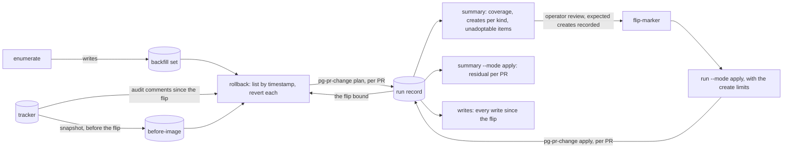

# pg-decider — the backfill driver (`pg-pr-backfill`)

`pg-pr-backfill` brings every followed PR through the composed command (`pg-pr-change`, see
[`pr-change.md`](pr-change.md)) once in `plan` mode, so an operator can read what the PR lane would
do, and once in `apply` mode, the first apply. The first apply needs an explicit pass because
nothing re-drives a PR that never changes again: changing the role's mode decides nothing for a quiet
PR. The driver is a packaged, tested binary of this repo, an operator-started batch that runs to
completion and resumes. It is not a scheduled job: the router owns every clock, and the only wait in
the driver is the pace between two PRs.

```text
pg-pr-backfill enumerate
pg-pr-backfill mark-watched [--from-set] [--pr-backend INSTANCE]
pg-pr-backfill run --mode plan|apply [--max-creates KIND=N,... | --limits-file FILE | --no-create-limits] [--new-pass]
pg-pr-backfill summary [--mode plan|apply] [--max-plan-age DURATION]
pg-pr-backfill flip-marker [--time RFC3339] [--epic-bead ID]
pg-pr-backfill writes
pg-pr-backfill snapshot [--snapshot FILE] [--force]
pg-pr-backfill rollback [--apply] [--snapshot FILE]
```



## The set

`enumerate` lists the PRs to run: the tracker's open anchors plus the open PRs of the deployment's PR
queries. It does not read the store's active rows, so an anchor whose PR is already merged or closed,
or absent from the store, is reached only through the tracker. The tracker's anchors come from one
named tracker query (`anchors_query`); a PR query's members come from `pg-connector pr list --query
<name> --ids-only`, the cheapest read. The names of the PR queries are read from one small file
(`queries_file`, one name per line, `#` comments allowed) that the deployment renders from the SAME
option that renders the connector's query definitions, so there is one source of query names, and the
driver names no query itself.

The set is persisted (`set_file`) for `run` and `summary`. Each entry carries the PR id, its `state`
(`open`, `merged`, `closed` or `unknown`: a PR found through a query is `open`, a PR reached only
through its anchor carries the state the anchor records, `unknown` when it records none) and where it
came from (`anchor`, `query` or both). The set also carries the number of open anchors, the number of
distinct PRs they name and the number of PRs the queries listed, which the check of watched PRs
against open anchors reads. An open anchor whose title maps to no PR, and a query id that is no PR
id, are listed as unparseable, never dropped.

## Mark watched

`mark-watched` is the marking step of the daemon cutover. The daemon appends change rows only for
PRs it WATCHES, and a PR that has an open anchor but has never matched a watched query is tracked by
the backfill's reads yet not watched, so it would never deliver the `merged` row that makes the
decider close its anchor. `mark-watched` closes that gap for the backlog at cutover, in one packaged
tool and not a hand-rolled loop. It enumerates afresh (read-only; it leaves the persisted set alone,
and `--from-set` reads the persisted one instead) and takes the entries that came in through an open
anchor, then:

1. reads each such PR with the watch option (`pg-connector pr show <id> --watch`), one at a time,
   paced, and under the same GraphQL floor and rate signal as `run`; a read needs no query;
2. refreshes the PRs it marked with `pg-desk pr refresh <id>`, which only hydrates: no decider, no
   apply, no write to the tracker. The refresh is needed because a watch-option read of a PR the
   daemon had never seen appends no change row, and because the backfill MAY have hydrated the PR
   before the daemon first saw it, so a change in that gap would otherwise be missed;
3. asks the daemon how many of those PRs it watches (`pg-connector pr inspect <id>...`, in chunks of
   at most 2,000, the counts added) and compares that count with the tracker's open-anchor count.

The open-anchor count the daemon's watched count MUST equal is the number of distinct PRs the open
anchors name, less the anchors whose PR is merged or closed. Those are not marked: the backfill
refreshes them once and the decider closes their anchors in the apply pass. An open anchor whose
title maps to no PR cannot be counted or marked, so it is listed (`UNMAPPED anchor <id> "<title>"`)
and never dropped; the operator decides what each is. The count MUST be non-zero, so the check
cannot pass at 0 equals 0. The step never resets a consumer's cursor: the replay decision belongs to
the cutover.

The last line is `DONE`, `FLOOR` or `FAILED` with the counts (`open_anchors=`, `open_anchor_prs=`,
`targets=`, `skipped_closed=`, `unmapped=`, `marked=`, `refreshed=`, `failed=`, `watched=`,
`expected=`), and the exit code says which:

| Last line | Exit | Meaning                                                                                                                    |
| --------- | ---- | -------------------------------------------------------------------------------------------------------------------------- |
| `DONE`    | `0`  | every target was marked and refreshed and the watched count equals the open-anchor count                                   |
| `FLOOR`   | `10` | the budget fell under the floor: wait for the window and run again; the step is idempotent                                 |
| `FAILED`  | `11` | some reads or refreshes failed (named by `failed_prs=`), or the inspection could not run: run it again                     |
| `FAILED`  | `12` | stopped at once (`stop=` says why): an `unauthenticated` read, a command that cannot be started, an unreadable rate signal |
| `FAILED`  | `20` | every PR was marked but the count check does not hold (`check=` says how), or there was nothing to mark                    |
| none      | `30` | the enumeration failed closed (the same causes as `enumerate`); nothing was marked                                         |

## Run

`run` runs the composed command over the set, one PR at a time, in the mode given, paced. The command
takes the per-PR lock and does all the work; the driver decides nothing and writes nothing to the
tracker. Before each PR it reads the newest GraphQL points left, and when that is under the floor
(3,000 by default, the floor the shadow runbook uses) it ends with `FLOOR`. The reading's source is the
configuration key `rate_source`: `old-backend-log` (before the daemon cutover: the newest
`graphql_remaining` row of the old backend's event log) or `daemon-metrics` (after it: the daemon's
budget gauge, read through the local metrics API). The cutover changes this one key. A signal that
cannot be read is a stop, never a reason to run blind against a shared token.

A PR that already has a final result of the SAME mode in the current pass is skipped, so a restart
redoes no finished PR: a result is final when the run succeeded or the forge reported the PR gone
(`not_found`), and a plan-mode result never satisfies an apply-mode resume. `--new-pass` starts a new
pass of the mode, so the records of the earlier passes no longer satisfy a resume (the second apply
pass of the verification, a re-plan after the plan went stale).

The last line is one of `DONE`, `FLOOR` or `FAILED`, with the counts, and the exit code says which:

| Last line | Exit | Meaning                                                                                                                                                       |
| --------- | ---- | ------------------------------------------------------------------------------------------------------------------------------------------------------------- |
| `DONE`    | `0`  | every PR of the set has a final result of the mode                                                                                                            |
| `FLOOR`   | `10` | the budget fell under the floor: wait for the window, run again; the run resumes                                                                              |
| `FAILED`  | `11` | some PRs ended in a failure the run recorded and went on past; they are named by class (`transient=`, `degraded=` and the others): run again, the run resumes |
| `FAILED`  | `12` | the run stopped at once (`stop=` says why): do not run again, go to the rollback                                                                              |
| none      | `64` | a usage or configuration error; nothing ran                                                                                                                   |

Exit `20` is `summary` (a check does not hold) and the count check of `mark-watched`, and `30` and
`31` are `enumerate` (and the enumeration inside `mark-watched`) and the marker failing to write. None of the driver's exit codes is `1` or `9`.

A run that ends `transient` or `degraded` is not a stop. A run that ends `unauthenticated` or
`decide_failed`, a command that cannot be started, an unreadable rate signal and a create limit that
is exceeded stop the run at once. The create limits are the operator's expected number of creates
per kind, taken from the plan summary. They are a stop criterion, checked after every PR of an apply
pass against the creates made since the flip, and not a cap: nothing prevents a create, and the run
stops after the PR that exceeded the number. A kind with no limit has the limit 0. An apply pass
refuses to start without limits unless `--no-create-limits` says so.

## The summary

`summary` reads the run record and, for each enumerated PR, its latest record of the mode.

In `plan` mode it prints, as fixed `key: value` lines: the PRs enumerated and the PRs with a plan-mode
record (which MUST be equal; every PR without a usable one is named, with the reason, including a
failed run, an unhydrated PR and a PR the forge reports gone); the planned actions per kind as the
counts of `adopt`, `create`, `reopen`, `close`, `update` (and `annotate`); the unadoptable items; the
PRs that would get a second anchor; and the age of the oldest plan record. A plan record older than
the bound (`--max-plan-age`, 48 hours by default) is flagged, and MUST be re-planned before the flip.

In `apply` mode it prints each enumerated PR's persisted residual, and fails when any is not zero,
when it is unknown, or when an enumerated PR has no usable apply-mode record.

## The flip marker and the listing of writes

`flip-marker` appends one row of its own kind to the run record: the mode and the time of the flip.
The time MAY be given (`--time`), so the marker can be written just before the deployment apply that
changes the role's mode, and not after. The run record is the authoritative source of the marker; a
comment with the same text on the epic bead (`--epic-bead`) is a copy. The marker row, and the
pass-start row of `--new-pass`, have their own `contract` strings and are ignored by everything that
takes the latest run record per PR and mode: the summary, the resume and the log source.

`writes` lists every write since the flip, by timestamp: creates, closes, reopens and head updates
alike, each with the rule that made it. The listing starts at the EARLIER of the marker's time and the
first apply-mode run record, so the writes live `pr-change` apply runs made between the deployment
apply and the marker are not missed. It does not start at the lane-level flip time pg-desk persists,
which is a display value.

## The rollback

The first apply is undone from the tracker, not from a store backup. The run record says which writes
the lane made but not on which work item, and an audit comment names the rule, the operation and the
time of a write but not the value an update replaced. The rollback therefore needs two things the
operator provides at the flip: the flip bound (above) and a before-image of the tracker.

`snapshot` records the before-image: every work item of the tracker in every status, with its title,
priority, description, labels and metadata. It is taken just BEFORE the flip marker. It refuses (exit
`33`) once the run record holds a flip marker or an apply-mode record, because a snapshot taken then
holds the writes it is meant to undo, unless `--force` says a rollback has happened and a second flip
is being prepared. It fails closed on a tracker that lists no item.

`rollback` lists every write since the flip bound, by timestamp, read from the decider's audit
comments on the work items, and then reverts each one by its inverse:

| Write    | Revert                                                                                             |
| -------- | -------------------------------------------------------------------------------------------------- |
| `create` | close the created item (a tracker has no delete)                                                   |
| `close`  | reopen the item, unless it is no longer closed                                                     |
| `reopen` | close the item, unless it is no longer open                                                        |
| `update` | put back the title, priority, description, labels and metadata of the before-image; not the status |

The revert is by write and newest first, so a change a person made since the flip is not undone: once
a write's result is not what the tracker shows now, that write and every older status write of the
item are left as they are and the listing says so. Without `--apply` it is a dry run that writes
nothing and ends `ROLLBACK PLANNED`. With `--apply` it makes the steps, goes on past a step that
fails, leaves one comment on each item it changed (so a second rollback lists nothing for it), reads
the tracker again and ends `ROLLBACK DONE` (exit `0`) or `ROLLBACK FAILED` (exit `34`). It refuses
(exit `33`, nothing written) when there is no flip bound, when the snapshot is missing or was taken
after the bound, and when the snapshot disagrees with the audit comments: an item updated but not in
the snapshot, or created but already in it.

The `bd` command line is the tracker access of these two commands (the connector reads no comments);
its name and the tracker directory are the configuration keys `bd` and `beads_dir`.

## Invariants

- **INV-BACKFILL-1.** <!-- uuid: 026451a2-cc69-472e-9a2f-38cfec301fc3 --> `enumerate` MUST list the tracker's open anchors plus the open PRs of the deployment's PR queries, MUST
  NOT take the set from the store's active rows, MUST reach an anchor whose PR is merged, closed or
  absent from the store, and MUST report an anchor or a query id that maps to no PR instead of
  dropping it.
- **INV-BACKFILL-2.** <!-- uuid: fd32e0c0-14c7-4736-91ab-acfe97ec8655 --> `enumerate` MUST fail closed: on a query-name file that is absent or lists no query, on a listing
  whose source did not answer or was truncated, and on an empty set. It MUST assert a non-zero count.
- **INV-BACKFILL-3.** <!-- uuid: 362d6a39-859a-4c16-9a78-9705c5a38e00 --> The set MUST carry, for each PR, its state and whether it came from an anchor, a query or both, and
  MUST carry the number of open anchors.
- **INV-BACKFILL-4.** <!-- uuid: 97ca396d-e730-4ff8-acf2-01efaba49fc9 --> `run` MUST run the composed command over the set in the mode given and MUST NOT decide or write
  to the tracker itself; the per-PR lock is the command's.
- **INV-BACKFILL-5.** <!-- uuid: 06dc76c2-299a-40a5-a86b-65ab2ae65807 --> `run` MUST read the newest GraphQL points left before each PR and end with `FLOOR` when they are
  under the floor, MUST read them from the source the configuration key `rate_source` names, and MUST
  stop when the signal cannot be read.
- **INV-BACKFILL-6.** <!-- uuid: df5dbeb7-dc70-4a62-a8ad-e1ed0c6c4631 --> `run` MUST skip a PR that has a final result of the SAME mode in the current pass, and a result of
  another mode MUST NOT satisfy it; a new pass MUST NOT be satisfied by the records of an earlier one.
- **INV-BACKFILL-7.** <!-- uuid: aae7605b-ec3c-43ce-825f-0c09e82abade --> The last line of `run` MUST be one of `DONE`, `FLOOR` or `FAILED` with the counts, each ending MUST
  have its own exit code, and none MUST be `1` or `9`. A `FAILED` MUST name the PRs that ended
  `transient` or `degraded`.
- **INV-BACKFILL-8.** <!-- uuid: 20664298-0aa6-4fee-8993-53f151c1dcc6 --> `run` MUST record a `transient` or `degraded` run and go on, and MUST stop at once, with an exit code
  of its own, when a run ends `unauthenticated` or `decide_failed`, when the command cannot be started
  and when the rate signal cannot be read.
- **INV-BACKFILL-9.** <!-- uuid: 2726ed12-3f1e-4fee-923d-7a3614df3df1 --> An apply pass MUST compare, after every PR, the creates made since the flip with the operator's
  limits per kind and MUST stop when any kind exceeds its limit; it MUST NOT prevent a create, and MUST
  NOT start without limits unless told to run without them.
- **INV-BACKFILL-10.** <!-- uuid: 2b48b585-8e6c-4639-97c1-3af641a7c865 --> The flip marker MUST be a run-record row of its own kind that every reader of the latest record per
  PR and mode ignores, MUST accept an explicit time, and the run record MUST be its authoritative
  source.
- **INV-BACKFILL-11.** <!-- uuid: a2a3ccff-f42e-48c9-aeee-2c3ee58a0510 --> The listing of writes MUST start at the earlier of the marker's time and the first apply-mode run
  record, MUST be ordered by timestamp and MUST include creates, closes, reopens and updates.
- **INV-BACKFILL-12.** <!-- uuid: 9f6fa7e3-c6d9-44f8-bc78-84c3d1851e62 --> The plan summary MUST print the fixed fields from the latest record per PR and mode, MUST name every
  enumerated PR without a usable plan-mode record, and MUST flag a plan older than its bound.
- **INV-BACKFILL-13.** <!-- uuid: 0be88afd-8459-422b-a59c-6b95bfea570c --> The apply summary MUST print each enumerated PR's persisted residual and MUST fail when any is not
  zero or when an enumerated PR has no usable apply-mode record.
- **INV-BACKFILL-14.** <!-- uuid: 095acc61-4ef3-4a0c-8e6c-a4e5c79f5700 --> The driver MUST NOT keep a clock of its own: it MUST NOT retry inside one run, and its only wait
  MUST be the pace between two PRs.<<<<<<< ours
- **INV-BACKFILL-15.** <!-- uuid: 5c1e8a3d-7b94-4f2a-9d60-e3a17c4b52f8 --> `mark-watched` MUST read every PR that has an open anchor and whose PR is not merged or closed
  with the watch option, MUST then refresh those PRs with the hydrate-only `pg-desk pr refresh`, and
  MUST NOT run the decider, apply anything, write to the tracker or reset a consumer cursor.
- **INV-BACKFILL-16.** <!-- uuid: b7d4026e-91c3-4a58-8e1f-2f6a0d93c7b1 --> `mark-watched` MUST compare the daemon's watched count over the PRs it marked, read with the
  inspection command, with the tracker's open-anchor count (the distinct PRs named by open anchors,
  less those whose PR is merged or closed), MUST require that count to be non-zero, and MUST exit
  non-zero, with a last line that names the mismatch, when the two differ.
- **INV-BACKFILL-17.** <!-- uuid: e92a6f15-03bd-4c7e-b4a9-6d8c51e0a37f --> `mark-watched` MUST list every open anchor whose title maps to no PR and every anchor skipped
  because its PR is merged or closed, and MUST NOT drop either silently.
- **INV-BACKFILL-18.** <!-- uuid: 3f08d6b2-a5e1-4690-8c7d-14b9e2f7a6c0 --> `mark-watched` MUST read the newest GraphQL points left before each call and MUST NOT call below
  the floor, MUST stop at once on an `unauthenticated` read or an unreadable rate signal, and MUST be
  idempotent: running it again marks and refreshes the same PRs and changes nothing else.
||||||| original

=======
- **INV-BACKFILL-13.** <!-- uuid: 27149d06-6cd3-413f-a218-a0c5ea00df36 --> `snapshot` MUST record every work item of the tracker in every status, MUST fail closed on an empty
  tracker, and MUST refuse once a flip marker or an apply-mode run record exists unless told it is
  being re-taken after a rollback.
- **INV-BACKFILL-14.** <!-- uuid: 62071cad-15e6-422a-b7d4-3e2822563c04 --> `rollback` MUST list every write since the flip bound, by timestamp, from the audit comments, MUST
  revert each by its inverse (a create by closing, a close by reopening, a reopen by closing, an
  update by restoring the before-image), MUST NOT undo a status a person changed since, and MUST
  verify the tracker afterwards.
- **INV-BACKFILL-15.** <!-- uuid: dbd123e1-bf9c-4333-bf83-2772cb20d612 --> `rollback` MUST be a dry run unless told `--apply`, MUST refuse and write nothing when the flip
  bound is unknown or the snapshot is missing, newer than the bound or inconsistent with the audit
  comments, and a second `rollback --apply` MUST write nothing.
>>>>>>> theirs
