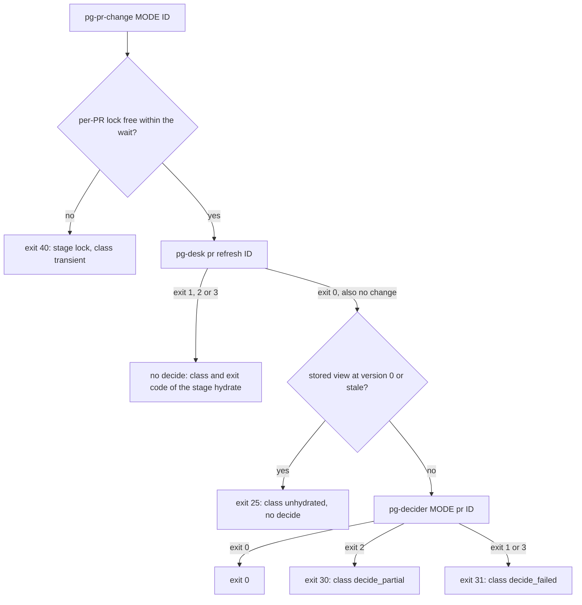

# pg-decider — the composed command (`pg-pr-change`)

`pg-pr-change` is the one command a `pr-change` role runs for one PR id. It hydrates the PR with
`pg-desk pr refresh <id>` and then decides it with `pg-decider plan pr <id>` or `pg-decider apply pr
<id>`, in sequence, for the same PR, holding a per-PR lock for the whole run. Ordering is
guaranteed by construction, so pg-desk stays independent of the decider, and there is no separate
pg-desk verb for it. An operator MAY run it by hand for one PR; `plan` is a read-only look at what
would happen, which also answers "why was no bead made for PR X". It is a packaged, tested binary
of this repo, not a shell snippet in a deployment's configuration, so its exit-code mapping is
testable.

```text
pg-pr-change [--lock-dir DIR] [--lock-wait DURATION] <plan|apply> <id>
```



## The id

`<id>` is `<owner>/<repo>#<number>`, or the router's retry-window form `<entity>@<12 hex digits>`
(the id a source adapter gives every item under a retry window; the suffix is a digest of the change
and is dropped). Both forms of one PR are the same PR, hence the same lock. Any other reference form
(a URL, a bare number) is a usage error, because the lock key must be one string per PR.

## The per-PR lock

The command holds an exclusive lock keyed by the normalized PR id for the whole run, so a manual
run, the paced backfill and a live dispatch for one PR cannot both see "no anchor" and each mint
one. The key is the lower-cased normalized id, so the bare form and the retry-window form take the
same lock. The kernel releases the lock when its holder ends, so a killed holder releases it.

A caller that cannot get the lock within a bounded wait (`--lock-wait`, default `30s`) exits with
the transient class (stage `lock`, exit `40`), never `1` or `9`, so the router re-runs it. The lock
directory is `--lock-dir`, else the environment variable `PG_PR_CHANGE_LOCK_DIR`, else
`$XDG_STATE_HOME/pg-pr-change/locks`.

## Hydrate, then decide

1. **Refresh.** `pg-desk pr refresh <id>`. The decider is NOT run after a refresh that exits `1`,
   `2` or `3`. A refresh that exits `0` always leads to the decider, including when it reports "no
   change": a retry after a decider failure sees no change because the first attempt already
   hydrated, an operator annotation changes the decider's input without any change on the forge,
   and a work item closed by an agent changes what should exist. The decider is idempotent, so a
   run with nothing to do writes nothing.
2. **Fail closed.** After a successful refresh the command reads the stored view
   (`pg-desk pr show <id> --json`) and refuses it, with its own exit code and without running the
   decider, when the view's version is `0` or the view is marked stale, so an unhydrated view can
   never mint an anchor. A legacy row has version `0`, so the version is a sufficient test.
3. **Decide.** `pg-decider plan pr <id>` for mode `plan`, `pg-decider apply pr <id>` for mode
   `apply`. The plan the decider prints is passed through on standard output.

The command never sleeps and retries inside one run: pg-router owns every clock.

## Exit codes and failure classes

No exit code is `1` (reserved for unexpected errors) or `9` (the router's "busy, retry" code). The
code names the failing stage and the class; `0` is success and `64` is a usage or configuration
error (a bad mode or id, an unknown flag, a decider configuration file that cannot be read).

| Code | Stage     | Class             | Retried by the router | Meaning                                                                              |
| ---- | --------- | ----------------- | --------------------- | ------------------------------------------------------------------------------------ |
| `20` | `hydrate` | `transient`       | yes                   | Forge or connector failure a later attempt may clear: a 5xx, a rate limit, a timeout |
| `21` | `hydrate` | `degraded`        | yes                   | Part of the read failed; the previous detail is kept and nothing was written         |
| `22` | `hydrate` | `not_found`       | no                    | The PR no longer exists at its source; see "A PR that no longer exists"              |
| `23` | `hydrate` | `unauthenticated` | no                    | A missing or invalid credential; needs a person                                      |
| `24` | `hydrate` | `hydrate_error`   | no                    | Refresh exit `1`, or any other failure that is not one of the classes above          |
| `25` | `hydrate` | `unhydrated`      | no                    | The stored view is at version `0` or marked stale, so the decider was not run        |
| `30` | `decide`  | `decide_partial`  | yes                   | The decider exited `2`: some actions failed or were skipped; captured and retried    |
| `31` | `decide`  | `decide_failed`   | no                    | The decider exited `1` or `3`, or could not be started                               |
| `40` | `lock`    | `transient`       | yes                   | The per-PR lock was not free within the wait                                         |
| `41` | `lock`    | `hydrate_error`   | no                    | The lock file could not be created or opened                                         |

There is no `retry_exhausted` class: the router keeps its attempt count in memory and passes none
to the command, so the command cannot know that a run is the last attempt.

Refresh exit `3` covers both a missing PR and a transient failure; the machine-readable class that
refresh prints (see `refresh.md` of the set `phillipgreenii-nix-agent-support · docs/behavior/pg-desk`) tells them apart, so a
transient failure is never escalated as not found. A refresh that prints no class is never read as
`not_found`: exit `2` is `degraded` and any other exit is `hydrate_error`.

### The failure line

Every failure writes exactly one line to standard error, and the line ends with the next command to
run:

```text
pg-pr-change: refresh failed (stage=hydrate, class=not_found): <detail>: run pg-desk pr show acme/widgets#42 --json
```

The decider's own diagnostics, which end with no next command, are re-wrapped the same way: on a
failure they become the detail of the command's line (stage `decide`, next command
`pg-decider plan pr <id>`), and on a success each is passed through prefixed `pg-pr-change:
decider:`. The decider's run counters line (contract `pg-decider.run-counters/v1`) is passed
through unchanged either way, so a log pipeline that matches it keeps working.

### Retry is the router's

The router re-runs a failed dispatch only when the failure text carries one of its retry words
(`unavailable`, `deadline exceeded`, `signal: killed`; a case-insensitive substring match), only
while the event carries a future `expiresAt`, and only if the role opts in with
`max_dispatch_retries`. Therefore:

- every retryable class (`transient`, `degraded`, `decide_partial`) writes a failure line that
  carries the word `unavailable`;
- the failure line of every other class carries none of the three words, including when it re-wraps
  upstream text: the command rewrites each of them in the upstream text before it is quoted;
- a failure that the router does not retry is never re-run, so every transient condition is marked
  retryable: a transient or degraded hydrate, a lock wait that ran out, a decider exit `2`, and
  every step of the not-found handling below that cannot be trusted.

## A PR that no longer exists

A PR that was deleted, or whose repository was deleted or transferred, exits refresh `3` with class
`not_found`, so the decider never runs and its anchor would never close. The condition is never
silent, and the outcome depends on whether the PR has an open anchor and on the mode. Whether the
anchor is open is read from the stored links (`pg-desk pr show <id> --json`) and a live read of the
linked anchor (`pg-connector issue show <anchor> --fresh`); a PR the store does not hold has no
anchor.

| Open anchor | Mode    | Outcome (exit `22`)                                                                                                    |
| ----------- | ------- | ---------------------------------------------------------------------------------------------------------------------- |
| no          | `apply` | The PR is marked inactive (`pg-desk pr mark-inactive <id>`), counted separately from the never-hydrated PRs            |
| no          | `plan`  | The same: marking inactive is a pg-desk store write, not a tracker write, so a plan period does not keep the alert red |
| yes         | `apply` | One `human` escalation is raised under the anchor, unless an earlier one exists in any status                          |
| yes         | `plan`  | The condition is reported on standard error; no tracker write is made and no escalation is raised                      |

The escalation's title is `pr not found: <repo>#<n>`, its body states the class and the next
command, and the title is its dedup key. Before raising it the command looks for an existing
escalation in EVERY status, closed included, with `pg-connector search <title>`, so a redelivered
change raises no second one even after the first was closed. The judgment is made from the per-source
rows of the search answer, never from the merged hits:

- only the beads tracker's row (source `pg-connector-issue-beads`) counts, and a hit counts only
  when its source is that backend and its title equals the escalation's title exactly;
- a degraded or disabled beads row, a beads row whose hit count reached the backend's cap of `100`,
  an answer that cannot be read, and an answer with no beads row at all are NOT "no match": the
  command exits as `transient` (retryable) and raises nothing;
- a row of any other source is ignored, so an unrelated degraded source neither retries forever nor
  counts as a match.

A failure to read the open-anchor probe, to mark the PR inactive or to create the escalation is
likewise `transient`.

## Invariants

- **INV-PRCHANGE-1.** <!-- uuid: 32cdf748-c087-4a1a-af34-5a282c6d9e23 --> The command MUST run `pg-desk pr refresh <id>` and then `pg-decider` (`plan` or `apply`,
  as the mode argument says) for the same PR, in that order, and MUST run the decider after every
  refresh that exits `0`, including one that reports "no change".
- **INV-PRCHANGE-2.** <!-- uuid: e4c1e1de-89ea-4bce-9fce-7da70f810300 --> The command MUST NOT run the decider after a refresh that exits `1`, `2` or `3`, and MUST
  NOT run it on a stored view whose version is `0` or that is marked stale.
- **INV-PRCHANGE-3.** <!-- uuid: 577d7c69-d98d-4eb4-94fb-4cfe457f94ba --> The command MUST hold an exclusive per-PR lock, keyed by the normalized PR id so that
  `<repo>#<n>` and `<entity>@<12 hex>` take the same lock, for the whole run. A holder that is
  killed MUST release it, and a caller that cannot get it within the bounded wait MUST exit with the
  transient class.
- **INV-PRCHANGE-4.** <!-- uuid: 2e3c14ef-a56c-4f0a-9460-496bc9c8b00d --> The command's exit code MUST name the failing stage and class, MUST NOT be `1` or `9`, and
  the table above MUST list every code the command can exit with.
- **INV-PRCHANGE-5.** <!-- uuid: 2c56647c-cb0a-4fca-9c00-6aba13553119 --> Every failure MUST write one line ending with the next command to run. The line of a
  retryable class MUST carry the router's `unavailable` word, and the line of every other class MUST
  carry none of `unavailable`, `deadline exceeded` and `signal: killed`.
- **INV-PRCHANGE-6.** <!-- uuid: 97eeec1d-1acc-4bae-97d0-5cd3ac1964da --> The command MUST NOT sleep and retry inside one run, and MUST NOT read a transient
  failure of refresh as `not_found`.
- **INV-PRCHANGE-7.** <!-- uuid: a8c67cfa-06e5-42a1-aeac-4bc20ffa5a6a --> A PR that no longer exists MUST NOT pass silently. With an open anchor, `apply` MUST raise at
  most one `human` escalation (deduplicated across every status, closed included, by exact title)
  and `plan` MUST make no tracker write and raise none; with no open anchor, the PR MUST be marked
  inactive in both modes, and never through a tracker write.
- **INV-PRCHANGE-8.** <!-- uuid: 4cd36cf0-c939-478f-a29f-fedcfd096665 --> An escalation lookup that cannot be trusted (a degraded or disabled beads row, a row at the
  cap, an unreadable answer, no beads row, or a failed open-anchor probe) MUST exit as the transient
  class and MUST NOT be read as "no match".
