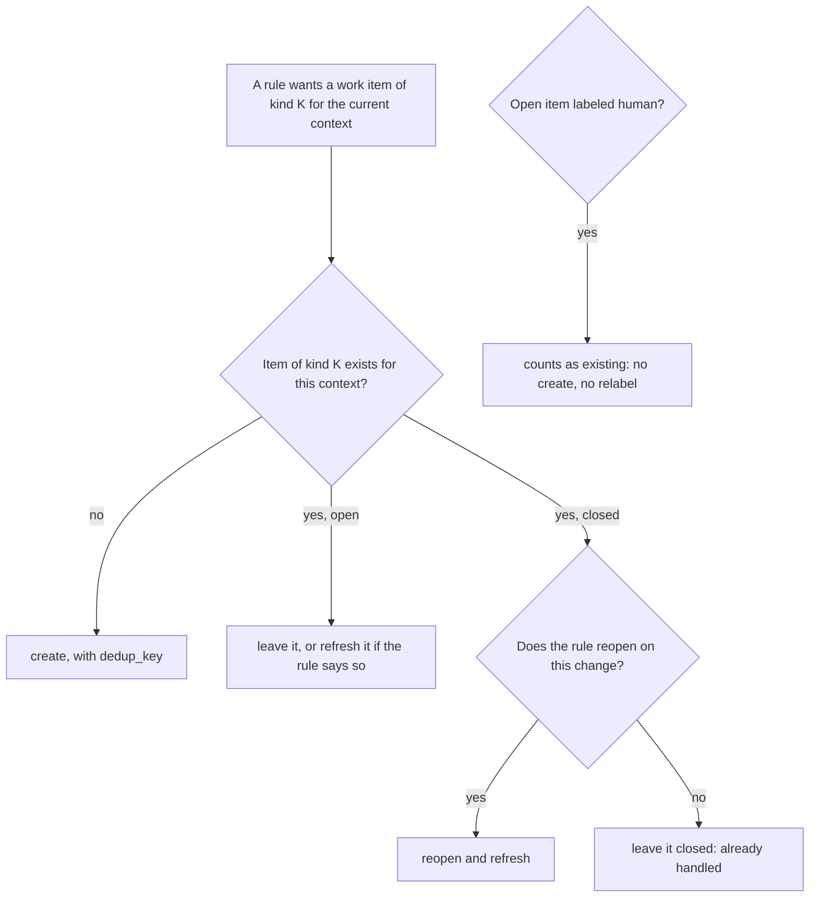

# pg-decider — work items

The decider writes work items to the agent tracker so a worker can claim them. This doc owns the
work-item contract: the kinds, their shapes, the dedup key that makes a write idempotent, and the
same-context rule that stops a decider from recreating work it has already raised. Roles and
workers MUST rely only on the fields in the table below.

## Kinds

There are six work-item kinds. A kind is named by its `kind` id, which is also the kind segment
of its dedup key.

| Kind id            | Table row        | Meaning                                                                 |
| ------------------ | ---------------- | ----------------------------------------------------------------------- |
| `anchor`           | anchor           | The parent of every other kind: one per PR                              |
| `process-feedback` | feedback cycle   | Address the unaddressed review feedback on a PR                         |
| `review-pr`        | review request   | Review a PR at a head; a PR may have several over time                  |
| `fix-ci`           | fix-ci           | Fix the failing CI builds on a PR's current head                        |
| `resolve-conflict` | resolve-conflict | Resolve the merge conflict between a PR and its base                    |
| `focus-item`       | focus-item       | The bead that tracks one source entity chosen for focus: one per source |

## Bead shapes

Reproduced from the design of record; any later change MUST land with the sources and prompts that
read these shapes, in the same change:

| Kind             | bd type         | Title                                         | Labels                                               | Metadata                                                                                                                                                                                                | Parent |
| ---------------- | --------------- | --------------------------------------------- | ---------------------------------------------------- | ------------------------------------------------------------------------------------------------------------------------------------------------------------------------------------------------------- | ------ |
| anchor           | `merge-request` | `<repo>#<n>: <pr title>`                      | `co-owned` when applicable, `pbase:<n>` while nudged | `repo`, `pr_number`, `state`, `branch`, `base`, `author`, `url`, `draft`, `dedup_key`                                                                                                                   | none   |
| feedback cycle   | `task`          | `process-feedback: <repo>#<n>`                | `mine`, `fbsum:<digest>`                             | `repo`, `pr_number`, `branch`, `covered_comments`, `dedup_key`; description is the rendered summary of unaddressed items                                                                                | anchor |
| review request   | `task`          | `review-pr: <repo>#<n> @ <short head>`        | none                                                 | `repo`, `pr_number`, `branch`, `head_sha`, `ownership`, `dedup_key`                                                                                                                                     | anchor |
| fix-ci           | `task`          | `fix-ci: <repo>#<n> @ <short head>`           | `mine`, `worker-ready`                               | `repo`, `pr_number`, `branch`, `head_sha`, `failing_checks`, `failing_builds`, `dedup_key`; description is the failing checks, each with a link to its run                                              | anchor |
| resolve-conflict | `task`          | `resolve-conflict: <repo>#<n> @ <short head>` | `mine`, `worker-ready`                               | `repo`, `pr_number`, `branch`, `head_sha`, `base`, `base_sha`, `dedup_key`; description is the base plus the conflicting files if the backend reports them, else an instruction to rebase onto the base | anchor |

| focus-item | `bug` when the source issue's tracker type is `Bug`, else `task` | `Focus <source ref> - <source title>` | `focus-item` | `source_type`, `source_id`, `focus_hold`, `dedup_key`; description is one line naming the source entity | none |

Notes on the table:

- `merge-request` and `task` are the tracker's issue types. `<repo>`, `<n>` and `<pr title>` are
  the PR's repository, number and title.
- `co-owned` is set only on a co-owned PR. `pbase:<n>` records the pre-nudge priority while a
  conflict nudge is in effect. `mine` is set only for a PR whose relationship to the operator is
  mine or co-owned; a team PR never gets a `process-feedback` or `fix-ci` item.
- `fbsum:<digest>` carries the digest of the feedback set the cycle was last aligned to. When an
  open cycle is updated for more feedback, the old `fbsum` label is replaced by the new one.
- `worker-ready` marks an item a worker can pick up with no further triage. A worker reads these
  fields the same way for every kind and needs no special case per kind.
- `<short head>` is the first seven characters of the item's `head_sha` (the whole value when it is
  shorter). It is in the title of the three head-scoped kinds, so a PR with flapping CI or several
  pushes does not accumulate identically titled items.
- `head_sha` on `review-pr` is the head the item is FOR: the head to review. It advances only while
  the item is unclaimed, when the decider refreshes the item for a newer head (see "The PR rules").
  `ownership` is the PR's relationship to the operator at that time. A PR MAY have several `review-pr`
  items over time, one per head that was reviewed or is waiting to be, and a worker reads `head_sha`
  at claim time.
- `base_sha` and `branch`, with `base`, name the conflict context of a `resolve-conflict` item.
- The labels cell of a review request is `none`: the decider writes no label on it.
- A `focus-item` bead is not a PR's own work; see "The focus bead" below. Its `<source ref>` and
  `<source title>` are the source entity's reference and title.

### The focus bead

A `focus-item` bead tracks one source entity (a PR, or a tracker issue) that an operator chose for
focus. It differs from the other kinds in these ways:

- **One per source entity.** Its dedup key has no context suffix and no per-day part, so a source
  entity has at most one focus bead for all time.
- **Shape.** The type is `bug` when the source is an issue whose tracker type is `Bug` and `task`
  for every other source, a PR included (`KindContract.IssueTypeFor` in the contract data). The
  title is `Focus <source ref> - <source title>`; it MUST NOT begin with `<ref>: `, which the
  anchor-adoption match would read as a PR's own anchor. The only label is `focus-item`: no `human`
  label and no worker-routing label, because whether a worker takes the bead is the router's
  decision. It is created without an assignee and has no parent.
- **Metadata.** `source_type` and `source_id` name the source entity with neutral field names (they
  carry no focus vocabulary). `focus_hold` is the decider's hold marker: `struck` while the bead is
  held and `released` after. Its values are strings on purpose, not booleans.
- **Priority.** The source's tracker priority through the decider's `focus_priority_map` (see
  [`config.md`](config.md)); an unmapped value, and a PR, which has none, map to `P2`.
- **Link relation.** A view lists a focus bead under the relation `source`, never the PR's own
  `work` relation. The index of a view's work items holds a keyed focus bead like any other keyed
  work item, and `ParseKey` accepts the `focus-item` kind for both `pr` and `issue` entities.
- **Ignored by the PR rules.** The PR rules, `all.closed`, `all.reopened`, `adoption`,
  `adoption.node-id` and the plan's linked-work line MUST ignore a focus bead: a PR whose view links
  a focus bead MUST get the same plan as the same PR without it. A keyless link of relation `source`
  is never adopted, whatever its title looks like.
- **Beads and other issues.** The decider tells a bead from any other issue by one configured
  pattern, `bead_id_pattern` (the same name and meaning as pg-desk's key; see
  [`config.md`](config.md)): an issue whose id matches is a bead and every other issue is not. The
  tracker field of an issue is not that discriminator.

The condition under which a focus bead is minted, held and released belongs to the `focus.item`
rule. Its durable home is the section "The `focus.item` rule" below in this document; the conditions
of the PR rules are in "The PR rules", and [`README.md`](README.md) names this document as the one
home of every rule's condition.

### Metadata encodings

Three metadata values hold lists. Each is a comma-separated string, sorted, with no spaces:

| Key                | Holds                                                                  | Example         |
| ------------------ | ---------------------------------------------------------------------- | --------------- |
| `covered_comments` | The ids of the comments this cycle (or an earlier update of it) covers | `c-881,c-902`   |
| `failing_builds`   | The failing builds on this head, each `<run id>:<attempt>`             | `9001:1,9002:2` |
| `failing_checks`   | The names of the failing checks                                        | `lint,unit`     |

`covered_comments` is what "not covered by an earlier cycle" is checked against: the union of the
`covered_comments` of every `process-feedback` item for the PR, open or closed. A cycle created
before the decider existed carries no `covered_comments` and covers nothing.

## The dedup key

Every work item the decider creates carries a `dedup_key` in its metadata. The key lives in the
work item itself, never only in some other store, so a crash between a create and anything else
that follows it cannot mint a duplicate on the next run.

The key is `<type>:<id>:<kind>` plus a context suffix, where `<type>` is the entity type (`pr`,
or `issue` for a `focus-item` bead of a tracker issue),
`<id>` is the entity id (for example `acme/widgets#42`) and `<kind>` is the kind id. The suffix
names the kind's context where that context is narrower than the PR:

| Kind id            | Context suffix                           | Example key                                                      |
| ------------------ | ---------------------------------------- | ---------------------------------------------------------------- |
| `anchor`           | none                                     | `pr:acme/widgets#42:anchor`                                      |
| `review-pr`        | `:<head_sha>`                            | `pr:acme/widgets#42:review-pr:9f3c1e2`                           |
| `fix-ci`           | `:<head_sha>`                            | `pr:acme/widgets#42:fix-ci:9f3c1e2`                              |
| `resolve-conflict` | `:<branch>:<head_sha>:<base>:<base_sha>` | `pr:acme/widgets#42:resolve-conflict:fix-x:9f3c1e2:main:77aa001` |
| `process-feedback` | `:<digest>`                              | `pr:acme/widgets#42:process-feedback:ab12`                       |
| `focus-item`       | none                                     | `issue:PROJ-1:focus-item`, `pr:acme/widgets#42:focus-item`       |

`<digest>` is the `fbsum` digest the cycle was created with.

A `review-pr` key whose item is created by a force-review request at a head that already has an item
adds a request-unique part after the head (`pr:acme/widgets#42:review-pr:9f3c1e2:r1`), so the create
is not read as a dedup of the item that exists. An item written before the key carried a head has the
key `pr:acme/widgets#42:review-pr` with no suffix (a legacy key). A refresh rewrites the suffix to
the new head and keeps the entity part of the key (id or `node_id` form). Nothing reads the suffix to
decide what an item is FOR: the head an item is for is its `head_sha`, never its key.

### The node_id form

When the entity carries a stable backend id (`node_id`), the same key also exists in a second form
with the `node_id` in place of the entity id: `<type>:<node_id>:<kind>` plus the same suffix, for
example `pr:PR_kwDOabc123:fix-ci:9f3c1e2`. A repository rename or transfer changes the entity id
but not the `node_id`, so matching on either form stops a rename from orphaning existing work
items. The two forms name the SAME identity: a lookup for one form MUST find an item keyed in the
other, and an entity with no `node_id` has only the first form.

## Same-context rule

A work item that exists for the CURRENT context, open or closed, is never recreated. The context
differs per kind:

| Kind id            | The context is                                                 | When the context changes                                                                                     |
| ------------------ | -------------------------------------------------------------- | ------------------------------------------------------------------------------------------------------------ |
| `anchor`           | The PR                                                         | Never: one anchor per PR                                                                                     |
| `review-pr`        | The PR's head                                                  | The head advances: an unclaimed item is refreshed in place, else a new item; a closed item is never reopened |
| `fix-ci`           | The head commit                                                | A new head gets a new item; a new failing build on the same head reopens and extends the existing one        |
| `resolve-conflict` | The branch, head, base and base commit together                | Any of the four changes: a new item                                                                          |
| `process-feedback` | The feedback itself: the comments no earlier cycle has covered | More feedback after a closed cycle: a new cycle; more feedback while a cycle is open: that cycle is extended |
| `focus-item`       | The source entity                                              | Never: one bead per source entity; a closed focus bead is never recreated                                    |

Further, for every kind:

- A closed item is left closed unless its own rule says that a new context reopens it. A hit on a
  closed item is therefore either a reopen (for the kinds above that say so) or nothing at all; it
  is never a second item.
- A merged or closed PR is dead, so the decider creates no work item for it, anchor included, and
  does not reopen one for it, unless the item is the anchor's own mirror or close (see "Terminal
  entities" and `INV-DECIDER-25` in [`plan-and-apply.md`](plan-and-apply.md)). The one other write
  is the `focus.item` hold of an unclaimed focus bead whose source is terminal.
- A changed `fbsum` digest alone is not more feedback. A cycle is raised only for comments that no
  earlier cycle covers.
- Items without a `dedup_key` that belong to the PR (matched by title shape, by the anchor title
  prefix `<repo>#<n>: `, or by `node_id`; see "Adoption") count as existing work, so no duplicate is
  created while such an item is waiting to be adopted.
- An open item labeled `human` is parked work. It counts as existing for dedup, and the decider
  MUST NOT recreate it or relabel it.
- Who closed an item, or how, is not recorded by the decider and never changes its behavior. The
  decider reads an item's state only: open, or closed (the `focus.item` rule also reads a focus
  bead's finer status, assignee and hold marker; see "The `focus.item` rule"). There is no notion of
  a closure being dismissed by a person.



## The PR rules

The PR rules decide which work items a PR calls for. This section is the durable home of their
conditions, as the section "The `focus.item` rule" is of that rule's: [`README.md`](README.md) names
this document as the one place a rule's condition lives. Every rule is a pure function of the PR's
view plus the work items of the PR that the run's all-status listing adds (see "The work-item
lookup" in [`plan-and-apply.md`](plan-and-apply.md)); none reads who closed an item. The rule ids, in
evaluation order, and the work-item kind each governs:

| Rule id                   | Kind               | Summary                                                          |
| ------------------------- | ------------------ | ---------------------------------------------------------------- |
| `all.closed`              | any (the anchor)   | A merged or closed PR closes its anchor and every open work item |
| `all.reopened`            | `anchor`           | A reopened PR reopens its closed anchor, and nothing else        |
| `adoption`                | any                | Keyless items of the PR are given their `dedup_key`              |
| `adoption.node-id`        | any                | A key naming the PR by id is rewritten to the `node_id` form     |
| `review.head-advanced`    | `review-pr`        | Several review items over time, one per head                     |
| `feedback.digest-changed` | `process-feedback` | A cycle for review comments no earlier cycle covers              |
| `fixci.failing-on-head`   | `fix-ci`           | One item per head commit with failing CI                         |
| `conflict.present`        | `resolve-conflict` | One item per conflict context                                    |
| `focus.item`              | `focus-item`       | Mint, hold and release focus beads (the section below)           |

A merged or closed PR is dead: only `all.closed`, `all.reopened`, `adoption` and `adoption.node-id`
act on it (`INV-DECIDER-25` in [`plan-and-apply.md`](plan-and-apply.md)); every work-creating rule
below skips it as `not matched`. A hidden PR runs no rule and a suppressed kind skips its rule (see
"Precedence" in [`plan-and-apply.md`](plan-and-apply.md)).

### `review.head-advanced`

A PR qualifies for review items when it is `mine` or `co-owned` (draft included), or `team` and not a
draft, and it has a head. Any other PR is skipped as `not matched`. Every review item carries `repo`,
`pr_number`, `head_sha` and `branch` metadata and a title `review-pr: <repo>#<n> @ <short head>`, so
all of a PR's review items, in any state, are found with one tracker query and no link between them:

```bash
bd list --all --limit 0 --metadata-field repo=<repo> --metadata-field pr_number=<n> --title-contains 'review-pr:' --sort created
```

`--limit 0` is required because `bd list` returns at most 50 rows by default. A review item is
**unclaimed** when its status is exactly `open` and it has no assignee: an `in_progress`, deferred,
blocked or closed item, and an assigned item whatever its status, is not. Given the PR's review items
in every state, the rule applies the first row that holds:

| Condition                                                          | Plan                                                                                                                            |
| ------------------------------------------------------------------ | ------------------------------------------------------------------------------------------------------------------------------- |
| An item of ANY state has `head_sha` equal to the PR's current head | Nothing: skip `review-pending` when one of them is open, else `already handled`                                                 |
| An unclaimed item exists                                           | One `update` of that item: its `head_sha`, the head suffix of its `dedup_key` and its title move to the current head; no create |
| Otherwise                                                          | One `create` for the current head                                                                                               |

Notes on the rule:

- **Metadata, never the key.** The test "an item has the current head" reads `head_sha`, because a
  refresh rewrites `head_sha` and the key together and a legacy item has a key with no suffix. A
  closed item that was created at one head, refreshed to the current head and closed therefore still
  blocks a create, and a legacy closed item at the current head blocks one too.
- **A burst of pushes yields one item.** While no reviewer has claimed the item, each push refreshes
  it, so the item that survives is the one for the head the burst ended on.
- **A claimed item for an older head is left alone.** Its reviewer is refused at submit when the head
  moved, and the new item lets the next reviewer start without waiting. A deferred or blocked item
  is left alone too and does not block the item for the new head.
- **The refresh is re-checked live.** `apply` reads the item live before the update, and abandons
  it as `skipped-stale` when a claim landed in the meantime (see "Executing actions" in
  [`plan-and-apply.md`](plan-and-apply.md)). A refresh keeps the entity part of the item's key.
- **A closed review item is never reopened.** The review rule alone creates review items, and no rule
  reopens one: a reopened PR whose head already has a reviewed item gets none, and a head that
  advanced past a closed item gets a NEW item.
- **Force-review (one-shot).** A PR with the `force_review` flag asks for a review at the current
  head even when one exists. If an unclaimed item exists it is refreshed as above; otherwise a NEW
  item is created whose `dedup_key` carries a request-unique suffix, so a claimed or closed item for
  the same head does not make `apply` report a dedup and consume the flag with no review. The flag is
  consumed only after the item action succeeded (see "Force-review consumption" in
  [`plan-and-apply.md`](plan-and-apply.md)). A PR that does not qualify neither acts nor clears the
  flag.
- **No settle window.** The delay between creating an item and its claim is the only protection
  against reviewing a head that is about to be replaced; there is no wait before a create.

### `feedback.digest-changed`

For a `mine` or `co-owned` PR (a `team` PR never gets a cycle), the rule reads the comments whose
effective disposition is open: the override when one is set, else the computed value. With none, it
skips as `not matched`. Let the **digest** be the `fbsum` digest of that set, and a comment
**covered** when some `process-feedback` item of the PR, open or closed, lists it in
`covered_comments`.

| Condition (first that holds)                                                                  | Plan                                                                                                        |
| --------------------------------------------------------------------------------------------- | ----------------------------------------------------------------------------------------------------------- |
| An open item labeled `human` exists                                                           | Nothing: `already handled` (parked work counts as existing)                                                 |
| An open cycle carries the current digest                                                      | Nothing: `already handled`                                                                                  |
| An open cycle exists with another digest, and some open comment is not covered                | One `update` of that cycle: the new `fbsum` label added, the stale one removed, `covered_comments` extended |
| An open cycle exists with another digest, and every open comment is covered                   | Nothing: `already handled`                                                                                  |
| No open cycle, and a closed cycle carries the current digest or every open comment is covered | Nothing: `already handled` (a changed digest alone is not more feedback)                                    |
| No open cycle otherwise                                                                       | One `create` of a cycle covering the whole open set, labeled `mine` and `fbsum:<digest>`                    |

### `fixci.failing-on-head`

For a `mine` or `co-owned` PR with a head, the rule reads the CI runs of the view. A run is failing
when it has completed with a conclusion other than success, neutral or skipped; CI is green when at
least one run completed and none is failing or pending. The
**build id** of a run is `<run id>:<attempt>`.

| Condition (first that holds)                                                    | Plan                                                                                                   |
| ------------------------------------------------------------------------------- | ------------------------------------------------------------------------------------------------------ |
| A run is failing and no item exists for the head, open or closed                | One `create` for the head, listing the failing builds and checks, with a description linking each run  |
| A run is failing, an item for the head exists and covers every failing build    | Nothing: `already handled`                                                                             |
| A run is failing, an item for the head exists and a failing build is new        | `reopen` the item when it is closed, then one `update` extending `failing_builds` and `failing_checks` |
| No run is failing, the item for the head is open and unclaimed, and CI is green | One `close`: CI is green on the head                                                                   |
| No run is failing, the item for the head is claimed                             | Nothing: the item is left for its worker to close                                                      |

A new head is a new context and gets a new item; an item for an older head is left as it is.

### `conflict.present`

For a `mine` or `co-owned` PR, the rule reads the mergeability of the snapshot. Its **conflict
context** is the head branch, the head commit, the base branch and the base commit together; an
item for the current context, open or closed however it was closed, is never recreated or reopened.

| Mergeability  | Condition                          | Plan                                                                                   |
| ------------- | ---------------------------------- | -------------------------------------------------------------------------------------- |
| `CONFLICTING` | Any member of the context is empty | Nothing: `not matched` (the conflict cannot be told apart from another)                |
| `CONFLICTING` | An item exists for the context     | Nothing: `already handled`                                                             |
| `CONFLICTING` | Otherwise                          | One `create` for the context, with a description naming the base and the rebase target |
| `MERGEABLE`   | Open, unclaimed items exist        | One `close` of each: the conflict is cleared; a claimed item is left for its worker    |
| `MERGEABLE`   | No open item                       | Nothing: `not matched`                                                                 |
| any other     |                                    | Nothing: `not matched` (an unknown mergeability is neither a conflict nor a clearing)  |

### The closure and reopen rules

`all.closed` and `all.reopened` keep the anchor in step with the PR, however the anchor was closed:

- **Closure.** A merged or closed PR closes every open direct child of its anchor, then the anchor.
  The cascade is type-blind: a child nobody classified is closed too, and a focus bead is not a child.
  Every open `review-pr` item of the PR is closed as well, claimed or not, even one the view lists
  without the child shape, so a PR with several review items leaves none open. With the anchor and all
  children already closed the rule is `already handled`.
- **Reopen.** An open PR whose anchor is closed has its anchor reopened, and nothing else: the
  rules that create work then decide against the open anchor. A reopened PR does not reopen a closed
  work item of any kind through this rule, and the review rule never reopens one.

## Adoption

The ledger that recorded which work item belongs to which PR is gone, so the decider re-links
existing work by what the work item itself says. The **adoption policy**:

- **Matched.** A work item without a `dedup_key` belongs to a PR when it names the PR by its backend
  `node_id` (its `node_id` metadata equals the PR's, and its title has a kind prefix or the anchor
  shape), or by title shape: a kind prefix and the PR reference (`<kind>: <repo>#<n>`, optionally
  followed by ` @ <short head>`), or the anchor prefix `<repo>#<n>: `. `node_id` is tried first, then
  the exact kind title, then the anchor prefix. An item that already has a well-formed `dedup_key` is
  not adoptable, and a keyless item whose relation to the PR is `source` (a focus bead) never is.
- **Adopted.** The `adoption` rule writes the `dedup_key` onto a matched item, open or closed, and
  nothing else: a parked item keeps its labels. The key carries the kind's context read from the item:
  the head for `review-pr` and `fix-ci`, the branch, head, base and base commit for
  `resolve-conflict`, the digest label for `process-feedback`. A matched item that lacks a value its
  key needs is **unadoptable** (the rule lists its id in the `unadoptable` fact of its skip). Until it
  is adopted a matched item counts as existing work, so no duplicate is created.
- **Unmatched is unadoptable.** An item that matches neither by `node_id` nor by title shape is not the
  PR's as far as the decider can tell, so the decider never sees it and the first apply would write a
  duplicate beside it. Its disposition is therefore ADOPT (give it the metadata or title that matches)
  or CLOSE (it is dead work), decided by the operator while reviewing the plans before the first apply.
  There is no third disposition: an unadoptable item MUST NOT be left alone.

## The `focus.item` rule

The `focus.item` rule mints, holds and releases focus beads. It is one rule, registered for both
the `issue` and the `pr` entity types, tied to the `focus-item` kind (so a suppressed `focus-item`
kind skips it) and evaluated after every PR rule. For a PR it runs inside the hidden and suppressed
precedence of [`plan-and-apply.md`](plan-and-apply.md): a hidden or suppressed source gets no focus
bead and no change to the one it has. This section is the durable home of the rule's condition, as "The PR rules" is of the PR rules.

The rule decides from the source entity's own view alone. The view says whether the source is
selected through the annotation `focus_selected`: a period key (a date, `YYYY-MM-DD`) means selected,
and `none`, the empty string and an unset value (`null`) all mean not selected. A value that is
neither a period key nor one of those three is malformed, and the rule skips it as `not matched`
whatever beads exist. A view in which the annotation is ABSENT is not the same as one in which it is
unset: the run fails closed (see "A view without the annotation" below).

**Terms.** A bead is **claimed** when its state is `in_progress` or its assignee is non-empty. It
is **held** only when ALL THREE hold: its status is `deferred`, its `focus_hold` marker is `struck`,
and its assignee is empty. Every other open bead is **in play**. A source is **terminal** when it is
a merged or closed PR, or an issue that is done: for an issue, its status category is `done`, or,
when the tracker gives no category (always for beads), its state is one of `closed`, `done`,
`resolved`, `cancelled`, `canceled` or `wontfix`.

### What the rule plans

| Transition      | When                                                                                                                             | Plan                                                                                                       |
| --------------- | -------------------------------------------------------------------------------------------------------------------------------- | ---------------------------------------------------------------------------------------------------------- |
| `mint`          | The source is selected, live, has no focus bead and its id is not a bead id                                                      | One `create` of the bead shape above                                                                       |
| `hold`          | The source is not selected, and the bead's status is exactly `open`, it is unclaimed and it is not held                          | One `update`: status `deferred`, no end date, metadata `focus_hold=struck`                                 |
| `release`       | The source is selected and live, and the bead is held                                                                            | One `update`: status `open`, deferral cleared, metadata `focus_hold=released`; the assignee is not touched |
| `release`       | The source is selected and live, and the bead is open, unclaimed and carries a stale `struck` marker (it was undeferred by hand) | One metadata-only `update` rewriting the marker to `released`                                              |
| `hold_terminal` | The source is terminal, and the bead's status is exactly `open` and it is unclaimed (selected or not, marker or not)             | The same single `update` as a hold                                                                         |

No bead is minted for a terminal source, nor for an issue whose id matches `bead_id_pattern` (an
epic or a plain bd task: its id already is a bead id; a PR is never one). A reselect of a terminal
source holds, and never releases, its bead. A source that already has a focus bead is never given a
second one, however the first was closed.

Every other state is a skip, with a reason from the closed vocabulary of
[`plan-and-apply.md`](plan-and-apply.md) and a `cause` fact naming the row. A skip of a source that
has a focus bead also carries the bead's id and state.

| Bead state                                                     | Selected source                         | Not selected source             | Skip reason       |
| -------------------------------------------------------------- | --------------------------------------- | ------------------------------- | ----------------- |
| No bead                                                        | `mint` (live) or skip `source-terminal` | skip `not-selected`             | `not matched`     |
| `open`, unclaimed, marker absent or `released`                 | skip `in-play`                          | `hold`                          | `already handled` |
| `open`, unclaimed, marker `struck`                             | `release` (marker rewrite only)         | `hold`                          | `already handled` |
| `in_progress`, or assigned (whatever the status and marker)    | skip `claimed`                          | skip `claimed`                  | `already handled` |
| `deferred`, marker `struck`, unassigned (held)                 | `release`                               | skip `held`                     | `already handled` |
| `deferred` with no marker, or marker `released` (someone else) | skip `deferred-by-someone-else`         | skip `deferred-by-someone-else` | `already handled` |
| `blocked`, `pinned`, `hooked` or any other status              | skip `status-not-open`                  | skip `status-not-open`          | `already handled` |
| `closed`                                                       | skip `closed`                           | skip `closed`                   | `already handled` |
| Terminal source, bead `open` and unclaimed                     | `hold_terminal`                         | `hold_terminal`                 | `already handled` |
| Terminal source, bead held                                     | skip `held-source-terminal`             | skip `held-source-terminal`     | `already handled` |

A terminal source otherwise follows the row of its bead's state (claimed, someone else's, closed and
the rest are left alone). A bead whose item is `open` but has open children is decided here like any
other open bead; whether a hold goes through then depends on the apply step's own live checks, which
[`plan-and-apply.md`](plan-and-apply.md) specifies. A bead a worker or a sweep closed is `closed` to
the rule, which does not read who closed it or why, and the rule never plans a `close` or a
`reopen` for a focus bead. A hold and a release are both `update` actions: the only fields they add
to the action are a status and a deferral clearing.

The rule decides from the stored view, which can be minutes behind the tracker, so `apply` does
not trust a hold or a release blindly: it reads the bead live first and abandons the write
(`skipped-stale`) if a claim landed, the bead closed, was already held or gained open children (see
"Executing actions" in [`plan-and-apply.md`](plan-and-apply.md)). That live read can only abandon
the rule's write, never choose another one. The dedup lookup for a focus bead lists beads in every
status through `focus_beads_query` (see [`config.md`](config.md)), so a closed focus bead is never
recreated.

The plan names its transition in `facts.transition` (`mint`, `hold`, `release` or `hold_terminal`).
The rule is idempotent by construction: after the hold the view shows the marker, so a re-run on an
unchanged view writes nothing; a held bead is only released by a reselect, and a later strike
overwrites `released` with `struck`.

### A view without the annotation

A view whose `annotations` carries no `focus_selected` member at all (an older pg-desk, or a
rollback) MUST fail the run closed: `plan` and `apply` print the reason `view-lacks-focus_selected`
on stderr and exit `3`, before any rule or hook runs and with nothing written. A present `null` is
not absent: it means unset.

## Invariants

- **INV-DECIDER-1.** <!-- uuid: 39ef94c7-3460-4eea-9eef-9c44ebb1eb35 --> Every work item the decider creates MUST carry a `dedup_key` of the form
  `<type>:<id>:<kind>` plus the kind's context suffix, and the key MUST live in the work item.
- **INV-DECIDER-2.** <!-- uuid: 8edd097b-af2f-4e03-8627-50d4bad061fc --> A work item that exists for the current context, open or closed, MUST NOT be
  recreated; a decider MAY only reopen or refresh it where its rule says a new context warrants it.
  The one other write is the `focus.item` rule's hold and release of an existing focus bead (a
  status and metadata `update`, never a `reopen` or a `close`), which is a change of the bead's
  availability and not a new item.
- **INV-DECIDER-3.** <!-- uuid: 58a96e9f-9cc5-4cc2-a21d-07d952d6c61d --> The `id` form and the `node_id` form of a dedup key MUST be treated as the
  same identity, so that a rename or transfer does not orphan an existing work item.
- **INV-DECIDER-4.** <!-- uuid: e38962f6-138c-494a-86f8-43c2083d4556 --> An open work item labeled `human` MUST count as existing work: the decider
  MUST NOT recreate it or change its labels.
- **INV-DECIDER-5.** <!-- uuid: 0c9fbe41-d1b9-4285-a549-c737e2f4991d --> No decider behavior MAY depend on who closed a work item or how it was closed;
  the decider MUST read only whether the item is open or closed. The `focus.item` rule additionally
  reads a focus bead's other status (`in_progress`, `deferred`, `blocked`, `pinned`, `hooked`), its
  assignee and its `focus_hold` marker, and nothing about a closure: a bead closed for any reason
  reads `closed`.
- **INV-DECIDER-6.** <!-- uuid: 8b061ac1-370d-4d98-85a6-c65f93a76729 --> A new feedback cycle MUST be raised only for comments no earlier cycle
  covers; a changed digest alone MUST NOT raise or reopen a cycle.
- **INV-DECIDER-29.** <!-- uuid: 8e24e8f0-d524-4dc8-8463-79b467ce3bd7 --> A PR MAY have several `review-pr` items over time. The review rule MUST
  create nothing when an item of any state has `head_sha` equal to the PR's current head (decided on
  metadata, never on the key), MUST otherwise refresh an unclaimed item (status `open`, no assignee)
  in place or create one item for the current head, MUST leave a claimed, deferred or blocked item
  alone, and MUST NOT reopen a closed review item. A refresh MUST NOT rewrite an item that was
  claimed since the view was read.
- **INV-DECIDER-30.** <!-- uuid: 9e18d7d6-f9f2-40cb-9e17-a46c52fda384 --> A work item that matches neither by `node_id` nor by title shape is
  unadoptable, and its disposition MUST be ADOPT or CLOSE; it MUST NOT be left alone.
- **INV-DECIDER-31.** <!-- uuid: 212b3917-157b-4c58-bbb7-54fd4b0fc34d --> A merged or closed PR MUST have every open `review-pr` item of it closed, a
  claimed one included.
