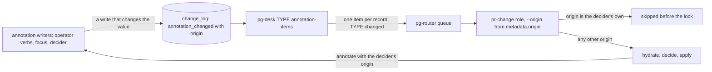

# pg-desk — annotation-items

`pg-desk <type> annotation-items --consumer annotations:NAME [--retry-window DUR] [--limit N]` is the
feed that turns a change of an entity's annotations into a pg-router item, so the entity's decider
runs when an operator hides, unhides, marks work in progress, annotates, suppresses, sets feedback on
or force-reviews it. The GitHub daemon cannot see pg-desk-owned data, so for `pr` this is the only
trigger an annotation change has (see [`changes.md`](changes.md), "Who owns change detection"). The
verb exists for every entity type (`pr`, `issue`, `thread`); a deployment wires it for `pr` only.
`issue` is not wired because its own `changes` feed already delivers `annotation_changed` (wiring both
would deliver twice), and `thread` is not wired because `thread changes` refuses on every call, so a
thread annotation change reaches nobody today.

It is the Adapter from pg-desk's change log to the router's item format, and it prints router items
directly, as `pg-desk heartbeat-item` does.

## Behavior

- **Local store only.** The verb reads pg-desk's own store. It does not call pg-connector, does not
  hydrate, and refuses an old-schema store with the same cutover message as `<type> changes`.
- **What is scanned and what is printed.** The verb reads the change-log rows of `<type>` past the
  consumer's cursor, in ascending sequence, and prints an item only for a row whose kind is
  `annotation_changed`. `--limit N` bounds the rows SCANNED, not the items printed (0 = no limit).
  The cursor advances, after the output is flushed, to the last row SCANNED, not the last item
  printed, so a page made only of other rows (hydrations) prints `[]` and still moves on: the feed
  cannot stall, and its lag stays near zero however many other rows the type has.
- **The output** is one JSON array of router items, in ascending sequence, ONE ITEM PER RECORD: records
  of one entity are never merged. An empty poll prints `[]`. An item has:
  - `type` `<type>.changed` (for `pr`, `pr.changed`, the event the `pr-change` role binds);
  - `id` `<entity id>@<12 hex>`, the hex a digest of (type, entity id, change-log sequence, origin),
    so one record always has one id (a router retry of the item is the same delivery) and two records
    have two; the digest `000000000000` reads as "no key" to `pg-pr-change` and is never emitted (it
    is remapped to `000000000001`);
  - `metadata.entity_id`, `metadata.origin` (who wrote the change: `pg-desk` for the operator verbs and
    the focus verbs, `decider:pr-decider` for the PR decider, free text for `annotate --origin`) and
    `metadata.kinds` `["annotation_changed"]`;
  - NO `metadata.seq`: a pg-desk sequence would share the delivery-key space with the GitHub daemon's
    change sequence, and the same PR would then carry two unrelated keys;
  - `expiresAt` = now + `--retry-window`, only when the flag is given, so the router retries a failed
    dispatch inside the window.
- **PR ids** are the canonical `OWNER/REPO#N`, so `pg-pr-change` takes the id as it is, and its delivery
  key is the 12 hex digits after the `@`.
- **The consumer.** `--consumer` is required and MUST start with `annotations:`. The consumer table is
  keyed by `(name, type)` with no kind column, so the prefix keeps this feed's cursor apart from
  `<type> changes`, which refuses the prefix: the two feeds can never share a cursor. A consumer
  registers at the CURRENT maximum sequence of the type on its first call, so records that exist
  already are not replayed as triggers; an existing consumer keeps its cursor. The consumer's type is
  the entity type, so `<type> consumer list|forget` and change-log pruning treat it like any other: a
  live consumer holds back pruning of that type's rows until it has gone `consumer_stale_after` unseen.
  The call reads, flushes and advances under the per-`(type, consumer)` lock and prunes the change log
  as a `changes` call does.
- **At-least-once.** The cursor advances after the print, as `<type> changes` does: a router failure
  between the print and the enqueue loses that record's trigger.

## Loop prevention

A decider's own annotation writes come back through this feed. The loop is closed in the decider's
composed command, not here: the feed reports who wrote each change, and a delivery whose origin is the
decider's own is skipped before the lock (see [`pr-change.md`](../pg-decider/pr-change.md), "Own-origin
deliveries are skipped"). An annotation write that does not change the stored value appends no record
(see [`annotate.md`](annotate.md)), so a re-run of a verb is not a trigger.

## Observability

The feed's health is its consumer lag, `pg_desk_consumer_lag{type,consumer}` (the type's maximum
sequence minus the consumer's cursor). A stuck feed shows only there: the pg-router source alerts treat
an empty `[]` poll as success. The pr lag alert (`pg-desk-pr-annotation-consumer-lag`) fires on the
`annotations:` consumers and is held while a gate such as `SYSTEM_PAUSE` blocks the query, because lag
grows on purpose then.

## Invariants

- **INV-ANNITEMS-1.** <!-- uuid: 8df34d77-b37e-453a-b10d-d2cf3af50458 --> The verb MUST print one item per `annotation_changed` record of the type past the consumer's
  cursor, in ascending sequence, with no merging of records, and MUST print `[]` when there is none.
- **INV-ANNITEMS-2.** <!-- uuid: 70b14771-75c1-43f7-9c83-8d4bbd02ea7c --> An item's id MUST be `<entity id>@<12 hex>` with the hex a digest of the type, entity id,
  change-log sequence and origin (stable for one record, distinct across records, never all zeros),
  and an item MUST NOT carry `metadata.seq`.
- **INV-ANNITEMS-3.** <!-- uuid: f24e7ddc-b147-4c5b-a332-8a7113a04470 --> The cursor MUST advance to the last change-log row scanned, not the last item printed, and only
  after the output is flushed.
- **INV-ANNITEMS-4.** <!-- uuid: d6d81434-92d2-4ede-abf7-06565a90a0ae --> A consumer of this verb MUST be named with the `annotations:` prefix, `<type> changes` MUST
  refuse that prefix, and a consumer's first registration through this verb MUST start at the type's
  current maximum sequence, while `<type> changes` consumers keep starting at `0`.
- **INV-ANNITEMS-5.** <!-- uuid: 6452f2dc-9023-4343-848e-62977f235dc2 --> The verb MUST read the local store only (no pg-connector call, no hydration), MUST refuse an
  old-schema store, and MUST exist for every entity type.
- **INV-ANNITEMS-6.** <!-- uuid: 9fc417f5-6d2a-46b3-bba1-3c065fbf9e2a --> `expiresAt` MUST be present on an item if and only if `--retry-window` was given, and then
  MUST be the time of the call plus the window.
