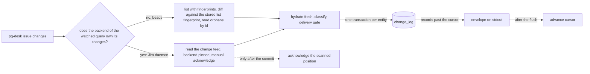
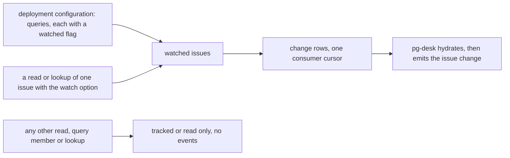

# pg-desk — changes

`pg-desk <type> changes --consumer NAME [--query Q] [--cached] [--reset] [--limit N] [--json]` is the
change feed that pg-desk itself serves for the types whose changes it emits (today `issue`): it
finds out which watched entities changed, hydrates and classifies only those, and hands the caller
the change-log records past its cursor as the `pg-desk.changes/v1` envelope. How pg-desk finds out
that an issue changed is decided per backend, not per type. For a backend that does not own its
changes (today the beads backend) pg-desk lists each watched query with pg-connector's fingerprints,
compares them with the fingerprints it stored at each entity's last hydration, and hydrates only the
entities that differ. For a backend that owns its changes (today the Jira backend, through its
daemon) pg-desk consumes that backend's change feed, hydrates the entities the feed names, and
acknowledges the feed only after it has committed. Either way pg-desk stays the single emitter of
the issue change event, and either way the flow is **watched-only**: an issue that is not watched
produces no change row and so no event, and nothing ever re-emits an issue that has not changed (see
"Tracked and watched").

For the `pr` and `ci` types pg-desk does NOT run this flow. The daemon-backed GitHub backend owns
change detection, the baseline, the age sweep and the per-PR hydration for them, so pg-desk's own PR
change flow is retired (see "Who owns change detection"). Everything below the next section describes
the flow for the types pg-desk still serves itself, unless a passage says otherwise.

## Who owns change detection

ADR 0090 lets a backend that declares it owns its changes decide what changed for its own types, so
for `pr` and `ci` the owner is the daemon-backed GitHub backend, not pg-desk. The behavior of that
backend (what it detects, its feed, its acknowledgement and its freshness) is the subject of the
behavior-docs set for the GitHub connector backend; this document names that set by its role and
does not restate it.

- **The backend owns detection for `pr` and `ci`.** The detection baseline, the age sweep and the
  per-PR hydration that pg-desk's own flow used for `pr` belong to the backend. pg-desk MUST NOT
  keep a baseline, run a sweep or hydrate entities in order to detect a PR or CI change, and the
  backend, not pg-desk, owns the consumers' cursors for those types.
- **For `issue`, ownership is decided per backend.** pg-desk MUST NOT choose how to detect an issue
  change by type alone. Its configuration names, for each watched query, the backend instance that
  serves it and whether that backend owns its changes, rendered from the same source as the
  connector's registry so that the two cannot drift. A backend that does not own its changes (the
  beads backend has no daemon and no store) is detected by pg-desk's own list-and-diff over the
  watched queries and the watched entities, with the watched flag kept in pg-desk's store. A backend
  that owns its changes (the Jira backend, whose daemon tracks the issues and keeps their rows) is
  consumed through its change feed. Every call pg-desk makes to read changes pins the backend: a
  call without a backend would fan out to every issue backend, and a non-owning backend would then
  take the connector's own ledger-diff path, a second change detector.
- **pg-desk reacts to the feed, it does not classify it.** The backend's feed decides WHETHER a
  desk run is triggered for a PR; the run itself decides what to do from the facts it gathers. After
  cutover the backend is the only source of the upstream change kinds for PRs, and pg-desk does not
  need them. `refresh` (see [`refresh.md`](refresh.md)) remains the only verb that classifies a
  change.
- **A CI change behind an unchanged rollup re-triggers categorization.** A change to a PR's CI runs
  or jobs is delivered on the PR feed as a PR change of kind `ci_changed`, naming the run and job
  fields that changed, so a PR whose rollup state did not move but whose runs or jobs did is still
  delivered, and the desk run for that PR re-categorizes it. One CI event triggers ONE desk run, not
  one per feed. This matters because CI state decides whether a PR is reviewable.
- **Detection bound.** A CI change that the rollup shows is seen within one summary freshness window
  plus the backend's settle time. A change behind an unchanged rollup is seen within the active-run
  window while a run on the current head is active, within the failed-run window while the current
  head has a non-passing run (the case that decides reviewability), and otherwise within the CI
  maximum age. Runs on an older head never make a PR active. The windows are the backend's
  configuration, not pg-desk's.
- **Recovery of a failed desk run.** There is no local reconcile tier in pg-desk for any type (see
  "Rolling age sweep: retired for issue"). For `pr`, a run that did not complete is recovered by the
  backend's acknowledged feed, which redelivers every row a consumer did not acknowledge, and by the
  periodic reconcile lanes that remain: the scheduler's slow full-sweep backstop and `pg-desk
reconcile` (see [`operator-commands.md`](operator-commands.md)). For `issue`, a failed decider run
  is not re-emitted: no timer, sweep, redrive or acknowledgement appends a row for it, and the issue
  is decided again at its next change.
- **Mergeability noise cannot reach the run.** The backend carries a PR's last known mergeability
  forward, so a transient mergeability answer does not change the facts a run compares.
- **A CI-only feed is available, and pg-desk does not use it.** The connector's `ci changes` feed,
  for a consumer that wants CI changes without parsing PR rows, is available; pg-desk does not use
  it.

## Tracked and watched

Two independent properties of an issue decide what pg-desk does with it.

- **Tracked** means the connector keeps the issue's content and keeps it fresh. For Jira the
  daemon's store does this. The beads backend has no store of its own, so nothing is tracked for
  beads: a bead is read when asked for. Tracking alone never produces an event.
- **Watched** means change rows are appended for the issue, and so it reaches pg-desk's consumers
  and the decider.

- **Nothing is watched by default.** An issue becomes watched when it is a member of a query whose
  configuration carries `watched = true` (the flag is a property of the query definition in the
  connector configuration, default false), or when a read or lookup of that one issue carries the
  watch option (`pg-desk issue refresh <id> --watch`, which for a Jira issue forwards the option to
  the daemon). There is no ad-hoc query run with the watch option: a query run would watch a SET,
  which the configuration declares instead. Which queries are watched is declared by the
  deployment, not by this document.
- **Stickiness.** A watched issue stays watched after it leaves every query, until it is closed AND
  past retention: for beads until pg-desk deactivates it after observing it closed; for Jira the
  daemon's flag lasts until the daemon evicts the issue 7 days after closing, while pg-desk's own
  flag follows the beads rule (cleared when it deactivates the entity after the delivered closed
  row) and is set again by the next feed row, which exists only for a watched issue. While the flag
  is set the connector delivers the issue's rows, including `closed` and `reopened`, so a `closed`
  row is delivered although the issue is no longer a query member, and a reopen inside the
  retention window needs no new watch. After the flag is cleared the issue is a first observation
  again (see "Baseline run, first observation and late watch").
- **Query level.** A beads query is watched exactly when its entry in the beads backend's query
  configuration carries `watched = true`. The deployment declares the flag once; the module that
  renders the deployment configuration MUST render it into the backend's query block and, for the
  same queries, into pg-desk's `watch.issue.queries`, which MUST list exactly the queries marked
  watched and no others. The connector answers a capabilities question for a backend, extended with
  each configured query's watched value; pg-desk MUST check it at start-up, and a mismatch with its
  own configuration (the backend instance, whether it owns changes, a watched value) MUST be a
  doctor gate. pg-desk lists only watched queries; an unflagged query stays available to every other
  reader and produces no change event.
- **Entity level.** pg-desk's entity row records the entity's backend and whether it is watched
  (not watched is the absence of the mark). The watched mark is set when a watched query lists the
  entity and by a one-off watch, and, for the first write of an entity, by the hydration write
  itself in the same statement, so that a first-observation row passes the delivery gate. The
  backend and the mark are also written by a column-only write that appends no row and does not
  bump the entity's version: from a feed row's pinned call, from a listing (for a created, changed
  or unchanged listed entity), and, for the backend, when a hydration resolves it. Hydration and
  refresh READ the stored backend and, when it is absent, resolve it from the configured watched
  queries and pass it to `issue show`, so a Jira id never costs a beads call first; an id served by
  queries of two different backends is a doctor gate. A Jira entity MUST NOT keep an absent backend:
  the hydration of a ticket key named in PR text resolves the owning backend by probing the
  configured owning instances first (a daemon read, never a beads call), the first that holds the id
  sets the column, and an id none holds is set to the non-owning backend.
- **Not watched means not diffed.** An entity pg-desk holds that is not watched (for example an
  issue stored only because PR text names its key) MUST be hydrated on demand only and MUST NOT be
  diffed or emitted. Narrowing `watch.issue.queries` to the watched queries therefore has two other
  effects: the ticket-key hydration for an issue named in PR text stores an issue entity only while
  some `watch.issue.queries` entry exists, and such an entity is held but silent, so a PR change no
  longer re-emits it; and the due-date attention rules raise only for the issues the watched queries
  select, so a deployment that wants due-date attention for an issue MUST declare a query that
  selects it watched.
- **The permitted append causes (stated once).** A change row for an issue entity MUST be appended
  only for: (1) a real difference in the normalised content (see "Change detection and the
  normalised comparison"), including `closed`, `reopened` and `removed`; (2) the first observation
  of a watched issue after its query's baseline; (3) the late watch of a known issue (causes 2 and 3
  are "Baseline run, first observation and late watch"); (4) propagation of `link_changed` or
  `work_changed` from a PR change to a WATCHED linked issue; (5) an annotation write on a watched
  issue; (6) `pg-desk issue changes --reset`, which replays only WATCHED active issues, as kind
  `added` with origin `reset`, never as `reconcile`. Every cause is subject to the delivery gate. For
  issue there is no age-driven sweep, no timer, no `reconcile` kind, no `sweep` or `local-reconcile`
  origin, and no acknowledgement or retry tier that appends a row.
- **Why.** The connector emits changes only for watched items, which keeps the volume of events
  small enough that the decision role is not overwhelmed. There is no blanket sweep and no
  reconcile event for issue.

## Behavior

The rest of this document describes the flow pg-desk runs itself, which serves the issue types of
every backend; it is retired for `pr`. Where a bullet applies only to the list-and-diff of a backend
that does not own its changes, it says so.

- **List-and-diff (a backend that does not own its changes).** For each watched query of `<type>`
  (`watch.<type>.queries`) served by such a backend, pg-desk runs `pg-connector <type> list --query
<q> --backend <b> --fingerprints --output json`: the whole current listing of the query with one
  opaque fingerprint per entity. There is no cursor and no connector-side consumer, so the call is
  stateless on the connector. pg-desk compares each listed entity's fingerprint with the list
  fingerprint it stored the last time it hydrated that entity (`entity.list_fp`): an entity with no
  row, or an inactive row, is **added**; an active row whose stored fingerprint differs is
  **changed**; otherwise it is unchanged and costs nothing. The comparison is always list against
  list, never against a hydrated payload: the list path lacks data the detail read has, and search
  results lag, so a cross-path comparison would report a change every tick. An entity the connector
  marks `stale` in a listing is ignored for change detection there. A row with an empty stored
  fingerprint (written by the cutover backfill) is changed once, which costs one re-hydration and
  appends a row only when the normalised content differs. Every added or changed entity is hydrated
  through the entity pipeline with origin `pg-connector`, classified and logged; an entity listed by
  several queries is hydrated once per call. A fingerprint is the connector's hash of the whole list
  entity, so any field the list returns that differs makes the entity changed; a read field the list
  does not return would be invisible to this comparison, and the fingerprint's completeness is
  pinned by a test. Hydration and classification run for every watched entity whether or not any
  decider subscribes to its type or kind.
- **Feed consumption (a backend that owns its changes).** See "Feed consumption for a backend that
  owns its changes". No list-and-diff runs for such a backend.
- **Hydration reads are fresh.** Hydration of a detected change keeps `--fresh` on `issue show`. The
  flag is not a no-op for beads: for a backend that does not opt out of caching, it is what makes the
  read bypass the connector's read-through cache, and a hydration after a detected change MUST NOT
  be served from that cache, or pg-desk would store the stale snapshot with the new list
  fingerprint and the change would be lost. A fresh read of a cached backend still falls back to a
  stale cache entry when the backend answers unavailable (and the connector's request budget denial
  answers exactly unavailable), so an answer marked `stale` or served from the cache is DEGRADED:
  hydration writes nothing and leaves the entity due. For a backend that owns its changes, "fresh"
  means the daemon answers from its store when the stored group version is at least the feed row's
  version, and otherwise refetches under its request budget.
- **One transaction, the observed fingerprint.** The entity's snapshot, `hydrated_at`, `active`,
  its change-log rows and (for a backend that does not own its changes) its stored list fingerprint
  are written in ONE transaction, and the fingerprint is the one observed in THIS call's listing,
  not one derived afterwards. A change that lands while the entity is being hydrated is therefore
  found on the next call, because the stored value is the older observed one. A hydration that
  fails, is degraded, or loses a compare-and-set writes nothing, so the entity is still different on
  the next call. Reads that do not come from a listing (`--reset`, an orphan read, a feed-driven
  hydration) write no fingerprint and leave the stored one as it was.
- **Order and cap.** Within `hydration.max_per_poll` the orphan reads come first (capped by
  `orphan_max_per_poll`, see "Active entities, membership and orphan reads"), then the changed
  entities, oldest mismatch first (never hydrated counts as oldest), then the added ones and the
  late watches by id. What the cap leaves is found again by the next call's diff; nothing is queued
  and nothing is dropped.
- **No retry state.** pg-desk runs no timer, backoff or retry loop and keeps no retry counter or
  deferral queue: the next scheduled call (pg-router's schedule) is the only retry, and an entity
  that keeps failing is retried on every call with no give-up. The one table pg-desk keeps for a
  failure is the failed-ingest table of the feed (see "Feed consumption for a backend that owns its
  changes"), which is retried at every call and has no counter.
- **Unsupported types.** An entity type whose list cannot be fingerprinted (`thread`: a Slack list
  has no stable per-entity fingerprint) is refused by `pg-desk thread changes` with a clear error
  and exit `1`, with or without `--cached`, before any connector call.
- **Records.** After hydration the call returns the change-log records of `<type>` past `NAME`'s
  cursor, ascending by `seq`, at most `--limit N` of them (`0`, the default, means all). A record
  is `seq`, `type`, `id` (pg-desk's canonical entity id), `title` (display only), `version`,
  `kinds`, `origin`, `at`. The first observation of a watched issue after its query's baseline
  yields one `added` record, never `reconcile` and never a transition kind (the first-observation
  rule of the classifier returns `added` for issue; the other types keep `reconcile`).
- **Cursor.** The cursor advances to the last delivered `seq` only after the envelope was written
  to stdout, so a crash in between re-delivers the same records (a duplicate, never a loss).
  Reading, writing and advancing are bracketed by the per-`(type, NAME)` lock: two concurrent
  calls for one consumer serialize and the second reads from the cursor the first advanced; calls
  for different consumers or types do not contend. A plain call advances `NAME`'s own cursor
  exactly like a real pg-router poll, so running it by hand under a real consumer name is not a
  peek. This cursor is pg-desk's own, over its own change log; it is not the cursor pg-desk holds
  with an owning backend's feed (see [`consumer.md`](consumer.md)).
- **`--cached`.** Returns the records a real call would, without listing through pg-connector,
  reading a feed, hydrating, registering the consumer, touching its `seen_at` or advancing its
  cursor; `sources` is empty. It works with no watched query configured and on an unregistered
  consumer (cursor `0`).
- **`--reset`.** Replays every WATCHED, ACTIVE entity of the type as `added` with origin `reset`:
  each is re-hydrated and its previous snapshot is treated as unobserved, so the record carries only
  `added`, never `reconcile`. The replay is EXEMPT from `hydration.max_per_poll` (decision recorded
  here as the design leaves it open): it is an explicit operator request, so every watched active
  entity is replayed in that one call and nothing is deferred; the replay's hydrations are not
  counted against the budget of the other work in the same call. It does not move the cursor, so a
  consumer first receives its undelivered backlog and then the replay. The replay is appended to the
  shared change log, so every consumer of the type receives those `added` records; consumers MUST
  tolerate duplicates and deciders MUST be idempotent. Inactive entities and entities that are not
  watched are not replayed. `--reset` cannot be combined with `--cached`.
- **`--query Q`.** Restricts a call to one watched query; `Q` MUST name a configured query of the
  type, otherwise the call exits `1` listing the configured ones.
- **No watched query.** A real call for a type with no `watch.<type>.queries` is a usage error and
  exits `1` naming that key. `--cached` is unaffected.
- **Liveness.** Every real call (not `--cached`) registers the consumer and sets its `seen_at`,
  including a call that ends in total failure. This is the liveness signal that replaced the
  retired heartbeat.
- **Pruning.** After a real call pg-desk prunes the change log with `change_log_retention` and
  `consumer_stale_after` (store defaults when unset): rows older than the retention that every
  non-stale consumer has passed are deleted, and a stale consumer no longer holds them back.
- **`sources`.** The envelope has one row per consulted watched query: `ok`; `degraded` when a
  pg-connector backend row of that query was neither `succeeded` nor `disabled` (disabled counts as
  healthy), when the listing was truncated (reason `list_truncated`), when a hydration of an entity
  that query listed failed or was degraded, or when the hydration budget left work for the next
  call (reason `hydration_budget`), with the reasons joined by `; `; `failed` when the pg-connector
  call itself failed or could not be started.
- **Text form.** One line per record, the history layout prefixed by the entity —
  `<type> <id>  <seq>  <at>  <kinds joined by ", ">  origin=<origin>` — then one `source <query>:
<status>[ (<reason>)]` line per query and a final `cursor <from> -> <to>` line. `--json` (or
  `PG_DESK_OUTPUT=json`) prints the envelope; its shape is pinned by the golden files under
  `internal/changes/testdata` and `cmd/pg-desk/testdata`.

## Feed consumption for a backend that owns its changes

For a watched query served by a backend that owns its changes, pg-desk reads that backend's change
feed instead of listing: the rows after the acknowledged position, for watched issues only, each
with its feed sequence. The feed is read with the backend pinned, in manual-acknowledge mode (the
connector does not acknowledge the rows when it flushes them), and acknowledged with a separate
acknowledge call that names the consumer, the query and the next position. Each changed entity is
hydrated from local reads (the daemon answers from its store, see "Hydration reads are fresh"), its
snapshot and change row are written, and only then is the feed acknowledged up to the last committed
row.

- **No acknowledgement before the commit.** pg-desk MUST NOT acknowledge a feed row before it has
  been committed: a hydration may still fail, which is why the connector's acknowledge-on-flush mode
  is wrong for pg-desk. The acknowledged position is the scanned next position, which can pass the
  last returned row, so pg-desk reads each row's sequence, and an EMPTY poll still acknowledges the
  scanned position.
- **In order, with a failed-ingest table.** pg-desk commits rows in order. A row that fails to
  hydrate is recorded in a small pg-desk table (the entity id and the row's sequence), pg-desk
  continues, and the feed is acknowledged past it: a permanently failing issue MUST NOT block every
  other issue's feed, which is the head-of-line blocking that position-based acknowledgement would
  otherwise cause. The table is retried at every poll (level-triggered, no counter) and an alert
  fires on its oldest age. This is ingest recovery (a row that could not be hydrated), not decider
  recovery.
- **Serialised across fetch and commit.** The consumer named `pg-desk`, under which pg-desk reads an
  owning backend's feed, MUST be serialised across the feed fetch AND the commit, not only across
  the delivery step (see [`consumer.md`](consumer.md)).
- **Redelivery is idempotent.** A crash between a commit and its acknowledgement redelivers rows,
  and feed rows are stored as given with no classifier diff, so a redelivered row would append a
  duplicate change row and a new event id. pg-desk therefore keys idempotence on the feed's own
  sequence AND on the daemon's store identity, because the sequence alone would skip new rows: a
  moved-aside daemon store restarts its sequence at 1, so every new row would look redelivered. In
  the same transaction as each row's commit pg-desk records the highest feed sequence it has
  committed for the pair (daemon instance, store identity), and it skips a row whose store identity
  equals the recorded one and whose sequence is at or below it, and a row for which a failed-ingest
  entry is already recorded at that sequence. A skipped row appends no row, bumps no version and
  produces no event. A different store identity, or a `cursor_expired:` answer, resets the record
  before any row is processed. The derived records written after that commit (local records, the
  interpretation, the derived cross-references) are not in its transaction, so a crash between the
  commit and them loses them and the redelivered row is skipped: the exposure is that one entity,
  and the recovery is `pg-desk issue refresh <id>`.
- **Kinds come from the feed row.** The change-log kinds of a feed-driven row are the row's own
  kinds (the daemon's classification), stored as given; pg-desk's own classifier is NOT run on it,
  because it knows only the status, closed, reopened, assignee, dependency and comment kinds and
  would collapse `title_changed`, `description_changed`, `labels_changed` and the rest into
  `fields_changed`. Link propagation for a feed row is derived from the row's kinds or from the
  stored snapshot, not from the classifier's kinds.
- **Membership.** The feed's `entered_query`, `left_query` and `removed` rows keep maintaining the
  per-query listing status and the persisted per-query sets (see "Active entities, membership and
  orphan reads"), which the focus coverage reads and which are maintained only by list runs
  otherwise. They MUST NOT end watching (see "Stickiness") and, except for the first observation of
  an unseen issue, MUST NOT be stored as change rows: otherwise each would become a row and an
  event for a flip that changed nothing about the issue. An `entered_query` row for an issue never
  seen before is delivered as its first-observation `added` row.
- **A dropped key is a gap.** A feed key unseen for the connector's consumer-stale period is
  dropped, and its next poll starts at the tail: a silent gap for the sole detector. The runbook for
  a dropped key (a refresh of every watched entity of that backend), and the doctor gate on a
  `cursor_expired:` answer, are in [`operator-commands.md`](operator-commands.md) (the section on a
  dropped feed key).
- **A moved-aside store.** Moving a pg-desk store aside also loses the failed-ingest table after its
  rows were already acknowledged, so those entities are never hydrated from the feed. The bound is
  the watched entities of the owning backend, and the recovery is the dropped-key runbook, which the
  operator who moves the store aside MUST run.

## Baseline run, first observation and late watch

Both backends follow one rule.

- **A marker per query.** Each watched query has its own baseline marker, kept where its backend
  keeps state: for Jira the daemon's per-query baseline time, set at a configured query's first
  complete run; for beads a pg-desk store key `change_flow.baseline.<query>` (a time).
- **The baseline run.** A run of a query that has no marker is a baseline run: every member is
  marked watched and NO row is appended. For beads, a member pg-desk does not yet hold is hydrated
  silently with the no-row write (a state write with empty kinds updates the snapshot and bumps the
  version but appends no change-log row), paced by `hydration.max_per_poll`; a held member is only
  marked, except that a held member whose list fingerprint differs is selected for hydration in the
  same poll and that hydration MUST use the same no-row write. The marker MUST be written only in
  the poll in which the last unhydrated member was hydrated, so a baseline that takes several polls
  stays silent. For Jira the daemon holds the members, and pg-desk learns a member it does not hold
  from that member's first feed row. A query added to the configuration later has no marker, so its
  first run is also a baseline run.
- **Which rule wins.** The baseline rule wins over "appears later": a member present at its query's
  baseline run is never "appearing later".
- **First observation.** An entity first seen in a watched query that already has its marker
  appends exactly one `added` row, the one first-observation kind for both backends.
- **Late watch.** A KNOWN entity that becomes watched after its query's baseline, by being listed by
  a baselined query it was not in or by a one-off watch, appends exactly one `added` row, so that
  pg-desk hydrates and emits it. The diff selects only an absent or inactive row or a row whose list
  fingerprint differs, so outside a baseline run the selection also includes a listed entity whose
  watched mark is absent, and the mark is set only by the hydration write, never at selection: a
  late watch cut by the hydration budget is retried at the next poll and not lost.
- **A query flipped to watched.** pg-desk lists only watched queries, so a beads query newly flagged
  has no marker and its first run is a silent baseline run. The Jira daemon baselines every
  configured query for tracking, so flipping an already-baselined Jira query to watched is a late
  watch: one `added` row per known member, bounded in total by the number of known open members of
  the query and in rate by `hydration.max_per_poll`, because a row is emitted only after hydration.
  The asymmetry follows from where the marker lives.
- **Move-aside.** A moved-aside pg-desk store or daemon store loses its markers, so each watched
  query runs a baseline run again: silent, no flood. The one-off watches are lost with the store;
  nothing re-asserts them.
- **A baseline that cannot finish.** A member whose hydration fails or is degraded is retried at
  every poll and keeps the marker unwritten. A baseline open for more than one day MUST be a doctor
  gate naming the query and the failing members, and from then on its members are no longer excluded
  from the unflagged-member alert (see "Telemetry and logs").

## The delivery gate

pg-desk MUST NOT append, and so MUST NOT deliver, a change-log row for an issue entity that is not
watched, whatever the origin of the row; each permitted append cause is subject to it. The gate is
needed because pg-desk has write paths of its own that the connector never reported, and because the
consumer read delivers every row of the entity type, with no origin or watched filter. The paths
that append a row for an issue entity are these, and the gate applies to all of them:

1. Hydration and refresh (`pg-desk issue refresh <id>` of an unwatched entity appends a row at
   origin `pg-desk`).
2. Link and work propagation (`link_changed` and `work_changed` records appended to the entities
   cross-referenced to a changed PR, and the manual link verbs). An issue entity held only because
   a ticket key in PR text was stored receives these, so without the gate every PR change would
   re-emit the issue change for each linked unwatched issue.
3. Annotation writes.

- **The gate and its statement order.** For an issue entity the append is skipped (no row, no
  sequence, no error) unless the entity is watched in the same transaction, where "watched" means
  the mark as it stood BEFORE the statement or the mark this same write sets (so a first-observation
  row passes). A write that CLEARS the mark does so AFTER the append, in the same transaction, so a
  `closed` or `removed` row of a watched entity is always appended and delivered, and the gate never
  hides the row that ends the watch. The snapshot, version, annotation and link writes themselves
  proceed; only the row is withheld, so no event can follow. An annotation write whose row the gate
  withheld still reports that the annotation WAS written, separately from the sequence.
- **On append, not on read.** The gate is on APPEND: filtering on the mark at read time would hide a
  `closed` row after the mark is cleared.
- **A watched issue still receives propagated rows.** A watched issue whose linked PR changed is
  worth a decider run.
- **Rows already in the change log** when the gate takes effect are not rewritten; they are consumed
  once through the cursors.
- **The gate applies to every issue entity.** Not only to those of an owning backend.

## Active entities, membership and orphan reads

An entity is **active** while BOTH hold: it is non-terminal in its source system (open PR; issue not
terminal, see "What counts as a terminal issue" below; thread with a reply inside
`watch.thread.active_window`) AND it is still watched. Only active, watched entities are replayed by
`--reset` or read as orphans.

- **Watched-set membership.** pg-desk keeps, per watched query, the ids that query listed at its
  last complete listing (store `meta` keys `change_flow.watchset.<type>.<query>`, no schema change).
  A **complete** listing is one where at least one pg-connector backend succeeded, none is degraded
  (`disabled` counts as healthy) and nothing was truncated; it rewrites the query's set to exactly
  the listed ids. A degraded or truncated listing only ever ADDS its listed ids and never removes
  any, and a failed query contributes nothing at all. For an owning backend the feed's membership
  rows maintain the same sets (see "Feed consumption for a backend that owns its changes"). The
  sets and the per-query listing status serve the focus coverage; they are not a source of
  `removed` rows.
- **Leaving a query is not removal.** For `issue`, an entity's absence from every watched query MUST
  NOT produce a `removed` row and MUST NOT end watching. A watched, still-open entity that no watched
  query lists any longer (a one-off watch, or an entity that left its query for an ordinary reason,
  for example a deferral, a block or a relabel) stays watched and is read by id until it closes.
  This is change detection for a watched entity, not a sweep. For an owning backend the daemon
  tracks the issue and the feed delivers its rows by the watched mark, so an issue that left its
  query is still reported and pg-desk has no orphan read for it.
- **Orphan reads (beads).** At most `orphan_max_per_poll` orphans are read per poll, and they are
  read FIRST, out of the same `hydration.max_per_poll` budget (and the connector's request budget),
  so that changed members cannot starve them and the orphans cannot take more than their cap from the
  members. A hydration is two connector calls when dependency hydration is on (`issue show --fresh`
  and `issue deps --full`). Orphans are read oldest-ATTEMPT first, by a per-entity last-attempt time,
  so with N orphans each is attempted within ceil(N / `orphan_max_per_poll`) polls and a failing
  orphan rotates instead of holding a slot at every poll. The age metric
  `pg_desk_oldest_orphan_read_age_seconds` counts from the last SUCCESSFUL read (`hydrated_at`
  before any), so a failing orphan keeps ageing and trips its alert. Both times are kept per entity
  and written by the column-only write, which appends no row and bumps no version.
- **Comparison basis.** An orphan read compares the NORMALISED snapshot with the stored one, never
  the list fingerprint, which is a hash of the list shape; it leaves the stored list fingerprint
  untouched, and an unchanged orphan read writes nothing but the two times: no row and no version
  bump.
- **Gone.** An orphan read that answers `not_found` (a deleted bead) appends one `removed` row, which
  is delivered because the gate reads the mark as it stood before the statement, and in the same
  transaction after that append clears the mark, deactivates the entity and stops reading it.
- **Failed or degraded.** A failed or degraded read leaves the entity watched and due. With no retry
  counter, its age is what exposes it.
- **The removal confirmation read is retired for issue.** The confirmation read that used to precede
  a removal (and the `removed` rows that came from leaving a query) no longer exist for issue: the
  only `removed` rows are the `not_found` one above and a `removed` row from an owning backend's
  feed.
- **The cost.** The PR backend refreshes every tracked PR in the background under its own governor;
  beads has no daemon, so orphan reads are foreground reads at each poll against the connector's
  request budget. This is the one place the beads path costs more than a store-backed one, and it is
  why the cap and the age metric exist.
- **Source-terminal deactivation.** After every successful hydration (added/changed, orphan read,
  feed-driven or reset) an entity that is terminal in its source system (closed or merged PR,
  terminal issue, thread with no reply inside `watch.thread.active_window`) is set inactive through a
  compare-and-set write, and its watched mark is cleared in the same transaction AFTER the append of
  the delivered `closed` row. No `removed` record is appended: the classifier (or the feed row)
  already logged `closed`/`merged` where it saw the transition. `closed`/`merged` never implies the
  entity left every watched query, and `removed` never implies it was closed.

### What counts as a terminal issue

One rule serves both the classifier (the `closed` and `reopened` records) and source-terminal
deactivation:

- When the issue's stored facts carry the tracker's **status category** (`issue_show.status_category`,
  one of `new`, `indeterminate`, `done`), the category decides: `done` is terminal, the others are
  not, whatever the status is called ("Complete", "Released", "Won't Do"). The `jira.done_statuses`
  list is not consulted.
- When there is no category (the beads backend never has one; Jira omits it for a legacy "No
  Category" status or when an older `pjira` is on `PATH`), the status NAME decides: `closed`,
  `done`, `resolved`, `cancelled`, `canceled` and `wontfix`, case-insensitive.
- `closed` and `reopened` compare the two snapshots' terminal-ness, not their status strings, so
  an issue whose status string is unchanged can still be `closed`. **Rollout:** an issue stored as
  "Complete" before categories were carried, whose next hydration arrives with category `done`,
  logs `closed` (without `status_changed`, since the status did not change) and is deactivated. The
  same happens once to every stored done-category Jira issue on its next hydration, so a
  one-time burst of `closed` records and deactivations after the category first arrives is expected.
- A category that disappears is not a movement: when the old snapshot had a category and the new
  one has none (an older `pjira` on `PATH`, a degraded decode), no `closed`, `reopened` or `opened`
  is logged, so the name fallback cannot misread "Complete" as reopened. `status_changed` is still
  logged when the status strings differ.

## Change detection and the normalised comparison

pg-desk decides whether a hydration appended a row by comparing the hydrated snapshot with the
stored one. The comparison MUST use a NORMALISED snapshot: normalisation drops `as_of`, `stale`,
`updated_at`, the connector's `served_from` and `age_seconds` (it adds them to every cached show
answer) and every field in the connector's fingerprint excludes. A byte or hash comparison of the
stored payload would never find "unchanged", because the stored payload and its hash differ on every
read (`as_of` is the read time).

- **A difference is a row.** A difference in the normalised content MUST produce a change row, and
  when no specific kind matches, the row carries `fields_changed` naming the fields that differ.
- **`updated` alone is no row.** A change to `updated_at` alone re-hydrates the entity and appends no
  row; the beads `comments_changed` proxy (below) is the one exception, kept for beads until the
  comment-count question is answered, and retired for rows that come from the Jira feed.
- **Nothing advances for an unchanged entity.** With no sweep, nothing needs to advance
  `hydrated_at` for an unchanged entity. The write that records only the backend, the watched mark or
  the orphan times is column-only: it appends no row and does not bump the entity's version.

## Rolling age sweep: retired for issue

pg-desk runs no age sweep for `issue`, and nothing replaces it. Both tiers of the former sweep are
retired: the blanket local tier (which appended `reconcile` records with origin `local-reconcile`
for every active entity whose latest row was old, with no remote call) and the always-appending
remote tier (which re-hydrated active entities by age and logged `reconcile` with origin `sweep`).
With them go the `reconcile` kind for issue, the `sweep` and `local-reconcile` origins for issue,
the deterministic jitter, the per-tier cap and the sizing bound. A failed decider run is not
re-emitted by anything; the issue is decided again at its next change. The `sweep.*` configuration
keys remain for the other types (`pr`, `thread`); the issue flow does not read them. The old
top-level `pg-desk sweep` bulk backfill is unrelated and unchanged.

## Hydration budget (design 8.5)

`hydration.max_per_poll` (default 50) caps the DETAIL reads per call, across both sources: the
orphan reads first, then the changed entities, then the added entities and late watches. A `--reset`
replay is exempt (see `--reset`).

- When the budget runs out, or the backend answers degraded three hydrations in a row, the
  remaining hydrations are left for the next call, never retried inline. Every watched query that
  listed a left-over entity is marked `degraded` with reason `hydration_budget` (or
  `hydration_backend_degraded`). The call exits `2`.
- Nothing is queued. A left-over added/changed entity still differs from its stored fingerprint, so
  the next call's diff finds it again in the same order; a hydration that FAILED wrote nothing and
  is found the same way, on every call, with no counter and no give-up.
- A budget-exhausted poll keeps the consumer cursor semantics unchanged: it advances only after the
  flush, over the records actually delivered.

## Due backlog

The count of work that is due (the due-backlog series and the focus coverage header, which marks the
focus state incomplete past `coverage_backlog_max`) MUST, for `issue`, count only hydrations that are
PENDING: a changed or watched entity not yet hydrated, and the entries of the failed-ingest table.
It MUST NOT count entities past an age, because with no sweep `hydrated_at` no longer advances for an
unchanged entity, and coverage would otherwise read incomplete for ever.

## Issue-dependency hydration (`hydration.read_issue_deps`)

`hydration.read_issue_deps` (boolean, default `false`; home-module option `hydration.readIssueDeps`)
switches issue-dependency hydration on. It applies to every path that hydrates an issue: `changes`,
`refresh`, `run issue`, `sweep` and `reconcile` all hydrate through the one gatherer the pipeline
builds, and that gatherer reads the key.

- **Off (the default).** An issue hydration reads `issue show` only. The stored facts carry
  `issue_show` and no `issue_deps`.
- **On.** After `issue show`, the hydration also reads `pg-connector issue deps <id> --full` and
  stores its result as `issue_deps` beside `issue_show`: the RECURSIVE set the issue is blocked BY. It
  costs one extra connector read per issue hydration (it does not draw on `hydration.max_per_poll`,
  which counts hydrations). A failed or `not_found` deps read fails the hydration, so a stored
  `issue_deps` is never stale relative to its `issue_show`.
- **What it is for.** The daily-focus rank's "unblocks" key. An issue whose stored facts carry
  `issue_deps` is "available" to it; one without (the key was off when it was last hydrated) ranks
  with the key at 0 and is counted as unavailable, not as zero by evidence.
- **Direct edges are not behind the switch.** The one-level typed edges (`issue_show.deps`, each
  `{id, type}`) are stored whether or not the key is on. `issue_deps` is recursive and the Jira
  backend returns it empty, so it is NOT the source of the reverse index: the index
  (`dependency.IssueDependents`, below) is built from the direct edges only.

**The reverse-edge index.** `dependency.IssueDependents`, in `internal/dependency`, is the issue
counterpart of the PR `Resolver.DependentsOf`. Built once per read from the stored issue entities, it
answers `DependentsOf(issueID)`: the sorted ids of the issues blocked BY `issueID` directly. An issue
B is a dependent of A when B's stored `issue_show.deps` holds an edge `{id: A, type: blocks}`; only
edges of type `blocks` count, one hop only. For a chain A blocked by B and B blocked by C,
`DependentsOf(C)` is `[B]` and `DependentsOf(B)` is `[A]`. A dependent is listed only while its
entity is active and the caller's terminal predicate (the rank passes one built over
`classify.SourceTerminal` and its injected clock) does not hold; the index itself reads no clock and
refuses an unmigrated store. `Available(issueID)` is true when the issue's own stored facts carry
`issue_deps`. The index reads the store only: no connector call, no tracker call.

## Issue `comments_changed` is an `updated_at` proxy

The landed beads issue payload carries no comment field. For beads issues, `comments_changed`
therefore means "`updated_at` advanced while every other field of the issue did not change"; it is
NOT a comment-level diff, and an edit that only touches labels or priority emits nothing as a
comment change (a labels or priority difference is a content difference and appends its own row, see
"Change detection and the normalised comparison"). Deciders MUST NOT read it as proof that a comment
was added. It is the one exception to "`updated` alone is no row": it is kept for beads until the
comment-count question is answered, and it is retired for rows that come from the Jira feed, where
the daemon's own kinds apply.

## Failure semantics and exit codes

| Exit | Meaning                                                                                                                                                                           |
| ---- | --------------------------------------------------------------------------------------------------------------------------------------------------------------------------------- |
| `0`  | Every watched query listed and every reported entity hydrated cleanly.                                                                                                            |
| `1`  | Any other error: bad flags, an unknown `--query`, no watched query, an old-schema store, a store or config error.                                                                 |
| `2`  | Partial: at least one watched query or hydration failed or degraded. The envelope still carries the records, and the cursor advanced past what was delivered.                     |
| `3`  | Total failure: every watched query failed. The envelope is printed with `failed` sources and no records; nothing was logged and the cursor did not move (`seen_at` is still set). |

- A degraded, truncated or failed source never yields `removed`/`closed` for an entity it failed to
  list; the entity stays as it was and is retried on a later poll.
- A detail read failing for one entity keeps that entity's previous snapshot and stored
  fingerprint, logs nothing for it and marks the listing query's source `degraded` (exit `2`). The
  entity still differs on the next call, so it is hydrated again then (see the hydration budget). A
  feed row that fails to hydrate is recorded in the failed-ingest table and retried at every call.
- Each hydration is counted in the store's `meta` table (`change_flow.hydrations.<type>`,
  `change_flow.hydration_failures.<type>`, `change_flow.occ_retries.<type>`, and the per-entity
  `change_flow.degraded.<type>` set) for `status`, `doctor` and `/metrics`; an entity degraded in
  two consecutive hydrations counts as repeatedly degraded.
- **Per-query listing status.** After every real (non-`--cached`) call, for each watched query the
  call consulted, `changes` writes the store `meta` key `change_flow.listing.<type>.<query>`
  holding the JSON `{"status": ..., "reason": ..., "at": ...}`: `status` is `ok`, `degraded` or
  `failed` and `reason` is the same short text that query's envelope `sources[]` entry carries
  (empty for `ok`), both exactly as the envelope reports them; `at` is the RFC3339 time of the call.
  A later call overwrites the entry, so a `failed` query reads `ok` again after one good call. A
  total-failure call (exit `3`) still writes its `failed` entries. A `--cached` call writes
  nothing (it consults no tracker), and a query the call did not consult (`--query` named another)
  keeps the entry it had. The write is best-effort: a meta write error is a stderr warning and
  never fails the call. Store-only readers (`focus show`'s coverage header, the `/metrics` listing
  gauge, `doctor`) read these keys through `changes.ReadListingStatuses`, which returns a type's
  entries sorted by query and skips an undecodable value rather than failing. Because the stored
  listing value is overwritten at every call, failures included, the time of the last SUCCESSFUL
  listing of a query is kept in its own key (`change_flow.listing_ok.<query>`). Telemetry: the write
  emits no OpenTelemetry or Prometheus output and logs only that warning.

## Old-schema refusal

`changes` has no old-schema counterpart, so on a store not yet cut over it refuses (including with
`--cached`) with the store's error, which says to run `pg-desk migrate --cutover`, and exits `1`.

## Invariants

All invariants below except INV-CHANGES-13 to INV-CHANGES-15 govern the flow pg-desk runs itself,
which serves the issue types of every backend (a passage says where it is specific to one kind of
backend); they do not apply to `pr`, whose flow is retired. INV-CHANGES-13 to INV-CHANGES-15 govern
`pr` and `ci`.

- **INV-CHANGES-1.** <!-- uuid: 73013e4b-a478-4964-a474-803f9749a719 --> The consumer's cursor MUST advance only after the envelope was written, and
  never on `--cached`.
- **INV-CHANGES-2.** <!-- uuid: 83204e57-b303-4df7-bedb-7a6b3f231053 --> A total failure MUST log nothing and leave the cursor where it was.
- **INV-CHANGES-3.** <!-- uuid: 37b33d52-a383-4891-91ff-762f9606c96a --> A degraded or failed source or hydration MUST NOT produce a `removed` or
  `closed` record.
- **INV-CHANGES-4.** <!-- uuid: 49df2f1a-e74a-4837-b49f-2d7138d615c2 --> The first observation of a watched issue after its query's baseline MUST yield
  exactly one row, of kind `added`, and never `reconcile`; a baseline run MUST append no row.
- **INV-CHANGES-5.** <!-- uuid: 32593ca1-19ba-4795-b890-cfd7920230ce --> The only binary this verb execs is `pg-connector`, through the gather
  package's single exec chokepoint. Every call it makes to read changes MUST pin the backend. For a
  backend that does not own its changes it calls `<type> list --fingerprints` and never `<type>
changes`; for a backend that owns its changes it calls `<type> changes` (in manual-acknowledge
  mode) and the acknowledge call, and never lists that backend's queries to detect a change.
- **INV-CHANGES-6.** <!-- uuid: e76e6662-4538-4ed0-9876-034c97381266 --> For `issue`, an entity's leaving a watched query MUST NOT produce a `removed`
  record and MUST NOT end watching. A `removed` record MUST be logged only for an entity its source
  no longer has: a read by id that answers `not_found`, or a `removed` row of an owning backend's
  feed.
- **INV-CHANGES-7.** <!-- uuid: 9d0e0556-37f8-4fe5-b5eb-dc757b2444df --> An inactive entity MUST NOT be read as an orphan or replayed by `--reset`, and an
  entity that is not watched MUST NOT be diffed, read as an orphan or replayed.
- **INV-CHANGES-8.** <!-- uuid: 122ffa2b-3aa3-4fc7-a577-7b9da8a16016 --> A call MUST NOT start more than `hydration.max_per_poll` hydrations, orphan reads
  included (a `--reset` replay is exempt); orphan reads MUST be served first, no more than
  `orphan_max_per_poll` of them, and changed work MUST be served before added work.
- **INV-CHANGES-9.** <!-- uuid: 62c190c8-189e-4476-904f-86a6271c5a50 --> For a backend that does not own its changes, an entity's stored list fingerprint
  MUST be written only in the transaction that writes its snapshot, MUST be the fingerprint observed
  in the listing that triggered the hydration, and MUST be left unchanged by every failed, degraded
  or lost hydration and by every read that does not come from a listing.
- **INV-CHANGES-10.** <!-- uuid: 256c917b-8696-4f05-a22c-82b089654006 --> pg-desk MUST NOT keep a retry counter, a deferral queue or a timer for the
  list-and-diff flow; the next scheduled call is the only retry.
- **INV-CHANGES-11.** <!-- uuid: 6f841a8a-ea31-422d-bd18-d2b8feda4d3b --> A failed or degraded read of a watched issue (an orphan read or a hydration)
  MUST leave the entity watched and due and MUST append nothing; a read that answers `not_found` MUST
  append one `removed` row and, in the same transaction after that append, clear the watched mark and
  deactivate the entity. A degraded, truncated or failed listing MUST NOT cause a read of an absent
  member.
- **INV-CHANGES-12.** <!-- uuid: 55ac4d95-84e0-438f-878a-d6d8e36e80b9 --> For `issue`, pg-desk MUST NOT re-emit an issue that has not changed: it MUST run no
  age sweep, no local reconcile tier and no timer, and no `reconcile` kind, `sweep` origin or
  `local-reconcile` origin MUST exist for issue. A row MUST be appended only for the permitted
  causes of "Tracked and watched": a real difference in the normalised content, the first
  observation after a baseline, the late watch, propagation to a watched linked issue, an annotation
  write on a watched issue, and `--reset`. A failed decider run MUST NOT be re-emitted: no timer,
  sweep, redrive or acknowledgement appends a row for it.
- **INV-CHANGES-13.** <!-- uuid: 6c271805-3abc-49a8-b4c0-0ce3358d7433 --> For `pr` and `ci`, pg-desk MUST NOT own change detection: it MUST NOT keep a
  detection baseline, run an age sweep or hydrate entities in order to find a change, and the
  backend that owns those changes, not pg-desk, MUST own the consumers' cursors.
- **INV-CHANGES-14.** <!-- uuid: bc6b61da-1a7b-4c42-b93d-98b89366cd8d --> A CI change behind an unchanged rollup MUST re-trigger categorization of the
  PR it belongs to, once per change and not once per feed.
- **INV-CHANGES-15.** <!-- uuid: fffa7fca-0a84-4f3b-9815-24a3928e7379 --> A desk run that did not complete for a PR MUST still be recovered with no
  decider acknowledgement protocol and with no local reconcile tier in pg-desk, through the
  backend's redelivery of unacknowledged feed rows and the periodic reconcile lanes.
- **INV-CHANGES-16.** <!-- uuid: 935902e9-8d86-4af6-9b97-947100dea37d --> With `hydration.read_issue_deps` false an issue hydration MUST NOT call
  `issue deps`, and with it true MUST store its `--full` result as `issue_deps` or fail the
  hydration; the direct `issue_show.deps` edges MUST be stored either way.
- **INV-CHANGES-17.** <!-- uuid: 6962bf00-e1eb-475f-b5f6-ea3ce09423e8 --> The issue reverse-edge index MUST count DIRECT, `blocks`-typed edges only,
  MUST exclude inactive and (by the caller's predicate) terminal dependents, and MUST report an
  issue without stored `issue_deps` as unavailable rather than as having no dependents.
- **INV-CHANGES-18.** <!-- uuid: 391c1ff5-ad6d-411e-a616-f75aa60dfacb --> pg-desk MUST NOT choose how to detect an issue change by type alone. Its
  configuration MUST name, per watched query, the backend instance that serves it and whether it
  owns changes, rendered from the same source as the connector's registry; the connector's
  capabilities answer MUST be checked at start-up and a mismatch MUST be a doctor gate; every
  pg-desk call that reads changes MUST pin the backend; the entity row MUST record its backend; and
  no Jira entity MAY keep an absent backend.
- **INV-CHANGES-19.** <!-- uuid: d1b6fbb4-ebc7-4438-b0ba-e2e96c1dd034 --> pg-desk MUST NOT acknowledge a feed row before it has been committed. An empty
  poll MUST still acknowledge the scanned next position. pg-desk MUST commit rows in order; a row
  that fails to hydrate MUST be recorded (entity id and the row's sequence) in the failed-ingest
  table, pg-desk MUST continue and acknowledge past it, and the table MUST be retried at every poll
  with no counter.
- **INV-CHANGES-20.** <!-- uuid: a7389f5b-5519-4ff5-828b-ab7124fc2d75 --> A redelivered feed row MUST NOT append a row, bump a version or produce an event.
  pg-desk MUST key idempotence on the feed's sequence AND the daemon's store identity, recording in
  the same transaction as each row's commit the highest committed sequence for the pair (daemon
  instance, store identity); a different store identity, or a `cursor_expired:` answer, MUST reset
  that record before any row is processed.
- **INV-CHANGES-21.** <!-- uuid: 56c68a2b-12dc-4c37-afc1-bcb355b22439 --> Nothing MUST be watched by default. An issue MUST become watched only when it is a
  member of a query configured `watched = true`, or when a read or lookup of that one issue carries
  the watch option; it MUST stay watched after it leaves every query until it is closed and past
  retention; the connector MUST emit change rows ONLY for watched issues; and an issue that is only
  read or only tracked MUST deliver nothing.
- **INV-CHANGES-22.** <!-- uuid: f03067ae-aa32-4931-8ccc-4c4469948a52 --> `watch.issue.queries` MUST list exactly the queries the deployment marks watched
  and no others, rendered from the same declaration as the connector's query configuration; pg-desk
  MUST list only watched queries; the entity row MUST carry a watched mark, set when a watched query
  lists the entity, by a one-off watch and by the hydration write itself in the same statement for
  an entity's first write; and an entity that is held but not watched MUST be hydrated on demand
  only and MUST NOT be diffed or emitted.
- **INV-CHANGES-23.** <!-- uuid: c9d109d5-0d3a-4f11-86de-018f52aca6e8 --> pg-desk MUST NOT append, and so MUST NOT deliver, a change-log row for an issue
  entity that is not watched, whatever the origin of the row. The gate MUST sit on the append, MUST
  read the watched mark as it stood before the statement or as this same write sets it, MUST NOT
  hide a row from a consumer after the append, and a write that clears the mark MUST do so after the
  append in the same transaction. A gated append MUST NOT hide that an annotation was written.
- **INV-CHANGES-24.** <!-- uuid: 1f831e85-4429-4c9a-a6d9-d5c7810fcc0f --> Each watched query MUST have its own baseline marker. A run of a query with no marker
  MUST mark every member watched and append NO row; the marker MUST be written only in the poll in
  which the last unhydrated member was hydrated. An entity first seen in a watched query that has its
  marker, and a known entity that becomes watched after its baseline, MUST each append exactly one
  `added` row; the baseline rule MUST win over "appears later"; the watched mark MUST be set only by
  the hydration write, so a late watch cut by the budget is retried. A baseline open more than one
  day MUST be a doctor gate.
- **INV-CHANGES-25.** <!-- uuid: 44cafed7-971c-4c67-99b5-b636daec064d --> For beads, a watched, still-open entity that no watched query lists MUST be read by
  id until it closes, oldest attempt first, within the cap and the shared hydration budget; the read
  MUST compare the normalised snapshot (never the list fingerprint), MUST leave the list fingerprint
  untouched and MUST write nothing but the attempt and success times when nothing differs.
- **INV-CHANGES-26.** <!-- uuid: c63f9f4c-0d29-4650-b3d6-456a2b3d954d --> Whether a hydration appended a row MUST be decided by comparing NORMALISED snapshots,
  which drop the read-time and volatile fields (`as_of`, `stale`, `updated_at`, `served_from`,
  `age_seconds` and the connector's fingerprint excludes); a difference MUST yield a row, with
  `fields_changed` when no specific kind matches; a change to `updated_at` alone MUST append no row,
  except the beads `comments_changed` proxy.
- **INV-CHANGES-27.** <!-- uuid: 13a7d5eb-88dc-4611-8f77-e07bc0a55364 --> Hydration of a detected change MUST keep `--fresh` on `issue show`, and an answer marked
  `stale` or served from the cache MUST be treated as degraded: pg-desk MUST write nothing and leave
  the entity due.
- **INV-CHANGES-28.** <!-- uuid: 11e0db31-83bb-4c1b-bd13-a191359ead2b --> The kinds of a feed-driven row MUST be the feed row's own kinds, stored as given;
  pg-desk's classifier MUST NOT be run on it. A feed's `entered_query`, `left_query` and `removed`
  rows MUST maintain the per-query listing status and persisted sets, MUST NOT end watching and,
  except for the first observation of an unseen issue, MUST NOT be stored as change rows.
- **INV-CHANGES-29.** <!-- uuid: 5286b9ce-b03d-4343-91a3-5cc1efb9cc54 --> For `issue`, the due backlog (the series and the coverage header) MUST count only
  pending hydrations (a changed or watched entity not yet hydrated, and the failed-ingest table), not
  entities past an age.
- **INV-CHANGES-30.** <!-- uuid: 6ef8f2ab-a5de-4c15-846f-7edcc8edddfd --> `--reset` for issue MUST replay only watched active entities, as kind `added` with
  origin `reset`, never as `reconcile`.
- **INV-CHANGES-31.** <!-- uuid: 9e7f62c1-264b-4f84-ac4c-2330c86fd460 --> Outcome alerts MUST exist for: the oldest orphan read age; a watched open issue
  whose source has not been observed for more than a day; a member of a watched query that has no
  watched mark across two consecutive polls (members of a baseline that has been open less than one
  day excluded); and a failed decider run with no later change.

## Telemetry and logs

`changes` writes no OpenTelemetry or Prometheus output itself. It persists the hydration counters
above for `serve`, `status` and `doctor` to read; its diagnostics (a failed `--reset` replay or
orphan or feed hydration of one entity, a failed membership write, a failed prune) go to stderr as
plain lines.

The series and alerts for the issue flow, all persisted by the short-lived CLI in the store and read
at scrape time, with instruments registered without a `_total` suffix:

- **New series.** `pg_desk_watched_entities{type,backend}` (the count of watched entities);
  `pg_desk_ingest_failed{backend}` and its oldest age; `pg_desk_oldest_orphan_read_age_seconds{backend}`;
  `pg_desk_watched_source_observed_age_seconds{backend}` and `pg_desk_issue_unflagged_members{backend}`.
  The existing `pg_desk_due_backlog`, `pg_desk_consumer_lag` and `pg_desk_watch_listing_status` stay,
  and `pg-desk-focus-consumer-lag` keeps working (the consumer rows stay).
- **The sweep-bound series.** For `issue` neither the local-tier bound nor the remote-tier bound
  exists any more: both go with the two sweep tiers, and the doctor lines, the `serve` text and the
  alert text that spoke of them are updated with the code. The bounds remain for the other types.
- **Alert on the failed-ingest age.** An alert on the oldest failed-ingest age.
- **Outcome alerts.** The process-liveness rules cannot see a watched issue that silently stopped
  being observed, so the following alerts watch outcomes:
  1. **Orphan lag.** `pg_desk_oldest_orphan_read_age_seconds{backend}` above a threshold (recommended
     default 30 minutes, 6 polls of 5 minutes, the longest an orphan waits under the recommended
     cap).
  2. **Watched issue not observed.** `pg_desk_watched_source_observed_age_seconds{backend}`, the age
     of the oldest successful observation of the source of any watched open issue (beads: the last
     successful listing of its watched query, or the orphan's last successful read; Jira: the
     daemon's last query success and the oldest unacknowledged feed row), above one day. It bounds
     how long a watched open issue's tracker state can differ from pg-desk's.
  3. **An issue that should be watched is not.** `pg_desk_issue_unflagged_members{backend}`: members
     of the last successful listing of a watched query (beads) or of the daemon's watched queries
     (Jira) whose pg-desk entity has no watched mark; the alert fires on any non-zero value across
     two consecutive polls. Members of a query whose baseline is in progress are excluded until it
     has been open one day.
  4. **A failed decider run with no later change.** Its source is a per-event failed-dispatch series
     of the router; until it exists this alert is the router's existing generic failure-rate rule.

  Each pg-desk alert is an alert-rule model with a model test, has its uid registered with the
  router probe, and uses a no-data state of alerting guarded by pg-desk liveness where its series is
  derived from the store at scrape time.

- **`doctor` and `status`.** Gates (can fail): a failed-ingest entity older than a bound; a baseline
  open for more than one day; a `cursor_expired:` key; a mismatch between pg-desk's dispatch
  configuration and the connector's capabilities answer (including a watched mismatch); active issue
  entities of a backend with no watched query declared for it, so that a missing declaration is
  loud. Reports: the watched count per backend, the member count of each watched query, and an
  entity pg-desk holds that nothing watches. `status` prints counts only.
