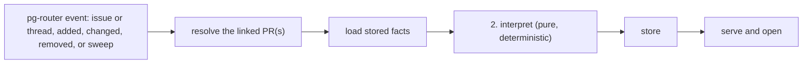

# pg-desk — the run command (`run`)

`pg-desk run <type> <id> --change added|changed|removed|sweep` re-interprets the pull requests an
`issue` or `thread` event is about; an absent `--change` means `sweep`. `<type>` is `issue` or
`thread`. There is no `run pr`: the gather, interpret, store and sync run for a pull request, the
`reconcile` and `sweep` passes over it, the `sync` stage and the `sync_error` retry bookkeeping were
deleted when the legacy sync lane was retired (PR lane refactor, packet P9a-2). The daemon is the PR
feed; `pg-desk pr refresh` is the verb that re-reads one PR. `run pr` is rejected as an unknown
entity type, with a failure line that names the removal.

The run is two stages in one process: the stored facts of the PR are loaded, and interpret (stage
2, pure and deterministic) re-derives its interpretation and stores it. It never gathers a PR and it
never writes a bead.

`run issue` resolves the triggering bead (or Jira ticket key) to the PR(s) it is about and
re-interprets each one, see [`run-issue.md`](run-issue.md). `run thread` cross-references a Slack
thread to PRs and re-interprets them, see [`run-thread.md`](run-thread.md). Both are kept after the
sync stage's removal and MUST run on a schema-2 store.

## Exit codes

`run`'s contract to pg-router is fixed: it MUST exit `0` on success and on a degraded run (see
[`gather.md`](gather.md)), and `1` when the triggering entity itself could not be resolved or
fetched, or the store could not be written. `run` MUST NEVER return a raw `pg-connector` exit code,
and MUST NOT exit `9` except for the one deliberate decline `run thread` documents (an `added`
thread `pg-connector` reports `not_found`: [`run-thread.md`](run-thread.md)'s "Exit codes"), which
is pg-desk's own signal, never a forwarded `pg-connector` code.

## Telemetry and logs

`run` emits nothing over OpenTelemetry or Prometheus (D24). `run` MUST log structured JSON to
stderr, which pg-router captures as the triggering scheduler. `--verbose` additionally prints the
timeline of the stage it ran.

### Run record (bead `pg2-dpml1`)

pg-router discards the stderr of a successful command-role run. Every `run` invocation for an
`issue` entity, successful or failed, MUST therefore append one JSON record per entity it ran to
`$XDG_STATE_HOME/pg-desk/run-record.log` (default `~/.local/state/pg-desk/run-record.log`, next to
`store.db`), in addition to the stderr line of the same shape. The file is created only when a
record is written, a write failure MUST NOT fail or slow the run, and a run that finds it at or
above 8 MiB rotates it to `run-record.log.1` first, so at most two files exist. A `run issue` for a
ticket with no linked PR writes one `noop` record for the ticket; a `run issue` for a PR writes one
record for that PR. A failure before the run proper (arguments, config, store open, bead resolution)
writes one record with `path` `early`. `run thread` writes no record of its own.

A record MUST carry:

- `ts`: the run's end time, RFC 3339 UTC.
- `entity_type`, `entity_id`, and, for a PR, `repo` and `pr` (the PR number).
- `change`: `added`, `changed`, `removed` or `sweep`, as passed to `run`.
- `path`: `interpret_only` (`run issue`, which does not gather) or `early`.
- `duration_ms`, `outcome` (`ok`, `degraded`, `noop`, `error`) and, on `error`, `stage`,
  `error_class` and `error`.

The record no longer carries `content_hash_changed`, `anchor_written` or `anchor_cause`: they
measured the gather and sync stages of `run pr`, which no longer exist. The persistent anchor-write
log (`anchor-write.log`) is gone with the sync stage.

### Failure diagnosis

pg-router records a failed `run` only as "exit status 1", so a failure MUST be attributable from
`run`'s stderr alone. The exit-code contract above is unchanged; the diagnosis is additive:

- The per-entity structured line of a failed run (`"outcome":"error"`) MUST carry `stage` (which
  step failed) and `error_class` (a coarse reason). A successful or degraded run's line MUST NOT
  carry either field.
- When `run` is about to exit non-zero it MUST also write one `{"event":"run_failed", ...}` line
  with `entity_type`, `entity_id`, `change`, `stage`, `error_class` and `error`. It has no
  `outcome` key, so a consumer counting outcomes does not count a failure twice. A failure from a
  path with no stage tag (`run issue` for Jira, `run thread`) is labelled stage `run`.
- Stages are `args`, `config`, `store_open`, `resolve_bead` (the `run` command itself) and
  `gather`, `known_check`, `interpret`, `store`, `load_facts`, `validate_change` (the pipeline's
  own steps, shared with the generic entity hydration).
- Classes are `canceled`, `deadline`, `killed` (a `pg-connector` child ended by a signal),
  `store_busy` (the store was locked) and `error` (anything else). They are diagnostic only:
  nothing branches on a class, and there is no retry keyed on one.

## Out of scope

`repos[]` supports exactly one repository; multi-repository `run` is out of scope.
