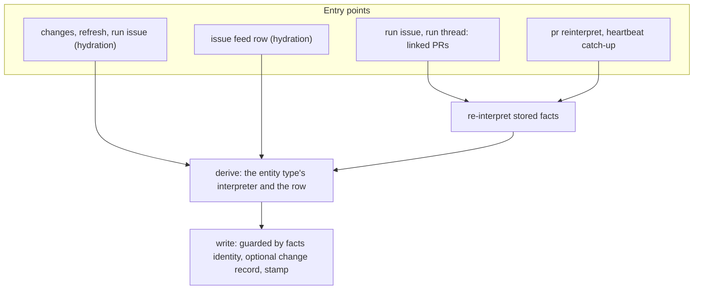

# pg-desk — re-interpretation, the stamp and the single interpretation path

Every entity pg-desk holds has one stored interpretation: who owes the next step, the panel the
entity belongs in, and the reason. An interpretation is recomputed when the entity's facts change,
because a hydration that finds a change interprets what it stored. That alone leaves a gap: when a
rule of interpret changes, the facts of a quiet PR do not, so its interpretation would keep the
answer of the old rule until something else touched the PR. This document specifies how pg-desk
closes that gap without reading anything from the network, and the one path every interpretation
takes, so that a hydration and a re-interpretation can never disagree.

The actors are the operator (who runs `pg-desk pr reinterpret`), the heartbeat (the periodic
`pg-desk heartbeat`, see [`operator-commands.md`](operator-commands.md)) and the hydration flows
(`<type> refresh`, `changes` and `run`, see [`refresh.md`](refresh.md), [`changes.md`](changes.md) and
[`pipeline-run.md`](pipeline-run.md)). The terms below are used in one sense throughout.

- **Interpretation** — the stored result of interpret (see [`interpret.md`](interpret.md)) for one
  entity.
- **Hydration** — reading an entity's facts from the connector and storing them.
- **Re-interpretation** — recomputing an interpretation from the facts already stored, with no read
  of any source.
- **Stamp** — the string stored on every interpretation that says which build and which
  interpretation-relevant configuration computed it.
- **Open PR** — a PR whose state, lower-cased and trimmed, is open, with a merged flag folded in
  (a merged PR is not open whatever its state text says). It is judged from the stored facts.
- **Behind** — an interpretation whose stamp differs from the running stamp. A row with no stamp
  (written before stamping existed) is behind.

## The single interpretation path

There is one way to derive an interpretation, one way to write it, and one way to re-interpret
stored facts. Every flow that interprets uses them; no flow builds or writes an interpretation row
of its own.



- A hydration derives the row from the facts it just gathered and writes it with the identity of
  the facts it committed. It records its own change kinds (see [`refresh.md`](refresh.md)); it adds
  none for the interpretation.
- A re-interpretation derives the row from the stored facts and as-of time of the entity, and writes
  it with the identity of the facts it read. It requires the stamp.
- For a PR with stored facts the two derive identical rows from identical facts: the row does not
  depend on which flow computed it. This is what the rest of the set relies on when it says "the
  interpretation".
- `run issue` and `run thread` re-interpret the PRs they are about through the same
  re-interpretation, see [`run-issue.md`](run-issue.md) and [`run-thread.md`](run-thread.md).

## The write

The one writer of an interpretation takes one short transaction per row.

- **The guard is facts identity, not entity version.** Several writers bump an entity's version
  while keeping the same facts and writing no interpretation: a deactivation, a local reconcile and
  a removed feed row (see [`changes.md`](changes.md)). A guard on version would skip an
  interpretation write that landed after one of them, and the row would stay stale. So the write
  is skipped only when the stored facts hash differs from the hash the interpretation was derived
  from, meaning different facts were committed since. The same facts at a higher version are
  written. A late, older hydration is still skipped once a newer one has committed.
- **The row is written with the stamp.** The stamp is the running one: the build version plus a
  digest of the interpretation-relevant configuration (see "The stamp").
- **A write for an entity that is not stored is an error.** It writes nothing.
- **A decision change appends one record.** When asked to record, and the entity is a PR, the write
  appends one `interpretation_changed` change record when the decision pair (`approvals.waiting_on`
  and the panel) differs from the old row, in the same transaction, at the entity's current
  version, without bumping that version. No record is appended for an `issue` or a `thread`.
- **A stamp-only write exists** for a row that is not re-interpreted (see "Open PRs and the rest"),
  under the same facts-identity check. It changes nothing but the stamp.
- **A failure marker write exists** (see "Failures") and checks no entity.

## The stamp

The stamp is `<build version>/<config digest>`.

- The build version changes whenever the pg-desk or pg-connector sources change. It therefore
  over-triggers on an edit that cannot change an interpretation (a README, a test). That is
  harmless: a re-run takes seconds and writes no change record when nothing differs.
- The config digest is the first eight hexadecimal characters of a SHA-256 over a canonical form of
  exactly the configuration interpret reads. It MUST NOT cover anything interpret does not read
  (the path the configuration was discovered at differs between the heartbeat, a router role and
  the operator's shell, and would make the stamp flap), and it MUST be unchanged by reordering the
  configuration's keys or by whitespace.
- The digest is over a fixed projection of the configuration, not the whole configuration: the
  fields interpret reads (own and team identities, watched labels, the approver allowlist, the
  verdict generations, the check interpreters, the review-exempt checks, the Jira block, the category
  vocabulary and the urgency block) plus the resolved in-progress and done status lists (the
  configured list, or the default when none is configured). An empty list and an absent one digest
  alike. A test fails when interpret starts reading a configuration field the projection does not
  hold, so a new read cannot silently escape the stamp.
- A build whose version is `dev` (a development or test build) stamps `dev/<digest>`.
- A row that carries no stamp differs from every stamp.
- Interpretation depends on configuration outside the package sources (for example the team
  members), and a change to it is a reason to re-interpret: the version alone would miss it.

## Open PRs and the rest

Re-interpretation recomputes only the open PRs.

- A PR that is not open (closed or merged, or no longer active) keeps its interpretation content;
  only its stamp is updated, which records "checked at this stamp" and makes the steady state
  cheap. If it reopens, its facts change and the normal hydration interprets it.
- The open test uses the stored facts, not the active flag of the entity: a PR the daemon owns can
  be inactive without being terminal.
- A hidden PR is included: hiding is an annotation, not part of the interpretation.
- The one exception is `pr reinterpret <pr>` on a closed PR: the operator named it, so it is
  re-interpreted in full.

## Failures

A row whose facts do not decode, or whose entity is gone, keeps its content and is given the stamp
`<stamp>!failed`. That differs from the running stamp, so the row is not recorded as current, but a
catch-up skips rows marked failed under the running stamp, so a heartbeat does not re-read the same
broken row every minute. A change of stamp makes the row eligible again, and `pg-desk pr
reinterpret <pr>` retries it at any time. A failure of one row never stops the pass: the loop
reports it and continues. After a failure at any step nothing is half-written.

## The command

`pg-desk pr reinterpret <pr>` re-interprets one PR; `pg-desk pr reinterpret --open` re-interprets
every behind PR and stamps the rest. It has no interpretation logic of its own: it is a loop over
the re-interpretation and the stamp-only update. It never starts a hydration, makes no network
call and writes no entity row.

- `<pr>` resolves exactly as `refresh` resolves it (`OWNER/REPO#N`, a PR URL or a bare number).
  `<pr>` and `--open` are mutually exclusive, and one of them is required.
- `<pr>` re-interprets that one PR whatever its stamp, so the operator can force one, including a
  closed one.
- `--open` selects the PR interpretations of the configured repository whose stamp differs from the
  running stamp and are not marked failed under it. It reads the stored facts of one row at a time,
  open PRs first, re-interprets the open ones and stamps the rest. It has no row cap and no time
  budget: it always finishes the job.
- `--dry-run` computes and prints what would change and writes nothing, not even a stamp.
- `--verbose` prints one line per PR: the old and the new `waiting_on`, panel and reason.
- The output ends in one summary line:

  ```text
  reinterpreted N open PRs: C changed, U unchanged; M not open (stamped only), S skipped, F failed
  ```

- It requires schema 2 and refuses a store on schema 1 with the cutover message (see
  [`store-schema.md`](store-schema.md)).
- Exit `0` when nothing failed; `1` otherwise (bad arguments, an unresolvable `<pr>`, a refused
  store, a failed row).
- It is a safe verb (see [`operator-commands.md`](operator-commands.md), "Verbs on a schema-2
  store").

## The heartbeat catch-up

After a build or a relevant configuration change, the open PRs behind the new stamp are
re-interpreted by `pg-desk heartbeat`, with no operator step, as long as the heartbeat runs. The
catch-up is a trial run inside the heartbeat, and it is bounded so that it cannot make a heartbeat
late or missed.

- It runs after the liveness stamp, and the source-fetch record (see
  [`freshness.md`](freshness.md)) is written after it, with the catch-up's error swallowed, so a
  slow or failing catch-up prevents neither.
- **Time budget: at most 10 seconds, and never more than the period leaves.** It is a deadline on
  the catch-up alone. The steps around it are bounded only by their own timeouts: the connector
  probe before it by 45 seconds and the ledger read after it by 30 seconds, so 45 + 30 = 75
  seconds already exceeds the 60-second period of the deployed heartbeat trigger, and no fixed
  budget is safe by itself. The catch-up therefore starts only when time remains and its deadline
  is the smaller of 10 seconds and the period minus the 30-second ledger read minus a 5-second
  margin (the store's busy timeout) minus the time already spent, that is, 25 seconds after the
  heartbeat began. With under one second left it is skipped with one stderr line. The loop checks
  the deadline between rows and stops at it; a row in flight finishes or rolls back, never
  half-writes, and is never marked failed because of the deadline.
- **Row cap: 25 rows per pass**, open PRs first, so a pass has a known ceiling even when the clock
  is fast. Later heartbeats continue where it stopped: each committed row carries the new stamp and
  drops out of the behind set.
- It holds no write lock across rows (one short transaction per row), so a concurrent heartbeat or
  command is not blocked behind it.
- If a previous catch-up is still running (in this or another process; a non-blocking per-store
  file lock), a new one skips rather than queueing behind it.
- It loads the configuration itself. A configuration that cannot be loaded, a store that cannot be
  read or a store on schema 1 skips the catch-up (silently, or with one stderr line) and never fails
  the heartbeat.
- It skips when the build version is `dev`.
- When nothing is behind it costs one query over the small interpretation table and reads no facts,
  and it writes nothing: the persisted last-run counts are written only when a pass selected at
  least one row.
- When a pass stops at a limit with rows still behind, it records the last-run counts, including the
  number remaining, so `pg-desk status` shows the backlog draining.
- The heartbeat role lives in the deployment, and it has been gated before, so the catch-up is a
  convenience while that role runs; `pg-desk pr reinterpret --open` is the guaranteed path.

## Change record

`interpretation_changed` is a change-log kind of a PR. It is history only: it wakes no decider and
no consumer acts on it (`pr history` prints it; `annotation-items` skips it, see
[`annotation-items.md`](annotation-items.md)). It is appended when a re-interpretation of a PR
changes `waiting_on` or the panel, and never when nothing changed. If an owner flip should
trigger work, that is a separate decision with its own design.

## Observability

- A re-interpretation logs one structured debug line per PR (id, old and new `waiting_on`, panel and
  reason, whether it changed); it is off by default.
- `pg-desk status` prints how many interpretations are behind, how many are marked failed and the
  counts and time of the last catch-up (see [`operator-commands.md`](operator-commands.md),
  "status"). Heartbeat and CLI processes are short-lived and emit no metrics, so a catch-up that
  keeps failing shows as a number that does not fall.
- It emits nothing over OpenTelemetry or Prometheus.

## Mixed versions

An older binary's write does not touch the stamp, so across a rollback, or in a process that
outlived an apply, a row can carry the content of an old rule with a new stamp. The residue is
documented, and `pg-desk pr reinterpret <pr>` is the fix for one PR.

## Invariants

- **INV-REINTERPRET-1.** <!-- uuid: 1177f42a-cc45-494c-8869-4da45b7d20e1 --> There MUST be exactly one way to derive an interpretation row, one way to write it and one
  way to re-interpret stored facts; a hydration and a re-interpretation of the same facts MUST
  produce the same row.
- **INV-REINTERPRET-2.** <!-- uuid: 7dc29d16-5e77-4674-8faa-334bfe5e1a9c --> A re-interpretation MUST recompute from the stored facts only: it MUST NOT read any source,
  and it MUST NOT change an entity's facts, as-of time, hydration time, list fingerprint or version.
- **INV-REINTERPRET-3.** <!-- uuid: 2077b599-fefc-4374-a193-4eff438b96cc --> Re-interpretation of a catch-up or of `--open` MUST recompute only open PRs; a PR that is not
  open MUST keep its interpretation content, receive the current stamp and have no change record
  appended, and `pr reinterpret <pr>` MUST re-interpret the named PR in full whatever its state.
- **INV-REINTERPRET-4.** <!-- uuid: 17bb97c2-ec47-4f43-b309-915197fda485 --> Every interpretation row MUST carry the stamp of the handle that wrote it, the stamp MUST be the
  build version plus a digest of exactly the configuration interpret reads, and a row without a stamp
  MUST count as behind.
- **INV-REINTERPRET-5.** <!-- uuid: eec45d09-702a-46c7-b490-f337c0e040a9 --> The configuration digest MUST be unchanged by the configuration's discovery path, by key order
  and by whitespace, and MUST change when a configuration value interpret reads changes.
- **INV-REINTERPRET-6.** <!-- uuid: 1e0cb883-a909-4f0f-89bb-56439ca1e4d3 --> An interpretation write MUST be skipped if and only if the stored facts differ from the facts
  the interpretation was derived from; a change of the entity's version alone, with the same facts,
  MUST NOT skip it.
- **INV-REINTERPRET-7.** <!-- uuid: b4df3ec1-0707-435d-983a-2549600c6a4f --> A re-interpretation of a PR that changes `waiting_on` or the panel MUST append exactly one
  `interpretation_changed` record, in the write's own transaction, at the entity's current version,
  without bumping it; a re-interpretation that changes neither MUST append none, and no record
  MUST be appended for an `issue` or a `thread`.
- **INV-REINTERPRET-8.** <!-- uuid: faefe610-0071-4667-b819-1a648d94e9ad --> A row that fails to re-interpret MUST keep its content and be marked failed under the running
  stamp, a catch-up MUST NOT select a row marked failed under the running stamp, a change of stamp
  or `pr reinterpret <pr>` MUST make it eligible again, and one failing row MUST NOT stop the pass.
- **INV-REINTERPRET-9.** <!-- uuid: 02114784-7e4f-4364-af2a-eed8dacf9486 --> `pr reinterpret` MUST accept exactly one of `<pr>` and `--open`, MUST make no network call,
  MUST write nothing under `--dry-run`, MUST exit `0` only when nothing failed, and MUST refuse a
  store on schema 1 before writing anything.
- **INV-REINTERPRET-10.** <!-- uuid: 10c66814-62cf-4226-985b-24f519a4211a --> The heartbeat catch-up MUST NOT make a heartbeat late or missed: it MUST run after the
  liveness stamp, stop at a budget of at most 10 seconds (cut to what the period leaves, skipped when almost none is left) and a 25-row cap, hold no write lock across rows, skip
  when a previous catch-up is running, never fail the heartbeat, and skip on a `dev` build.
- **INV-REINTERPRET-11.** <!-- uuid: 4fb86cda-a3db-4ddc-9429-9d034a144b1c --> A pass that finds nothing behind MUST cost one query over the interpretation table, read no
  facts and write nothing; a pass that stopped at a limit with rows remaining MUST record the
  remaining count.
- **INV-REINTERPRET-12.** <!-- uuid: 3b9def65-86bf-43fb-b5c7-0b8d0675b037 --> Every command that writes an interpretation MUST require schema 2 and, on a store on schema 1,
  MUST refuse with the cutover message before writing anything, including `run issue` and `run
thread`.
- **INV-REINTERPRET-13.** <!-- uuid: 88ff5153-bef3-485f-ab35-90681e8b060b --> A reader that does not migrate the store MUST work on a store that does not yet have the stamp
  column, reading the stamp as absent, and `status` MUST report the behind count as unknown rather
  than zero there.
- **INV-REINTERPRET-14.** <!-- uuid: 4818e667-6a9b-496c-9ec9-db673898a1b8 --> A hydration MUST write its interpretation with the stamp when the handle has one and with no
  stamp otherwise, and a hydration writing through a handle with no stamp MUST warn once per
  process, never into the structured run log.
- **INV-REINTERPRET-15.** <!-- uuid: f62b8fb8-17c9-4ab8-b94a-07e65fc1e6aa --> A re-interpretation MUST NOT wake a decider: the `interpretation_changed` record MUST be read
  by history only.
