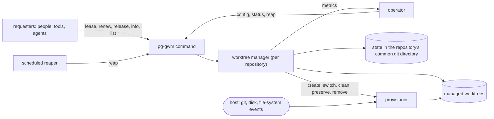

# pg-gwm (pg-git-worktree-manager) — behavior docs

`pg-gwm` hands out git worktrees of a repository on request and owns them for their whole life. A
requester (a person, a tool or an agent) asks for a worktree and is told its path; it does not choose
the path. Each handed-out worktree carries a lease with an owner, a name, metadata and an optional
expiry. Because the manager knows which worktrees are leased, released or expired, it alone decides
when one may be cleaned, kept for reuse or removed. Per repository it can also keep a minimum number of
worktrees ready, cap the number of worktrees, and reuse released worktrees instead of creating new
ones, which makes it a pool for a repository whose worktrees are expensive to create.

It replaces `pg-checkout-pool` (renamed, not a second package). It is generic: it is tied to no agent
runtime, router or organization, it MUST contain no organization identifiers, and a deployment supplies
configuration only. This set describes intended behavior only, at product level: actors, stories,
journeys and invariants, with no implementation detail below that floor. A behavior change MUST edit
these docs in the same change.

## Place in the product

A requester only ever asks for a worktree, renews its lease and releases it. The manager owns every
managed worktree, every lease and every removal. The provisioner is the one place that knows what a
worktree is made of, so a different backing store (a copy-on-write clone) can replace it without
changing anything here.

## Goals

- **`GOAL-GWM-ONE-OWNER`** <!-- uuid: ae2e5e7d-1798-469b-bf55-c45598dea516 --> — Exactly one component
  MUST decide when a managed worktree is cleaned, reused or removed: the manager. A requester MUST NOT
  need to know about any other requester to use it safely. _(Operator ruling, Phillip, 2026-11-13: a
  pool that does not own a worktree should not clean it up.)_
- **`GOAL-GWM-ASK-NOT-PATH`** <!-- uuid: d40aaf64-12b4-4677-811a-b4099f3465b6 --> — A requester MUST be
  able to get a worktree by asking for one, without choosing a path, and get the same worktree back
  later by its name.
- **`GOAL-GWM-CHEAP-REUSE`** <!-- uuid: 3efc8e1c-668d-4962-99f4-5ecb989db6d7 --> — For a repository
  configured to reuse worktrees, a steady-state lease MUST create and delete no whole worktree.
- **`GOAL-GWM-NEVER-LOSE-WORK`** <!-- uuid: 40b8a943-b06e-49be-864e-b1998cb85e6a --> — Committed work
  and uncommitted changes in a managed worktree MUST never be destroyed by the manager: they are
  preserved on a branch before any worktree is reclaimed.
- **`GOAL-GWM-BOUNDED`** <!-- uuid: aa1996f3-be8b-435c-b388-4725d67769fd --> — A repository MAY bound
  its managed worktrees by a maximum count and a free-space floor, and the manager MUST then be the
  admission control for them.
- **`GOAL-GWM-GENERIC`** <!-- uuid: 134fd8c9-6cca-4b5b-b756-2ed04066f765 --> — The same command MUST
  serve people at a terminal and programs, with text output for a person and JSON output for a
  program.

## Actors

- **`ACTOR-REQUESTER`** <!-- uuid: 39f83153-b494-4d3c-b510-5d8358e2ccfd --> — anyone who needs a
  worktree: a person in a shell, a tool, an agent session, or a dispatcher acting for one (for example
  a router handler naming the worktree `<role>/<bead>`). Leases, renews, releases and reads.
- **`ACTOR-OPERATOR`** <!-- uuid: 091d9bf2-807e-404b-beac-540630551e97 --> — the person who owns the
  machine. Configures each repository, reads status and metrics, and decides what to do with a broken
  worktree or a preserved dirty branch.
- **`ACTOR-REAPER`** <!-- uuid: 1fcc1c05-7cb1-4e33-8d96-54a6500a61b9 --> — the scheduled job that runs
  `reap` for every configured repository, so expired and released worktrees are reclaimed and standby
  worktrees topped up without anyone typing a command.
- **`ACTOR-HOST`** <!-- uuid: 3f1942c8-0bd9-4148-b65c-452537c04bbb --> — the machine environment: git,
  the disk, the file-system event service. Not under the product's control; guarantees are stated
  against its failures.

## Glossary

The terms this set owns. Every doc reuses them and MUST NOT redefine them.

| Term                | Meaning                                                                                                                                                                            |
| ------------------- | ---------------------------------------------------------------------------------------------------------------------------------------------------------------------------------- |
| Managed worktree    | A git worktree of a repository that the manager created and owns until it removes it                                                                                               |
| Worktree id         | The manager's own identifier for a managed worktree, unique per worktree and stable for its life; consumers rarely use it                                                          |
| Lease               | A requester's right to use one managed worktree, from `lease` until release or reclaim; it has an owner, a name, metadata and an optional expiry                                   |
| Lease id            | The identifier of one lease, unique per lease; holding it is what lets a caller renew or release that lease                                                                        |
| Name                | The requester-chosen label of a lease; fixed for the lease's life and unique, case-insensitively, among worktrees whose lease is preparing, valid or expired (`INV-GWM-5`)         |
| Owner               | Free text naming who holds a lease (a user, a session id); blank when the worktree is not leased                                                                                   |
| Metadata            | An arbitrary string key/value map carried by a lease; replaced entirely on renew                                                                                                   |
| Expiry              | The time after which a lease is expired. A lease may have none (the default), which never expires                                                                                  |
| Release             | The owner's statement that it is done with the worktree, so it may be cleaned and reused or removed. A released lease is over                                                      |
| Reap                | The pass that reclaims released and expired worktrees, preserving unsaved work first                                                                                               |
| Reclaim             | What reap does to one worktree: remove it, or keep it for reuse with its branch freed                                                                                              |
| Standby worktree    | A managed worktree with no lease, ready to be leased: a reclaimed one kept for reuse, or a fresh one created to keep the repository at its minimum                                 |
| Unsaved work        | A changed tracked file, an untracked file, or a head commit that no branch or tag reaches. Ignored files and commits on a branch are not unsaved work. "Dirty" means the first two |
| Tombstone           | The record of a reclaimed lease (id, name, preserved branch) kept for `tombstone-retention`, so a late renew learns `lease-lost`                                                   |
| Dirty-reaped branch | `pg-gwm/dirty-reaped-<timestamp>-<branch>-<name or lease id>`, the branch the manager writes to preserve unsaved work before a reclaim or a hand-out (`INV-GWM-24`)                |
| Keep list           | The ignored paths of a repository that a clean leaves in place                                                                                                                     |
| Slot index          | The manager's per-repository counter of worktree positions; the lowest free index is handed to the name templates                                                                  |
| Provisioner         | The part that creates, switches, cleans and destroys a worktree's backing store                                                                                                    |

## Repository configuration

Configuration is per repository and lives outside the repository (a user-level file keyed by the
repository), so a repository that cannot carry it still works. A repository with no configuration
works with the defaults below: no `min` or `max`, no reuse, no clean. It is then close to plain
`git worktree add`, with reap to clean up after it, and it enters the reaper's registry on its first
lease (`INV-GWM-32`). The default `worktree-root` MAY fall outside an agent sandbox's writable paths,
so a sandboxed requester's repository SHOULD be configured. _(Operator ruling, Phillip, 2026-11-14:
"yes it should work in a repo without config. default would be no min or max or clear or use, so it is
very close to unmanaged, but you get the reap to help with clean up.")_

| Key                         | Default                             | Meaning                                                                                                                       |
| --------------------------- | ----------------------------------- | ----------------------------------------------------------------------------------------------------------------------------- |
| `worktree-root`             | `<repository directory>.worktrees/` | Directory under which the manager creates this repository's worktrees                                                         |
| `worktree-dir-template`     | `{{repo}}-wt-{{index}}`             | Directory name of a new worktree, given the worktree information (`INV-GWM-22`)                                               |
| `standby-branch-template`   | (unset)                             | When set, a worktree kept at reap is put on a new branch from `standby-base` named by this template instead of being detached |
| `standby-base`              | `HEAD` of the main checkout         | The base of a standby branch                                                                                                  |
| `min`                       | (unset)                             | `available` worktrees the manager keeps ready after a reap, kept or freshly created (`INV-GWM-20`)                            |
| `max`                       | (unset)                             | Upper bound on managed worktrees, counted in every state                                                                      |
| `reuse-reclaimed-worktrees` | `false`                             | A new lease takes a released, then an expired, worktree before creating one                                                   |
| `clean-reused-worktree`     | `false`                             | Cleaning a reused worktree to a pristine tree, except the keep list, before handing it out                                    |
| `keep-list`                 | (empty)                             | Ignored paths a clean leaves in place                                                                                         |
| `reuse-hook-policy`         | `run`                               | Whether the post-checkout hook runs when a reused worktree is switched (`run` or `skip`; creation always runs it)             |
| `free-space-floor`          | (unset)                             | Free bytes below which no worktree is created                                                                                 |
| `default-ttl`               | `none`                              | Lease time to live when a lease names none                                                                                    |
| `lock-wait`                 | `10s`                               | How long a command waits for the repository's lock before `busy` (`INV-GWM-29`)                                               |
| `git-timeout`               | `2m`                                | Timeout of one repository operation (`INV-GWM-31`)                                                                            |
| `create-timeout`            | `30m`                               | Timeout of a creation or a clean (`INV-GWM-31`)                                                                               |
| `index-lock-stale-after`    | `10m`                               | Age after which a zero-byte index lock is stale (`INV-GWM-31`)                                                                |
| `reap-interval`             | `10m`                               | How often the scheduled reaper runs (`INV-GWM-32`)                                                                            |
| `tombstone-retention`       | `7d`                                | How long a reclaimed lease's record is kept (`INV-GWM-7`, `INV-GWM-34`)                                                       |

A fixed pool of four is `reuse-reclaimed-worktrees = true` with `min = max = 4`. With reuse off, `max`
is only an upper limit: every lease gets a fresh worktree, and there are never too many.

## The docs

| Doc                                              | Covers                                                                                                          |
| ------------------------------------------------ | --------------------------------------------------------------------------------------------------------------- |
| [`lease-interface.md`](lease-interface.md)       | The command and its output, the record, the statuses, lease, renew, release, info, list, names, errors          |
| [`worktree-lifecycle.md`](worktree-lifecycle.md) | Creating, branch and commit choice, reuse and clean, reap, minimum and maximum, preserving dirty work, git lock |
| [`failure-modes.md`](failure-modes.md)           | Concurrency, crashes mid-operation, broken worktrees, bounded git, the scheduled reaper, metrics                |

## Interfaces

| Interface       | Defined in                                       | Boundary                                                    | Counterparty (kind)       | Participation |
| --------------- | ------------------------------------------------ | ----------------------------------------------------------- | ------------------------- | ------------- |
| `INTF-GWM-CLI`  | [`lease-interface.md`](lease-interface.md)       | The subcommands in, the record and the error catalog out    | `ACTOR-REQUESTER` (actor) | essential     |
| `INTF-GWM-REAP` | [`failure-modes.md`](failure-modes.md)           | The scheduled reap pass over configured repositories        | `ACTOR-REAPER` (actor)    | essential     |
| `INTF-GWM-OPS`  | [`failure-modes.md`](failure-modes.md)           | Metrics and the list view the operator reads                | `ACTOR-OPERATOR` (actor)  | optional      |
| `INTF-GWM-HOST` | [`worktree-lifecycle.md`](worktree-lifecycle.md) | The repository operations the manager relies on, in and out | `ACTOR-HOST` (actor)      | essential     |

## Invariants

The invariants are numbered `INV-GWM-1` to `INV-GWM-34`, in RFC 2119 language:

- `INV-GWM-1` to `INV-GWM-14` are in [`lease-interface.md`](lease-interface.md).
- `INV-GWM-15` to `INV-GWM-27` are in [`worktree-lifecycle.md`](worktree-lifecycle.md).
- `INV-GWM-28` to `INV-GWM-34` are in [`failure-modes.md`](failure-modes.md).

### Operator rulings and where they are stated

Operator rulings (Phillip, 2026-11-14), quoted verbatim from the design session. Earlier rulings
carried over from `pg-checkout-pool` keep their dates.

| Ruling (verbatim)                                                                                                                                                                                                  | Stated in                  |
| ------------------------------------------------------------------------------------------------------------------------------------------------------------------------------------------------------------------ | -------------------------- |
| "with this tool you don't specify the path, you request/lease and the path is returned to you. for humans the output is text, for non-human, json out is support."                                                 | `INV-GWM-1`, `INV-GWM-2`   |
| "a name must be unique with the set of worktrees with a valid or expired lease." and "a name for a lease can't change."                                                                                            | `INV-GWM-5`                |
| "if i want to renew my name "potato", there must be only 1 with that name out of the leased and lease-expired."                                                                                                    | `INV-GWM-7`                |
| "releasing is a claim that i'm done with the worktree, so it can be cleaned up, so it can't be dirty."                                                                                                             | `INV-GWM-9`                |
| On reaping under a live process: "this is ok, if this happens, then that is an indication that the agent wasn't properly doing the renewals."                                                                      | `INV-GWM-11`               |
| "yes to default of none, this aligned with normal work trees" and "we have to make sure that a renew can be triggered when no preexisting lease duration was set. total replace for metadata on renew."            | `INV-GWM-6`, `INV-GWM-8`   |
| "the reap inside lease, it isn't doing a full reap."                                                                                                                                                               | `INV-GWM-19`               |
| Branch table: row 5 "i agree, error"; row 8 "yes" (no takeover of a branch held by an expired lease)                                                                                                               | `INV-GWM-16`               |
| "change the arg to "clean" instead of "reset""                                                                                                                                                                     | `INV-GWM-18`               |
| On `min` with reuse off: "it suggest that there is always one ready to use. it isn't a ruse because i was never used."                                                                                             | `INV-GWM-20`               |
| "if re-use is off then it isn't a pool, it is just an upper limit."                                                                                                                                                | `INV-GWM-21`               |
| "an internal index should be kept" and "I don't think it is worth overhead for an adopt."                                                                                                                          | `INV-GWM-22`, Scope        |
| Work-in-progress preservation: "create a new branch based on the current branch, then do commit -am "adding dirty WIP"" (amended: untracked files are added too, because `commit -am` skips them)                  | `INV-GWM-24`               |
| The git worktree lock with a `pg-gwm` reason: "that seems good to me"                                                                                                                                              | `INV-GWM-26`               |
| "lets try the git-commondir path; we will need to create the test to verify it works"                                                                                                                              | `INV-GWM-28`               |
| Scheduled reap as a scheduled job plus the lease's own partial reap: "yes"                                                                                                                                         | `INV-GWM-32`               |
| "we should use $role/$beadid as the name for pg-router"                                                                                                                                                            | Scope (consumers)          |
| "rename over new package" and "just do it. and enable it."                                                                                                                                                         | Scope                      |
| Keep list and hook policy carried over: the keep list is per repository; the post-checkout hook runs at creation and MAY be skipped on reuse (Phillip, 2026-11-07, "i agree with your recommendations")            | `INV-GWM-18`, `INV-GWM-25` |
| `core.fsmonitor` stays on in a managed worktree of a large monorepo (operator, 2026-10-05)                                                                                                                         | `INV-GWM-27`               |
| "the "name" is closer to the worktree path of a non managed ... You could reuse a managed worktree with different branches, so the name and branch are not the same."                                              | `INV-GWM-5`, `INV-GWM-16`  |
| "if possible we should try to be similar to git worktree add" and "i would expect lease to work similar to how git worktree add would do"                                                                          | `INV-GWM-16`, `INV-GWM-17` |
| "i prefer the expire ofr renew --ttl 0s it is more clear" and "renew --ttl 0s should be an error"                                                                                                                  | `INV-GWM-6`                |
| "i think releaase --preserve does too much. if a release is being explicitly called, then the caller could deal with creating the branch and commit it."                                                           | `INV-GWM-9`                |
| `preserved list` and `preserved prune` touch only preserved-work branches: "yes"                                                                                                                                   | `INV-GWM-13`               |
| `min` counts ready (`available`) worktrees: "yes"                                                                                                                                                                  | `INV-GWM-20`               |
| "hand-out; not need to run it if never needed."                                                                                                                                                                    | `INV-GWM-18`               |
| The preservation commit skips hooks, says so, and says how to undo it: "yes; the comment should mention that" and "instruction on how to take the WIP commit and remove it but leave the WIP changes on the index" | `INV-GWM-24`               |
| A worktree is "a place to work, different branches could use it."                                                                                                                                                  | Scope (consumers)          |
| An unconfigured repository works with defaults: "yes it should work in a repo without config."                                                                                                                     | Repository configuration   |

**Superseded by these rulings** (from the `pg-checkout-pool` set): the lease key is no longer the
owner's session id (`INV-POOL-20`; the name is the requester's handle and the owner is free text);
interactive sessions are no longer excluded (`INV-POOL-21`); a lease's liveness no longer depends on an
exclusive hold or a live-process probe (`INV-POOL-2`, `INV-POOL-3`, `INV-POOL-8`), only on its expiry;
and a reused worktree is no longer always reset before it is handed out (`INV-POOL-5`), only cleaned
when `clean-reused-worktree` is on.

## Scope

**Extent (in)** — leasing a managed worktree of a repository to any requester; the lease's owner,
name, metadata and expiry; renew, release, info, list and reap; choosing the worktree's branch and
commit; reuse and clean of reclaimed worktrees; the minimum and maximum per repository; preserving dirty
work before any reclaim; protecting managed worktrees from other tools; the scheduled reaper; metrics.

**Extent (out)** — adopting existing, unmanaged worktrees (a person moves the work: commit, release
the branch, then lease); how a requester uses its worktree; the router handler's other isolation modes;
the alert expressions, dashboards, test plan and packaging, which belong to the design and deployment.

**Consumers (non-normative).** A router handler names a lease `<role>/<bead>` (the place), passes the
branch it wants explicitly (for example `pg-router/<bead>`), and puts the session and role in the
metadata, so a redispatch of the same bead renews the same name and gets the same worktree. A name says
nothing about the branch on it: tools that look for work by branch keep looking by branch. Two
worktrees cannot hold one branch at once (a git rule), so a role that only reads another role's branch
leases with `--detach <that branch>`.
An agent skill tells agents to lease from `pg-gwm` instead of running `git worktree add`.

**Floor** — the set speaks in managed worktrees, leases, names, owners, expiry, release, reap, clean,
standby and the provisioner, and in the repository operations that are themselves behavior (a clean of
ignored files, a skipped hook, a git worktree lock). It names no storage format, locking primitive or
system call, and fixes no tuning constant other than a configured default.

## Open questions

- **`OQ-GWM-TTL-REMOVE`** <!-- uuid: c8803a11-b484-4303-b335-4d11aa5d34fc --> — May `renew` turn a
  lease with an expiry into one with none? The operator left it open (2026-11-14: "we can do some other
  syntax if switching to non ttl renewal, if we decide to allow that"). Until ruled, `renew` cannot
  remove an expiry; a requester that wants none releases and leases again with `--ttl none`. Owner:
  operator. Blocks: nothing else.
- **`OQ-GWM-MEASURE`** <!-- uuid: 466a4a0f-f407-428a-827f-c07d75180c9b --> — Carried from
  `OQ-POOL-MEASURE`: what do create, switch, clean and remove cost on the large monorepo, and does a
  skipped hook on reuse leave the tree correct? Owner: the measurement work item. Blocks: the
  `reuse-hook-policy` default for that repository only.

Resolved on 2026-11-14 and folded into the invariants: the preservation commit skips hooks
(`INV-GWM-24`); an unconfigured repository works with defaults (Repository configuration,
`INV-GWM-32`); a lease never fetches (`INV-GWM-17`); the clean runs at hand-out (`INV-GWM-18`); `min`
counts ready worktrees (`INV-GWM-20`); a name never determines a branch (`INV-GWM-5`, `INV-GWM-16`);
no `release --preserve`, and `expire` instead (`INV-GWM-6`, `INV-GWM-9`); `preserved prune` touches
only preserved branches (`INV-GWM-13`); a name labels a place, not its branch, so router roles
choose their branch explicitly (Scope); and a lease with no branch argument, no commit-ish and no
name is a `usage` error (row 9 of the branch table, `INV-GWM-16`; operator ruling, Phillip,
2026-11-14: "no branch or name should be an error, right? not enough to do anything.").

## Realization gaps

This set's **realization-gap register**: intended behavior the product does not yet deliver, one row
per gap. The code is still `pg-checkout-pool`, whose contract this set replaces.

| Element        | Intended                                                                                                 | Where the implementation stands                                                                                                                                                                                           |
| -------------- | -------------------------------------------------------------------------------------------------------- | ------------------------------------------------------------------------------------------------------------------------------------------------------------------------------------------------------------------------- |
| `INTF-GWM-CLI` | One `pg-gwm` command with `lease`, `renew`, `release`, `info`, `list`, `reap` and text or JSON output    | `pg-checkout-pool` has `lease`, `renew`, `release`, `status`, `reap`, JSON only                                                                                                                                           |
| `INV-GWM-5`    | A requester-chosen name, unique among valid and expired leases                                           | Leases are keyed on the owner's session id with the work item as a hint                                                                                                                                                   |
| `INV-GWM-11`   | Liveness is the expiry alone                                                                             | An exclusive hold plus a live-process probe                                                                                                                                                                               |
| `INV-GWM-20`   | `min`, `max` and reuse per repository                                                                    | A fixed pool of slots that are always reused                                                                                                                                                                              |
| `INV-GWM-24`   | Unsaved work preserved on a `pg-gwm/dirty-reaped-…` branch before any reclaim or hand-out                | A rescue ref of tracked changes only                                                                                                                                                                                      |
| `INV-GWM-26`   | Every sibling tool skips a worktree locked with a `pg-gwm` reason                                        | Each of `wtaudit`, `wtdone`, the audit-worktrees and cleanup-workforest skills, `pg-disk-reclaimer` and the handler's sweep recognizes pool slots by their old marker; each needs its own change and its own test         |
| `INV-GWM-28`   | State in the repository's common git directory                                                           | A pool state directory                                                                                                                                                                                                    |
| `INV-GWM-32`   | A scheduled reaper over a registry of repositories                                                       | The router handler's janitor and the pool's own reap                                                                                                                                                                      |
| `INV-GWM-15`   | One provisioner conformance suite                                                                        | The existing provisioner suite builds its fixture repositories with raw git calls; it MUST move to the shared hermetic git fixture library, and git calls to the shared git client and command-runner seam, in the rename |
| Consumers      | The router handler leases `<role>/<bead>` from `pg-gwm` and no longer creates or sweeps worktrees itself | The handler creates `<worktree dir>/<bead>` and runs its own worktree-keyed sweep with a live-process probe                                                                                                               |
