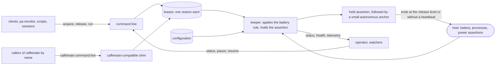

# pg-keep-awake — behavior docs

`pg-keep-awake` is the one place on a Mac that decides whether the machine is held awake. Every
program that wants the Mac to stay awake while agents work asks it, through a command line or through
a drop-in replacement for `caffeinate`, and every one of those requests passes a single low-battery
rule. It lives at `packages/pg-keep-awake` in this repo and is generic: it MUST contain no
organization identifiers, and a deployment supplies configuration only.

This set describes intended behavior only, at product level: actors, stories, journeys and
invariants, with no implementation detail below that floor. A behavior change to the product MUST edit
these docs in the same change. The reasons behind the main decisions are in
`docs/adr/0100-pg-keep-awake-is-the-single-holder-of-the-keep-awake-assertion.md` and the design
`docs/superpowers/specs/2026-10-14-pg-keep-awake-design.md`; the design's section numbers are cited as
"Design section N" so each element can be traced back to it. The design's headings by number are: 1
Problem, 2 Goals and non-goals, 3 Operator rulings, 4 Architecture, 5 State layout and schemas, 6 CLI
contract, 7 The shim, 8 The keeper, 9 The anchor, 10 Battery policy, 11 Configuration, 12
Observability, 13 pa-monitor migration, 17 Decisions O1-O9.

## Place in the product

Clients and callers only ever record a lease. The keeper is the single holder: it reads the leases, the
battery and the configuration, and holds the Mac awake exactly when the rule allows. A small autonomous
anchor ties the held assertion's life to the battery rule even when the keeper is gone or stuck.

## Goals

- **`GOAL-ONE-RULE`** <!-- uuid: 0e5b9a37-c2d4-4168-b7f9-5a83e1d06c94 --> — Every keep-awake request on the Mac MUST pass one battery rule, so a
  low battery ends the hold whoever asked for it. _(Design section 2; ADR 0100 decision 4.)_
- **`GOAL-ONE-HOLDER`** <!-- uuid: b84c1d6f-3a07-4e92-8d15-f6c2a09b7e38 --> — At steady state exactly one process holds the keep-awake assertion.
  _(Design section 2; ADR 0100 decision 1.)_
- **`GOAL-CLI-ONLY`** <!-- uuid: 73a9e2c5-f1b8-4d04-9c63-0b7e4d5a81f2 --> — The only supported interface MUST be the command line; the product's
  stored state is private. _(Design sections 2 and 3 (R10); ADR 0100 decision 2.)_
- **`GOAL-SURVIVE-RESTART`** <!-- uuid: 2c60d8b1-97e5-4a3f-a1c8-d4f3b6092e75 --> — The product MUST survive its own restarts without dropping an
  assertion that is held. _(Design section 2; ADR 0100 decision 5.)_

## Actors

- **`ACTOR-OPERATOR`** <!-- uuid: 4b1d7e90-62a3-4c58-9e07-a1f3c85d2b61 --> — the person who owns the Mac. Wants it awake while agents work and
  never awake on an almost-empty battery; asks "what is holding my Mac awake?" and may pause the hold.
- **`ACTOR-CLIENT`** <!-- uuid: 9c2f5a13-d80e-4b7a-8a46-3e91b7c0f524 --> — a program that asks to keep the Mac awake through the command line:
  the pa-monitor daemon, a wrapper script, a session. It acquires, refreshes and releases a lease, reads
  the status and MAY retry any request.
- **`ACTOR-CALLER`** <!-- uuid: e7a40b6d-15c9-4f32-b8d1-72c6a09e3f85 --> — a program that spawns `caffeinate` by name and cannot be changed: the
  Claude Code CLI, an interactive shell, a downstream wrapper script. It believes it talks to the real
  tool.
- **`ACTOR-CONFIGURER`** <!-- uuid: 2d86f1ab-7e43-4a09-93c5-b5d0e8174a2c --> — whoever deploys the product and writes its configuration: the
  durations, the battery rule and the telemetry endpoint. Usually the operator in another role.
- **`ACTOR-WATCHER`** <!-- uuid: 61c3e9f7-a2b8-4d15-87e0-c4f92d6a1b38 --> — whatever reads the product's health: the alerting stack reading its
  telemetry, and pa-monitor reading the health check. It notices a keeper that is down.
- **`ACTOR-HOST`** <!-- uuid: f05b28d4-39e1-4c76-a2b9-0d7e6c13f8a5 --> — the machine environment: the battery and power source, the process table,
  the operating system's power assertions and the service manager (launchd) that restarts the keeper. It
  is not under the product's control, and the product's guarantees are stated against its failures,
  including a host so starved that reading the battery fails.

## Glossary

The terms this set owns. Every doc reuses them and MUST NOT redefine them.

| Term            | Meaning                                                                                                                              |
| --------------- | ------------------------------------------------------------------------------------------------------------------------------------ |
| Lease           | One reason to keep the Mac awake, identified by an owner and a key, bound to a process, an expiry or both                            |
| Owner           | The name of the party that holds a lease (for example `pa-monitor` or `shim`)                                                        |
| Key             | The name of one lease among an owner's leases; `default` when none is given                                                          |
| Live lease      | A lease whose process is still running, whose expiry has not passed and whose watched process, if any, is still running              |
| Reap            | Remove a lease that is no longer live                                                                                                |
| Keeper          | The one long-running process that reads the leases, applies the battery rule and holds the assertion                                 |
| Assertion       | The held request to the host not to sleep the Mac; at most one at steady state                                                       |
| Anchor          | The small autonomous process the held assertion follows, so the assertion ends when the anchor ends                                  |
| Gate            | The battery rule's current verdict: `ok`, `no_spawn`, `released`, `unknown` or `disabled`                                            |
| Hold level      | The battery percentage at or below which, on battery, no assertion is started or replaced (default 30)                               |
| Release level   | The battery percentage at or below which, on battery, the assertion is dropped (default 20)                                          |
| Hysteresis      | The margin above the hold level (default 5) that the battery MUST climb past before a new or replacement assertion is allowed again  |
| Blind rule      | The rule for a battery that cannot be read: three failed reads in a row after a last good reading at or below the hold level release |
| Heartbeat       | The keeper's proof that it is alive, given only after a completed pass                                                               |
| Watchdog        | The anchor's deadline: without a heartbeat for the watchdog timeout, the anchor ends the assertion                                   |
| Linger          | The short time the assertion is kept after the last live lease ends (default 30 seconds)                                             |
| Pause           | An operator-requested stop of the assertion that leaves every lease in place                                                         |
| Adopt           | A keeper taking over, unchanged, the assertion an earlier keeper started                                                             |
| Shim            | The `caffeinate`-compatible command that turns a caller's request into a lease                                                       |
| External holder | A power-assertion holder that is not this product's own assertion, shown by the status view                                          |
| Managed holder  | An external holder the keeper stops at the release level: the keep-awake that Claude Code starts for itself (`INV-BATT-13`)          |
| Realization gap | Settled intended behavior the product has not yet built; recorded in the register below                                              |

## The docs

| Doc                                        | Covers                                                                                                                             | Design sections |
| ------------------------------------------ | ---------------------------------------------------------------------------------------------------------------------------------- | --------------- |
| [`cli-contract.md`](cli-contract.md)       | The command line: acquire, release, run, status, pause, resume, config check; output; exit codes; the health check                 | 2, 3, 6, 13     |
| [`lease-lifecycle.md`](lease-lifecycle.md) | The lease: what it is, when it is live, how it is reaped, how damaged or hostile state is tolerated, how a stuck client is handled | 5, 8            |
| [`battery-rule.md`](battery-rule.md)       | The low-battery rule: gate, hold, release, hysteresis, the blind rule, the anchor, the watchdog and the churn guard                | 8, 9, 10        |
| [`caffeinate-shim.md`](caffeinate-shim.md) | The shim's compatibility with `caffeinate`: flags, timeout, watched process, utility form, signals, exit statuses, failure policy  | 7               |
| [`keeper.md`](keeper.md)                   | The single holder: reconciling, linger, survival and adoption, shutdown, no fallback, configuration, telemetry and alerts          | 4, 8, 11, 12    |

## Interfaces

Every boundary the product exposes is an interface. A counterparty's participation is **essential**
when the product is nonsense without it and **optional** when the product runs untouched without it.

| Interface        | Defined in                                 | Boundary                                                                                   | Counterparty (kind)        | Participation |
| ---------------- | ------------------------------------------ | ------------------------------------------------------------------------------------------ | -------------------------- | ------------- |
| `INTF-CLI`       | [`cli-contract.md`](cli-contract.md)       | Commands in; lease records, data and the exit-code catalog out                             | `ACTOR-CLIENT` (actor)     | essential     |
| `INTF-SHIM`      | [`caffeinate-shim.md`](caffeinate-shim.md) | The `caffeinate` command line in; its exit statuses and messages out                       | `ACTOR-CALLER` (actor)     | essential     |
| `INTF-HEALTH`    | [`cli-contract.md`](cli-contract.md)       | The status view and the health check: what a watcher can learn, and the exit codes it gets | `ACTOR-WATCHER` (actor)    | optional      |
| `INTF-CONFIG`    | [`keeper.md`](keeper.md)                   | The configuration file in; its problems out                                                | `ACTOR-CONFIGURER` (actor) | optional      |
| `INTF-HOST`      | [`battery-rule.md`](battery-rule.md)       | The battery reading, the process table and the power assertion, in and out                 | `ACTOR-HOST` (actor)       | essential     |
| `INTF-TELEMETRY` | [`keeper.md`](keeper.md)                   | The metrics and logs the keeper emits, and the closed catalog of metrics                   | `ACTOR-WATCHER` (actor)    | optional      |

## Invariants

The invariants are numbered by area, in RFC 2119 language:

- `INV-KCLI-1` to `INV-KCLI-15` are in [`cli-contract.md`](cli-contract.md).
- `INV-LEASE-1` to `INV-LEASE-10` are in [`lease-lifecycle.md`](lease-lifecycle.md).
- `INV-BATT-1` to `INV-BATT-13` are in [`battery-rule.md`](battery-rule.md).
- `INV-SHIM-1` to `INV-SHIM-14` are in [`caffeinate-shim.md`](caffeinate-shim.md).
- `INV-KEEP-1` to `INV-KEEP-12` are in [`keeper.md`](keeper.md).

### Operator rulings and where they are stated

| Ruling (operator, 2026-10-14 unless noted)                                                                                                | Stated in                                  |
| ----------------------------------------------------------------------------------------------------------------------------------------- | ------------------------------------------ |
| No forced sleep or shutdown: release the assertion at low battery (R1)                                                                    | `INV-BATT-4`                               |
| One tool abstracts `caffeinate` for every client and caller (R2)                                                                          | `INV-KCLI-1`, `INV-SHIM-1`                 |
| A `PATH` shim is acceptable (R3)                                                                                                          | `INV-SHIM-1`, `INV-SHIM-14`                |
| Clients only record state; the keeper reads it; a client lives until it ends or is killed (R4)                                            | `INV-KCLI-6`, `INV-LEASE-2`                |
| No fallback to the real `caffeinate` when the keeper is down (R5)                                                                         | `INV-KEEP-8`                               |
| The anchor does not end merely because the keeper is gone; it MAY end without a heartbeat (R6)                                            | `INV-BATT-9`, `INV-KEEP-5`                 |
| Configuration is managed, not hand-edited: durations, battery rule, telemetry (R7)                                                        | `INV-KEEP-9`                               |
| On shutdown the keeper removes dead leases and its heartbeat and leaves valid leases (R8)                                                 | `INV-LEASE-9`, `INV-KEEP-6`                |
| The assertion's flags are the union of the live leases' flags, `-s` included (R9)                                                         | `INV-KEEP-1`                               |
| The command line is the only contract; pa-monitor uses it; the health check is in the first version (R10)                                 | `INV-KCLI-1`, `INV-KCLI-10`, `INV-KCLI-15` |
| Logging and metrics follow the existing OTel pattern (R11)                                                                                | `INV-KEEP-10`                              |
| Tick 10 s and watchdog 10 min (O1, confirmed 2026-10-15)                                                                                  | `INV-KEEP-2`, `INV-BATT-9`                 |
| The shim rejects `-u` (O2, confirmed 2026-10-15)                                                                                          | `INV-SHIM-3`                               |
| The shim failure policy: pure form exits 3, utility form warns and runs (O3, confirmed 2026-10-15)                                        | `INV-SHIM-11`                              |
| The keep-awake Claude Code starts for itself is stopped under the low-battery rule (operator, 2026-10-22, "(a) then (b)", bead pg2-0n6og) | `INV-BATT-13`, `INV-BATT-10`               |
| Linger of 30 seconds, configurable (O4, confirmed 2026-10-15)                                                                             | `INV-KEEP-3`, `INV-KEEP-9`                 |
| Pause, resume and release of every lease of an owner (O5, confirmed 2026-10-15)                                                           | `INV-KCLI-4`, `INV-KCLI-13`                |
| The status view lists external holders (O6, confirmed 2026-10-15)                                                                         | `INV-KCLI-9`, `INV-SHIM-13`                |
| A bad configuration falls back to the last good one, then to defaults (O7, confirmed 2026-10-15)                                          | `INV-KEEP-9`                               |

## Scope

**Extent (in)** — asking for the Mac to stay awake and withdrawing the ask, through the command line
and through the `caffeinate` command line; the lease and its life; the single holder and the one
assertion; the low-battery rule, including a battery that cannot be read, a stuck keeper and a lost
keeper; survival of a keeper restart; the status view and the health check; pausing; the
configuration; and what the keeper exports to be observed.

**Extent (out)** — forcing the Mac to sleep or shut down; stopping any assertion holder that is not
`caffeinate` (audio, browsers, other apps); a holder that calls the real `caffeinate` by absolute path
or with a search path of its own, which is reported and not intercepted, except the Claude Code CLI's own
(a managed holder), which the keeper stops at the release level; changing Claude Code itself; pa-monitor's own mode toggle, busy
detection and grace period; the alert rules' exact expressions and dashboards; the test plan, the packaging and
the home-manager module's options, which are the design's and the deployment's.

**Floor** — the set speaks in leases, owners and keys, the assertion, the gate and its levels, the
keeper, the anchor, the shim, the status view and exit codes. It never names a file layout, a
storage format, a locking primitive, a system call or a polling API, and it never fixes a number
that is a tuning constant rather than a configured default or a rule.

## Realization gaps

This set's **realization-gap register**: intended behavior that the product does not yet deliver, one
row per gap, each keyed by the element it is against. The set describes a product that is designed and
not yet built, so the rows name the four foundations; every other element of the set is built on them.

| Element      | Intended                                                                  | Where the implementation stands                                                      |
| ------------ | ------------------------------------------------------------------------- | ------------------------------------------------------------------------------------ |
| `INV-KCLI-1` | The command line is the only supported interface and every client uses it | The package does not exist yet; pa-monitor still runs and rules its own `caffeinate` |
| `INV-KEEP-1` | One keeper is the only process that starts `caffeinate`                   | No keeper exists; several programs on the Mac each run their own `caffeinate`        |
| `INV-BATT-1` | Every request passes the one low-battery rule                             | Only pa-monitor's own `caffeinate` obeys a low-battery rule                          |
| `INV-SHIM-1` | A `caffeinate`-compatible shim sits ahead of the real tool on `PATH`      | No shim exists; callers reach the real tool directly                                 |
