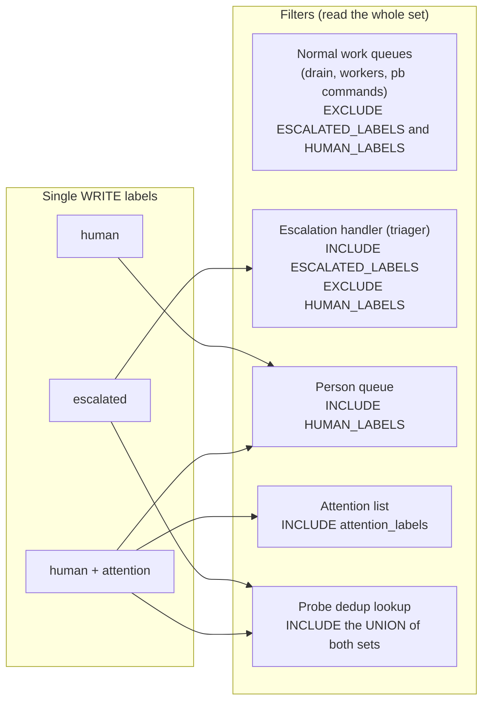
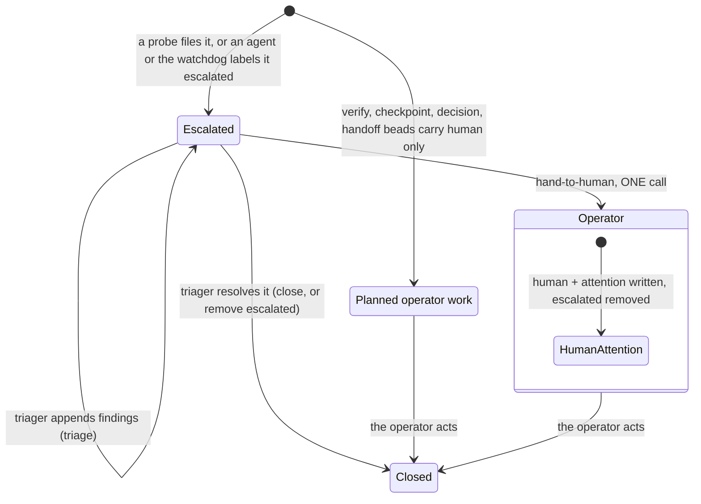
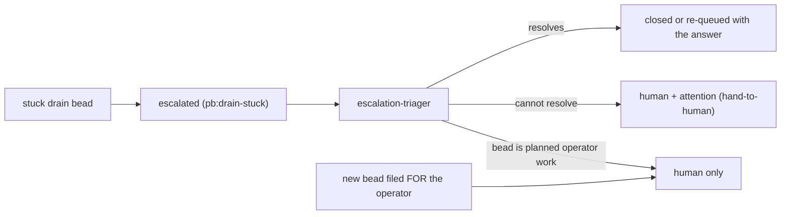

# Bead label vocabulary: escalation and operator attention

The key words MUST, MUST NOT, SHOULD, SHOULD NOT and MAY in this page are to be read as in RFC 2119.

This page is the one place that says which bead label means what for escalation and for operator
attention, and when each is written. Every consumer (the escalation-triager prompts, the `pb`
commands and queue definitions, the `beads-lifecycle` skill, the pg-connector attention list, the
probes and the handler) points here. The decision record is
[ADR 0105](../adr/0105-bead-label-vocabulary-for-escalation-and-operator-attention.md). The
agent-facing rules are `LV-1` to `LV-7` in the `beads-lifecycle` skill.

## Why it exists

An agent that has a problem escalates to the escalation-triager; if the triager cannot resolve it,
it comes to the operator. ONLY those beads should show up as the operator's attention. Before this
page the labels were used by habit: a bead that reached the operator carried `human`, sometimes
with `escalated` kept and sometimes not, nothing ever wrote `attention`, and the attention list
read a name (`human-focus`) that no agent writes. The exact label names do not matter; what
matters is that they are EXPLICIT, so queries, agents and other tools agree.

## Terminology

| Term                    | Means                                                                                                                                                                                                             |
| ----------------------- | ----------------------------------------------------------------------------------------------------------------------------------------------------------------------------------------------------------------- |
| the `escalated` label   | An agent or system (a probe, the budget watchdog) asked the escalation-triager to look at this bead. The triager resolves it, appends findings, or hands it to a person.                                          |
| the menu-bar escalation | An attention item raised by a reminder rule and shown in the menu bar (`docs/superpowers/specs/2026-10-10-escalations-design.md`). It is NOT the `escalated` label. The two share a word and nothing else (LV-6). |
| `human`                 | A PERSON is the blocker (beads-lifecycle `D-1`): a decision, input, approval or out-of-band action only a person can supply. It is also what many planned-work beads carry.                                       |
| `attention`             | The escalation path could not resolve this bead and the operator must act. Written ONLY at the escalation hand-off, always together with `human`.                                                                 |
| `human-focus-required`  | The bead needs the operator interactively. Written only in addition to `human`. It keeps a bead out of the default unblock queue.                                                                                 |
| `human-focus`           | A historical spelling. It is read, never written (no skill, command or agent applies it; ADR 0081 listed it as an initial attention label, which was a name mismatch with `human-focus-required`).                |
| pg-desk attention       | The cross-entity attention view evaluated at read time (ADR 0081). A different mechanism from the bead attention list; it is not driven by the labels on this page.                                               |

## The two label sets

Writes are strict and reads are wide. Agents write ONE canonical label per role. Every read filter
accepts the whole set, so a bead labeled by historical habit, or by a bug, still filters correctly.
The page's job is to stop the drift at the source by saying which label to use and when.

| Set                | Members (read)                                              | Single WRITE label                                                                |
| ------------------ | ----------------------------------------------------------- | --------------------------------------------------------------------------------- |
| `ESCALATED_LABELS` | `escalated`                                                 | `escalated`                                                                       |
| `HUMAN_LABELS`     | `attention`, `human-focus`, `human-focus-required`, `human` | `human` (a person is the blocker); `human` + `attention` (an escalation hand-off) |

The set `HUMAN_LABELS` is also the list a beads instance reports as its attention list
(`attention_labels` in the pg-connector configuration). That list is deliberately as wide as the
set. `human` is in it TEMPORARILY: the operator wants the whole human queue visible until a
reclassification pass (`pg2-wo1il`) is done, after which `human` is dropped from the attention list
(and only from it; `human` stays in the set and in every filter below). `escalated` stays out of the
attention list: it is the triager's input queue, not an operator signal.

## Which queue reads which set

| Consumer                                                     | Rule                                                                                                                                                          |
| ------------------------------------------------------------ | ------------------------------------------------------------------------------------------------------------------------------------------------------------- |
| Normal work queues (drain claim, drain termination, workers) | MUST exclude every label of `ESCALATED_LABELS` and `HUMAN_LABELS`. Mirrored in `claude-marketplace/pb/queues.json`, checked by `tests/pb-queues-mirror.bats`. |
| Escalation handler (the triager's dispatch query)            | MUST include `ESCALATED_LABELS` and exclude `HUMAN_LABELS`, so a bead carrying both is never handled by the handler.                                          |
| Person queue (`/unblock-human-beads`)                        | Selects on `human` (every handed-off bead carries it) and, for the interactive sub-queue, `human-focus-required`.                                             |
| Attention list                                               | Reads `attention_labels`, which equals `HUMAN_LABELS`.                                                                                                        |
| Probe dedup lookup (`escalated-all`, `escalated-closed`)     | MUST read the union of both sets, because the hand-off removes `escalated` (otherwise the probe refiles the bead every tick).                                 |

## The escalation lifecycle

- A bead the triager cannot resolve is handed over with the `hand-to-human` command. It writes
  `human` and `attention` and removes `escalated`, all in ONE update call, then reads the bead back.
- Planned operator work (verify, checkpoint, decision and handoff beads) carries `human` ONLY. It
  MUST NOT carry `attention`, because `attention` is what separates "an agent asked for the
  operator and nothing resolved it" from the operator's ordinary work queue.
- Removing `escalated` means the escalation is resolved or handed on. If it was handed on, the
  human labels MUST already be on the bead (ordering below).

### Ordering is load-bearing

A bead carrying neither the escalated nor the human labels is visible to the normal work queues, so
an agent could claim it. The human labels therefore MUST be on the bead no later than the
`escalated` removal. The `hand-to-human` command does both in one `bd update` (adds first, then the
removal, in the same call), which satisfies it. A path that cannot make one call MUST add first and
remove second. The same reasoning is beads-lifecycle `D-5`.

## The `hand-to-human` command

| Form                                   | Effect                                                                                                                                                          |
| -------------------------------------- | --------------------------------------------------------------------------------------------------------------------------------------------------------------- |
| `hand-to-human ID [--actor ID]`        | `bd update --add-label human --add-label attention --remove-label escalated`, then a `bd show` read-back.                                                       |
| `hand-to-human ID --bd-dir DIR`        | The same against the tracker root `DIR` (`bd -C DIR`).                                                                                                          |
| `hand-to-human ID --backend NAME`      | The same through `pg-connector issue update --backend NAME`, for a session that has no direct bd access to its tracker (the escalation-triager). Not read back. |
| `hand-to-human ID --also-remove LABEL` | More labels removed in the SAME call, for example `needs-split-review`.                                                                                         |

Code that writes beads through the `bd` CLI from Go (the ccpool handler) uses
`beads.HandToHuman`, which issues the same single `bd update`. The two MUST stay equivalent; each
has its own test of the call shape.

## Direct-to-human producers

Operator ruling (2026-10-22, "blanket rule"): every producer that hands a bead to the operator
because automation could not resolve it writes the strict pair, through the helper where it can.
An exemption exists only for a producer the operator names.

| Producer                                                                                                                     | Disposition                                                                                                                                                                                                                                                                                                                                                                               |
| ---------------------------------------------------------------------------------------------------------------------------- | ----------------------------------------------------------------------------------------------------------------------------------------------------------------------------------------------------------------------------------------------------------------------------------------------------------------------------------------------------------------------------------------- |
| `pg-router-probe` alert label `escalation="human"` (`run.go`, consumed by `packages/pg-router/grafana/alerting/alerts.yaml`) | Rerouted, NOT through the command. The alert label is routing metadata, and the probe CREATES the bead, so there is no existing bead for `hand-to-human` to update. The create call now writes `escalated`, `human` and `attention` together in one call, so there is no window with neither label. `escalated` stays so a dedup query that reads only it still sees the bead.            |
| `pg-router-ccpool-handler` watchdog terminal path (`internal/watchdog/terminal.go`, a triage role's own budget stop)         | Rerouted through `beads.HandToHuman` (the Go form of the command, one `bd update`).                                                                                                                                                                                                                                                                                                       |
| `pg-router-ccpool-handler` split path (`internal/beads/split.go`: `MarkUnsplittable` and the fail-safe of `ApplySplit`)      | Rerouted through `beads.HandToHuman`.                                                                                                                                                                                                                                                                                                                                                     |
| split-triager prompt (`docs/roles/split-triager-prompt.txt`, and the deployment copy)                                        | Rerouted: the prompt's outcome commands are the `split` subcommands above, so the prompt only names the pair; it MUST NOT tell the session to write labels by hand.                                                                                                                                                                                                                       |
| pg-wi-flow resolver (`claude-marketplace/pg-wi-flow/agents/resolver.md`, `pg-wi-flow escalate`)                              | Rerouted, NOT through the command. The bump is the package's own single update call, and it now adds `attention` beside `human` and removes `escalated` in that call. The command is not used because the package takes its label names from the workflow configuration (`labels.human`, `labels.attention`, `labels.escalated`), which the command's fixed canonical names cannot honor. |

### Other writers of `human` found while routing (not in the original list)

The handler's failure and park paths (`on_failure = add-human`, the needs-input park, the
completion park: `beads.AddHuman` and `beads.AddHumanAndUnclaim` callers in `internal/executor` and
`internal/complete`) also write `human` without `attention`. They are a different class (a session
died or stalled; the park note says "resume-or-land work, not a decision"), so they were NOT
changed here and whether they are operator escalations needs a ruling. Until that is settled,
`human` MUST stay in the attention list's read set.

## Stuck beads and agent-filed operator work

ADR [0107](../adr/0107-pb-drain-stuck-escalates-instead-of-parking-for-a-person.md) (bead
`pg2-zpj6z`). An agent that cannot finish a claimed bead ESCALATES it (`beads-lifecycle` LV-7):
`pb:drain-stuck` writes one comment (findings, `FRESHNESS:` output, a `NEEDS:` line, the
preserved branch), then ONE `bd update --add-label escalated --status open --assignee ""`. It never
writes `human` or `attention` on the stuck bead and never runs `hand-to-human`. A bead that waits
on another bead is a dependency, and one that waits on a live external event is a defer; neither
is escalated.

A NEW bead an agent files for the operator is planned operator work (LV-2), carries `human` ONLY
and is not routed through the triager. These are the only direct `human` writes left in the
agent skills; a conformance test (`tests/pb-escalation-conformance.bats`) pins the list:

| Writer                                          | Bead it writes                                         |
| ----------------------------------------------- | ------------------------------------------------------ |
| `pb:drain-stuck` mixed-blocker case             | a decision bead for a question answerable now          |
| `pb:drain-stuck` CLOSE-AS-MOOT                  | a `worktree-review` follow-up (plus `worktree-review`) |
| `pb:drain-one` post-deploy gate fallback        | a verification child                                   |
| `pb:pb-gate-lifecycle` (gate-ineligible change) | a verification follow-up                               |
| `plan-decompose:phase-plan-verifier`            | an open-question bead the phase trigger depends on     |

`bead-grooming` escalates a bead whose criteria need a decision (`escalated`, with the questions
in notes) instead of labeling it `human`. Releases by `/unblock-human-beads` remove `attention`
together with `human`, so a released bead is claimable by drain again.

## Escalation-triager prompts

The triager prompts (in the deployment flake, one per tracker) hand a bead to the operator ONLY
through `hand-to-human --backend <that tracker's pg-connector backend>`; the "Escalate to human"
and "Park for a human" outcomes both use it, so both trackers behave identically. A "Handle
directly" resolution removes `escalated` (or closes the bead); a "Triage" outcome leaves it. The
"Stuck work beads" section covers a bead a drain agent escalated: the triager answers or closes it
when the evidence allows, re-queues it at most once with the answer written into the bead, hands it
to the operator with `hand-to-human` when it cannot resolve it, and leaves a bead that is itself
planned operator work in the person queue with `human` only (one update that adds `human` and
removes `escalated`, never `attention`).

## Script-first routing marker: `script-gave-up`

The label `script-gave-up` says "the script rung is exhausted, the worker may take this item". It is
a marker for script-first execution of resolve-conflict and fix-ci work items, not an escalation or
attention label, and it is in neither `ESCALATED_LABELS` nor `HUMAN_LABELS`.

- It is written by the `give-up` handler of the `pg-rescue` home-manager module (the last handler of
  the `conflict` and `fix-ci` chains, `pg-rescue-bead --annotate-from-env PG_RESCUE_ITEM_ID
--add-label script-gave-up`), and by nothing else.
- It never replaces `worker-ready`: the item keeps `worker-ready`, and the marker only tells the
  worker role that the script rung already failed for it.

## Non-goal

Prefer one label for INTENT (attention, design, implementation, ...) augmented by `escalated` or
`human` for the LEVEL, over a cross-product of labels (human-design, escalated-design, design,
human-implementation, ...). Recorded only; not implemented here.

## Provenance

Operator direction and rulings (2026-10-21 and 2026-10-22, recorded on bead `pg2-ikkpk`): "label-set
model" (two sets; strict write, open read), "direct-to-human producers" (the blanket rule) and "how
stuck agents reach the operator" (`pb:drain-stuck` follows the triager flow; follow-up
`pg2-zpj6z`). The producers are tracked by `pg2-u0j0s`.
