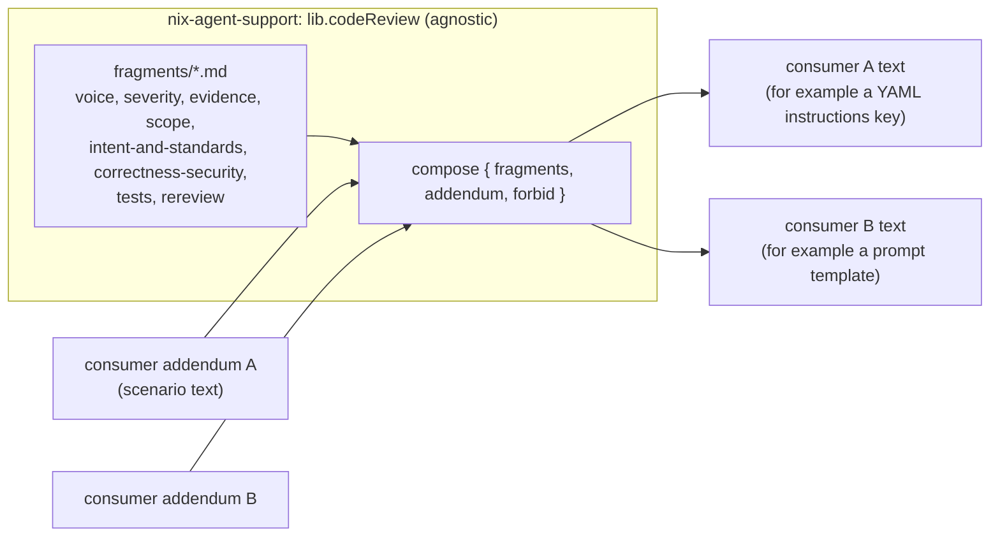

# Code-review principles: one common definition, composed per consumer

The guidance on HOW to review code is written once, as plain markdown fragments in
`lib/code-review/fragments/`, and assembled at nix evaluation time into every text that
tells an agent how to review. Decision record: ADR 0114.

## Design

- **Fragments** are one concern per file and MUST stay agnostic: no
  repo, tracker, hosting service, vendor, organisation, tool or agent name. A fragment
  talks about "the change", "the author" and "the reviewer". Policy sentences use the RFC 2119 keywords (MUST, SHOULD, MAY) in capitals, and every
  fragment holds at least one (checked). This repo carries no word list for the vocabulary rule
  (its public-repo rule forbids committed denylists); each consumer checks the composed text
  against its own vocabulary. Anything scenario-specific
  (how a finding is posted, which system holds the change, which control regime applies)
  MUST go in a consumer's addendum, never in a fragment.
- **`lib.codeReview`** (flake output, `lib/code-review/default.nix`) exposes `fragments`,
  `fragmentNames`, `principles` (all fragments, in order) and
  `compose { fragments ? all; addendum ? ""; forbid ? [ "{{" ]; }`. `compose` joins the
  chosen fragments and the addendum with blank lines, returns no trailing newline, and
  THROWS when any piece contains a substring of `forbid`. The default forbids the Go
  template opener so that composing into a prompt that is itself a Go template cannot
  change its actions. A consumer that is not a template MAY pass `forbid = [ ]`.
- **Composition is build-time.** Fragment text is embedded at evaluation time. A consumer
  never reads a fragment path at runtime and a skill or prompt never names a repo or path.

## Add a consumer

1. Reach the library through the flake input on this repo:
   `inputs.<agent-support input>.lib.codeReview` (no system argument).
2. Write the scenario addendum in the consumer's own repo. It SHOULD say how findings are
   delivered and anything the scenario adds to the severity bar; it MUST NOT restate a
   fragment.
3. Call `codeReview.compose { addendum = ...; }` (or pick `fragments = [ ... ]`) at the
   site that builds the text.
4. Add a check in the consumer that reads the rendered text and proves what the consumer
   needs (for example that the template actions it relies on survive).

Consumers live in a downstream, organisation-specific configuration flake: a reviewer-plugin
configuration file (a trimmed fragment set, because the plugin owns voice and the blocker bar) and
the prompt of a router review role (all fragments, plus a precedence line).

## Sources reviewed, and what became of each

Every place that already carried review guidance was read. Only guidance on HOW TO REVIEW became
common; process mechanics stayed with their owner.

| Source                                                                                  | Disposition                    | Reason                                                                                                                                                                                                                                                                                                                                                                                                                                                                                                                                                                                                                                                                                                  |
| --------------------------------------------------------------------------------------- | ------------------------------ | ------------------------------------------------------------------------------------------------------------------------------------------------------------------------------------------------------------------------------------------------------------------------------------------------------------------------------------------------------------------------------------------------------------------------------------------------------------------------------------------------------------------------------------------------------------------------------------------------------------------------------------------------------------------------------------------------------- |
| Router review prompt (a Go template)                                                    | Composed                       | Judgement lifted into fragments; claiming, checkout, prefetch, posting and the close guard stay in the template.                                                                                                                                                                                                                                                                                                                                                                                                                                                                                                                                                                                        |
| Reviewer plugin configuration                                                           | Composed                       | New consumer; trimmed set. The plugin also owns the signature line it appends to every comment: posting mechanics, so not common text.                                                                                                                                                                                                                                                                                                                                                                                                                                                                                                                                                                  |
| `pg-wi-flow` reviewer agent and its concern files (`packages/pg-wi-flow/data/concerns`) | Deferred, not code review      | They judge work-item readiness (intent, sufficiency, conformance, secondary effects, destructive actions) and record a verdict with a tool. Two ideas were genuinely about code and are in the fragments: secondary effects (dependents, documentation, configuration, schedules, alerts) and conformance to documented standards.                                                                                                                                                                                                                                                                                                                                                                      |
| `phase-split-reviewer` agent                                                            | Deferred, not code review      | Reviews the boundaries of a plan split (coverage, forward-only seams, independence).                                                                                                                                                                                                                                                                                                                                                                                                                                                                                                                                                                                                                    |
| Workflow critic prompts (implementation phase) and their older copies                   | Deferred                       | Their guidance is a criteria checklist (tests pass, acceptance met, clean commits, no debug artifacts, branch green) inside templates whose placeholders are filled by the downstream configuration repo's own dispatcher, mixed with work-tracker mechanics. Their REQUIRED and SUGGESTED labels diverge from the blocker, follow-up and nit vocabulary. The code-review ideas in them (debug artifacts and commented-out code, prior feedback accepted when reasonably declined, required versus suggested) are in `intent-and-standards`, `rereview` and `severity`. Composing them is an open follow-up in that downstream repo; an older copy of the critic prompts sits outside every repository. |
| The operator's global agent rules                                                       | Not composed                   | Rules that bear on reviewing are mechanics or policy (no mutation testing in a review flow, `--no-ext-diff` on diffs, a marker on agent-authored comments, critique of plans by an independent subagent). They belong to the consumer's procedure, not to the shared judgement.                                                                                                                                                                                                                                                                                                                                                                                                                         |
| Installed third-party review skills                                                     | Read for gaps only, not copied | They added the two-axis idea (intent and standards) and the smell baseline, both phrased independently in `intent-and-standards`.                                                                                                                                                                                                                                                                                                                                                                                                                                                                                                                                                                       |

## Tests

`checks.<system>.test-code-review` (`tests/code-review.nix` and a shell part in
`flake.nix`) checks the fragment inventory, the composition layout, that a Go-template
opener fails evaluation, that fragments contain no tab or opener, that every fragment has an RFC 2119 keyword, and pins the fragment order. A consumer
owns the vocabulary scan.
