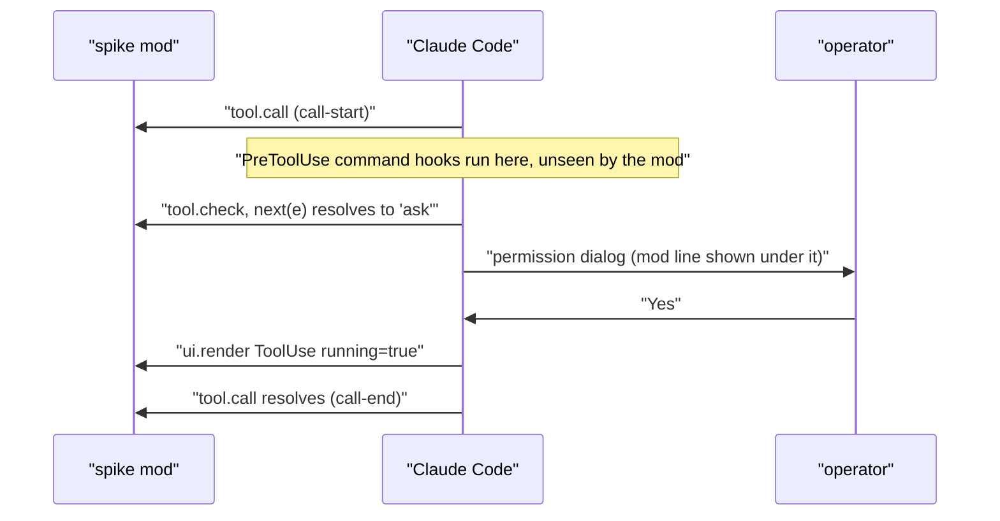

# Investigation: what a Claude Code mod can observe (spike, 2026-10-13)

Measured 2026-10-13, between about 22:50Z and 23:15Z, on **Claude Code 2.1.296** (`claude --version`), in
the CLI in a macOS terminal, with the session model `claude-opus-5-5`. The mods API was marked
"EARLY ACCESS: this surface may change between releases without notice" in that build's type
declarations, so re-check these results against the installed version before relying on them (see
"Re-checking this later").

The machine had **managed settings**: they were delivered remotely from the organization's admin
console, and the user was signed in with an enterprise plan. That loads the built-in guard
`sec-default@builtin`, which changes what a user-installed mod sees. Results on a machine without
managed settings may differ, most of all for `classic.*` events.

The spike mod was throwaway and has been deleted. This page is the record of what it saw. This repo
is public, so the write-up names no organization setting values.

## Why

The question was whether some of this repo's Claude Code integrations would work better as a mod (a
plugin whose `hooks/hooks.json` names an in-process TypeScript hooks module) than as command hooks:

- **claude-extended-tool-approver (CETA)**: move all tool-call _tracking_ out of CETA into a mod, so
  CETA is only its `PreToolUse` decision hook. Direction from the operator on 2026-10-13: leave the
  background-shell ownership check in CETA for now; CETA's database is for offline testing and
  validation, not something the runtime should need.
- **pa-monitor and related session-state tools**: let each session report its own state rather than
  having the daemon infer it from transcripts and process listings.

## Summary

| #   | Question                                                                      | Result                                                                                                                                               |
| --- | ----------------------------------------------------------------------------- | ---------------------------------------------------------------------------------------------------------------------------------------------------- |
| 1   | Can a mod wrap CETA's command hook (`classic.PreToolUse`) to see its verdict? | **No.** With managed settings, the built-in guard skips user mods on every `classic.*` event. `tool.check` gives the same verdict and reason instead |
| 2   | Can a mod tell approve, "No" and Esc apart at a permission dialog?            | Approve, yes. **"No" and Esc look identical**                                                                                                        |
| 3   | Can a mod measure how long the person took to answer?                         | **Yes**: from `tool.check` returning `ask` to the tool row redrawing as running (approved) or to the rejection                                       |
| 4   | In auto mode, does an ask reach the person or the classifier?                 | A CETA ask (`hook=PreToolUse`) reached the person. An ask the engine made itself, after CETA abstained, went to the classifier (no dialog)           |
| 5   | Can a mod start a slash command, as a drain idle monitor would?               | **Yes** with `$.command.run`. `$.prompt.submit` refuses text that starts with `/`, by design                                                         |
| 6   | Can one `hooks/hooks.json` hold both command hooks and a module?              | **Yes**; both ran                                                                                                                                    |
| 7   | Can a mod write one file per event with `$.fs.write`?                         | It creates folders and is fast, but it is **not safe**: 2 of 328 files were corrupt                                                                  |
| 8   | Do the UI pieces work in this terminal?                                       | Yes: pane, band above the prompt, status entry, and the line under the permission dialog                                                             |
| 9   | Is `$.process.run` cheap, and does it find the right tools?                   | **4 to 6 ms** per process. It finds the wrapped `bd`. The child does **not** get `CLAUDE_CODE_SESSION_ID`                                            |
| 10  | Can a mod read rate limits and the unsent prompt?                             | Yes, both                                                                                                                                            |
| 11  | Are a subagent's tool calls visible and tagged?                               | Yes, with `agentId`                                                                                                                                  |
| 12  | Does state survive a hot reload?                                              | Yes: `$.state` keeps its values and `session.start` fires again                                                                                      |

## Method

- **The spike mod** hooked `session.start`, `session.end`, `turn.start`, `turn.complete`, `tool.call`,
  `tool.check`, `classic.*` and seven named `classic.<Event>` hooks, `command.run` for four commands of
  its own, and `ui.render` for `Pane`, `AbovePrompt` and `ToolUse`. Every hook only observed: it
  returned what `next(e)` resolved to, unchanged. Each event was written as its own JSON file with a
  millisecond timestamp from `$.clock.now()`, and kept in `$.state` for a pane and the band.
- **The interactive session** loaded the mod from the session's hot-reload mods folder. The operator
  answered real permission dialogs in default mode (approve, "No", Esc) and then in auto mode.
- **Headless runs** used `claude -p --plugin-dir <copy> --debug` against a copy whose `hooks.json`
  also held a `Stop` command hook.
- **Checks** used `claude plugin validate` and `tsc` against the build's own `claude-code.d.ts`.

The observed order of one tool call that needed approval:



## Results in detail

### `classic.*` events never reach a user mod on this machine

No `classic.*` hook in the spike ever fired, in the interactive session or headless, though
`claude plugin validate` listed them and the command hooks of other plugins ran normally. The debug
log of a headless run gives the reason:

```text
cc-plugin-sec-default@builtin seated outermost: this machine has managed settings
hooks module cc-plugin-sec-default@builtin loaded (native, environment 1, tier prepend); events: classic.*, ...
plugin.register: mod-spike (user, mod-spike@inline), judged by cc-plugin-sec-default: admitted
mod-spike: classic.PreToolUse bypassed by cc-plugin-sec-default (tier user); beneath runs
mod-spike: classic.PostToolUse bypassed by cc-plugin-sec-default (tier user); beneath runs
mod-spike: classic.Stop bypassed by cc-plugin-sec-default (tier user); beneath runs
Hooks: Stop [...] (plugin mod-spike@inline) finished with status 0 (36ms)
```

This is documented behavior, not a bug:

- The mods admin page says the guard loads ahead of every user mod when the machine has managed
  settings or the user is signed in with a Team or Enterprise plan, and that "Users can't turn it
  off".
- The guard's README states its `classic.*` rule as "Continue past the user tier: the organization's
  settings hooks see the engine's input and their answer stands". The only condition is the event
  name.
- The guard's only options are `allowManagedModsOnly` and `allowModsToOverrideDenyRules`, and only
  managed settings can set them. Neither one lets a user mod receive `classic.*` events.

Command hooks are unaffected: the admin page says settings hooks and plugin `hooks/hooks.json` hooks
"run as before, alongside mods". So a value that only a classic event carries (the live
`permission_mode`, `PostToolUse.duration_ms`, `Notification`, `PermissionRequest` suggestions) needs a
command hook.

The same guard also protects the system prompt, managed instructions, what mods read as settings,
and managed MCP servers' tools. So a user mod here cannot drop sections of Claude Code's system
prompt. That is from the docs; the spike did not probe it.

### Permission outcomes and timing

Timestamps are milliseconds from `$.clock.now()`. "Wait" is the time from `tool.check` returning
`ask` to the next event that shows the dialog was answered.

| Call                                    | Mode    | Operator | Events after `tool.check` → `ask`                                 | Wait                                                    |
| --------------------------------------- | ------- | -------- | ----------------------------------------------------------------- | ------------------------------------------------------- |
| WebFetch `example.com`                  | default | Yes      | row `running=true` at 1791932469372, then `ok`                    | 1791932469372 − 1791932465902 = 3470 ms                 |
| WebFetch `example.org`                  | default | No       | `error`, `aborted=true`, row `err=true int=true` at 1791932490065 | 1791932490065 − 1791932481552 = 8513 ms                 |
| WebFetch `example.net`                  | default | Esc      | the same as "No", at 1791932516956                                | 1791932516956 − 1791932513443 = 3513 ms                 |
| `git push --dry-run` (CETA ask)         | auto    | No       | the same as "No", at 1791932721724                                | 1791932721724 − 1791932713967 = 7757 ms                 |
| WebFetch `example.edu` (CETA abstained) | auto    | none     | no dialog; row `running=true` at 1791932817166                    | 1791932817166 − 1791932816513 = 653 ms (the classifier) |

For the approved call, the tool's own run time is the gap from running to `call-end`:
1791932470946 − 1791932469372 = 1574 ms.

What a mod can and cannot tell apart:

- **Approved, refused, or run without asking**: yes, from `tool.check`'s `decision` and the
  `tool.call` result.
- **"No" versus Esc**: no. Both give the error text "The user doesn't want to proceed with this tool
  use", `next.signal.aborted === true`, a row with `isErrored` and `isInterrupted`, and a
  `turn.complete` with `isAborted: false` and `reason: "answer"`.
- **Who asked**: `tool.check`'s `hook` is `PreToolUse` when a command hook (CETA) decided, and absent
  when the engine's own rules or mode did. The reason text identifies CETA's rule (for example
  `primary-push: ...`).
- **Person versus classifier** when the engine itself asks: not directly. The live permission mode is
  carried only by classic events. In auto mode, an engine ask went to the classifier and a CETA ask
  went to the person.

The time from a call starting to its verdict, which includes every `PreToolUse` command hook, the
permission rules and the spike's own file writes, was computed per call as `t(check) − t(call-start)`
over the calls that had both records:

| Verdict came from                       | Calls | Min   | Median | Max    |
| --------------------------------------- | ----- | ----- | ------ | ------ |
| a `PreToolUse` command hook (CETA here) | 44    | 41 ms | 86 ms  | 591 ms |
| rules or mode, after CETA abstained     | 15    | 55 ms | 63 ms  | 199 ms |

The median is the value at 0-based position `floor(n / 2)` of the sorted list.

### Writing data out of a mod

- **`$.fs.write`** creates the file and its folders. Twenty writes of about 500 bytes each took 7 ms in total. The
  docs say it is not atomic, and it corrupted files in practice: 2 of the 328 event files
  (2 ÷ 328 ≈ 0.6%) held runs of NUL bytes. Both were written while a subagent was making tool calls
  at the same time. There is no append, rename or delete.
- **`$.process.run`** started a process in 4, 4, 5, 5 and 6 ms (5 runs of `true`). It accepts
  `stdin`, so a small append command can take one JSONL line or a batch. The cost of CETA's command
  hooks comes from Go start-up and opening SQLite, not from starting a process.
- **The child environment** came from the Claude Code process: `bd` resolved to the home-manager
  wrapper, which exports `BEADS_DOLT_AUTO_START=0` itself. `CLAUDE_CODE_SESSION_ID` was **not** set
  in the child, so a tool that needs the session id (such as `session-mode`) must be given it with
  `init.env`.
- **`bd ready --json`** ran from the mod and returned the ready queue.

### Commands, prompts and timers

- **`$.command.run({ command: 'mod-spike:spike-echo', args })`**, run from a `$.clock.after` timer
  2 s after a command, expanded the plugin's markdown command and started a turn. This is the
  mechanism a drain idle monitor would use to resume `/pb:drain-beads`.
- **`$.prompt.submit({ text: '/mod-spike:spike-echo ...' })`** was refused: "a text beginning with /
  would run a command as the user; run one with $.command.run({ command }) (host check)".
- **`$.prompt.read()`**, polled every 3 s, returned the operator's unsent draft as it was typed. That
  fixes "typed but not sent looks idle" for session state, and it also means any mod can read drafts.
- **`$.session.usage().rateLimits`** returned the `five_hour` window. No `seven_day` entry appeared
  during the spike.
- **`turn.complete`** carried `durationMs`, token `usage`, `isAborted` and `reason`.
- **Subagent calls** reached `tool.call` and `tool.check` with `agentId` set.
- **Hot reload**: after an edit, the load counter kept in `$.state` went from 1 to 2 to 3,
  `session.start` fired again, and the 3 s timer started again.

### Interface

- **Pane**: `$.ui.open` returned `{ isPlaced: true }` and the pane was visible.
- **Band and status entry**: both visible.
- **`$.ui.notice(tool_use_id, text)`**: the line showed under the open permission dialog, called both
  right after `tool.check` returned `ask` and 500 ms later.
- **`ui.render` on `ToolUse`** reported the row's state changes (`isRunning`, `isErrored`,
  `isInterrupted`, output present). Render hooks may not write `$.state`, so the spike wrote files only
  from that hook.

### Packaging

- **Command hooks and a module together**: a `hooks.json` with both a `hooks` key (a `Stop` command
  hook) and `modules` passed `claude plugin validate`, and both ran in a headless session.
- **Markdown commands**: a mod plugin's `commands/*.md` loaded as `mod-spike:<name>`.
- **Validator rule**: `$` may only be passed to functions declared at the top of the module (a
  function declaration or a `const` bound to one), not to closures created inside `register`.

## What this means for the designs

These are the consequences the spike points to. They are inputs to planning, not decisions.

- **Tool tracker**:
  - The mod gets the verdict, reason and deciding hook from `tool.check`, the outcome from
    `tool.call`, the wait from `ToolUse` row redraws, and the subagent from `agentId`.
  - It should hand each record to a small append command through `$.process.run` (JSONL), with an
    offline ingest into SQLite for `evaluate`, rather than writing one file per event.
  - CETA keeps `PreToolUse`, plus its `PostToolUse` background-shell registration for now.
- **Gaps that need a command hook or acceptance**:
  - "No" versus Esc cannot be told apart at all.
  - Person versus classifier for engine asks needs the live permission mode, which only a classic
    event carries.
- **Drain idle monitor**: a mod timer runs `bd ready` through `$.process.run` and resumes the drain
  with `$.command.run`.
- **Session state for pa-monitor**: a mod can report turn state, waits, the prompt draft and rate
  limits, and keep a heartbeat. Tools it runs need the session id passed explicitly.

## Re-checking this later

1. Run `claude --version` and compare it with 2.1.296.
2. Check whether the guard still loads and still skips user mods on classic events: start
   `claude -p --debug --plugin-dir <a mod that hooks classic.Stop>` and search the debug log
   (`~/.claude/debug/latest`) for `bypassed by cc-plugin-sec-default`.
3. Re-read the guard's README for its `classic.*` row, and the admin page for new guard options.
4. Re-run the dialog sequence (approve, No, Esc) to see whether a later build separates "No" from Esc.
5. Re-test `$.fs.write` under concurrent tool calls before trusting it for per-event files.

## Sources

- Mods reference: `https://code.claude.com/docs/en/plugins/mods/reference.md`
- Mods events: `https://code.claude.com/docs/en/plugins/mods/events.md`
- Manage mods for your organization: `https://code.claude.com/docs/en/plugins/mods/admin.md`
- The built-in guard's source and README: `https://github.com/anthropics/claude-code/tree/main/mods/sec-default`
- Claude Code changelog: `https://github.com/anthropics/claude-code/blob/main/CHANGELOG.md`
- The build's own declarations, written by Claude Code 2.1.296 when the `plugin-authoring` skill
  loads (`types/claude-code.d.ts` in that skill's folder)
