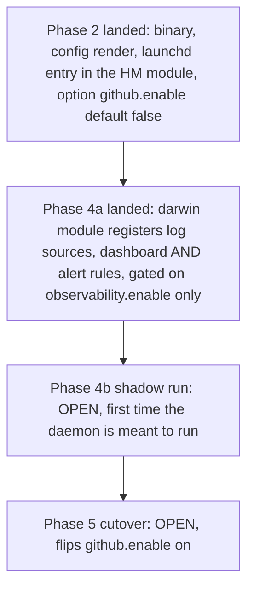
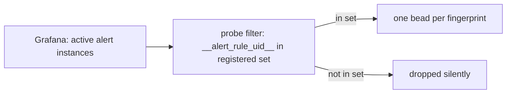

# Investigation: critical alert "pg-connector-github daemon is down" firing about 4 days with no bead (bead `pg2-bry0w`)

Found by the pg-router health review `pg2-hk7lb` on 2026-10-19. All times are UTC. Evidence was read
without changing any service: the local Grafana rules API (`GET` only, `127.0.0.1:3000`),
`~/.local/state/pg-router-probe/snapshot.json`, `~/.local/state/grafana-notifier/`, `launchctl list`
and `pgrep` output, `git log`, and the bead tracker. This repo is public, so the write-up names no
organization repo, PR or tracker id outside this workspace.

## Summary

| Question                                                   | Answer                                                                                                                                                              | Status |
| ---------------------------------------------------------- | ------------------------------------------------------------------------------------------------------------------------------------------------------------------- | ------ |
| Is a production `pg-connector-github` daemon meant to run? | No, not yet. The programme is before its shadow run (Phase 4b) and cutover (Phase 5). The module that installs the daemon is off by default and nothing enables it. | PROVED |
| Why does the alert fire?                                   | The alert rules were registered ahead of the daemon. The rule has `noDataState: Alerting`, so an absent `daemon_up` series alerts critical forever.                 | PROVED |
| Is it a deploy gap (daemon meant to run, module missing)?  | No. The launchd entry exists in the home-manager module; it is simply not enabled.                                                                                  | PROVED |
| Why was no bead filed?                                     | `pg-router-probe` only scans an allowlist of rule uids. `pg-conn-github-daemon-down` is on no list, so the probe never sees it.                                     | PROVED |
| Did the 90 hour pg-router outage also hide it?             | It contributed for part of the window, but is not the cause: the alert was invisible to the probe before, during and after the outage.                              | PROVED |

## Is the daemon supposed to be running now

- The programme epic and its phase beads show Phases 1, 2, 3a and 4a closed; 3b, 3c, 4b, 5, 6a and 6b
  open. Phase 5's acceptance says "github.enable is on" and consumes Phase 4b's shadow report, so the
  daemon is meant to be installed no earlier than the shadow run.
- No machine configuration in the workspace sets `phillipgreenii.programs.pg-connector.github.enable`.
- `launchctl list` has no `pg-connector-github-daemon` job. `pgrep` finds `pg-connector-github serve`
  processes only under test-runner temp directories, which are test fixtures.
- The darwin module `darwin/modules/pg-connector-github` registered the alert rules whenever the
  observability stack was on. Its header said this was "harmless while the daemon is idle or not yet
  installed (the rules see no data)". That was wrong for the daemon-down rule: the rule's own comment
  chooses `noDataState: Alerting` for "once the daemon is supposed to run", and the gate did not
  encode that condition.
- Grafana reports the six other rules of the group as `inactive` since 2026-10-15T14:19:50Z, the first
  evaluation after provisioning (they have `noDataState: OK`). `daemon is down` went `firing` at
  14:21:50Z, after its 2 minute `for`.

## Resolution in this repo

The module now registers `pg-connector-github-alerts.yaml` only when some home-manager user sets
`phillipgreenii.programs.pg-connector.github.enable`, following the pattern of
`darwin/modules/pg-task-focus`. The log sources and the dashboard stay on `observability.enable`
alone: they show no data while the daemon is absent and cannot fire. The check
`test-pg-connector-github-darwin-module` asserts the rule file is absent with no user, with a user
that has the option false, and with a user that does not mention the option, and present when it is
true.

Grafana keeps listing the rule as firing until a `pn workspace apply` reloads provisioning with the
new module; the repo change alone does not clear it.

## Why no bead was filed

The path that turns a firing Grafana alert into a bead is `pg-router-probe`
(`packages/pg-router-probe`). It reads every active instance from Grafana and keeps only those whose
`__alert_rule_uid__` is in a registered set.

Evidence:

- The probe's built-in set (`registeredRuleUIDs` in `run.go`) holds seven `pg-router-*` uids. The
  deployment passes `--rule-uid` flags, which REPLACE that default wholesale; the deployed list
  restates the built-ins and adds the pg-desk and bead-claim rules. Neither list contains
  `pg-conn-github-daemon-down` or any other `pg-conn-github-*` uid.
- The probe's snapshot (`snapshot.json`, `checked_at` 2026-10-19T18:57:33Z) holds alert entries for
  eight rule uids only (`beads-claims-no-live-owner`, `pg-desk-sweep-bound-violated`,
  `pg-desk-sync-error-rows`, `pg-router-failure-rate`, `pg-router-origin-unavailable`,
  `pg-router-queue-depth-growing`, `pg-router-queue-stalled`, `pg-router-source-persistent-failure`).
  There is no `pg-conn-github-daemon-down` entry, so the probe never observed the alert.
- Grafana delivered it to `grafana-notifier` (a banner): `firing` at 2026-10-15T14:22:10Z, then
  flapping `resolved`/`firing` pairs around host sleeps. A banner is the only other delivery path.

This is a scoping decision, not a code bug in the probe: the probe is deliberately limited to rules
somebody registered, and the rule was added with no registration step. Nothing connects "a rule file
is added to `alertRuleFiles`" to "its uids are escalated", so a new critical rule is silently
unescalated by default.

### The pg-router outage is not the cause

The pg-router daemon was down from 2026-10-15T21:08:32Z to 2026-10-19T15:32:13Z (see
`docs/investigations/2026-10-19-pg-router-daemon-90h-outage.md`), and the probe runs inside pg-router,
so for those 90 hours no probe ran. That covers most of the 4 days, but the alert started at
14:21:50Z on 10-15, about 6.5 hours before the stop, and has stayed unseen for the roughly 3 hours
since the daemon came back. The filter, not the outage, is what kept it out.

## Findings and follow-ups

- The alert is resolved at the source by gating (above). It does not need a bead of its own beyond
  the one tracking this change.
- When the daemon is deployed (Phase 4b/5), whoever enables `github.enable` SHOULD decide whether
  `pg-conn-github-daemon-down` is registered with the probe in the deployment's rule list; once
  the daemon is meant to run, a silent critical alert is the failure this note describes.
- A rule file listed in `alertRuleFiles` MAY be checked against the probe's registered set, with an
  explicit exclusion list, so an unregistered critical rule is a deliberate choice and not an
  omission. This is a possible hardening, not a fix to a bug in the probe.
