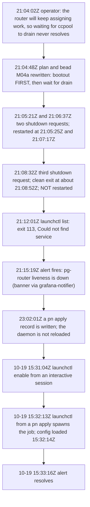

# Investigation: pg-router daemon down about 90 hours, 2026-10-15 to 2026-10-19 (bead `pg2-zuc5x`)

Found by the pg-router health review `pg2-hk7lb` on 2026-10-19. All times are UTC unless a local
time is named (EDT = UTC-4). Evidence is local and was read without changing any service:
`~/.local/state/pg-router/launchd-stderr.log`, `/private/var/log/com.apple.xpc.launchd/launchd.log*`,
`launchctl print` and `plutil -p` of the live job, the local Prometheus on `127.0.0.1:9090`, the
local Grafana database opened with `sqlite3 -readonly`, `~/.local/state/grafana-notifier/`,
`~/.local/share/pn-workspace/applied/*`, and the operator's own Claude session transcripts.

This repo is public, so the write-up names no organization repo, PR or tracker id.

## Summary

| Question                                        | Answer                                                                                                                                       | Status                    |
| ----------------------------------------------- | -------------------------------------------------------------------------------------------------------------------------------------------- | ------------------------- |
| Who stopped the daemon at 2026-10-15T21:08:32Z? | The operator, by hand, following step 1 of the workspace-move window "W1" (unload the LaunchAgent with `launchctl bootout`).                 | PROVED (act inferred)     |
| Why did launchd not restart it?                 | It was UNLOADED, not exited. `KeepAlive` applies only to a loaded job; the W1 step that loads it again was never run until a `pn` apply did. | PROVED                    |
| What does `KeepAlive = true` do after exit 0?   | launchd respawns the job (throttled at 10 s). A clean exit is restarted. Only an unload keeps it down.                                       | PROVED                    |
| Change the plist so a clean exit restarts?      | No change. It already does. The plist is pinned by a test instead.                                                                           | RULED INTENDED            |
| Did an alert exist for "pg-router not up"?      | Yes, `pg-router-liveness-down` (5 min, critical). It fired at 21:15:19Z and was recorded 51 times. It was a banner only, so nobody acted.    | PROVED                    |
| Did the launchd-health "not running" rule fire? | It fired but was muted. The rule is `severity=warning` and the critical-only desktop policy mutes it before any webhook call.                | PROVED (bead `pg2-84dj8`) |

## Timeline

## Cause of the 2026-10-15T21:08:32Z shutdown request

The router logs `run: shutdown requested` only from its signal context (`SIGINT` or `SIGTERM`,
`packages/pg-router/cmd/pg-router/run.go`), so the line proves a signal arrived, not who sent it.
The sender is established from three independent sources.

1. The operator's workspace-move session was in the middle of the move plan. At 21:04:02Z the
   operator said that ccpool will not drain while the router keeps assigning work. Within a minute
   the session rewrote the plan and the bead for step M04a so that step 1 is
   `launchctl bootout gui/$(id -u)/com.phillipg.pg-router-daemon` BEFORE the drain wait, and step 6
   is `launchctl bootstrap gui/$(id -u) ~/Library/LaunchAgents/com.phillipg.pg-router-daemon.plist`.
2. The router log shows three shutdown requests inside 3 minutes (21:05:21Z, 21:06:37Z, 21:08:32Z),
   which fits an operator working through that step, and the third one is the last the router ever
   logged before 10-19.
3. At 21:12:01Z the same session ran `launchctl list com.phillipg.pg-router-daemon` and got exit 113
   `Could not find service`. The job was not loaded.

NOT directly observed: the `bootout` command itself. `launchd.log` rotates in about a day and the
retained files start at 2026-10-17 08:29 local (12:29Z), so the 10-15 launchd lines are gone. This is the same
caveat recorded when the 2026-09-28 outage (`pg2-mnyvy`) had the same shape. The two earlier
requests (21:05:21Z, 21:06:37Z) were restarted by launchd in 4 s and 40 s, so they were signals sent
to a loaded job; which command sent them is NOT DETERMINED.

Corroboration that a `pn` apply also does this: `launchd.log` shows the 2026-10-19T17:53Z apply
sending `launchctl bootout` (from `sudo` under `.pn-wrapped`), the job exiting with `exit(0)` after
`SIGTERM`, `removing service`, then a `launchctl enable` and a respawn 13 s later.

## launchd behaviour after a clean exit 0

The live plist (`plutil -p ~/Library/LaunchAgents/com.phillipg.pg-router-daemon.plist`) carries
`KeepAlive => true`, `RunAtLoad => true`, `ExitTimeOut => 60`, `AbandonProcessGroup => true`. It is
generated by `darwin/modules/pg-router/default.nix` through
`phillipgreenii.system.launchdServices.userAgents.pg-router-daemon`, whose `keepAlive` default is
`true` in `phillipgreenii-nix-personal`'s `lib/launchd-service-submodule.nix`.

- `KeepAlive = true` means "keep the job running whenever it is loaded". launchd respawns it after
  ANY exit, including exit 0. The only brake is the 10 s minimum run time (`minimum runtime = 10` in
  `launchctl print`).
- That is observed here: the 21:05:21Z and 21:06:37Z shutdown requests are followed by a new
  `loaded pg-router config` 4 s and 40 s later.
- `LastExitStatus = 0` in the bead is therefore not the cause. The job did exit 0, and was then
  removed from the domain by the `bootout`. A removed job has no `KeepAlive`.

Decision: the plist MUST NOT change, and `KeepAlive` MUST stay plain `true`. Narrowing it to
`{ SuccessfulExit = false; }` would STOP restarting after exit 0, which is the opposite of what is
wanted. No `KeepAlive` value can restart an unloaded job, so a plist change cannot close this gap.
The restart is the operator's explicit `bootstrap` (W1 step 6), or the next `pn` apply that reloads
the agent.

Regression guard added in this change: `checks.<system>.test-pg-router-module` in `flake.nix` now
asserts `keepAlive == true` and `runAtLoad == true` for the generated `pg-router-daemon` agent. The
check evaluates against the stubbed launchd option set (this flake has no input on
`phillipgreenii-nix-personal`), so it proves this module does not override the registry default; the
real default lives in personal.

### Why the 10-15 apply did not bring it back

A `pn` apply was recorded at 2026-10-15T23:02:01Z, two hours after the stop, and the daemon stayed
down until the 10-19 apply. The cause is DETERMINED (bead `pg2-4345r`), and it is neither of the two
guesses this note first made (that nix-darwin reloads only agents whose plist changed, and that the
post-activation health check failed to recover it). The activated generations of the 21:48Z and
23:02Z applies did not define the LaunchAgent at all: the daemon option was disabled on purpose,
temporarily, in the terminal flake's home-manager configuration, ten minutes before the 21:48Z apply.
An agent that is not defined has no plist for activation to reload and is not in the set the health
check polls, so there was nothing for either to restore. The 10-19 generation defines it again, and
that apply brought it back.

The evidence (the activated generations compared directly, the per-apply health-check records, and
the policy now pinned by tests for the health check's one `launchctl bootstrap` of a defined,
unloaded agent) is in `docs/investigations/2026-10-19-unloaded-agent-not-restored-on-apply.md` in
`phillipgreenii-nix-personal`.

## Alerting

### What fired

`pg-router-liveness-down` (this repo, `packages/pg-router/grafana/alerting/alerts.yaml`):
`for: 5m`, `noDataState: Alerting`, severity critical. A stopped daemon has no `/metrics`, so
`pg_router_liveness` has no series and the rule alerts on no data. That is a 5 minute threshold, so
the "not up for more than 15 minutes" requirement is already met by an existing rule and NO new rule
is added.

Evidence it worked: `grafana-notifier.jsonl` records `pg-router liveness is down` as `firing`
(critical) at 2026-10-15T21:15:19Z, 6 minutes after the stop, and `resolved` at 2026-10-19T15:33:16Z,
one minute after the daemon came back. 51 notifications were recorded between those, alternating
firing and resolved because the host sleeps (Prometheus has multi-hour gaps in
`up{job="pg-router"}`; that series is `0` for 495 of its 527 five-minute samples in the window and
absent otherwise).

### Why nobody acted

- The only delivery path for a Grafana alert on this machine is a macOS banner through
  `grafana-notifier` (`terminal-notifier`). A banner is passive, is lost when the machine is asleep
  or the screen is locked, and the notifier log also shows `terminal-notifier timed out` errors.
- The path that turns a firing alert into a bead is `pg-router-probe`, which runs INSIDE pg-router.
  When the daemon is the thing that is down, no bead is filed. This is an inherent gap, not a bug in
  the rule.
- The 51 flapping notifications taught nothing: `resolved`/`firing` pairs around every sleep look
  like noise.

### What did not fire

`launchd daemon not running: com.phillipg.pg-router-daemon` (rule uid `lh-15238ecc24b48408`, in
`phillipgreenii-nix-support-apps`). The exporter did report `launchd_service_running = 0` for the
label from about 21:09Z to 15:33Z on 10-19, and Grafana logged `Sending alerts to local notifier` for
the rule once a minute from 21:14Z to 21:47Z. The notifier log has NO entry for it in that window.
The bead's claim that "none is recorded" is correct for this rule and incorrect for the liveness rule.

An earlier revision of this note recorded why as NOT DETERMINED and read the log line as a send to the
notifier that then went missing for an unknown reason. Both are superseded by bead `pg2-84dj8`, which
established the cause. The full finding is the amendment headed "Finding, 2026-10-19: a warning-severity
"daemon not running" alert is silent by design" in `phillipgreenii-nix-support-apps` ADR 0040
(`docs/adr/0040-host-metrics-and-local-alert-notifier.md` in that repo). In short:

- **Cause: muted by policy, working as ruled.** Every rule rendered for the launchd-health group
  carries `severity=warning`, and the provisioned notification policy mutes every
  `severity != critical` notification with the `always` timing. The embedded Alertmanager therefore
  suppressed the rule's notifications and never called the webhook. This is the 2026-10-08
  critical-only desktop ruling doing what it was set to do, not a delivery fault. The live
  provisioning confirmed it: all 64 rules in the launchd-health file carry `severity: warning`, and
  the rendered policy holds the `mute_time_intervals: [always]` child route.
- **The log-line inference was wrong.** `Sending alerts to local notifier` (logger
  `ngalert.sender.router`) is the Grafana scheduler handing an evaluation result to its own embedded
  Alertmanager, where "local notifier" means the in-process Alertmanager and NOT `grafana-notifier`.
  It is logged for every firing rule on every evaluation, before routing, muting or the webhook, so it
  is not a webhook send and proves nothing about the notifier. The Grafana log shows identical
  once-a-minute lines for other warning rules that also have no notifier entry.
- **Corroboration.** The last non-critical entry in the notifier log is dated 2026-10-09T04:35Z, and
  every `notified` entry from 2026-10-10 to 2026-10-19 is `critical`.
- **What this does not show.** It does not show the desktop path is adequate for a daemon that drives
  work: `pg-router-liveness-down` (critical) did reach the notifier and, as a passive banner, still
  went unnoticed (see "Why nobody acted").
- **Sleep-gap flapping (mechanism unverified).** The same ADR amendment records that the notifier
  logged `resolved` then `firing` 2 s later for `pg-router liveness is down` after the host woke
  (2026-10-15T23:53Z and 2026-10-16T01:31Z), and gives the operator's options for it. This note makes
  no claim about the mechanism.

## Recommendations

These are policy statements for the owners named. None is implementable in this repo.

1. The workspace-move plan's W1 step 6 (re-load the agent) MUST be a hard gate of the same
   procedure that unloads it, not a trailing note. The plan lives in `phillipg-nix-ziprecruiter`.
2. A manual `launchctl bootout` of a `KeepAlive` agent SHOULD be followed immediately by a check that
   prints `state = running`; the check SHOULD be the last line of any procedure that unloads one.
3. A deliberate disable of the daemon option in the terminal flake MUST be paired, in the same
   procedure, with the step that re-enables it, because an agent the configuration no longer defines
   is neither reloaded by activation nor checked by the health check (and MUST NOT be, since that
   would resurrect a service the operator just removed). The health check itself needs no change for
   this outage: it already bootstraps a defined, unloaded user agent once per activation, pinned by
   tests in `phillipgreenii-nix-personal`.
4. `phillipgreenii-nix-support-apps`: the cause of the missing notifier entry is established (see
   "What did not fire"), so there is nothing left to establish. A critical "daemon down" alert for the
   daemon that drives work SHOULD have a delivery that does not depend on a transient banner, and the
   notifier SHOULD NOT report a host-sleep gap as `resolved`. Which of those to apply is the operator's
   call, laid out as options in `phillipgreenii-nix-support-apps` ADR 0040's amendment headed "Finding,
   2026-10-19: a warning-severity "daemon not running" alert is silent by design".
5. `KeepAlive` for `com.phillipg.pg-router-daemon` MUST remain `true` (guarded by
   `test-pg-router-module`).
