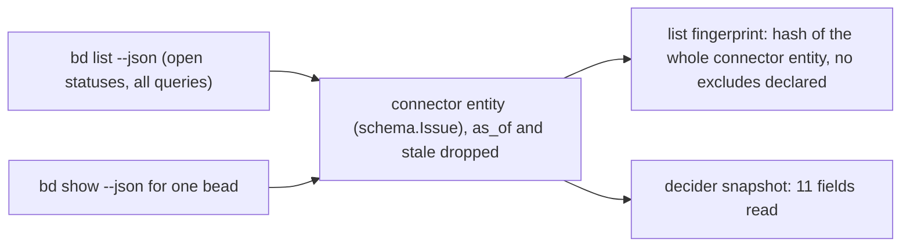

# Investigation: issue change emission, spikes that need live data and installed tools (phase 1)

Run on 2026-10-22, between 18:08Z and 18:20Z (all times UTC). These are the live-data spikes of step
1 of the issue change emission design (the per-backend design: section 10 item 13 and item 4,
and section 4.1). Later phases consume the outputs: phase 2 reads the
tracked-set threshold, phase 3 the comment answer, phase 5 the orphan cap, the `bd` budget defaults
and the watched-set size.

This repository is public, so the document gives counts, shapes, defaults and arithmetic only: no
issue key, bead title, tenant host name, project key, user name or home-directory path appears in it.

## Read this first

- Every spike is read-only. The verbs that ran are listed in "What was and was not run" at the end;
  none of them advances a consumer cursor, appends a change row, hydrates an entity into the
  pg-desk store, writes a work item or edits a tracker.
- A number that could not be measured says "default, not measured" or "not measurable here" with the
  reason. No number is invented.
- **The real-change rate in 13(a) is the rate under the OLD classifier** (the blanket reconcile
  tiers still running, `reconcile` for first observation, no `fields_changed` row). It MUST be
  re-recorded under the new `fields_changed` rule by the later phase that cuts the beads path,
  because that rule adds rows that today are dropped.
- Nothing was skipped for network reasons: every spike ran against local reads. The Jira burst
  headroom and `search --expand` of item 13(j) are Jira reads, which the sibling spike packet owns,
  and are not recorded here.

## Summary

| Spike (design label)               | Output                                                                                                                                 | Default that applies if nothing changes it                           |
| ---------------------------------- | -------------------------------------------------------------------------------------------------------------------------------------- | -------------------------------------------------------------------- |
| `bd list --json` comparison        | The fingerprint covers all 11 fields the decider reads; list and show agree on every carried field except `deps`                       | Fingerprint kept; fix the list-side `deps` decoding in a later phase |
| 13(d) `bd` budget                  | `bd_max_concurrent` 9, `bd_max_per_minute` 92, wait bound 5 s                                                                          | These three values                                                   |
| 13(a) watched set and real-change  | Active 425 beads and 11 Jira; watched set 425 and 11; real-change rate 63.9 rows per day (29.5 tracker-observed), old classifier       | Record again under the new rule                                      |
| 13(c) `bd` processes per hydration | `issue show --fresh` is 1 process; `issue deps --full` is 1 plus one per blocker visited (1 to 36 measured); deps read is OFF today    | Size on umbrella calls (2 per hydration), check against processes    |
| 13(b) orphan cap and lag           | Cap 10 per poll is never the binding limit at 19.5 leave events per day; the lag threshold is set by poll cadence, not measurable here | Cap 10, lag alert 30 minutes                                         |
| Item 4 comment count               | `bd` returns `comment_count` in `list` and in `show`; it returns no latest-comment time                                                | Count replaces the proxy once the connector maps it                  |
| 13(j) Jira tracked-set threshold   | Store holds 11 Jira entities; threshold 55 (5 times 11)                                                                                | 55                                                                   |

## `bd list --json` against what the decider reads

### How the three layers relate

The change check is a list-and-diff over `bd list --json`: the umbrella maps each listed bead onto the
connector entity and hashes it, and the `fingerprint_excludes` list the beads backend declares is
empty (only `as_of` and `stale` are dropped). The decider reads the stored snapshot, which comes from
`pg-connector issue show <id> --fresh` (the same mapping, applied to `bd show --json`). Hydration reads
`issue deps <id> --full` only when `hydration.read_issue_deps` is true; it is unset, so false, in the
deployed configuration.

Method: `bd list --readonly --json --limit 0` over the open, in-progress and blocked beads of the
deployed tracker gave 425 beads. `bd show --readonly --json` was taken for 13 beads (5 with comments,
5 with dependencies, 3 plain). The connector entity from `list` was then compared with the one from
`show --fresh` for every one of the 124 beads of the `work-beads` listing (field by field, `as_of`,
`stale`, `served_from` and `age_seconds` dropped), in a scratch state home.

### Field-by-field table

"List" counts beads carrying the field out of 425 listed; "show" counts out of the 13 sampled (a field
absent from a bead is omitted by `bd`, so the denominators are the same for every row). "Carried" is
whether the connector copies the field into its entity, and therefore into the fingerprint.

| `bd` field                                                   | In list (of 425) | In show (of 13) | Carried by the connector as   | Read by the decider |
| ------------------------------------------------------------ | ---------------- | --------------- | ----------------------------- | ------------------- |
| `id`                                                         | 425              | 13              | `id`                          | yes                 |
| `title`                                                      | 425              | 13              | `title`                       | yes                 |
| `status`                                                     | 425              | 13              | `state`                       | yes                 |
| `priority`                                                   | 425              | 13              | `priority`                    | yes                 |
| `issue_type`                                                 | 425              | 13              | `issue_type`                  | yes                 |
| `labels`                                                     | 398              | 13              | `labels`                      | yes                 |
| `assignee`                                                   | 3                | 1               | `assignee`                    | yes                 |
| `parent`                                                     | 158              | 2               | `parent`                      | yes                 |
| `metadata`                                                   | 172              | 8               | `metadata`                    | yes                 |
| `due_at`                                                     | 0                | 0               | `due_date`                    | yes                 |
| (connector-built)                                            | n/a              | n/a             | `url`                         | yes                 |
| `owner`                                                      | 425              | 13              | `owner`                       | no                  |
| `description`                                                | 359              | 13              | `description`                 | no                  |
| `created_at`                                                 | 425              | 13              | `created_at`                  | no                  |
| `updated_at`                                                 | 425              | 13              | `updated_at`                  | no                  |
| `external_ref`                                               | 31               | 1               | `external_refs`               | no                  |
| `dependencies` (edge records in list, nested issues in show) | 209              | 5               | `deps` (see the defect below) | no                  |
| `acceptance_criteria`, `design`, `notes`                     | 125, 30, 208     | 1, 1, 6         | not carried                   | no                  |
| `started_at`, `lease_expires_at`, `heartbeat_at`             | 68, 3, 3         | 4, 1, 1         | not carried                   | no                  |
| `created_by`                                                 | 425              | 13              | not carried                   | no                  |
| `comment_count`                                              | 425              | 13              | not carried                   | no                  |
| `dependency_count`, `dependent_count`                        | 425, 425         | 13, 13          | not carried                   | no                  |
| `revision`                                                   | 0                | 13              | not carried (show only)       | no                  |
| `comments_omitted`                                           | 0                | 7               | not carried (show only)       | no                  |
| `closed_at`, `close_reason`                                  | 0, 0 (open only) | not sampled     | not carried                   | no                  |

Notes on the table:

- The decider's snapshot reads 12 members of the entity (`id`, `title`, `state`, `url`,
  `status_category`, `priority`, `issue_type`, `labels`, `assignee`, `parent`, `due_date`,
  `metadata`). `status_category` is a Jira-only field and is empty for beads, so 11 apply.
- `due_at` is on no bead: 0 of 425 open beads and 0 of 6,286 beads over all statuses carry it, so
  whether `bd list --json` returns it identically to `bd show --json` is **not measurable here**
  (reason: no bead carries a due date, and writing one is forbidden). The connector code maps
  `due_at` to `due_date` for both verbs through one function, which is the only evidence.
- `dependency_count` is non-zero for 32 beads, the same 32 beads that carry a `blocks` edge, while
  `dependencies` is present for 209 beads because it also holds `parent-child` (158 edges),
  `discovered-from` (72), `related` (11) and `relates-to` (7) edges next to the 79 `blocks` edges.

### Verdict

- **Every field the decider reads is in the fingerprint.** All 11 applicable fields are carried by the
  connector and hashed. Across the 124 beads compared, the list entity equalled the show entity on
  every field except `deps`: 63 of 124 beads were identical in full, and the 61 that differ are exactly
  the 61 beads that have an edge (61 of 61).
- **Defect, `deps` on the list side.** For a listed bead, `bd list --json` returns each edge as a
  record with `depends_on_id` and `type`, while `bd show --json` returns nested issues with `id` and
  `dependency_type`. The connector decodes only `id` and `dependency_type`, so every list-side edge
  becomes an entry with an empty id and an empty type (`[{"id":"","type":""}]` against
  `[{"id":"<id>","type":"parent-child"}]` for the same bead). The fingerprint therefore sees how many
  edges a bead has and nothing about which. The decider does not read `deps`, so this does not break
  the verdict above; it matters to the dependant-staleness gap of the design (section 10 item 11(d)):
  a blocker that is replaced by another with the same edge count does not move the fingerprint.
  Default if no later phase fixes it: leave as is, and treat the edge count as the only dependency
  signal in the list check.
- **The fingerprint is wider than the decider.** It also hashes `owner`, `description`,
  `created_at`, `updated_at`, `external_refs` and the edge count, none of which the decider reads. In
  particular `updated_at` is in the hash, so any write (including a same-value `bd update`) changes
  the fingerprint. That is the noise INV-ICD-6 removes by dropping `updated_at` from the compared
  content; it is not a gap in coverage.
- The fingerprint-completeness test of the design (section 9, T-7) can therefore assert the 11 read
  fields against the entity and MUST NOT assert `due_at` from live data.

## 13(d) The `bd` budget defaults, with the host load and timeout length behind them

Inputs, all measured here.

| Input                                                   | Value                                                                                                        |
| ------------------------------------------------------- | ------------------------------------------------------------------------------------------------------------ |
| Host cores (`sysctl -n hw.ncpu`)                        | 11                                                                                                           |
| Load average at the start (18:08Z), 1, 5, 15 minutes    | 37.43, 28.34, 23.67 (37.43 / 11 = 3.4 runnable per core)                                                     |
| Load average at the end (18:20Z), 1, 5, 15 minutes      | 8.25, 15.02, 19.32                                                                                           |
| Beads backend event log span                            | 2026-10-22 11:44:29Z to 18:10:27Z = 6.44 hours (the log keeps one rotated copy, so no longer)                |
| Calls with a final row / of which ran `bd`              | 19,982 / 6,979, running 8,813 `bd` processes (mean 8,813 / 387 active minutes = 22.8 a minute)               |
| `bd` processes started per minute, p50, p99, maximum    | 23, 49, 61                                                                                                   |
| Peak `bd` processes at once (call intervals overlapped) | 6                                                                                                            |
| Call duration, p50, p95, p99, maximum                   | 516 ms, 3,025 ms, 8,906 ms, 40,038 ms                                                                        |
| Calls at or over 10 s, 20 s, 30 s                       | 61, 15, 6 (6 / 6,979 = 0.086 percent), by UTC hour 14 to 17 (10, 27, 16, 7 at 10 s or more) and 1 at hour 18 |
| Writes in the span (close, comment, create, update)     | 16 (1 + 8 + 1 + 6) in 6.44 hours                                                                             |

The load average during the busy hours is **not recorded** anywhere on the machine (the event log
carries no load), so the load behind the slow calls is stated only as the load observed at the start
of this spike (3.4 per core, 37.43 on 11 cores).

Timeout length behind it (read from `pkg/scriptout/limits.go`): a backend call has a 30 s budget
(`DefaultBackendTimeout`), `list` has 40 s (`ListBackendTimeout`), `list_activity` has 60 s, and the
umbrella kills the backend 5 s after the budget (`BackendDeadlineMargin`), so a `list` is killed at
45 s. In the log the single timeout is a `list` that reached its 40 s budget (40,038 ms), answered
`unavailable` and had its `bd` child killed; all 6 calls at or over 30 s are `list` calls. The log
has no `bd_timeouts`, `budget_wait_ms` or `budget_denied` field yet (the design adds them).

Formulas and defaults (the design gives no numeric default, so these are outputs):

- `bd_max_concurrent` = min(cores, ceil(1.5 x peak at once)) = min(11, ceil(1.5 x 6)) = min(11, 9)
  = **9**. It is above the observed peak (6), so steady state never waits; it binds in a burst.
  Reserve **2** of the 9 slots for writes (16 writes in 6.44 hours is 2.5 an hour, so two is ample).
- `bd_max_per_minute` = ceil(1.5 x peak a minute) = ceil(1.5 x 61) = ceil(91.5) = **92**.
- Wait bound = **5 s**: above the p95 duration (3.0 s) so a call that waits for a slot usually gets
  one, and half of the shortest poll interval of the probes that pin `--backend` (10 s), so it stays
  shorter than their poll interval as INV-ICD-9 requires. The p99 duration (8.9 s) is above 5 s, so a
  small share of waits end in the retryable `unavailable`; that is the intended behavior.

Consistency checks against the other defaults (these are checks, not measurements):

- The orphan burst (13(b)) of 10 hydrations adds 10 x 1 = 10 processes with the deps read off, or
  10 x (1 + 1.43) = 24.3 with it on (1.43 from 13(c)). 61 + 24.3 = 85.3, within 92.
- **Tension to resolve in phase 5:** the default `hydration.max_per_poll` is 50 (`config.go`,
  `DefaultHydrationMaxPerPoll`). With the deps read on, 50 x 2.43 = 121.5 processes exceed the per-minute
  headroom of 92 - 22.8 = 69.2 (mean) and would be throttled across polls; with it off, 50 x 1 = 50
  fits. Phase 5 MUST NOT turn the deps read on without re-checking this.

## 13(a) Watched set, active count and real-change rate

Backend inferred from the id shape (the `backend` column does not exist yet): the deployed tracker
uses lowercase-letter prefixed ids, Jira keys are an uppercase project key plus a number. The
packet's own rule (an id with this repository's tracker prefix is a bead) cannot be applied literally,
because the connector reads a different tracker whose ids carry another prefix. Counts only.

| Backend (by id shape) | Active (store flag, as `pg-desk status` counts it) | Inactive rows | Expected watched set (union of its watched queries) |
| --------------------- | -------------------------------------------------- | ------------- | --------------------------------------------------- |
| Beads                 | 425                                                | 52            | 425                                                 |
| Jira                  | 11                                                 | 0             | 11                                                  |
| Total                 | 436 (equals `pg-desk status`: 436)                 | 52            | 436                                                 |

Member count of each watched query (`pg-connector issue list --query <q> --ids-only`, and agreeing
with the watch-set markers stored in the pg-desk store):

| Watched query      | Members | Backend |
| ------------------ | ------- | ------- |
| `work-beads`       | 124     | Beads   |
| `mine`             | 11      | Jira    |
| `focus-open-beads` | 425     | Beads   |
| `focus-held-beads` | 0       | Beads   |

The union is counted once per entity: `work-beads` is wholly inside `focus-open-beads` (intersection
124 = size of `work-beads`), `focus-held-beads` is empty, so the beads watched set is 425, and the Jira
set is 11. The union equals the active set (425 + 11 = 436), so no active entity is outside every
watched query today, and the orphan queue of 13(b) is empty. The connector also registers a second
beads source (this repository's own tracker) that recognises none of the four query names, so that
tracker has no watched queries.

Real-change rate, **measured under the OLD classifier**:

- Retained window: oldest change-log row 2026-10-19T16:15:50Z, newest 2026-10-22T18:12:44Z = 266,214
  s; 266,214 / 86,400 = 3.081 days.
- Issue rows in the window: 17,335, of which `reconcile` 17,138 (12,350 `local-reconcile`, 4,289
  `sweep`, 499 `pg-connector`) = 98.9 percent, and not `reconcile` 197 (17,335 - 17,138).
- Real-change rate = 197 / 3.081 = **63.9 rows a day**. Of the 197, 91 were observed in the tracker
  (origin `pg-connector`): 91 / 3.081 = **29.5 a day**, and 106 were written by pg-desk itself
  (28 `annotation_changed` and 78 `link_changed`). 13 of the 91 are `comments_changed` rows, which the
  old classifier derives from a bare `updated_at` change (the proxy of item 4).
- Hydrations whose fingerprint changed per day: **not measurable here**. The store keeps one
  cumulative hydration counter (5,048, with 121 failures) with no start time and no per-day series, so
  no division is possible.
- This is a row rate, not a drain rate. It MUST be re-recorded under the new `fields_changed` rule.

## 13(c) How many `bd` processes stand behind one hydration

Code path read first: hydration is `pg-connector issue show <id> --fresh`, then (only when the deps
read is on) `pg-connector issue deps <id> --full`. The beads backend records each `bd` execution of a
call in its event log row (`bd_calls`). `issue show --fresh` writes the umbrella entity cache; so the
probe ran with a throwaway state home (`XDG_STATE_HOME` pointed at a scratch directory), which also
gave the probe its own clean event log. Neither verb advances a cursor or writes the change ledger
(read from `cache_policy.go` and `issue.go`).

| Call                                                 | `bd` processes                                                                                      |
| ---------------------------------------------------- | --------------------------------------------------------------------------------------------------- |
| `issue show <id> --fresh`                            | 1, in 3 of 3 probes (and in 583 of 583 `show` calls in the live log)                                |
| `issue deps <id> --full`, bead with no `blocks` edge | 1 (3 of 3 probes; 479 of 479 `deps` calls in the live log)                                          |
| `issue deps <id> --full`, bead with `blocks` edges   | 1 for the bead plus 1 for each blocker visited (breadth-first, one `bd dep list` per node): 2 to 36 |

Distribution over the 32 beads of the watched set that have a `blocks` edge (every one of them probed
once): sorted `bd` processes per `deps` call 2, 2, 2, 2, 2, 2, 2, 2, 2, 2, 3, 3, 3, 3, 4, 4, 4, 4, 4,
5, 5, 5, 6, 6, 6, 6, 7, 7, 14, 30, 31, 36; total 216 = mean 6.75 a call, median 4; slowest call 9.7 s.
The other 393 of 425 beads cost 1. Mean over the whole watched set: (393 x 1 + 216) / 425 = 609 / 425 =
**1.43 processes a `deps` call**.

Answer: one hydration is **2 umbrella calls and 1 `bd` process with the deps read off (today's
deployed state)**, or 2 umbrella calls and **1 + 1.43 = 2.43 processes on average (3 to 37 worst
case)** with it on. The design's default (size the orphan cap on umbrella calls, 2 per hydration) is
therefore exact for calls and an underestimate for processes when the deps read is on; the cap check
in 13(b) uses processes.

## 13(b) The orphan cap and the orphan-lag threshold

There is no orphan queue in today's pipeline, so neither value can be measured; both are checked
against the measured arrival rate and budget.

- Arrival: rows of kind `closed` or `removed` in the window are 60, so at most 60 / 3.081 = **19.5
  leave events a day**, an upper bound on how many watched entities could leave every query in a day.
  Orphans in the store now: 0 (13(a)).
- Cap: `orphan_max_per_poll` = 10 clears 19.5 a day in two polls, so the cap never binds at this
  arrival rate. Its cost per poll is 10 x 2 = 20 umbrella calls, or 10 processes (deps off) to 24.3
  (deps on, 10 x 2.43), inside the 92 a minute of 13(d). **Default kept: 10.**
- Lag threshold: the lag an orphan can reach is set by the poll cadence, and `pg-desk doctor` reports
  the poll interval as unknown (no verdict) in this deployment, so the threshold cannot be derived
  from a measured cadence. **Default kept, not measured: 30 minutes**, equal to the age of the local
  sweep tier it replaces.

## Item 4 Does `bd` return a comment count or a latest-comment time

- **Comment count: yes, in both verbs.** `bd list --json` returns `comment_count` for all 425 beads (91
  of them non-zero), and `bd show --json` returns it for all 13 sampled, with `comments_omitted: true`
  on the 7 that have comments and no comment bodies.
- **Latest-comment time: no, in neither.** Neither verb returns a field holding a comment's time. The
  times exist only per comment: `bd comments <id> --json` returns `author`, `created_at`, `id`,
  `issue_id` and `text` for each comment (one call per bead), and `bd show --include-comments`
  streams comment bodies.
- The connector does not carry `comment_count` today (its `bdIssue` struct has no such field), which
  is why the entity has no comment list or count and the old classifier infers `comments_changed`
  from `updated_at` alone.
- Verdict: **a field exists that can replace the proxy.** Mapping `comment_count` into the connector
  entity (an additive field, a connector change for a later phase) makes a comment add visible as a
  count increase, so the `comments_changed` row can be derived from that field and the proxy retired
  for beads. Limits: a count cannot see a comment edit or a deletion that leaves the count equal, and
  this spike did not test whether a new comment moves `updated_at` (that needs a write). Default
  if the change is not made: keep the proxy for beads, as INV-ICD-6 says today.

## 13(j) The Jira tracked-set size threshold

- Observed: the pg-desk store holds **11** non-bead issue entities (the count of entities, not of open
  issues), all active, none inactive; the `mine` query lists 11, so tracked equals members and no
  issue is tracked only because it was read. The sampled connector ledgers behind the design's
  "3 to 4" figure are older; the count has grown from 3 to 4 to 11 since.
- Formula: threshold = 5 x observed = 5 x 11 = **55**. The multiple 5 is a choice (**default, not
  measured**), set above the growth already seen (11 / 4 = 2.75 times, taking the upper end of the
  older figure) so the alert fires only on growth that the governor's lower priority class for
  non-members should have absorbed, and low enough that 55 tracked issues on a shared tenant is
  still a size the request budget can refresh.
- The Jira burst headroom and `search --expand` are not recorded here (Jira reads, owned by the
  sibling packet).

## What was and was not run

Run, all read-only: `pg-desk status`, `pg-desk doctor`, `sqlite3 -readonly` against the pg-desk store,
`pg-connector issue list --query <q> --ids-only --output json` for the four watched queries and once more to pick probe beads (five calls, against
the real state home, the verb the packet names), `bd list --readonly --json`, `bd show --readonly
--json`, `bd comments <id> --json`, and, with a throwaway `XDG_STATE_HOME` so no real cache, ledger or
event log is touched, `pg-connector issue list --query work-beads --fingerprints`, `issue show
--fresh` (130 calls: 124 for the comparison, 6 for the probes), `issue deps --full` (37 calls) and
`issue deps` without `--full` (30 calls, to find beads with blocker edges). Reads of the beads backend
event log and of the code. The real beads backend event log gained the rows its own verbs always
append (the five `list` calls above).

Not run: `pg-desk issue changes`, `pg-desk issue refresh`, `pg-connector issue changes`, any `bd`
write verb, any `--reset`, any Jira read, any verb that contacts a remote host.
