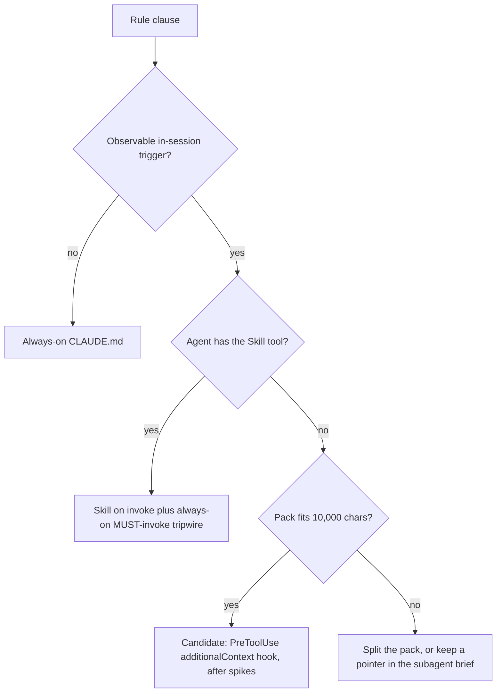

# Investigation: hook-based conditional rule injection for agent rules (2026-11-08)

**Status**: Findings and recommendation only. No hook is adopted or implemented by this document, and
no ADR, `CLAUDE.md` or agent-rules file is edited.

**Origin**: operator-requested follow-up (Phillip, 2026-08-25) from the agent-rules token-efficiency
reorganization. That reorganization moved bead-lifecycle clauses into the `beads-lifecycle` skill
behind a short always-on "MUST invoke" tripwire. This page is the deferred deep dive into whether
hook injection should replace or back that tripwire.

**Evidence base.** Everything below is tagged **[docs]** (Claude Code hooks documentation,
`https://code.claude.com/docs/en/hooks`, fetched 2026-11-08, first 100,000 of about 290,000
characters read), **[repo]** (files in this repository, read 2026-11-08), or **[untested]** (needs a
spike; procedure given). No live Claude session was run for this page.

## Summary

| Question                                                   | Answer                                                                                                |
| ---------------------------------------------------------- | ----------------------------------------------------------------------------------------------------- |
| Does hook `additionalContext` re-inject every turn?        | **No** [docs]. It is inserted once, at the point the hook fired, and saved in the transcript.         |
| Is there a size cap?                                       | **Yes, 10,000 characters** per string [docs]. A 5-9k-token pack (about 20-36k characters) is over it. |
| Do `PreToolUse` hooks fire inside subagents?               | **Yes** [docs], with `agent_id` and `agent_type` in the payload.                                      |
| Is hook adoption allowed by the existing ADR?              | **Not without a recorded supersession.** Wording is drafted below.                                    |
| Does hook or skill decomposition help the two big loaders? | Hooks **no**; skill decomposition **yes**, for `unblock-human-beads` in particular.                   |

Recommendation in one line: **do not adopt a hook now.** Keep the skill-plus-tripwire design; reserve
a small `PreToolUse`-on-`bd` hook for the one class the skill cannot reach (subagents without a
Skill tool), and only after the spikes in section 4 pass.

## 1. Rule classes: hook vs skill-on-invoke vs always-on

| Class                                                                                                                     | Recommendation                                                              | Reason                                                                                                                                                                                                           |
| ------------------------------------------------------------------------------------------------------------------------- | --------------------------------------------------------------------------- | ---------------------------------------------------------------------------------------------------------------------------------------------------------------------------------------------------------------- |
| **A.** No observable trigger: bare prohibitions, conversation-time rulings, M-1..M-3, destructive-command bans            | MUST stay always-on in `CLAUDE.md`                                          | A hook or tripwire needs a trigger to key on. `home/programs/agent-rules/default.nix` already records this boundary [repo].                                                                                      |
| **B.** Observable trigger (`bd` verb, park/release, label mutation), main-loop agent with a Skill tool                    | SHOULD stay skill-on-invoke with the always-on tripwire (current design)    | Zero per-session cost for sessions that never touch `bd`. Its only weakness is invocation rate, which the Stage C soak measures (see section 5).                                                                 |
| **C.** Observable trigger, agent has Bash but no Skill tool (pnwf runners, pg-pr agents, per the operator's bead framing) | MAY use a small `PreToolUse`-on-`bd` hook, gated on the spikes in section 4 | A hook is the only mechanism that reaches such agents. The Skill-tool absence is taken from the operator's description and is not re-verified here.                                                              |
| **D.** B-1/B-2 claim-release essence                                                                                      | MUST stay always-on                                                         | `docs/agent-rules-rationale.md` [repo] keeps it always-on precisely because a tool-restricted subagent cannot invoke the skill. A hook would be a second, redundant channel (see the double-injection analysis). |

The hook is therefore a **Proxy-plus-Guard** for class C only, not a replacement for class B.

## 2. Spike questions, answered or reduced to procedures

### 2.1 Established by docs [docs]

1. **Injection is once, not per turn.** `additionalContext` is "wrapped in a system reminder and
   inserted into the conversation at the point where the hook fired"; for `PreToolUse` it sits next to
   the tool result. The text is "saved in the session transcript", and on `--continue`/`--resume` the
   saved text is replayed rather than the hook re-run. So the feared per-turn re-injection cost does
   not follow from the mechanism. The cost is the ordinary one: the text is part of the transcript
   (and so of every later request's prefix) like any tool result.
2. **Cap: 10,000 characters** for each of `additionalContext`, `systemMessage`,
   `initialUserMessage` and plain stdout. Over the cap, the output is written to a file in the session
   directory and replaced by the file path plus a preview of up to the first 2,000 characters, and
   "Claude Code doesn't ask Claude to read the file." The existing pack is far over the cap: the
   `beads-lifecycle` skill body is 41,111 bytes [repo], about 10,300 tokens at 4 characters per token
   (41,111 / 4). The bead's 5-9k-token figure is 20-36k characters at the same ratio. A hook MUST
   therefore carry a compact pack of at most 10,000 characters (about 2,500 tokens, 10,000 / 4), not
   the skill body.
3. **Subagent firing.** "When a subagent calls a tool, tool events such as PreToolUse and
   PostToolUse fire the same configured hooks as in the main conversation, and the input carries the
   `agent_id` and `agent_type`." That answers the bead's second spike question for command hooks.
   Local corroboration that subagent calls are tagged at all: the mods spike recorded subagent calls
   with `agentId` [repo, `docs/investigations/2026-10-13-claude-code-mods-spike.md`, row 11], and
   `packages/claude-tool-tracker/testdata/pre_tool_use.json` carries an `agent_id` field [repo]. Both
   concern mods and tracking, not an injection test.
4. **`session_id` is in the common input**, so a per-session marker file is implementable. The only
   built-in once-semantics (`once: true`) is honoured only for hooks declared in skill frontmatter, so
   a settings or plugin hook MUST implement its own guard.
5. **Headless.** Hooks fire "wherever it runs", including `claude -p`.
6. **Hook parallelism.** Same-event hooks run in parallel and `updatedInput` collides (last wins)
   [repo, `docs/adr/0071-claude-code-hook-router.md`]. `additionalContext` is not `updatedInput`, but
   the ADR does not establish how contexts from parallel hooks combine; see spike S4.

### 2.2 Untested; needs a spike

Each spike MUST run in a throwaway fixture project with a throwaway plugin or settings hook, never
the live pa-monitor or CETA configuration. A later bead runs them; this page does not.

| ID     | Untested claim                                                                                                    | Procedure                                                                                                                                                                                                                                                                               | Pass condition                                                                                                                                     |
| ------ | ----------------------------------------------------------------------------------------------------------------- | --------------------------------------------------------------------------------------------------------------------------------------------------------------------------------------------------------------------------------------------------------------------------------------- | -------------------------------------------------------------------------------------------------------------------------------------------------- |
| **S1** | `additionalContext` on `PreToolUse` is delivered when the decision is allow or absent                             | Hook on `PreToolUse` matcher `Bash` that prints `{"hookSpecificOutput":{"hookEventName":"PreToolUse","additionalContext":"CANARY-7f3a"}}` and omits `permissionDecision`. Run `claude -p` with a prompt that runs `bd --version` then asks the model to quote any canary string it saw. | Model quotes `CANARY-7f3a`. Repeat with an explicit `allow` decision.                                                                              |
| **S2** | The guard fires the pack once per `(session_id, agent_id)` and not again on later `bd` calls                      | Hook script writes a marker `$TMPDIR/pack-<session_id>-<agent_id or main>` and prints the canary only if absent. Run a session that makes 5 `bd` calls. Count canary occurrences in the saved transcript JSONL.                                                                         | Exactly 1 occurrence per agent.                                                                                                                    |
| **S3** | A dispatched subagent with no Skill tool receives the injection and its own marker is independent of the parent's | Parent runs `bd` first (marker set), then dispatches a subagent restricted to `Bash` that runs `bd`. Inspect the subagent transcript for the canary.                                                                                                                                    | Canary present in the subagent transcript even though the parent already consumed its own.                                                         |
| **S4** | A parallel hook (the CETA or router `PreToolUse` entry) does not suppress or overwrite the canary                 | Register the canary hook alongside the real router config copy in the fixture, so both match one `Bash` call.                                                                                                                                                                           | Canary survives, and CETA's decision is unchanged.                                                                                                 |
| **S5** | The injected pack survives auto-compaction, or the design must re-inject after `compact`                          | After the canary is injected, force a compaction (`/compact`), then ask the model to quote the canary. Also test a `SessionStart` matcher `compact` hook as the re-inject path.                                                                                                         | Either the canary survives, or the re-inject hook restores it. Record which; this decides whether the guard is session-scoped or compaction-aware. |
| **S6** | Over-cap behaviour is as documented (file path plus 2,000-character preview)                                      | Emit 12,000 characters of context once.                                                                                                                                                                                                                                                 | Transcript shows path plus preview only. Confirms the 10,000 limit is a hard design constraint.                                                    |
| **S7** | Resume replays the saved injection and does not re-fire the guard                                                 | After S2, `claude --resume` the session and make one more `bd` call.                                                                                                                                                                                                                    | Canary count stays 1; marker unchanged.                                                                                                            |
| **S8** | Invocation-rate baseline: how often sessions that run mutating `bd` invoke the skill today                        | Query the tool-call census for sessions with a mutating `bd` Bash call and the fraction with a `beads-lifecycle` Skill call. This is a read-only analysis, no live session.                                                                                                             | A number to compare with the pre-registered 90% threshold.                                                                                         |

## 3. Reconciling the prior rulings on the record

### 3.1 ADR 0054 (`docs/adr/0054-in-context-agent-rules-staleness-accepted.md`)

The ADR rejects Option 2 (record an apply, re-read `CLAUDE.md` or the command at a boundary) and
Option 3 (compare the `readlink` target and re-read on change), "including in reduced form", and
says a later reader should find the ADR rather than re-open the design. Both rejected options share
one defect: **a re-read of already-loaded text appends a second, possibly contradictory copy**, so a
precedence rule would be needed.

A `PreToolUse`-on-`bd` hook differs on the exact axis the ADR relied on:

- It is **not a refresh mechanism.** It does not detect that anything changed, and does not re-read
  text the session already holds. It delivers a pack **once, to a session that does not have it**.
- The pack text is **absent from always-on `CLAUDE.md`** (only a pointer-level tripwire stays), so
  there is never an older copy to contradict. The append-only-context problem does not arise.
- It does not close the staleness gap and does not claim to. A session that received the pack before
  an apply keeps the pre-apply pack for its life, which ADR 0054 already accepts. If anything the
  hook narrows the gap slightly, because the pack is read from disk at first use rather than at
  session start.

The distinction fails, and the hook MUST NOT be adopted, if the design ever re-injects after an apply
or at a loop boundary. That is Option 2 in reduced form.

**Draft supersession wording** (for a later change to record; this page does not edit the ADR):

> **Partially superseded by ADR NNNN (YYYY-MM-DD, Phillip Green II).** Options 2 and 3 remain
> rejected as written: nothing in this repository re-reads already-loaded rules at a boundary or on a
> changed `readlink` target, and the in-context staleness this ADR accepts remains accepted. ADR NNNN
> adds one narrow mechanism this ADR did not weigh: a `PreToolUse` hook matching `bd` that injects a
> bounded rule pack, once per (session, agent), into a context that does not already hold it. It is a
> first-delivery mechanism, not a refresh mechanism, so it needs no precedence rule and does not
> reopen the append-only-context problem that rejected Options 2 and 3.

### 3.2 The SessionStart double-injection defect (`home/programs/agent-rules/default.nix`)

The comment records that a `SessionStart` hook plugin was added during the marketplace migration,
injected the same rules a second time (the rules were already in the user-level `CLAUDE.md`), and was
removed; the user-level `CLAUDE.md` is "the single, canonical always-on delivery". The defect was
**the same content delivered through two channels into one context**.

A `PreToolUse`-on-`bd` design avoids recreating it only if all of these hold. Each MUST be a
recorded design constraint and a test:

1. **Content moved, not copied.** The hook pack MUST be removed from `pgii-agent-rules.md` before the
   hook ships. What stays in `CLAUDE.md` is the pointer-level tripwire only, which carries no rule
   text that the pack repeats.
2. **Once-per-(session, agent) guard**, keyed on `session_id` plus `agent_id` (or a literal `main`),
   so neither repeated `bd` calls nor parallel subagents multiply it (spikes S2, S3).
3. **No overlap with the skill.** If the agent has already invoked `beads-lifecycle`, the pack
   duplicates the skill body. The hook SHOULD be scoped to class C agents (the guard cannot see a
   Skill call; a `PostToolUse` marker on the Skill tool MAY pre-set the marker).
4. **Not on `SessionStart`.** The hook fires on a trigger (`bd`), not on session start, so a session
   that never runs `bd` pays nothing, unlike the removed plugin which paid on every session.

## 4. Recommendation per rule class

1. **Class A:** no change. Always-on.
2. **Class B:** no change today. Keep the skill and tripwire. This investigation's own
   precondition for revisiting is the Stage C invocation-rate result (section 5).
3. **Class C:** SHOULD NOT adopt a hook yet. Run S1-S7 in one spike bead. If they pass, a later change
   MAY add a hook carrying at most 10,000 characters, behind its own ADR using the wording in 3.1 and
   with constraints 3.2.1-3.2.4 as acceptance criteria. If S1 or S3 fails, the hook is dead for class
   C and the alternative is a pointer in every subagent brief that names the rules file to Read
   (the context-diet design already makes briefs pointers).
4. **Do not use hook injection to carry the full skill body.** It does not fit the cap (S6) and would
   duplicate the skill.

## 5. Trigger

The bead's early un-defer trigger is the Stage C soak failing its pre-registered threshold (at least
90% of bd-mutating sessions invoking `beads-lifecycle`). That result is external and was not
observed for this page. Spike S8 produces the comparable baseline. A pass at or above 90% means
classes A and B are settled and only class C remains; a miss strengthens the case for the class C
hook but does not by itself justify a hook for main-loop agents, where the cheaper first step is
strengthening the tripwire wording.

## 6. The `drain-beads.md` and `unblock-human-beads.md` size question

Measured in this worktree [repo], sizes in bytes and tokens at 4 characters per token:

| File                                                    | Bytes   | Approx. tokens       |
| ------------------------------------------------------- | ------- | -------------------- |
| `claude-marketplace/pb/commands/drain-beads.md`         | 37,122  | 9,280 (37,122 / 4)   |
| `claude-marketplace/pb/commands/unblock-human-beads.md` | 143,702 | 35,926 (143,702 / 4) |

The bead quoted 58KB and 88KB. The drain command has since been cut by the context-diet work (rare
paths moved to the `pb:drain-stuck` and `pb:drain-one` skills, 36,271 and 17,518 bytes); the unblock
command is larger than the bead stated. The bead's figures are stale; the table is current.

**Hooks do not help.** A command body is loaded in full when the command is invoked, before any tool
call, so a `PreToolUse` hook cannot shrink it. A hook could only inject less if the content were
already moved out, which is skill decomposition, not hook injection. A 10,000-character cap also
rules out hooks as the carrier for sections of this size.

**Skill decomposition helps, unevenly.**

- `drain-beads.md` (about 9.3k tokens) has already had its large rare-path sections moved. The
  remainder is the main loop, rules and arguments, which every `/drain-beads` run needs. SHOULD NOT
  be decomposed further without a measurement showing a rare path still dominates.
- `unblock-human-beads.md` (about 35.9k tokens) SHOULD be decomposed. Its section headings show large
  per-class procedures that apply only when a bead matches that class: Class 1a (lines 528-616),
  Class 3 (654-812), Class 4 (812-919), terminal actions (963-1216, about 250 lines) and the Rules
  block (1351-1591, about 240 lines). Following the dispatcher/handler pattern already used by
  `integrate-branch` and `pb:drain-stuck`, each class procedure becomes an on-demand skill and the
  command keeps the triage rubric, which selects the class. The Sourcing invariant, label
  vocabulary and "DO NOT REGRESS" blocks MUST stay in the command body, since they are safety
  invariants needed before any triage.
- Caveat inherited from ADR 0054: moving text from a command into a skill converts it from
  loaded-at-invocation to loaded-at-use. A long-running sweep then loads class skills from the
  on-disk copy at the time of use, which is arguably fresher than a stale command body. No new
  mechanism is needed.
- Untested, spike S9: that a model reliably invokes the right class skill from the triage result.
  Procedure: run the decomposed command against a fixture bead set with one bead per class and check
  that each is handled by the intended skill. This is the unblock analogue of the invocation-rate
  question.

## 7. Open decisions for the operator

1. Whether to fund the S1-S7 spike bead now, or wait for the Stage C soak result.
2. Whether `unblock-human-beads.md` decomposition (section 6) is worth filing independently of any
   hook decision. It does not depend on one.
