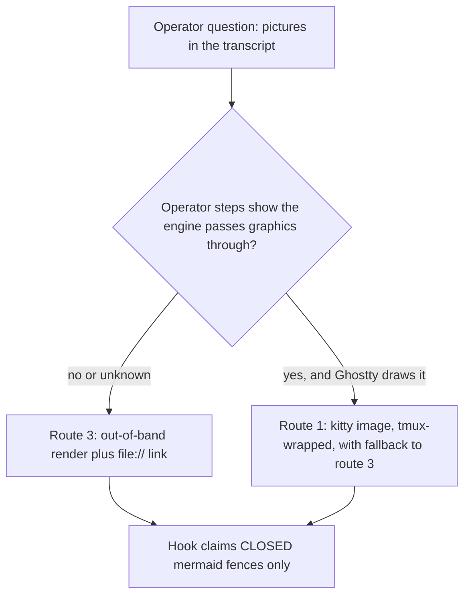

# Investigation: mermaid blocks and inline images from a Claude Code mod render hook (2026-11-10)

The key words MUST, MUST NOT, SHOULD, SHOULD NOT and MAY in this page are to be read as in RFC 2119.

**Status**: spike findings and a recommendation. Nothing here is built or adopted.

**Origin**: operator question (Phillip, 2026-11-09): "are we limited to strings? or can we do something
like parse a codeblock which uses mermaid and render a mermaid image inline?", with the ruling "do a
spike on this, it isn't related to the other work".

**Evidence tags.** Every finding carries one tag.

- **verified live**: observed in this spike, with a real tool in a hermetic setup (named below).
- **docs only**: taken from documentation, typings, or reading source; not observed here.
- **not observed**: needed a human at Ghostty's real display, or a real model turn in an interactive
  session, and the spike could not do it. The exact operator steps are in "Operator steps".

Environment: Claude Code 2.1.318, tmux 3.7b, Node 24, macOS (Darwin 25.6), `TERM_PROGRAM=ghostty`.

## What the spike could and could not run

The mods guide documents one isolated way to run a throwaway hook: `claude --plugin-dir <dir> -p`
(headless). A headless run draws no transcript, so it cannot exercise an assistant-message render
hook. An interactive run would need a real model turn under the operator's login (`--bare` mode
accepts only an API key, and none is available), and would load the operator's live pgd mod and write
its session files. The spike therefore did NOT run any hook inside Claude Code, installed no hook, and
touched no Claude configuration. What it did run for real:

- the pgd mod's own `links.ts` through the same node harness the `test-pgd-mod` check uses (a scratch
  copy of the mod with the `.ts` import suffix and testing shim);
- a real tmux 3.7b server on a private socket, a pty-attached client that records the bytes tmux sends
  to the outer terminal, and `tmux capture-pane -p -e`;
- `nix eval` of nixpkgs metadata (no build, no download).

No network connection was opened to an outside host and no diagram was sent anywhere.

## Verdicts

| Route                                                | Verdict                       | Evidence tag                                                 |
| ---------------------------------------------------- | ----------------------------- | ------------------------------------------------------------ |
| Kitty or iTerm2 image from a render hook, in Ghostty | not known (could not run)     | not observed                                                 |
| The same, inside tmux with passthrough               | works with caveats (tmux leg) | tmux leg verified live; engine and Ghostty not observed      |
| Mermaid source to a picture (mermaid-cli)            | works with caveats            | docs only plus nix eval                                      |
| Mermaid source to a text diagram                     | not known (no converter)      | not observed                                                 |
| `file://` link to a rendered file                    | works with caveats            | link mechanism verified live earlier; `file://` not observed |
| Claiming a mermaid fence in a render hook            | works                         | verified live (links.ts harness)                             |
| Half-written fence while streaming                   | works with caveats            | verified live (string level); engine streaming not observed  |

## 1. Inline image (kitty and iTerm2)

### What a render hook can return

`links.ts` shows the contract: the hook on `AssistantMessage` receives `e.props.text` (a string of
raw markdown) and hands `next()` a copy with a rewritten string. The band hook, by contrast, returns
element trees built from `$.ui.resolve(e)` (`Box`, `Text`, `Button`) (**docs only**: both read from
the mod source). The typings shipped in this repo contain no image or raw-escape component, so no
image primitive is known. Whether the engine passes an APC or OSC graphics sequence through the
markdown renderer and the Ink layout (it may strip it, count it as visible width and mis-wrap, or
pass it) is **not observed**.

### The tmux leg (verified live)

A raw sequence and a tmux-wrapped one were written to a pane's tty, with `allow-passthrough` off and on,
and the bytes tmux sent to the attached client were recorded. The payload was a 1x1 PNG.

| Sequence                                 | passthrough off                              | passthrough on                          |
| ---------------------------------------- | -------------------------------------------- | --------------------------------------- |
| kitty APC raw (`ESC _ G ... ESC \`)      | not forwarded; tmux takes it as a pane title | not forwarded; still taken as the title |
| kitty wrapped in `ESC P tmux; ... ESC \` | dropped                                      | forwarded intact to the client          |
| iTerm2 OSC 1337 raw                      | dropped                                      | dropped                                 |
| iTerm2 wrapped                           | dropped                                      | forwarded intact to the client          |

Further observations:

- The pane text (`capture-pane -p -e`) never held the payload in any case: no stray characters in the
  pane.
- A raw kitty APC under tmux leaked into the status bar: tmux drew the first characters of the payload
  (`"Ga=T,f=100,t=d;iVBORw"`) as the pane title. That is a visible stray-text defect for any hook that
  emits the raw form under tmux.
- Wrapping needs every inner ESC doubled. tmux forwards the sequence but does not track the image: it
  has no record of the placement, so scroll, resize, split or redraw does not move or clear it
  (**docs only**: the tmux behaviour; kitty Unicode placeholders are the documented way to make
  placement follow text).

### The Ghostty leg (not observed)

Whether Ghostty draws a kitty image here, whether it accepts the iTerm2 sequence at all, whether cmux
(the terminal the operator reaches Ghostty through) forwards graphics, and survive-scroll and
survive-resize behaviour all need the real display. Ghostty documents kitty graphics support
(**docs only**); the iTerm2 inline-image protocol is not believed to be supported (**docs only**,
unconfirmed).

### Verdict and recommendation

Not provable from an agent. Even if Ghostty draws the image, an image written by a string-rewriting hook
has no layout identity in Ink (position drifts on redraw) and needs a per-terminal fallback, so this
route SHOULD NOT be pursued before the operator steps below show that the engine passes the sequence
and that it survives scroll and resize.

## 2. Mermaid source to a picture

- **mermaid-cli** (`mmdc`): nixpkgs has `mermaid-cli` 11.12.0, not marked broken, platform list includes
  `aarch64-darwin` (**verified live**, `nix eval nixpkgs#mermaid-cli.meta`).
- Its derivation wraps a browser only when `chromium` is available on the host platform. nixpkgs
  `chromium` lists Linux platforms only (**verified live**, `nix eval nixpkgs#chromium.meta.platforms`),
  so on this Mac the nix build gets NO bundled browser: a render needs `PUPPETEER_EXECUTABLE_PATH`
  pointed at an installed Chrome (one is in `/Applications`) (**verified live** for the nix side; the
  render itself **not observed**).
- Closure size and render time: **not observed** (measuring needs a substituter download or a local
  build; the spike opened no outside connections). Expect a Node plus puppeteer closure and a
  headless-browser start per diagram of the order of seconds (**docs only**, no number measured).
- A text or box-drawing converter: `graph-easy` exists in nixpkgs as a Perl tool, but it reads its own
  graph syntax, not mermaid, so it would need a mermaid parser in front. No mermaid-to-text converter
  was found in nixpkgs (`mermaid-ascii` is not an attribute) (**verified live** by eval). Quality on
  flowchart, sequence and state diagrams: **not observed**.
- A hosted-viewer link sends the diagram to a third party. That is a policy question for the operator
  (diagrams from an employer repo MUST NOT be sent outside without an explicit ruling). It is evaluated
  on paper only and MUST NOT be built by default.

Verdict: a picture is feasible only as a file rendered out of band (see section 3), with caveats (no
bundled browser on darwin, cost unmeasured).

## 3. `file://` link to a rendered file

The mechanism is already proven for web URLs: a rewritten match is drawn as a terminal hyperlink and
ctrl+click opens it, plain click being consumed by tmux mouse mode (**verified live** 2026-11-09, noted
in the link-resolvers design). The `file-ref` design already emits `file://` URLs
(`file://{path}:{line}`). What is **not observed** is whether ctrl+click on a `file://` URL to a `.svg`
or `.png` opens it in the operator's viewer from Ghostty, and what happens with the `:line` suffix.

A hook cannot render the file itself (no browser in the mod sandbox is known), so this route needs a
separate renderer (a tool run by the operator or a background job) that writes the file, and the hook
then links the fence to it.

Verdict: works with caveats. It is the cheapest route that does not depend on terminal graphics, and
the only one whose first step (an unchanged markdown link) is already proven.

## 4. Detection: claiming a mermaid fence

Run through the pgd mod's real `rewriteLinks` with two always-matching rules, on a scratch copy
(**verified live**):

| Input                                                                    | Result                                                                   |
| ------------------------------------------------------------------------ | ------------------------------------------------------------------------ |
| closed backtick fence labelled `mermaid`, with `ZR-9` and `graph` inside | fence contents byte-for-byte unchanged; text outside the fence is linked |
| open (unterminated) fence with the same body                             | contents unchanged (the fence regex protects to end of text)             |
| ` ```mer ` with no newline yet                                           | not yet a fence; plain text, nothing inside to rewrite                   |
| closed `~~~mermaid` fence                                                | unchanged                                                                |
| four-space indented fence                                                | unchanged (not a fence by the regex; indented code)                      |

So the existing protection already shields a mermaid fence from link rules. A mermaid claimer is a
separate pass over the same text and MUST run on the fence regions only, using the same fence
definition so it cannot disagree with the protected-span pass about where a fence starts and ends.

### Streaming

At string level an unterminated fence is "protected to end of text", so a link rule never rewrites the
growing fence. A mermaid claimer MUST therefore require a CLOSED fence before it replaces anything;
otherwise a half-written diagram would be replaced by a partial or invalid render on every token and
flash garbage. Until the closing line arrives, the source text shows as written. Whether the engine
calls the render hook with partial text mid-stream, and how often, is **not observed** (the string
level behaviour above is verified live; the engine behaviour is not).

## Recommendation



1. Adopt route 3 as the first route: the hook claims a closed mermaid fence and appends a link to a
   rendered file, leaving the source visible; rendering is done by a separate tool and the operator
   chooses the renderer (mermaid-cli with a supplied browser path is the only candidate found).
2. Do not build a hosted-viewer link by default; it needs an operator ruling on third-party disclosure.
3. Defer route 1 until the operator steps below report on the real display.

## Operator steps (everything marked not observed)

Run these by hand in Ghostty and report the results.

1. Directly in Ghostty (no tmux), draw a kitty image and then scroll and resize the window:

```sh
printf '\033_Ga=T,f=100,t=d;iVBORw0KGgoAAAANSUhEUgAAAAEAAAABCAYAAAAfFcSJAAAADUlEQVR42mP8z8BQDwAEhQGAhKmMIQAAAABJRU5ErkJggg==\033\\'; echo
```

2. The same, then the iTerm2 form (`printf '\033]1337;File=inline=1;width=1;height=1:<same base64>\a'`).
3. Inside tmux with `set -g allow-passthrough on`, the wrapped kitty form (ESC doubled inside the DCS):

```sh
printf '\033Ptmux;\033\033_Ga=T,f=100,t=d;iVBORw0KGgoAAAANSUhEUgAAAAEAAAABCAYAAAAfFcSJAAAADUlEQVR42mP8z8BQDwAEhQGAhKmMIQAAAABJRU5ErkJggg==\033\033\\\033\\'; echo
```

4. In a scratch Claude Code session with a throwaway copy of the mod loaded through `--plugin-dir`, a
   render hook that adds one of those sequences to an assistant message: record whether it draws,
   whether the engine strips it, stray characters, and behaviour on scroll and resize.
5. In Ghostty, ctrl+click a `file:///tmp/example.svg` markdown link in a transcript: does the file open?

## Follow-up work recommended

See the report that accompanied this note; the follow-ups are not filed from this note.
