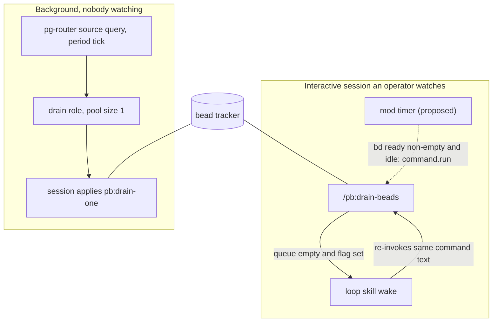

# Drain idle monitor as a mod timer: pre-read (2026-11-21)

**Status**: Draft pre-read for an operator decision. Nothing here is a design or a decision.

This note prepares the operator for ruling on "the drain idle monitor mod timer plan" (workstream 3
of the Claude Code mods plan). It compares the proposed mod timer with two mechanisms that now
exist: the `--monitor-if-empty` flag of `/pb:drain-beads`, and the pg-router drain roles of ADR 0089
("Drain roles apply the shared pb:drain-one skill, one pool per tracker"). Every claim cites a file
read on 2026-11-21 in this repository.

## The three mechanisms

| Mechanism             | What it is                                                                                                                                                       | Source                                                                                                                                  |
| --------------------- | ---------------------------------------------------------------------------------------------------------------------------------------------------------------- | --------------------------------------------------------------------------------------------------------------------------------------- |
| Proposed mod timer    | A mod timer (`$.clock.after`) runs `bd ready` through `$.process.run`; when the queue is non-empty it resumes the drain with `$.command.run`                     | `docs/investigations/2026-10-13-claude-code-mods-spike.md` (summary rows 5 and 9; "Commands, prompts and timers"; "Drain idle monitor") |
| `--monitor-if-empty`  | When the drain's claim query is empty, the command delegates to the `loop` skill, which re-invokes the same command text on each self-paced wake                 | `claude-marketplace/pb/commands/drain-beads.md`, section "--monitor-if-empty"                                                           |
| pg-router drain roles | A background process per tracker: a source query offers a bead, a ccpool role runs one session (pool size 1) that applies `pb:drain-one`, and the router repeats | `docs/adr/0089-drain-roles-apply-the-shared-pb-drain-one-skill.md`, Decision section 1 and operator ruling R7                           |

What the spike proved for the mod timer, and only that: `$.command.run` started a plugin slash
command from a timer; `$.prompt.submit` refuses text starting with `/`; `$.process.run` took 4 to 6
ms and found the wrapped `bd`; the child did not receive `CLAUDE_CODE_SESSION_ID`; a hot reload
restarts the timer (spike doc, "Commands, prompts and timers" and "Summary" rows 5, 9, 12). The
spike did not test idle detection, a queue query with the drain exclusions, claim identity,
cancellation or multi-session behavior; it lists the drain idle monitor only as a consequence "to
planning, not decisions" (spike doc, "What this means for the designs").

## Coverage against the design bead's open questions

The plan's own list of needs (idle detection, queue query, actor identity for claims, stop condition
and cancellation, several sessions running the same timer) maps as follows.

| Need                         | Mod timer (as proposed)                                                                                                                   | `--monitor-if-empty`                                                                                                                                                                       | Drain roles (ADR 0089)                                                                                                               |
| ---------------------------- | ----------------------------------------------------------------------------------------------------------------------------------------- | ------------------------------------------------------------------------------------------------------------------------------------------------------------------------------------------ | ------------------------------------------------------------------------------------------------------------------------------------ |
| Trigger when work appears    | Timer polls `bd ready`                                                                                                                    | `loop` wake re-runs the claim query and drains if a bead is found                                                                                                                          | Router period tick over a source query, one bead per dispatch                                                                        |
| Idle detection               | Open: the spike observed `turn.complete` and `$.prompt.read()` but built no idle rule                                                     | Not needed: the wake is a self-paced re-invocation, which only fires between turns                                                                                                         | Not needed: the role runs its own session                                                                                            |
| Queue query and exclusions   | Open: must copy the drain exclusions                                                                                                      | Reuses the command's own claim query and its exclusion set (`escalated`, `attention`, `human-focus`, `human-focus-required`, `human`, `refactor-campaign`; template filtering client-side) | The deployment supplies the source query; the optional `precheck = "ready"` declines stale or unworkable beads (ADR 0089, section 4) |
| Claim actor identity (B-5)   | Open: the spike found the child gets no session id, so the timer cannot form the actor itself                                             | Inherited: the resumed command builds its own actor id                                                                                                                                     | The role's literal actor id, so orphan reconcile recognizes its claim (ADR 0089, section 2 table)                                    |
| Cancellation                 | Open: `/pb:stop-draining-beads` cancels only the `loop` wake (`ScheduleWakeup({stop: true})`); a mod timer would need its own stop signal | Covered: `stop-draining-beads.md` and `session-wrapup:wrap-up-session` cancel it                                                                                                           | Covered by pool size, budget and the role's enable flag (ADR 0089, Decision section 1)                                               |
| Several sessions, same timer | Open                                                                                                                                      | Known limitation recorded for `/pb:unblock-human-beads` ("run ONE `--monitor-if-empty` session at a time"); `drain-beads.md` is built for concurrent sessions with atomic claims           | One in-flight bead per tracker by construction (pool size 1)                                                                         |

## Overlap

- **With `--monitor-if-empty`**: both resume an interactive session's drain when the queue turns
  non-empty and both end up running the same `/pb:drain-beads` command. The flag already covers the
  query, the exclusions, claim identity, cancellation and the resume, by reuse of the command. The
  timer would re-implement them in a second place, so the exclusion list in `drain-beads.md` (marked
  `pb-queue:drain-termination`) would have two copies to keep in step.
- **With the drain roles**: the roles were built for the original wish behind this plan. ADR 0089
  records operator ruling R7 (verbatim): "instead of me running `/drain-beads` and monitoring it to
  know when to stop it, i want a background process which is constantly trying to drain beads, one at
  a time." A mod timer that restarts `/pb:drain-beads` in an idle interactive session would run a
  second drain loop beside the roles, in the same tracker, so it overlaps two mechanisms. ADR 0089
  also records that a role must not call `/drain-beads` (Decision section 1 rules), which is the
  opposite shape from the timer.

## Remaining gap

After removing what the two shipped mechanisms cover, what only the mod timer would add:

1. **Resume without a model turn per poll.** `--monitor-if-empty` re-arms through a `loop` wake that
   re-runs the command; the command text calls the empty re-arm "a quiet re-arm — noop: true" but it
   is still a command invocation in the session. The timer polls with a 4 to 6 ms process (spike doc).
   This is the only concrete advantage the files support, and no measurement of the per-wake model
   cost exists in this repository that I found.
2. **Arming without a prior `/pb:drain-beads --monitor-if-empty` run.** The flag helps only a session
   whose operator already started the drain with the flag. A mod could in principle start the drain
   in a session where none was running. Whether that is wanted is unstated, and it would conflict
   with the stop semantics in the next point.
3. **Nothing else found.** Idle detection, claim identity, cancellation and multi-session behavior
   are open questions for the timer, not gaps it fills.

Risks the timer would add that the flag does not have: `/pb:stop-draining-beads` cannot reach a mod
timer (it cancels only `ScheduleWakeup`), so an operator who stops the drain could be restarted by
the timer; `$.prompt.read()` shows that a typed-but-unsent draft makes a session look idle unless
handled; and a hot reload restarts the timer (spike doc, summary row 12). It also depends on the mod
runtime, which the spike found is skipped by the managed guard for `classic.*` events (summary row 1)
and so is an unusual delivery path for something that starts claiming beads.

## Cost

| Option                         | Cost to the operator                                                                                                                                                                                                                                                    |
| ------------------------------ | ----------------------------------------------------------------------------------------------------------------------------------------------------------------------------------------------------------------------------------------------------------------------- |
| (a) Close as superseded        | None to build. Gives up item 1 above (a poll with no model turn)                                                                                                                                                                                                        |
| (b) Agent writes the spec      | A design document of the size the plan's acceptance criteria describe (replace or complement, idle detection, query, identity, cancellation, multi-session), then operator review, then decomposition into implementation work; ongoing duplicate of the exclusion list |
| (c) Interactive design session | An operator session; justified only if the operator wants the timer to be the primary mechanism, which the shipped alternatives make hard to argue                                                                                                                      |

## Recommendation

Recommend **(a) close as superseded**, by `--monitor-if-empty` for the interactive resume and by the
drain roles for unattended draining. Reasons grounded above: the flag covers every need the plan
lists and the plan never asked for something the flag cannot do; the roles satisfy the original
unattended-drain wish (ruling R7); and the timer would add a second copy of the claim query and an
uncancellable restart path. If the operator values a poll without a model turn (gap 1) enough to
keep the idea, the second choice is **(b)**, with the spec required to state that the timer
complements the flag, to reuse the command's claim query instead of copying it, and to define
how `/pb:stop-draining-beads` reaches it. Option (c) is not recommended: no open question here needs
live discussion that a written spec could not hold.

This is a recommendation only. The choice among (a), (b) and (c) is the operator's.

## Not verified

- Per-wake model cost of `--monitor-if-empty`: not measured in anything I read.
- Whether the running router currently has an enabled drain role for each tracker: the deployment
  supplies roles (ADR 0089), and I did not inspect the deployment in this read-only pass.
