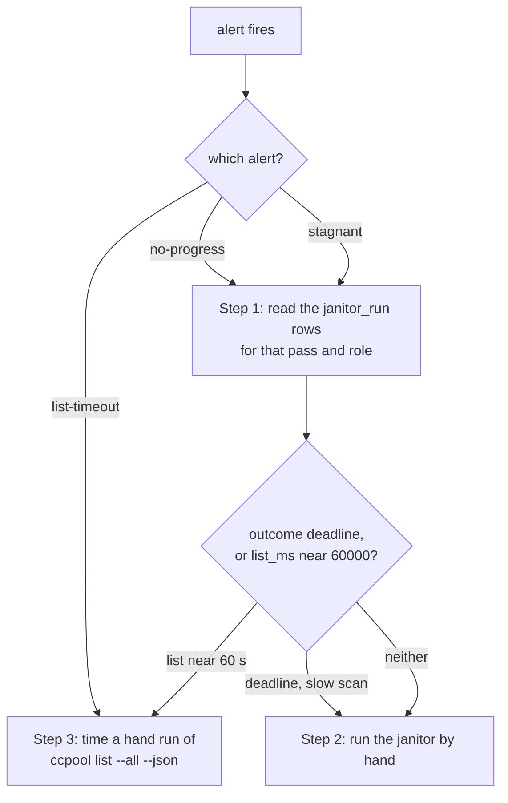

# Runbook: ccpool janitor progress alerts

Operator-facing. Three Grafana alerts watch whether the ccpool handler's janitor is making progress,
not just whether it runs. The older alerts (`pg-router-ccpool-janitor-stale`, `-deadline`, `-idle`)
say the janitor stopped, hit its deadline or reclaimed nothing; these say it runs but does not reach
its work. Operator ruling (Phillip, 2026-11-13): "the focus for me should be to improve the
alerting. we should be checking on is the janitor making progress and is the oldest one not seen not
growing unboundly." A candidate waiting an hour or so is fine; unbounded waiting is not.

| Alert uid                               | Fires when                                                                                                                                               | Why this bar                                                                                                                                                |
| --------------------------------------- | -------------------------------------------------------------------------------------------------------------------------------------------------------- | ----------------------------------------------------------------------------------------------------------------------------------------------------------- |
| `pg-router-ccpool-janitor-no-progress`  | for one pass and role, every run of the last 2 hours (at least 6) saw candidates and examined and cached none                                            | healthy runs never went more than 5 in a row without reaching anything (7 days to 2026-11-13); the 2026-11-11 stall went 16                                 |
| `pg-router-ccpool-janitor-stagnant`     | the oldest unexamined candidate of a pass has waited over 7200 s (2 hours), for 30 minutes                                                               | healthy peak was 4550 s in 24 hours; the stall reached 13904 s. The bar was 21600 s and never fired                                                         |
| `pg-router-ccpool-janitor-list-timeout` | over 6 hours, more than 25% of the worktree sweeps spent 55 s or more in their list phase (the session list is killed at 60 s), from at least 24 samples | baseline is about 8.5% of sweeps (132 of 1557); 25% was passed in 3% of the six-hour windows of the week. It reads the existing list-phase gauge, see below |



## Step 1: read the janitor_run rows

The handler writes one `janitor_run` record per run to its `events.jsonl` (the state directory of the
ccpool handler, for example `~/.local/state/pg-router-ccpool-handler/events.jsonl`). Each carries
`counters` per pass and role: `candidates`, `examined`, `cached`, `kept`, `removed`, `unexamined`,
`oldest_unexamined_age_seconds`, and for `worktree_sweep` the phases `list_ms`, `probe_ms`, `scan_ms`.

```bash
rg '"janitor_run"' ~/.local/state/pg-router-ccpool-handler/events.jsonl | tail -n 20 \
  | jq -c '{t: .time, outcome, w: [.counters[] | select(.pass == "worktree_sweep" and .candidates > 0)
      | {role, candidates, examined, cached, unexamined, age: .oldest_unexamined_age_seconds, list_ms}]}'
```

Success: you can say which of three causes applies. (1) `list_ms` near 60000 or absent for the role,
so the session list is hanging: go to Step 3. (2) The run `outcome` is `deadline` and the role is
late in the rotation, so the pass is cut before it reaches the candidates. (3) `examined` and
`cached` are 0 with `unexamined` equal to `candidates` and no deadline: a per-run cap or a stuck
lock; look at the handler log for `worktree sweep` lines. Report the cause on the bead or to the operator.

## Step 2: run the janitor by hand

```bash
pg-router-handler-ccpool janitor --config <the agent's --config file> --role-file <role file>
```

Take the two arguments from the janitor LaunchAgent's definition (`launchctl print gui/$UID/<label>`).
Success: the run ends with outcome `completed` and the next `janitor_run` row shows the oldest
unexamined age back at 0 for the pass.

## Step 3: time the session list

```bash
time ccpool --pool <pool directory> list --all --json | jq length
```

A healthy list takes well under a second (median 204 ms measured). A run that takes tens of seconds
or hits the 60 s kill points at a stuck child: `tmux`, the ccpool sqlite store (busy timeout 5 s) or
`git` on a live checkout. Check host load (`uptime`) first: timeouts also occur at low load, so load
alone is not the explanation.

## What the list-timeout alert can and cannot see

It reads `ccpool_janitor_phase_seconds{pass="worktree_sweep",phase="list"}`, the time of the sweep's
list phase, not a per-pool count of killed list calls: that metric does not exist yet. The alert
should be rebuilt on it when it lands.

## Evaluation of the alerts

After deployment, count over 7 days how often each alert fired and whether each firing was a real
stall. Keep an alert that fires only on real stalls; if one is noisy or the threshold trade-off is
unclear, write a short report and ask the operator before tuning.
