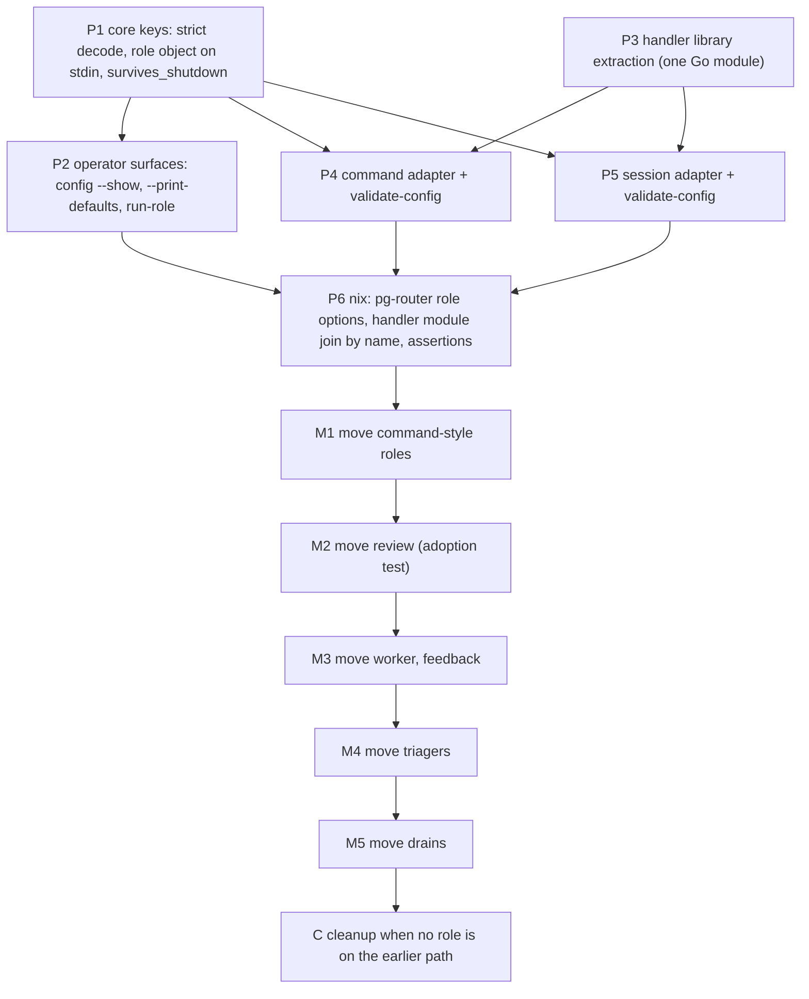

# Handler split: consumer checklist and cutover steps

This is the working list for the implementation of the handler split (bead `pg2-12gr4.6`). It turns
the things the consuming flake keys on today into concrete steps. Each step is **either a planned
packet** for `pg2-12gr4.6` **or an explicit no-op with its reason**, and every step names the rule it
carries out.

The decisions are recorded, with their rationale and rejected alternatives, in
`docs/adr/0065-pr-pool-participant-extraction-prpool-ccpool-handler.md` ("Addendum (2026-10-20): the
handler split"), `docs/adr/0085-daemon-restart-leaves-ccpool-backed-dispatches-running.md` ("Addendum
(2026-10-20)") and `packages/pg-router/docs/decisions/role.md` (`DEC-ROLE-1`) with
`packages/pg-router/docs/decisions/wire.md` (`DEC-WIRE-3`). The behavior is
`packages/pg-router/docs/behavior` (`INV-ROLE-1` to `INV-ROLE-4`) and the two adapter sets under
`packages/pg-router-ccpool-handler/docs/behavior`. This page decides nothing: where it and an ADR
disagree, the ADR wins.

In this page, "the consuming flake" is the deployment flake that assembles pg-router, the handler
module and its roles (`your-private-flake` in this repo's other documents), and "the session adapter"
is `pg-router-handler-ccpool`.

## Ground rules for every packet

- A packet **MUST** keep the earlier path working until the compat window ends: a role that does not
  set `handler` behaves exactly as before, and the old `type` and per-kind options keep working
  without translation shims (S5, S6).
- A packet **MUST NOT** change a failure-reason string or the busy exit code (step 6).
- A packet that touches a role's configuration, a query or a role's wrap **MUST** exercise the changed
  role once with `pg-router run-role` or `run-query` against a realistic event, and read an actual
  outcome (`CLAUDE.md`, "pg-pr / pg-router Development Rules" section's `run-role` rule).
- Code **MUST NOT** cite ephemeral design specs; it cites the ADRs and decision entries above.
- This repo lands first, then the consuming flake's `flake.lock` bump; a family's move is one commit
  in the consuming flake, and reverting that commit rolls the family back (S5).

## The packets, in landing order

P1 to P6 are this repo's. M1 to M5 and the consuming-flake halves of the steps below are the moves of
each role family; the order is S5's. `pg2-12gr4.2` (the wrap mechanism, base environment and wrapper
contract) lands in the earlier handler before the split starts, and `pg2-12gr4.6` is not blocked by
the per-family review.

## Core and adapter packets

These carry out the "Core changes" of the design. None of them may change anything for a role that
does not set `handler`.

| Packet | Step                                                                                                                                                                                                                                                                                                                                                                                                                                                                                                                                                                                                                      | Carries out                                            |
| ------ | ------------------------------------------------------------------------------------------------------------------------------------------------------------------------------------------------------------------------------------------------------------------------------------------------------------------------------------------------------------------------------------------------------------------------------------------------------------------------------------------------------------------------------------------------------------------------------------------------------------------------- | ------------------------------------------------------ |
| P1     | Core: decode `handler`, `wrap`, `[role.config]`, `survives_shutdown` and a query's `wrap` strictly (a wrong type, or a `handler` that is not an absolute path, fails the load with exit `3`). Send the role object `{ name, config }` in the stdin payload of `dispatch`, `postStartup` and `preShutdown`, only for a role that sets `handler`. Read `survives_shutdown` from the TOML where roles are registered during boot, and read the JSON flag only for a role without `handler`. Add the optional `role` field to the three request schemas and their conformance checks.                                         | `DEC-ROLE-1`, `DEC-WIRE-3`, `INV-ROLE-2`, `INV-ROLE-3` |
| P2     | Core: resolve a role's adapter in **one** place used by the daemon, `config --show` (text and `--json`), `config --print-defaults` and `run-role`, so a role on the per-role path shows and runs its own `handler`, and a role on the earlier path shows and runs the shared command. `config --show` prints each role's path, resolved command, `wrap`, `survives_shutdown` and the `config` table as it would be sent, and each query's composed command. `--print-defaults` documents the four keys and prints no per-kind block. `run-role` sends the role object and still brackets the dispatch with `preShutdown`. | `DEC-ROLE-1`                                           |
| P3     | Handler module: extract the shared internal library (the beads claim and completion helpers, prompt templating) so both adapters import it. The existing executor tests (the real-git abandoned-worktree test, the isolation tests) pass unchanged against the extracted library; git fixtures stay on the shared git test helper.                                                                                                                                                                                                                                                                                        | ADR 0065 Addendum, S2                                  |
| P4     | Command adapter `pg-router-handler-command`: the earlier command executor behind the role object, with strict decoding and a `validate-config` subcommand. The earlier binary keeps building.                                                                                                                                                                                                                                                                                                                                                                                                                             | S1, S1a, S2, `INV-CMA-1`, `INV-CMA-2`                  |
| P5     | Session adapter `pg-router-handler-ccpool`: the earlier session executor, `postStartup`, `preShutdown`, the reconcile and orphan sweeps and the session-specific subcommands (`origin`, `pool-capacity`, `split`, `query`, `pool-metrics`), with strict decoding and a `validate-config` subcommand. The earlier binary keeps building. The live conformance test, which builds its dispatch from a command role's per-role file today, migrates to the new shape.                                                                                                                                                        | S1, S1a, S2, `INV-CCA-1`, `INV-CCA-2`                  |
| P6     | Nix, in this repo: the pg-router module owns `roles.<name>` (`binds`, `enabled`, `handler`, `wrap`, `config`, `survives_shutdown`); each handler module's own `roles.<name>` fills in the matching role's `handler`, `config` and `survives_shutdown` and sets up the pool and launcher (join by name through module merging). Each adapter's module runs `<adapter> validate-config` over every rendered role table during the build. The session adapter's module asserts that every role using it sets `survives_shutdown`. Nix render tests: the keys reach the TOML.                                                 | S1a, S3, S6, `INV-CCA-3`                               |

## Consumer checklist

The things the consuming flake keys on, one step each.

| #   | Keyed on                                                                                                                                                                               | Step                                                                                                                                                                                                                                                                                                                                                            | Kind                                    |
| --- | -------------------------------------------------------------------------------------------------------------------------------------------------------------------------------------- | --------------------------------------------------------------------------------------------------------------------------------------------------------------------------------------------------------------------------------------------------------------------------------------------------------------------------------------------------------------- | --------------------------------------- |
| 1   | The role rules for host activity filter on `type == "ccpool"` and also match the agent's command line (`--name pg-router-<role>- --plugin-dir`).                                       | Derive the set from each role's `handler` instead of `type`, so a moved role is still counted and the rule set is never silently empty (the consuming flake's existing host-activity check pins this). Check the command-line match once with a launcher in the process tree, because the launcher adds a process whose command line the match could also meet. | Packet, in the consuming flake, with M2 |
| 2   | The handler module's `roleFileFor`, `ccpoolRolesWithOwnPool` and `roleBootstrapEntries` key on `roleCfg.type`.                                                                         | Key them on the adapter the role names, and keep the `type` form working until the cleanup (S6). `ccpoolRolesWithOwnPool` keeps deciding which roles have a pool of their own.                                                                                                                                                                                  | Packet P6                               |
| 3   | The darwin module re-exposes `handlerCommandDir`, and the darwin pg-router module's `AbandonProcessGroup` comment explains survival by the single handler binary.                      | Keep `handlerCommandDir` and its re-exposure until the cleanup removes it. The `AbandonProcessGroup` setting itself does not change; reword its comment to say that a session-backed role's adapter and its sessions survive a restart, so it no longer names one binary.                                                                                       | Cleanup packet C; comment with M2       |
| 4   | The consuming flake declares each role twice (the pg-router module's role list, and the handler module's per-role set), both through `type` and the per-kind options.                  | Option migration (S6): per family, declare the role once through the pg-router module's `roles.<name>` and let the handler module's `roles.<name>` fill it in; leave the old `type` and per-kind options in place for the roles not yet moved, with no translation shim; remove them in the cleanup.                                                            | Packets M1 to M5 and C                  |
| 5   | The handler binary's `origin` and `pool-metrics` subcommands and agents, the alerts that call them, and the runbooks that name the binary.                                             | Rename each alert, agent and runbook mention when the role family it covers moves over (S2). The subcommands move to the session adapter in P5, and the earlier binary keeps them until the cleanup.                                                                                                                                                            | Packets M2 to M5, then C                |
| 6   | The failure-reason strings (`usage-limit`, `triager-failure`, `at-capacity`, `session-in-flight`, every `skipped-*`) and the busy exit code `9` are what the failure-rate alert reads. | **Preserve them exactly.** Add a test that runs the failure-rate alert's rule test over reasons produced by the new adapters, and keep the usage-limit and budget-stop sentinels (`INTF-HANDLER`'s sentinels) byte for byte. No alert expression changes.                                                                                                       | Packets P4 and P5 (test)                |
| 7   | A session the earlier handler left running must be adopted by the new adapter across the cutover (its external identifier format and its dispatch metadata; `ADR 0085`).               | **Test** it at M2, the first session-backed move: start a session with the earlier handler, move the role, and redeliver; the new adapter finds the session by its stable name and launches nothing beside it. **Runbook step** for every session-backed move: see "Moving one role" below.                                                                     | Packet M2 (test), M2 to M5 (runbook)    |
| 8   | About 20 `[[query]]` producers get a wrap and the base environment.                                                                                                                    | **No-op for the split.** The split changes `[[role]]` keys only, and a query gains only `wrap`. Applying the wrap and base environment to queries is `pg2-12gr4.2`'s, and each query's declared wraps are the per-family review's (`pg2-12gr4.3`).                                                                                                              | No-op, reason given                     |
| 9   | Landing order across the two repos.                                                                                                                                                    | This repo first, then the `flake.lock` bump in the consuming flake.                                                                                                                                                                                                                                                                                             | Process                                 |
| 10  | `CLAUDE.md`'s "A role's real invocation lives in a separate rendered file" bullet and the hand-rolled session-role recipe in the config-testing bullet.                                | Rewrite both in the **same change** that makes them false, which is the first move of a role to `handler` (M1: from then on a role's `handler` and `[role.config]` are in `config.toml`). Until then they remain true for the roles on the earlier path.                                                                                                        | Packet M1                               |

## Moving one role

This is the runbook for one family's move (S5). A move is one commit in the consuming flake.

1. **Before.** Read the role's current per-role file, and note any session the role has running
   (`pg-router status`, and the session tool's own listing for the role's pool).
2. **Declare.** Set the role's `handler`, move its settings from the per-role file into
   `[role.config]` (the field names do not change; the adapter rejects an unknown one), and, for a
   session-backed role, set `survives_shutdown = true`.
3. **Build.** The build runs `<adapter> validate-config` over the role's table and evaluates the
   assertions (every session-backed role sets `survives_shutdown`; roles on a shared pool declare the
   same wrap).
4. **Exercise.** Run `pg-router run-role <role> '<json>'` against a realistic event and read an
   actual outcome. Note the caveat that `run-role` runs in the operator's shell environment, not the
   service's, so it does not prove the minimal base environment until the family's environment switch
   is on.
5. **Apply and adopt.** Apply. For a session-backed role, a session the earlier handler left running
   **MUST** be adopted by the new adapter's redelivered dispatch (`ADR 0085`'s Addendum): confirm that
   the redelivered dispatch found the session by its stable name, that no second session exists for
   the same bead and role, and that the supervision lease is fresh.
6. **Alerts.** Confirm that the failure-reason strings in the alert's inputs are unchanged (step 6),
   then rename the alerts, agents and runbooks that named the earlier binary for this family
   (step 5).
7. **Roll back.** Revert the commit. The role is on the earlier path again, with nothing else to undo.

The move order is: command-style roles (the desk, deciders and probes), then review, then worker and
feedback, then the triagers, then the drains. The window ends when no role is left on the earlier
path; then cleanup packet C removes the fallback, the earlier binary, the role `type`, the per-role
JSON link farm and `PG_ROUTER_HANDLER_COMMAND(_DIR)`, renames the package directory (to
`packages/pg-router-handlers`), moves the lifecycle rules that belong to one adapter into that
adapter's behavior set and removes the earlier combined set, and deletes the compat code in the core
and the darwin and home modules.

## Input beads

How the split accommodates each input bead is recorded in the Addendum of
`docs/adr/0065-pr-pool-participant-extraction-prpool-ccpool-handler.md` ("How the split accommodates
the four input beads"). None of the four needs a packet of its own here.
