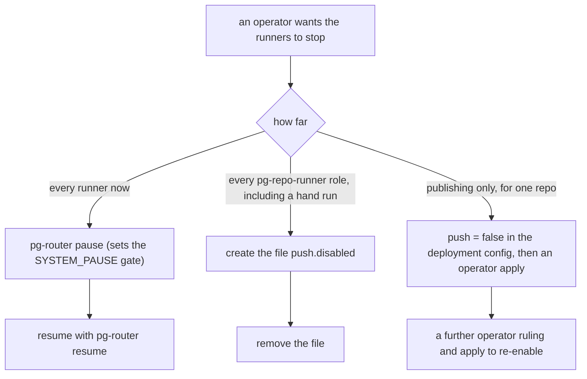
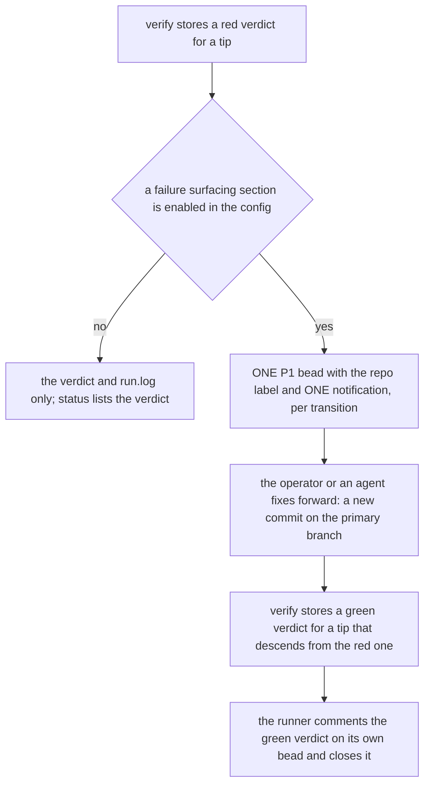

# Runbook: pg-repo-runner (async repo runners)

Operator reference for the pg-router-managed async repo runners: where their state lives, how to
read them, how to stop them, what a red tip means, and how a repo is first enabled for push. Tool and
package detail: `packages/pg-repo-runner/README.md`. Decision record:
[ADR 0108](../adr/0108-an-operator-enabled-unattended-runner-may-publish-within-a-defined-scope.md).
The key words MUST, MUST NOT, SHOULD, SHOULD NOT and MAY are to be read as in RFC 2119.

## Push status: no repo is enabled

**No repo is enabled for push.** `repos.<name>.push` is `false` for every repo, in the module
default, in the tests and in every deployment configuration of this workspace. Today the runners
fetch, fast-forward a behind clone, verify the primary tip and surface problems; none of them
publishes.

Enabling a repo for push needs an operator ruling recorded on a bead (who, when, verbatim), per
decision 1 of ADR 0108. An agent MUST NOT enable it, widen the push scope, run the push by hand, or
run `pn workspace push|update|apply` to make it take effect (rule U-5 as reworded by that ADR). The
first enablement MUST run dry-run first (decision 6): the procedure is
[First enablement](#first-enablement-dry-run-first) below.

## Where the state lives

The state directory is `${XDG_STATE_HOME:-$HOME/.local/state}/pg-repo-runner/`, created with mode
`0700`. The config is `${XDG_CONFIG_HOME:-$HOME/.config}/pg-repo-runner/config.toml` (override with
`PG_REPO_RUNNER_CONFIG`), rendered read-only by the home module
`phillipgreenii.programs.pg-repo-runner`. In the table, `<state>` is the state directory.

| Path under `<state>`                | What it is                                                                                                                                    |
| ----------------------------------- | --------------------------------------------------------------------------------------------------------------------------------------------- |
| `run.log`                           | One line per step of every run. pg-router discards a role's stdout and stderr, so this file is where a run is explained.                      |
| `lease`                             | Single-flight lease, shared by every role: a symlink whose target is `<pid>:<process start time>`. Absent means free.                         |
| `verdicts/<repo>/<sha>.<kind>.json` | The verdict store (fields below). Written atomically (temp file, then rename).                                                                |
| `logs/<repo>/<sha>.check.log`       | The output of the `nix flake check` behind a verdict (`logPath`).                                                                             |
| `sync/<repo>.json`                  | The result of the last sync pass of a repo: `repo`, `branch`, `outcome`, `behind`, `ahead`, `behindBeforeFetch`, `detail`, `at`.              |
| `surface/<repo>.<kind>.json`        | One record per open or recently closed failure transition (`red`, `diverged`, `needs-relock`, `build-red`), with its bead and notified state. |
| `push.disabled`                     | Kill switch file. If it exists, every role exits 9. The runner never creates or removes it.                                                   |
| `push-live/<repo>`                  | Dry-run exit flag for one repo (see First enablement). Only the operator creates it.                                                          |
| `push-audit.jsonl`                  | One JSON line per real push. Absent while nothing has ever been pushed.                                                                       |

The config also names a second kill file, `kill_switch`. The home module defaults it to
`<state>/kill` (option `killSwitchPath`).

## Reading `pg-repo-runner status`

```bash
pg-repo-runner status                   # whole store
pg-repo-runner status --repo <key>      # one repo
pg-repo-runner status --json            # verdicts only, one JSON array
pg-repo-runner status --json --repo <key>
```

`status` reads the state directory and nothing else (no config, no git, no network). The text form
prints these lines in this order:

```text
state dir: <state>
kill switch: <state>/push.disabled        (or: absent)
lease: free                                (or: held by <pid>:<start>, or: stale (<pid>:<start>))
verdicts:                                  (or: verdicts: none)
<repo>  <sha, 12 chars>  <kind>  <result>  <inputs>  <finishedAt>
open transitions:                          (or: open transitions: none)
<repo>  <kind>  <sha, 12 chars>  <bead id or bead-pending>  <notified or notify-pending>
sync:                                      (or: sync: none)
<repo>  <outcome>  behind N  ahead N  behind-before-fetch N  <at>
```

Columns are tab separated. `lease: stale` means the owner is dead or its pid was recycled; the next
run reclaims it. `bead-pending` or `notify-pending` means a part of a transition could not be
delivered and the next run of that repo finishes it.

The `outcome` of a sync pass is one of `in-sync`, `fast-forwarded`, `ff-refused`, `ahead`,
`diverged`, `yielded` (the canonical clone was not steady, so nothing was touched), `fetch-failed`,
`no-remote-ref`, and, only for a repo with `push = true`, `push-dry-run`, `pushed` and
`push-rejected`. For an `ahead` repo, `detail` is `push withheld: <reason>` when a push was a
candidate and a gate failed.

## The verdict store

`<state>/verdicts/<repo>/<sha>.<kind>.json` holds one JSON object:

| Field                               | Meaning                                                                                                                                            |
| ----------------------------------- | -------------------------------------------------------------------------------------------------------------------------------------------------- |
| `repo`, `sha`                       | The repo key and the full commit sha the verdict is about.                                                                                         |
| `kind`                              | `check` (the verify role) or `build` (the workspace build, not implemented yet).                                                                   |
| `result`                            | `green`, `red` or `superseded` (the tip moved before the check ran, so no nix ran). `error` is accepted by the writer but no role writes it today. |
| `inputs`                            | `locked` (the check ran over the commit's own `flake.lock`, what a fresh clone sees) or `override`.                                                |
| `startedAt`, `finishedAt`           | UTC timestamps of the check.                                                                                                                       |
| `exit`                              | The exit status of nix (`0` for a green verdict).                                                                                                  |
| `logPath`                           | Absolute path of the nix output under `<state>/logs/`.                                                                                             |
| `durationS`, `loadStart`, `loadEnd` | Verify checks only: whole seconds, and the 1-minute load average when the check started and ended.                                                 |

A red verdict exits 0 (it is data, not a malfunction) and is never retried automatically. A nix
process killed by a signal (exit 129 to 192) stores NO verdict: the role exits 1 and pg-router
retries it.

## The kill switch

Three independent stops exist. Each takes effect on the next pass without a restart; a pass that is
already running is not interrupted, except that the push step re-reads the file switches right
before it would push.



| Switch                                    | How to engage                                                                                        | Effect                                                                                                                                                                                         |
| ----------------------------------------- | ---------------------------------------------------------------------------------------------------- | ---------------------------------------------------------------------------------------------------------------------------------------------------------------------------------------------- |
| pg-router pause                           | `pg-router pause --description "<why>"`; release with `pg-router resume`                             | The `SYSTEM_PAUSE` gate. The role and query entries of the deployment keep the default blocking gate, so nothing is dispatched. Check with `pg-router gate list`.                              |
| `push.disabled` or the `kill_switch` file | `touch "${XDG_STATE_HOME:-$HOME/.local/state}/pg-repo-runner/push.disabled"`; release by removing it | Every role (`verify`, `sync`, `build`) exits 9 ("not now", pg-router re-offers the item), and a hand run exits 9 too. The `tips` source ignores it (it only reads refs and the verdict store). |
| `push = false`                            | Edit the deployment config (operator-owned), then an operator `pn workspace apply`                   | The sync pass never reaches the push step for that repo. This is the default for every repo.                                                                                                   |

Notes:

- `pg-repo-runner status` prints the `push.disabled` file only. A file at the config `kill_switch`
  path stops the roles all the same but is NOT shown by `status` (see Known gaps).
- The kill switch stops publishing as well as everything else, so it is the first thing to engage
  when a push looks wrong.

## A red tip: surfacing and fix-forward

A red tip is a landed primary-branch commit whose `nix flake check` failed. The runner reports it and
never repairs it.



- The first red report after a clear files one bead (metadata `runner = pg-repo-runner`, `repo`,
  `kind`, `sha`) and one notification. A repeat report files nothing; a newer red sha is commented
  on the existing bead. `status` lists the open transitions.
- The fix is forward: a new commit. The runner MUST NOT revert, reset, rebase, edit or push a repo
  to clear a red tip, and no code in it can.
- A green verdict at a sha that descends from the red tip (`git merge-base --is-ancestor`) closes
  the bead, but only a bead whose metadata says `runner = pg-repo-runner`. Any other bead is left
  alone.
- Pushing a green tip also publishes its ancestors, which can include an intermediate red commit
  that a later commit fixed forward (ADR 0108, Consequences).
- A `diverged` repo (behind and ahead of its remote) gets the same one-bead treatment, with the
  instruction to resolve it with `pn workspace rebase` or `/pn-workspace-sync`. The runner never
  rebases it. A `needs-relock` transition ("push blocked: needs relock") means the tip is red under
  its locked inputs while a sibling it consumes has unpublished commits; the operator runs
  `pn workspace push` for the sibling. The runner never pushes the sibling.

## The reserved `runner-build-` branch prefix

Branches whose names start with `runner-build-` are reserved for the workspace builder (runner C).
When that runner lands it will create a throwaway coordinated workforest set on a
`runner-build-<utc timestamp>` branch, build in it and remove it, and it will treat any leftover
set whose branch starts with that prefix as its own and remove it. Therefore:

- A person or an agent MUST NOT name a branch or a workforest set `runner-build-...`.
- Nothing in the current package creates or removes such a branch: the `build` role and the
  `workspace-tips` source are stubs that exit 2 with "not implemented". Finding a `runner-build-`
  branch today means someone created it by hand.

## First enablement (dry run first)

This is the procedure for the FIRST time a repo is enabled for push, after the operator ruling. It
is an operator procedure; an agent MUST NOT run any step that publishes.

1. **Ruling.** The operator records a ruling on a bead naming the repo (who, when, verbatim). Without
   it, stop. No such ruling exists today.
2. **Change.** In the deployment config set `repos.<name>.push = true` and leave `dryRun` at its
   default `true` (rendered as `dry_run`). The `consumes` list names sibling repos whose unpublished
   commits can make this repo red. An agent MAY propose the change but MUST NOT merge it before step
   1, and MUST NOT run any apply.
3. **Apply.** The operator runs `pn workspace apply`. Confirm the rendered file:
   `grep -A5 '^\[repos\.<name>\]' "${XDG_CONFIG_HOME:-$HOME/.config}/pg-repo-runner/config.toml"`
   shows `push = true` and `dry_run = true`.
4. **Wait for a pass.** The next sync pass of the repo that finds it ahead of its remote only (not
   behind, not diverged) with a green verdict for exactly the primary tip records `push-dry-run`
   and pushes nothing. Until then `status` shows `ahead` with `push withheld: <reason>` (for
   example `no green check verdict for the tip <sha>`).
5. **Review the range.** The operator reads what would be published:

   ```bash
   pg-repo-runner status --repo <name>
   grep 'dry run' "${XDG_STATE_HOME:-$HOME/.local/state}/pg-repo-runner/run.log"
   ```

   The run log carries one line `would push <old>..<new> (N commit(s)) to origin refs/heads/<primary>`
   and one line per commit (at most 50). A repo that is far ahead publishes everything in that
   range on the first push, so this review is the point of the dry run.

6. **Go live.** Only after that review, the operator removes the dry run for that repo with ONE of:
   create the flag file `<state>/push-live/<name>`, or set `dryRun = false` in the deployment
   config and apply.
7. **Check the first push.** The next pass pushes `git -C <canonical clone> push origin <verified
sha>:refs/heads/<primary>` and writes one record to `<state>/push-audit.jsonl`, to `run.log`
   (`push-audit {...}`) and to stderr: `event`, `repo`, `remote` (without credentials), `branch`,
   `oldRemoteSha`, `newRemoteSha`, `verdict` (path, sha, result, finish time) and `at`. The sync
   record says `pushed`. A push that git refuses is `push-rejected`: never forced, never retried in
   that pass.
8. **Stop at any time** with a switch from the kill switch table. Removing the flag file
   `push-live/<name>` returns the repo to dry run, unless the config also says `dry_run = false`.

The push gate (ADR 0108, decision 3) holds in the same pass for every push: a green `locked` check
verdict for exactly the primary tip, that tip re-read as current right before the push, a steady
canonical clone, and `origin/<primary>` an ancestor of the tip. The push never uses a force flag,
a `+` refspec, a deletion, another ref, `--tags`, `--mirror` or `--no-verify`.

## Exit codes and quick diagnosis

| Exit | Meaning                                                                                                                                | First look                                             |
| ---- | -------------------------------------------------------------------------------------------------------------------------------------- | ------------------------------------------------------ |
| 0    | Completed with any verdict (a red check is data), or skipped by design                                                                 | `status`, the last lines of `run.log`                  |
| 9    | Not now: kill switch, load average at or above the threshold, lease held                                                               | `status` (kill switch, lease), `run.log` (`busy: ...`) |
| 2    | Usage error or refusal: repo not in the allow-list or not a `pn-workspace.toml` key, failed path check, malformed item id, a stub role | `run.log` (`exit=2 ...`)                               |
| 1    | Malfunction: unreadable config, no load reading, unusable state directory, nix killed by a signal                                      | `run.log`, pg-router failure metrics                   |

## Known gaps (as of the writing of this page)

- `status` does not print the config `kill_switch` file, only `<state>/push.disabled`. Both stop the
  roles.
- The `error` verdict result exists in the writer but nothing writes it.
- The `sync` role requires `PG_ROUTER_ITEM_ID` to be a repo key; a bare timer tick id is not one, and
  the kernel refuses it with exit 2. How a deployment maps the `repo.sync` tick to repos is a
  deployment concern; confirm it in the post-apply verification of the wiring.
