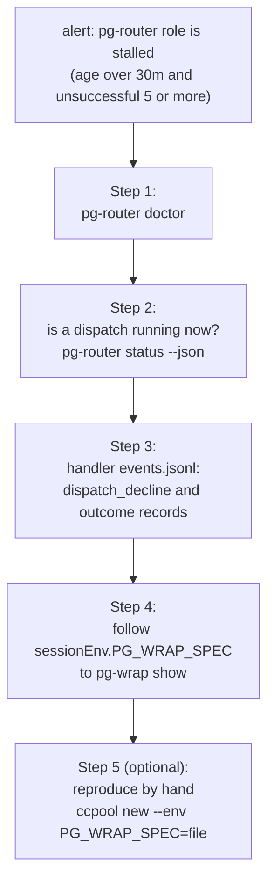

# Runbook: reading a stalled role and hand-running ccpool on a handler pool

Operator-facing. Two procedures: how to find out why a pg-router role has stopped making progress
(the `pg-router-role-stalled` alert, "pg-router role is stalled (by role)"), and how to run ccpool by
hand on a pool a pg-router handler owns. Both depend on the same fact: the environment the agent
runs in is not pg-router's and not ccpool's, it is `pg-wrap`'s (ADR
`docs/adr/0103-wrapping-is-a-standalone-tool-and-a-pre-ready-failure-is-a-decline.md`), so the
trail runs from pg-router, to the handler's event log, to a spec file that `pg-wrap show` prints.



## Prerequisites

- `pg-router`, `pg-router-ccpool-handler` and `ccpool` are on `PATH` (home-manager installs them).
- `jq` is on `PATH`.
- You can read the handler's state directory (Step 3 names it) and the pool directories under
  `~/.local/state/pg-router-ccpool*`.

## Step 1 — run `pg-router doctor`

The alert says a role has made no progress for over 30 minutes while its last offers keep failing
(age over 30 minutes and five or more unsuccessful offers since its last progress). `doctor` shows
what the core and each handler think of the configuration right now.

Run it with the same environment the daemon has. The daemon gets `CCPOOL_POOL` from its launchd
environment, and the handler's `validate` reads it to check the handler-wide pool directory, so set
it to the daemon's value or that directory is not checked:

```bash
CCPOOL_POOL=<the daemon's CCPOOL_POOL> pg-router doctor
echo "exit=$?"
```

`doctor` runs `pg-router config check` and then prints one verdict line per probe, each `ok`, `FAIL`
or `info`: the config, the state directory, the core's socket, the gates that are active, the roles
the core marked unavailable (with the reason), each role's progress (age since last progress, and the
unsuccessful and busy counts), and each enabled role's handler `validate`. It exits `0` when no
probe is `FAIL` and `1` otherwise. To run only the config checks, use `pg-router config check`
(`config ok` and exit `0`, or one problem per line and exit `1`).

Read the output in this order:

1. A `FAIL` on a handler's `validate` names a role JSON field, a `sessionEnv` key or a pool directory
   that is wrong. That is a configuration fault: fix it and re-apply.
2. A role listed as unavailable has a reason; the core is not offering it work at all.
3. An active gate (for example `SYSTEM_PAUSE`) explains a quiet role without any fault. List gates
   with `pg-router gate list`.
4. The per-role progress line confirms the alert's numbers (age, unsuccessful, busy). A role whose
   unsuccessful count is high but whose handler `validate` is `ok` is failing at dispatch time:
   continue.

## Step 2 — tell whether a dispatch is running now

Do not infer a running dispatch from the event log. A `dispatch_start` with no record after it yet
may be a dispatch in flight, a payload that hung, or a record not written yet, and the handler also
writes an outcome record for every accepted dispatch (Step 3), so the log alone cannot say which.
Ask the running core:

```bash
pg-router status --json | jq '.listeners[] | select(.role == "<role>")
  | {role, inFlight, inFlightEventType, delivered, declined, declinedByReason}'
```

`inFlight` is `true` exactly while the role has an outstanding offer, and `inFlightEventType` names
the event type. A role that has been `inFlight` for hours is a hung payload or session: look at the
pool (`ccpool list`) and at that role's `dispatch_start` in Step 3. A role that is not in flight and
is stalled is being declined or failing: read the records in Step 3.

## Step 3 — read the handler's event log

The handler writes `events.jsonl` in its state directory. That directory is `originProbe.stateDir`
in the handler's launch config, the file named by `PG_ROUTER_CCPOOL_HANDLER_CONFIG` (rendered by the
handler's nix module as `launchConfigFile`):

```bash
LOG="$(jq -r '.originProbe.stateDir' "$PG_ROUTER_CCPOOL_HANDLER_CONFIG")/events.jsonl"
echo "$LOG"
```

Every record has `time`, `level`, `kind` and `msg`. The kinds that matter here:

| `kind`             | Written                                                     | What it tells you                                                                                                                                                    |
| ------------------ | ----------------------------------------------------------- | -------------------------------------------------------------------------------------------------------------------------------------------------------------------- |
| `dispatch_start`   | when the payload STARTS, for command and ccpool roles alike | ccpool role: `route` (`launched` or `adopted`), `session` and `session_env`. Command role: the rendered `argv`, `strict_base_env` and `base_env_names` (names only). |
| `dispatch_decline` | per pre-accept decline                                      | `role`, `item_id`, `reason`, `decline_kind` (`busy`, `fault` or `neutral`), `session_env`, the redacted `evidence` tail and `failure_signature`.                     |
| `dispatch_result`  | when an accepted dispatch FAILED                            | `failure_signature` and `signature_evidence`; see `docs/runbooks/dispatched-session-failure-signatures.md`.                                                          |
| `dispatch_end`     | when an accepted dispatch ended without failing             | `outcome`: `completed`, `unclaimed-end`, `peer-held`, `needs-input-stalled` or `interrupted`.                                                                        |

A command role's `dispatch_start` is written before its payload runs, so a payload that hangs or is
killed still has one. A command role that exits `9` leaves a `dispatch_start` and then a
`dispatch_decline`. A ccpool role's `dispatch_start` is written once `ccpool new` returned ready or a
live session was adopted, so a launch that declined has only a `dispatch_decline`.

The last declines for one role, newest last:

```bash
jq -c 'select(.kind=="dispatch_decline" and .role=="<role>")
       | {time, item_id, reason, decline_kind, failure_signature, evidence, session_env}' "$LOG" | tail -n 10
```

Count the reasons, to see whether one dominates:

```bash
jq -r 'select(.kind=="dispatch_decline" and .role=="<role>")
       | "\(.decline_kind) \(.reason)"' "$LOG" | sort | uniq -c | sort -rn
```

The `decline_kind` is what the alert counts. Only `fault` declines (`capacity-unknown`,
`pool-unreadable`, `low-disk`, `launch-failed`) and handler errors count as unsuccessful; `busy`
declines (`at-capacity`, `session-in-flight`, `command-busy`) feed the quieter
`pg-router-role-busy-long` alert ("pg-router role has been busy a long time (by role)") instead, and
`neutral` ones (`origin-unavailable`, `skipped-*`) count toward neither.

- `launch-failed` is the pre-ready decline: the session never became ready. `evidence` is the
  redacted tail of what the launch returned, which is where a `pg-wrap[<stage>]:` line appears when
  the wrap failed. Go to Step 4.
- `at-capacity`, `session-in-flight` or `command-busy` on every offer means the pool is full or a
  session is still working that event: `ccpool capacity` and `ccpool list` against the pool.
- Failure outcomes (`dispatch_result`) with `usage-limit`, `api-rate-limit` or similar signatures are a
  Claude limit, not a wrap fault.

## Step 4 — follow `sessionEnv.PG_WRAP_SPEC` to `pg-wrap show`

For a ccpool role, the `session_env` of the `dispatch_decline` or `dispatch_start` record holds a
`PG_WRAP_SPEC` entry: the path of the pg-wrap spec for that role. The agent's own environment is not
in the handler's records; it is the spec's. Read it with `pg-wrap show`, which prints the composed
layers without running anything:

```bash
SPEC="$(jq -r 'select(.kind=="dispatch_decline" and .role=="<role>") | .session_env.PG_WRAP_SPEC' "$LOG" | tail -n 1)"
pg-wrap show --spec "$SPEC"
pg-wrap check --spec "$SPEC"
```

`pg-wrap check` decodes the spec strictly and verifies that every referenced path is an executable
file. Every failure pg-wrap detects exits `97` before the payload and prints a `pg-wrap[<stage>]:`
message; that stage names the failing layer.

`pg-wrap show --spec <file> --env-from <file>` additionally lists which variable names the spec
keeps and drops, given a `NAME=value` dump (values are ignored).

`pg-wrap` itself is not necessarily on `PATH`. It sits beside `pg-wrap-exec`: on a handler pool the
pool's `config.toml` `[claude] bin` names `.../bin/pg-wrap-exec`, and `$(dirname <that path>)/pg-wrap`
is the binary:

```bash
POOL=<the role's pool directory>
PGWRAP="$(dirname "$(grep -E '^bin *=' "$POOL/config.toml" | sed -E 's/^bin *= *"(.*)"/\1/')")/pg-wrap"
"$PGWRAP" show --spec "$SPEC"
```

For a command role, there is no `session_env`: the spec path is in the `argv` of its `dispatch_start`
record, as `pg-wrap run --spec <file> -- <cmd>`.

## Step 5 — hand-run ccpool on a handler pool

Do this only to reproduce a failure, and on a scratch external id.

A pool whose `claude.bin` is `claude` (your own pools) starts claude directly, unchanged. On a
handler pool (`~/.local/state/pg-router-ccpool*`), `claude.bin` is `pg-wrap-exec`, which takes the spec
path from `PG_WRAP_SPEC` and refuses without it:

```text
PG_WRAP_SPEC is not set in the environment this launcher received; a terminal-multiplexer pane does not inherit your shell's variables
```

That is why exporting `PG_WRAP_SPEC` in your shell does not help: the session runs in a terminal
multiplexer pane that does not inherit your shell's environment. Pass it to the session with `--env`:

```bash
ccpool --pool "$POOL" new <id> --env PG_WRAP_SPEC="$SPEC"
```

`ccpool reply` has no `--env`. A session on a handler pool that has gone cold therefore cannot be
resumed by hand with `ccpool reply`: it would start without `PG_WRAP_SPEC` and `pg-wrap-exec` would
refuse. Resume it with `ccpool new <id> --env PG_WRAP_SPEC=<file>` instead; `new` takes its resume
route when the transcript exists, and it carries the env. Any other pool can use pg-wrap if its owner
sets `claude.bin` to `pg-wrap-exec` and passes `PG_WRAP_SPEC`.

Close the scratch session when done (`ccpool close <id>`).

### Caveat: `pg-router run-role` does not run in the daemon's environment

`pg-router run-role` runs under your shell's environment, not launchd's. While the strict switch is
off it is not representative of the payload's environment, so a role that works under `run-role`
can still fail under the daemon (or the reverse). Judge a stalled role from the daemon's own records
(Step 3) and the spec (Step 4), not from `run-role`.

## Rollback

Both rollbacks are nix changes: edit the module options and apply.

- **Base env.** Revert the per-role and per-query strict switches, and each spec's `strict_env`. The
  switches are `strict_base_env` on a `[[query]]`, `strictBaseEnv` on a handler role
  (`roles.<name>.strictBaseEnv` in nix) and `strictEnv` on a role's spec (rendered as `strict_env`).
- **pg-wrap.** A role or query reverts by dropping its pg-wrap run prefix or its `PG_WRAP_SPEC`,
  together with its pool's `claude.bin` (back to `claude`). The two-way nix check keeps the pair
  consistent: a pool with `claude.bin` = `pg-wrap-exec` needs a spec, and a spec needs that pool, so
  changing only one fails the build.

After applying, run `pg-router doctor` (Step 1) to confirm every probe is `ok`.

## Related

- Handler behavior docs: [pg-router-ccpool-handler](../../packages/pg-router-ccpool-handler/docs/behavior/README.md)
- Core behavior docs: [pg-router](../../packages/pg-router/docs/behavior/README.md)
- ADR: [0103 wrapping is a standalone tool and a pre-ready failure is a decline](../adr/0103-wrapping-is-a-standalone-tool-and-a-pre-ready-failure-is-a-decline.md)
- Failure signatures of `dispatch_result`: [dispatched-session-failure-signatures](dispatched-session-failure-signatures.md)
