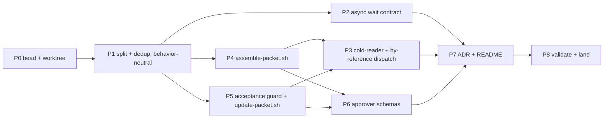

# Plan: make plan-decompose faster (fixes 1–4) — revision 5

Repo root (all paths relative to it unless absolute):
`/Users/phillipg/phillipg_mbp/phillipgreenii-nix-agent-support`. Plugin root
`claude-marketplace/plan-decompose/` is abbreviated `PD/`. Revision 3 folds in review rounds 1–2
(round 1: B1–B3, S1–S7, N1–N8; round 2: N-1–N-5); revisions 4 and 5 are recorded under
"Execution status".

## Evidence (measured 2026-10-12/13 from session transcripts)

Method: every `plan-decompose:*` subagent transcript under `~/.claude/projects/**/subagents/`
(meta `agentType`), records sorted by timestamp, each gap attributed to the record that ends
it (assistant block = model generation, tool_result = tool execution, attachment / user
message = waiting). Scripts: `/tmp/pd-analysis/`.

- Wall time: `plan-decomposer` median 49 min (n=40, p90 83); `phase-decomposer` median 51 min
  (n=43, p90 152). `phase-decomposer` runs `decompose` inline (`PD/skills/phase-decompose/SKILL.md`
  147–154) and never loads `PD/agents/plan-decomposer.md`. Tool execution 1–5 min/run, hooks
  < 3 min/run.
- Fix 1: Agent calls are async ("Async agent launched … working in the background"); the
  harness notification says "A task-notification fires each time this agent stops with no live
  background children of its own." 25 runs ended a turn mid-run 380 times, every one resumed by
  a child's hand-back; the dispatcher saw only the final hand-back. 19 of the 20 runs since
  10-01 that never ended a turn mid-run had brief wording "keep calling tools" / "never end your
  turn" / "cannot wait across turns" and polled with fixed sleeps; overshoot on the 10-12 run ≈
  13 min of 78 (8.5 + 3.3 + 1.4).
- Fix 2: inline sub-dispatch content is regenerated as output at ≈ 350 chars/s (58,206 chars in
  166 s, 10-05). Cold-read prompts cost up to 15.9 min/run (529k chars, 10-02 00:53).
  Post-check prompts in run `ad2f9aa2` fell back to 102,938 and 97,004 inline chars after
  by-reference attempts (34,727, 3,890) ≈ 294 s + 277 s of writing (chars ÷ 350).
- Fix 3: 452 of 1,016 cold-read verdicts `executable: no` (44%); 296 of those 452 (65%, keyword
  pass) cite files the reader was forbidden to open.
- Fix 4: curation 16–28 min/run = writing 6.9–9.1 min + thinking 4.2–15.9 min. pg2-0v21t: 151 KB
  model-written packet text (151,523 description bytes − 23,916 shell-copied preamble + 23,677
  acceptance) for an 87 KB design; 23% of packet words are verbatim 8-word runs; Binding
  decisions 56 KB at 46% verbatim. Reconcile + report = 14,697 B of the 54,349 B SKILL.md, loaded
  on every decompose run; the stamp rule is restated 6+ times.
- Acceptance duplication: 22 of 118 packets across 9 dockets repeat their acceptance block in
  the description (pg2-x3h8c 12/12, pg2-qc5uc 7/7, pg2-vfmp7.7 3/4; six dockets 0) —
  whole-block copies by the decomposer, not by `create-packet.sh`.

## Operator rulings (Phillip, 2026-10-13, this session)

- Fixes 1, 2, 3 and 4 "as we have discussed" — plan approved for write-up.
- Fix 3: "treat named files as available."
- 4A: "if there are exerpts which are exactly the same, we should do that with a command."
- 4B: "split the skill as necessary, refactor it so that we aren't duplicating thing so much."
- 4C (parallel curation): "we can try the other fixes first." — deferred.
- 4D (cold-read each packet as soon as written): "if this is simple, i like it." — assessed not
  simple for its gain (see Excluded).
- Acceptance: "only the aceptance field needs to hold the acceptance."

## Behavior preserved (MUST NOT change)

- Packet anatomy (9 parts, order), citation rule, self-containment, HELD-until-verified,
  release-as-a-set, abort path, loop bounds and the canonical gate-and-cap rule.
- `pd_curated_rev` write-once in `decompose`; RESUME dedup immediately before EACH
  `create-packet` call (a call refused by a guard created nothing, so its retry is a new call
  and gets its own fresh check — the existing rule); every `pd_phase` literal and its routing;
  mode semantics; every binding operation's bd mapping except the content-update mapping (P5).
- Mode `decompose` step NUMBERS (cited elsewhere as "step 3", "step 8", "step 10").
- Existing leaf agents (semantic-post-checker, phase-split-reviewer, phase-plan-verifier) and
  the new cold-reader report fully in one turn and dispatch nothing.
- phase-plan-verifier keeps receiving the design text inline (6.5 KB prompt; reading chunked
  designs from bd adds risk).
- The `tc-wklt` rule for backgrounded SHELL jobs / `Monitor` stays; this plan only scopes it.
- No migration of existing dockets or packets; `pg-pr` (frozen) untouched.

## Execution status (revision 5, 2026-10-14)

Operator asked (2026-10-13) to implement P2 and P3 first, ahead of P1. Resulting order, now
executed as one bead per step:

| Step | Bead        | State                                          |
| ---- | ----------- | ---------------------------------------------- |
| P1   | `pg2-kcwi3` | split and dedup (this change)                  |
| P2   | `pg2-47tth` | done (wait contract)                           |
| P3a  | `pg2-7eath` | done (cold-reader agent, two-path dispatch)    |
| P3b  | `pg2-0bc0f` | after P1, P4, P5                               |
| P4   | `pg2-ltvod` | after P1                                       |
| P5   | `pg2-2npcm` | after P1 and P4 (both edit step 3 and anatomy) |
| P6   | `pg2-3gizb` | after P4, P5                                   |
| P7   | `pg2-nb8lf` | after P2, P3b, P6                              |
| P8   | `pg2-8k0fo` | done (see "Measured after")                    |

- P2 ran unchanged. P1 MUST keep the P2 contract paragraph, verbatim, in all three orchestrator
  agent files.
- P3 is split. **P3a (done):** new `PD/agents/cold-reader.md` (named-files rule); the cold-read
  dispatch template moved from `plan-decomposer.md` into `PD/skills/plan-decompose/SKILL.md`
  step 6 itself, so phase-decomposer gets it without waiting for P1 (P1 relocates the dispatch
  into the "Sub-dispatch templates" section); the dispatch passes two paths — the body file and
  the acceptance file passed to `create-packet.sh` (`--body-file`, `--acceptance-file`) or to
  the fix-loop `bd update`. **P3b (after P1, P4, P5):** the `drafts/` → `packets/` layout and
  the ⊕ items (post-checker, phase-split-reviewer, plan-sanity-check fallback). The operator
  approved all three ⊕ extensions on 2026-10-13 (ruling verbatim on `pg2-0bc0f`: "Post-checker
  (Recommended), Phase-split-reviewer, Sanity-check fallback").
- P5 is ordered after P4: both edit SKILL.md step 3 and the anatomy, so P5 runs on P4's text.
- P8 is narrowed to the post-apply re-measure (`pg2-8k0fo`): each step runs its own hooks and
  its own read-only diff review and lands on its own, so there is no separate validate-and-land
  step (see P8 below).

## Steps and order



### P0 — Tracking and isolation (S)

- One bead in the `pg2` tracker, labels `agent-support` + `plan-decompose` (the subject; the pb
  and approver edits support it). Body points at this plan, committed as
  `docs/superpowers/plans/2026-10-13-plan-decompose-speedup.md` in P1's first commit.
- One git worktree (EnterWorktree), one feature branch, one commit per step. Implementation is
  done in-session; the only subagent is P8's diff review. Invoke `bash-scripting` before P4/P5.

### P1 — Split the skill and remove duplication (4B) (M)

Behavior-neutral: every rule keeps its meaning; only where it is stated, and how many times,
changes.

1. `PD/skills/plan-decompose/SKILL.md` keeps Concepts, Medium binding, Metadata keys, Packet
   anatomy, mode `check`, mode `decompose` (0a–10 + abort path), Consumers, Usage, plus:
   - a **Helper scripts** section (moved from `plan-decomposer.md` 17–48 and
     `phase-decomposer.md` 38–66): resolved from this skill's base directory
     (`<base>/../../scripts/`); lists every script. Agent files keep a one-line pointer.
   - a **Sub-dispatch templates** section (moved from `plan-decomposer.md` 87–123, rewritten
     in P3) that steps 6 and 7 name — so phase-decomposer, which runs `decompose` inline, gets
     them too (finding B1).
   - the **draft workflow** (moved from `plan-decomposer.md` 56–67: draft in scratch files,
     fix-loop edits with Edit, never a full-content heredoc rewrite) into step 3.
   - an **Other modes** router: mode `reconcile` (incl. "Stamp catch-up (no amendment)",
     "Resuming `reconciling:<R>`", "Stamp-mismatch releases") → `references/reconcile.md`;
     mode `report` → `references/report.md`; read the file before running that mode.
2. New `PD/skills/plan-decompose/references/reconcile.md` (current 358–498, headings verbatim)
   and `references/report.md` (500–547). Inside them, every bare "step N" that means a
   `decompose` step becomes "mode `decompose` step N (SKILL.md)" (e.g. 429 "step 8's canonical
   gate-and-cap rule", 441 "A packet step 8 halts").
3. `PD/skills/plan-decompose-beads/SKILL.md`: move `amend-design`, the "Reconcile restamps"
   block and `append-metric` / `read-metrics` (+ estimate side) to
   `PD/skills/plan-decompose-beads/references/reconcile-and-report.md`; rewrite the intro
   (13–14, "one heading per core-table row, same grouping and order") to describe the split.
4. One canonical statement per rule, a one-line pointer everywhere else:
   - curation-stamp write-once → a "Curation stamp" subsection under Metadata keys (pointers:
     steps 3, 5, 6, 7; binding "Revising an already-created packet's content");
   - RESUME dedup → step 3 (step 1 points to it);
   - Metadata-keys table cells for `pd_phase`, `pd_curated_rev`, `pd_stale` → one-line
     meanings; detail in subsections below the table;
   - agent charters (`plan-decomposer.md`, `phase-decomposer.md`, `epic-decomposer.md`) drop
     restated skill rules; keep identity, actor, report shape, the P2 contract;
   - incident narratives (`pg2-oupz5` tuning review, `pg2-2sk88` "Correction of an earlier
     claim", `pg2-oc52e`/`pg2-b439c` "Why a script", `pg2-93e5s` part-6 incident) → the rule
     plus a bead-id parenthetical; ruling and incident ids MUST stay greppable.
5. Cross-references — fix these known ones explicitly, then sweep:
   - `claude-marketplace/pb/skills/drain-one/references/delegate.md` ~58, ~74 → name
     `references/reconcile.md`;
   - `PD/agents/phase-plan-verifier.md` 57–61 (cites `plan-decomposer.md`'s "Locating this
     plugin's helper scripts") → SKILL.md "Helper scripts";
   - `PD/agents/phase-decomposer.md` 76–79 and `PD/agents/epic-decomposer.md` 63–66 (cite
     "`agents/plan-decomposer.md`'s own semantic-post-checker dispatch template") → SKILL.md
     "Sub-dispatch templates";
   - binding 62 ("the `plan-decomposer` agent's `scripts/chunk-for-bd-field.sh`") → SKILL.md
     "Helper scripts";
   - `PD/agents/epic-decomposer.md` 43–55 keeps its OWN helper-script list (epic-decomposer
     never loads plan-decompose's SKILL.md);
   - sweep: case-insensitive grep (`rg -i`) outside `docs/superpowers/` for `stamp-mismatch`,
     `stamp catch-up`, `mode .reconcile`, `mode .report`, `plan-decomposer.md`,
     `Locating this plugin`, `dispatch template`; fix every hit.
6. Neutrality proof in the commit body: decompose-path bytes before/after (before = 54,349
   SKILL.md + 19,094 binding + 8,930 plan-decomposer.md = 82,373 B), and a scripted inventory
   of every MUST/MUST NOT/NEVER sentence before vs after, each mapped to its new location.

### P2 — Wait on Agent children by ending the turn (fix 1) (S)

- Put this contract VERBATIM in the three orchestrator agent files — `PD/agents/plan-decomposer.md`
  (replacing 81–85), `PD/agents/phase-decomposer.md` (32–36), `PD/agents/epic-decomposer.md`
  (37–41) — because each is that agent's system prompt and is in force before any skill loads
  (finding B2). Three short copies are deliberate: separate entry points.

```markdown
**Waiting for sub-agents.** If an Agent call's result says "Async agent launched", the child
runs in the background and its report arrives later as a message from it. To wait, end your
turn while at least one child is still running; each child's report resumes you, and your own
dispatcher is not notified while you have children running. You MUST NOT poll for a child: no
sleep or `timeout … tail -f /dev/null` waits, no loops over its output or transcript file, no
`Monitor`. Dispatch independent children in one turn. When resumed while other children of the
same round are still running and there is nothing to act on yet, end the turn again with one
line and no tool calls; act on the round once every report is in. Never end a turn to wait
when no child is running. This overrides brief wording such as "never end your turn" or "keep
calling tools", which is about backgrounded shell commands, not Agent children. Your run ends
when you hand back your final report.
```

- `claude-marketplace/pb/skills/drain-one/references/rules.md` 11–20: correct the bullet that
  says a subagent "gets no such notification for its own child and MUST block on it itself via
  `Monitor`" — true for its backgrounded Bash/Monitor work, false for its Agent children.
- `claude-marketplace/pb/skills/drain-one/references/delegate.md`: scope 108–109 ("report fully
  in ONE turn (no waiting/monitoring across turns)"), the `tc-wklt` block (~110–140) and the
  stall-detection block (~203–235) with one sentence each: they cover backgrounded shell
  commands; an agent that dispatches Agent children waits for THEM by ending its turn, and a
  brief MUST NOT tell it otherwise. Stall detection is unchanged (the dispatcher only sees the
  final hand-back).
- Auto-memory `feedback_subagents_cant_wait_across_turns.md` (+ its `MEMORY.md` line if present):
  same scope.

### P3 — Cold-reader agent and by-reference dispatch (fixes 2 + 3) (S)

- **One scratch layout** (N6), stated in step 3: `drafts/<key>.draft.md` (may hold `@@`
  directives) → assembled `packets/<key>.body.md` + `packets/<key>.acceptance.md`; `packets/`
  never holds drafts. The same two files feed
  `create-packet.sh` / `update-packet.sh` (`--body-file`, `--acceptance-file`), the cold-reader,
  and the post-checker. Assemble all packets in one Bash loop.
- New `PD/agents/cold-reader.md`: `model: haiku`, `tools: Read`. Body = the current template
  text (`plan-decomposer.md` 99–106) changed so that it reads EXACTLY the two files named in its
  dispatch and nothing else; anything the packet says a named file holds counts as present —
  never list "I would need to read X" when the packet names X; flag only what the text leaves
  unstated (signatures, thresholds, sibling shapes not pinned); report fully in one turn; output
  unchanged (`executable`, `missing`, `unpinned-assumptions`).
- SKILL.md "Sub-dispatch templates" (P1): cold-read = `subagent_type:
"plan-decompose:cold-reader"`, prompt = the two paths only; all of a round in ONE turn;
  never re-read an unedited packet (unchanged). Step 6 wording "input is the packet content
  ONLY" → "input is the packet's stored text only, by file path".
- ⊕ semantic-post-checker (template + `PD/agents/semantic-post-checker.md` description):
  round 1 = design file path + the explicit `packets/*.body.md` / `*.acceptance.md` paths +
  planned ordering inline + repo roots;
  round 2+ = an excerpt file holding only the design sections the findings cited (built with
  `assemble-packet.sh`), the touched packets plus direct neighbours, ordering inline — keeps
  step 7's round scoping. The "prompt byte-length" metric (steps 7 and 10, report shape)
  becomes "input bytes = prompt + referenced files".
- ⊕ phase-split-reviewer: `PD/skills/epic-decompose/SKILL.md` 99–101, the epic-decomposer
  template and `PD/agents/phase-split-reviewer.md` description → design file path, inventory
  file, sketch file.
- ⊕ plan-sanity-check fallback (`PD/skills/plan-sanity-check/SKILL.md` 65): "Give it the plan
  text" → the plan text's file path.
- A design stored in a bead is written to a file once per run (`read-docket-design`, following
  the chunk index) and that file is reused by every step.

### P4 — Exact excerpts by command (4A) (M)

New `PD/scripts/assemble-packet.sh` + `PD/scripts/tests/assemble-packet.bats`.

```text
@@file <path>
@@design-section [--quote] <heading path>
@@design-table-row <heading path> | <first-cell text>
```

- Usage: `assemble-packet.sh --design <design.md> --in <draft.md> --out <body.md>`.
- Only lines starting with exactly `@@file `, `@@design-section ` or `@@design-table-row `
  are directives; every other line (including diff hunks `@@ -1,3 …`) passes through
  byte-for-byte; expanded text is never re-scanned.
- `<heading path>` = heading text after stripping `#`s and whitespace; `Parent > Child` selects
  a heading under a parent when the text repeats. `#` lines inside code fences are not
  headings.
- `@@design-section` emits ONE section as reconcile defines it — the heading's own text up to
  the next heading of ANY level (keeps reconcile's mechanical affectedness test valid); the
  heading line itself is not emitted (so the packet's `## N.` part structure stays parseable);
  it ends with a `[design: <heading path>]` line — the path exactly as the directive gave it
  (`Phase 2 > Validation` when disambiguated), so step 5's citation-target check and
  reconcile's mechanical match stay unambiguous. More sections = more directives. `--quote`
  prefixes `> `.
- `@@design-table-row` emits the header row, separator and matching row(s) of the first table
  under that heading, then `[design: <heading path>]`.
- Exit 3 = heading/row not found, 4 = ambiguous heading (message lists the parent paths that
  would disambiguate), 2 = usage, 1 = generic.
- Skill text (step 3, anatomy parts 1 and 5): a verbatim WHOLE section or table row MUST come
  from a directive; verbatim sentences inside curated prose stay hand-written. Step 4 sizing
  and step 5 pre-filter run on the assembled `body.md`.
- Tests: single section; repeated heading resolved by path; ambiguous → 4; not found → 3;
  heading inside a code fence ignored; last section in file; table row with header; `@@file`;
  `--quote`; diff-hunk line passes through; no re-expansion of directive-looking text inside an
  excerpt; byte identity of non-directive lines.

### P5 — Acceptance only in its field; content updates by script (\*) (S)

- Shared guard `PD/scripts/lib/acceptance-guard.bash` (sourced; one implementation): refuse
  (exit 3, message quotes the first matches) when the body contains an "Acceptance criteria"
  heading followed by a checklist, OR ≥ 2 whole acceptance lines (after stripping a leading
  `- [ ] ` and surrounding whitespace) appear as whole lines in the body. A single matching
  line (e.g. an AC restating a verbatim Binding decision) passes.
- `PD/scripts/create-packet.sh`: run the guard before `bd create`.
- New `PD/scripts/update-packet.sh` (separate script so "MUST NOT call create-packet again"
  stays literally true): `--id <packet> --body-file <file> [--acceptance-file <file>]
[--actor <id>]`; runs the guard (against the given acceptance file, else the packet's stored
  acceptance: `bd show <id> --json`, unwrap `.data` when present, key `acceptance_criteria`
  per binding "Field placement"), then one `bd update <id> --body-file <file>
[--acceptance "<text>"] [--actor <id>]`. Rejects every other flag; never `--set-metadata`,
  `create` or `defer`. Binding "Revising an already-created packet's content" and reconcile's
  re-curation content write map to it (reconcile's restamp stays its own explicit
  `--set-metadata` call). Consequence to note: a reconcile that re-curates an old packet
  carrying a duplicated block must drop the duplicate.
- Anatomy part 7: acceptance lives ONLY in the acceptance field; `bd show` prints it under
  ACCEPTANCE CRITERIA, so the implementer's single read still covers it. Binding
  `create-packet` example shows `--acceptance-file`. Pre-filter metadata check names the rule.
- Tests (extend `create-packet.bats`, new `update-packet.bats`, same argv-logging `bd` mock as
  the existing suite — script logic only, no bd-semantics claims): block duplicate → 3, no bd
  call; one matching line passes; heading+checklist → 3; update issues exactly one `bd update`
  with `--body-file`, no `--set-metadata`/`create`/`defer`; update rejects `--metadata`,
  `--label`, `--allow-inherit-labels`; update with duplicate → 3; update without
  `--acceptance-file` reads the stored acceptance (the mock gains a `show` case returning a
  JSON envelope; every other subcommand still exits 99).

### P6 — Approver schemas (finding B3) (S–M)

Decomposers run non-interactively (`requestNonInteractive: true`); an unmodeled command is
denied or stalls.

- First establish the real verdict for the call form decomposers actually use. The schemas
  are keyed by basename and apply to REPO-RELATIVE calls only (`registry_plugin_tools.go`
  686–694: "An ABSOLUTE path to the same script fails the P4 identity check and abstains, by
  design"), but decomposers call the scripts by absolute path under
  `~/.local/share/pgii-marketplaces/…`. In real runs those absolute `create-packet.sh` calls
  were approved by the approver's `safe-commands` evaluator ("all commands are safe"; seen on
  the 10-12, 10-06 03:51 and 10-05 23:13 runs). Run the approver on recorded absolute-path
  command lines for `create-packet.sh` and for the two new scripts; the new scripts MUST get
  the same verdict `create-packet.sh` gets today, by whatever rule grants it. If that rule does
  not cover them, extend it there; add golden-corpus cases for the absolute form either way.

- `packages/claude-extended-tool-approver/internal/cmddesc/registry_plugin_tools.go`
  (`pluginScriptSchemas`, ~726–750): add `assemble-packet.sh` (`--design`/`--in` PathRead,
  `--out` PathCreate) and `update-packet.sh` (`--id`/`--actor` literal, `--body-file`/
  `--acceptance-file` PathRead, implicit `writesBeads`); `create-packet.sh` flags unchanged.
- Regenerate the embedded spec JSON (`internal/embeddedspecs/data/*.json`) with the
  `claude-extended-tool-approver:ceta-spec-gen` skill; add golden-corpus cases; confirm the
  script help-hash exemption entry.
- Build `checks.<system>.plugin-conformance`, the spec-drift check and the approver's Go tests
  (via `pg-test-runner`, or `nice -n 10 go test -p 4`), in the background
  (`pg-nix-log-wrapped nix build …`). Add label `claude-extended-tool-approver` to the bead.

### P7 — Record the decisions (S)

- New ADR (next free number in `docs/adr/index.md`; tail is 0093) + index row: async Agent wait
  contract, by-reference sub-dispatch, cold-reader named-files rule, exact excerpts by command,
  acceptance placement and the content-update script, skill split. Cites this plan.
- `PD/README.md`: add a short "Components" section (agents incl. cold-reader; scripts incl.
  assemble-packet, update-packet).
- SKILL.md provenance line names the ADR.

### P8 — Re-measure after apply (S; narrowed in revision 5)

- Per-step validation moved into every step bead (P1–P7): each runs `git add -A`; `nix fmt --
<changed files>`; `pg-hooks fix`; `pg-hooks run pre-commit <changed files>` (bats via
  `run-unit-tests`), one read-only review subagent over its own diff, and lands on its own
  (`pg-hooks run pre-land`; `integrate-branch:integrate-branch`).
- Skills are store-served: live only after the operator's next `pn workspace apply` (not run by
  the agent). One `pn:applied`-gated follow-up bead: measure the next decomposition runs with
  the method above (wall time, wait overshoot, sub-dispatch writing time, cold-read `no` rate)
  against Evidence.

## Excluded

- 4C parallel curation — operator: try the other fixes first.
- 4D per-packet cold-read during curation — needs the pre-filter split into per-packet and
  set-wide halves and steps 3–6 reordered; set-wide fixes would force re-reads; after P3 the
  gain is the round-1 wait, ≈ 2 min on 10-12 (23:20:16 → 23:22:19). Revisit with 4C.
- Re-reading only "materially" changed packets — current any-edit ⇒ re-read rule kept.
- phase-plan-verifier by-reference — 6.5 KB prompt; risk not worth it.
- Background shell-job waiting (`tc-wklt`) — out of scope.

## Measured after (2026-10-21, bead `pg2-8k0fo`)

### Readiness

- Both P7 commits (`deee4728cdd8cb6898c0c4d9037fea7b3525b346`,
  `dafce73f2a0ec41b3e75f2296754e3e5c243f58b`) are ancestors of the `nix-agent-support`
  `applied_ref` in `pn workspace info --json` (`559e61316821530e014da944eadf4a63f9fc6b89`;
  `git merge-base --is-ancestor` exited 0 for both).
- Post-apply runs are the `plan-decompose:*` subagent transcripts whose tool results contain the
  SKILL.md provenance line naming ADR 0098 (text that exists only after P7): 9 `plan-decomposer`
  and 10 `phase-decomposer` runs, started 2026-10-15T01:35Z through 2026-10-21T04:38Z. The
  provenance line sits in a skill-load or README tool result, never only in the dispatch prompt.
  Four `phase-decomposer` runs on 2026-10-14/15 lack the line (partial apply) and are excluded.

### Method

Same as Evidence: every `plan-decompose:*` transcript under `~/.claude/projects/**/subagents/`
(106 decomposer runs), records sorted by timestamp, each gap attributed to the record that ends it.
Baseline cohort = runs started before 2026-10-13 without the ADR line (40 `plan-decomposer`, 43
`phase-decomposer`), re-measured with the same scripts so both columns use one method; it
reproduces Evidence (wall median 51.1 / p90 84.0 and 51.1 / 143.4 min against 49 / 83 and 51 /
152). The analysis scripts were scratch files and are not committed. Definitions:

- Wall time: first to last record timestamp.
- Wait overshoot: for each `Bash` `sleep` that started while a dispatched child was running, the
  time from the first child finishing to the sleep returning; for each mid-run `end_turn`, the time
  from the first running child finishing to the parent's next record. Children are matched to
  dispatches through the `agentId` in the async-launch tool result.
- Sub-dispatch writing time: summed `Agent` prompt characters ÷ 350 per second.
- Cold-read verdicts: every `Agent` dispatch described "cold-read", final report text, last
  `executable: yes|no`. Verdicts with no parsable answer are excluded.
- Curation window: from the first model-written tool input of 3,000 characters or more to the
  first cold-read dispatch; writing = output characters ÷ 350 per second, thinking = the rest.
- Acceptance repeated in description: at least half of the acceptance field's lines (25 characters
  or more, whitespace-normalized) appear in the description. The detector finds 12 of 12, 7 of 7
  and 3 of 4 on the three dockets Evidence named.
- Model-written packet text: post-apply, the last `Write` of each draft (`drafts/` or `rest/`)
  and acceptance file in the run, `@@` directive lines excluded from the verbatim test; baseline
  dockets, description bytes minus the common preamble plus acceptance bytes (Evidence formula).

### Results

| Metric                                      | Baseline (n)                      | Post-apply (n)          |
| ------------------------------------------- | --------------------------------- | ----------------------- |
| `plan-decomposer` wall median / p90 (min)   | 51.1 / 84.0 (40)                  | 33.3 / 77.2 (9)         |
| `phase-decomposer` wall median / p90 (min)  | 51.1 / 143.4 (43)                 | 16.9 / 32.4 (10)        |
| wait overshoot, `phase-decomposer`          | 222.9 min in 12 of 43 runs        | 0 min in 0 of 10 runs   |
| wait overshoot, `plan-decomposer`           | 0.8 min (all runs)                | 0 min                   |
| fixed-sleep `Bash` calls (runs using any)   | 124 (33 of 83)                    | 7 (4 of 19)             |
| sub-dispatch prompt chars per run, median   | 121,318 / 32,092 (plan / phase)   | 7,398 / 6,236           |
| sub-dispatch prompts over 20,000 chars      | 78 of 1,527                       | 0 of 410                |
| sub-dispatch writing time per run, median   | 5.8 / 1.5 min                     | 0.4 / 0.3 min           |
| cold-read `executable: no` rate (all runs)  | 441 of 1,105 (39.9%)              | 77 of 374 (20.6%)       |
| cold-read `no` rate, `plan-decomposer`      | 261 of 492 (53.0%)                | 62 of 225 (27.6%)       |
| cold-read `no` rate, `phase-decomposer`     | 180 of 613 (29.4%)                | 15 of 149 (10.1%)       |
| `no` verdicts citing unopenable files       | 183 of 441 (41%)                  | 7 of 77 (9%)            |
| curation window length, median (min)        | 10.7 / 6.6 (31 / 31 runs)         | 7.8 / 3.7 (6 / 10 runs) |
| curation window write + think, median (min) | 4.5 + 5.4 / 2.6 + 3.2             | 3.4 + 2.0 / 1.4 + 0.7   |
| whole-run generation write + think, median  | 13.9 + 16.3 / 6.0 + 9.0           | 4.9 + 7.2 / 3.5 + 4.2   |
| packets repeating acceptance in description | 61 of 385 (22 of 118 in Evidence) | 0 of 105                |

Notes on the table:

- Wall time: the post-apply set includes short reconcile and resume runs (3.4, 5.8 and 7.1 min). On
  runs that created packets the medians are 68.6 → 47.7 min (`plan-decomposer`, 14 → 5 runs) and
  57.1 → 16.9 min (`phase-decomposer`, 28 → 10 runs). The longest post-apply run (98.5 min) curated
  several dockets in one dispatch.
- Fix 1: every post-apply run now ends turns mid-run (7 of 9 and 10 of 10 runs; median 26 and 13.5
  per run against 3.5 and 2.0) and every one is resumed within seconds of a child's hand-back,
  which is the intended contract. The `phase-decomposer` sleep polling that caused 7.9% of its
  baseline wall time is gone.
- Fix 2: the largest single sub-dispatch prompt fell from 124,001 chars to 3,122 (`plan-decomposer`)
  and from 94,867 to 4,924 (`phase-decomposer`).
- Fix 3: the cold-readers now report through `SubagentHandback`; the verdict regex covers both
  forms. The keyword pass for unopenable-file citations is not Evidence's pass (that gave 65%), so
  compare only the two columns above.
- Fix 4, packet text: model-written bytes per design byte did not move. Post-apply, three dockets:
  1.09, 2.39 and 1.53 (82,043, 125,569 and 59,334 bytes against designs of 75,278, 52,602 and
  38,757 bytes). Pre-apply dockets with a local design, same formula: 1.22, 3.33 and 0.86 (Evidence
  docket `pg2-0v21t`: 1.74; its design file is not on this machine). Verbatim 8-word-run share of the
  model-written text: 7.1%, 8.7% and 5.1% post-apply against 3.9%, 13.3% and 4.5% on the pre-apply
  dockets re-measured here; the 23% in Evidence was one docket and is not reproduced on others.
  Words now arriving by command: 43–52% of an assembled packet is verbatim design text, written
  by `assemble-packet.sh` from 33 to 64 `@@` directives per docket, not typed by the model.
- Fix 4, curation time: the window medians fell, but the `plan-decomposer` mean did not (11.6 →
  13.8 min, 6 runs).
- Acceptance placement: all 105 post-apply packets (14 dockets, curated 2026-10-15 onward; the baseline figure covers the 385 pre-apply packets fetched for this check) keep the
  acceptance block only in the acceptance field.

### Follow-ups

1. Model-written packet size is unchanged by fix 4A: bytes per design byte stayed
   1.1–2.4 post-apply (worst case: the 22-packet `pg2-8bgxg.2` docket at 2.39, about 5.7 KB per
   packet). Decide whether a size target for model-written packet text is wanted and, if so, what
   lever (fewer or smaller packets, shorter Binding decisions) would meet it.
2. The verbatim-share and bytes-per-design-byte baselines are not reproducible: Evidence's single
   docket has no local design file. If these two metrics matter, record the design bytes and the
   draft bytes in the run report so the next measurement needs no reconstruction.
3. `plan-decomposer` cold-read `no` rate is still 27.6%. The remaining verdicts name unpinned
   contracts (option types, build invocations, error classification) rather than unopenable files;
   judge whether a pre-filter for "binding decision names a contract it does not state" is worth it.
4. Observation, lowest priority: hook-attributed gap minutes per run rose (median 1.4 → 3.3
   `plan-decomposer`, 1.7 → 3.7 `phase-decomposer`) with a similar hook record count (420 → 362 and
   284 → 272). The attribution is crude and hooks are outside P1–P7; check only if run time
   regresses.

### Follow-up decisions (2026-10-21, bead `pg2-i56s4`)

Each follow-up above has one recorded decision.

1. **Packet size target: declined for now.** Bytes per design byte is a cost proxy, not a quality
   signal. The 2.39 worst case is a 22-packet docket whose packets each restate the contracts
   their cold-read needs; shrinking them would trade directly against follow-up 3 (unpinned
   contracts are the dominant `no` reason). Model-written text is also already bounded by the
   per-packet `pd_read_target` sizing in step 4, and 43–52% of an assembled packet no longer costs
   writing time at all (`assemble-packet.sh`). The existing evidence cannot set a number: one
   baseline docket has no design file (follow-up 2). Revisit when at least 10 dockets carry the
   `measure-sizes.sh` line (follow-up 2) and either the ratio median exceeds 2.0 or the curation
   window median regresses; the levers then are fewer packets (fold across the reviewer-reject
   boundary) and shorter Binding decisions, in that order.
2. **Run-report size fields: accepted and implemented.** `scripts/measure-sizes.sh` prints
   `design_bytes=N draft_bytes=M drafts=K bytes_per_design_byte=R` from the design file and the
   scratch `drafts/` and `packets/*.acceptance.md` (the same "model-written packet text" formula
   as the Method section). Decomposition-report step 10 and the `plan-decomposer` report outline
   now require pasting that line; `phase-decomposer` inherits it through `plan-decompose`. Tested
   by `scripts/tests/measure-sizes.bats` against the real script. The verbatim-share figure is not
   recorded: it is derivable from the same design and drafts when needed, and the design file
   (the reason the old baseline was lost) is now sized in the report.
3. **Pre-filter for "binding decision names a contract it does not state": declined.** Step 5 is
   mechanical, near-zero-cost and gates agent dispatches; "names a contract without stating it"
   (an option type, a build invocation, an error classification) is a semantic judgment that no
   grep or script can make without flagging most packets, and the cold-reader exists to make
   exactly that judgment on stored text. The 27.6% `no` rate is the cold-reader doing its job
   (those rounds fix real unpinned contracts); only the 9% unopenable-file share was waste, and
   fix 3 removed it. Revisit if cold-read rounds per packet stay above 2 in the median after the
   size-line data accumulates; the cheaper first lever then is a one-line anatomy rule ("a
   Binding decision that names a type, command or classification states its definition or cites
   where it is defined"), not a script.
4. **Hook-attributed gap minutes: deferred.** Check only if decomposer run time regresses; the
   post-apply wall medians fell (33.3 and 16.9 min), so there is no trigger.
