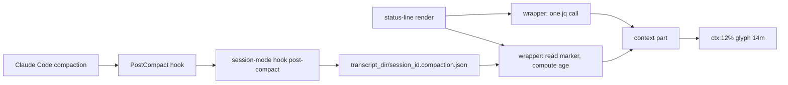

# Status line: compaction awareness

**Status**: Approved for implementation by the operator (2026-10-13), after two independent read-only reviews of earlier drafts. This is the implementer's source of truth.
**Repo**: `phillipgreenii-nix-agent-support`. Every path below is relative to the repo root; locate code by NAME, not by line number (the files move).
**Effort**: L overall (PD S, A S, B1 M, B2 M, H S, V S).

## 1. Problem

Right after a compaction, the status line showed `0%` context together with the red >200k alert glyph. The two readings contradict each other (0% cannot exceed 200k tokens).

The wrapper (`home/programs/claude-status-line/scripts.nix`, `mkWrapperScript`) extracts every field in ONE `jq` call and exports `CLAUDE_SL_*` variables. The context part (`contextPart`, a `pkgs.writeShellScript "claude-sl-context"`) prints `<glyph><used_pct>%`, exits when `CLAUDE_SL_CONTEXT_USED_PCT` is empty, and appends the alert glyph (`glyphAlert`) when `CLAUDE_SL_EXCEEDS_200K=true`.

### 1.1 Findings

Documented (https://code.claude.com/docs/en/statusline):

- `exceeds_200k_tokens`: whether the total tokens "from the most recent API response" exceed 200k; "a fixed threshold regardless of actual context window size".
- `current_usage` is null "before the first API call in a session, and again after `/compact` until the next API call repopulates it".
- `used_percentage` "may be `null` early in the session".

From reading the minified Claude Code binaries (2.1.289 and 2.1.296; version-specific, so bead V re-confirms live):

- `used_percentage` is null exactly when `current_usage` is null; otherwise it is `round(sum(input + cache_creation + cache_read) / window * 100)`, clamped to 0..100.
- The wrapper's `// ""` turns null into empty and `contextPart` exits on empty, so a displayed `0%` means `used_percentage` was a literal `0` (`0 // ""` stays `0` in jq: only null and false are falsy). `contextPart`'s empty-string guard does NOT hide a literal `0`: the variable is the non-empty string `0`.
- `exceeds_200k_tokens` is cached against the uuid of the last assistant message. After a partial compaction that message is in the preserved segment, so the cached `true` survives until the next API response.
- Hook order inside compaction: `SessionStart(compact)` hooks, then `PostCompact`, then the `compact_boundary` entry is assembled and `postTokens` is set, then the result is persisted. The boundary is NOT on disk when either hook runs.
- `PostCompact` payload: base fields (`session_id`, `transcript_path`, `cwd`) plus `trigger` (enum `manual` | `auto`) and `compact_summary`; it is skipped for subagent compactions. The SessionStart payload key is `source`, not `session_start_reason`.
- `session_id` is identical before and after compaction (local transcripts hold multiple `compact_boundary` entries in one file).

### 1.2 Constraint

The status line MUST NOT read or parse the transcript on each render. Existing discipline: one `jq` call per render; any other per-render read is a pure-bash `read` of one tiny sibling file (cf. `home/programs/claude-status-line/session-mode-status.bash`).

## 2. Design



### 2.1 Part A: fix the 0% plus stale-alert mismatch (no hook)

- The wrapper's existing `jq` program MUST gain one `@sh` line, and the wrapper MUST `export CLAUDE_SL_CONTEXT_SETTLING` in the `export` list. The tested line (jq 1.8.2) is:

```jq
@sh "CLAUDE_SL_CONTEXT_SETTLING=\((.context_window.used_percentage == 0 and (((.context_window.current_usage | type) != "object") or (((.context_window.current_usage.input_tokens // 0) + (.context_window.current_usage.cache_creation_input_tokens // 0) + (.context_window.current_usage.cache_read_input_tokens // 0)) == 0))) | tostring)"
```

- Edit-site pitfalls: the jq program is ONE comma-separated generator inside a single-quoted jq string, and its LAST `@sh` line (`_sl_transcript`) has no trailing comma. Insert the new line anywhere before that last line (for example right after the `CLAUDE_SL_CONTEXT_USED_PCT` line) and end it with a comma. The `\(...)` inside the Nix `''` string is fine as the existing lines show; any `${` would need `''${`.
- Semantics: `CLAUDE_SL_CONTEXT_SETTLING` is `true` ONLY when `used_percentage == 0` AND (`current_usage` is not an object OR its input-side token sum is `0`). `output_tokens` is excluded, matching the `used_percentage` formula. Every other input yields `false`.
- Verified outputs:

| `context_window` input                                                      | SETTLING |
| --------------------------------------------------------------------------- | -------- |
| absent `current_usage`, `used_percentage` 25                                | false    |
| `used_percentage` null, `current_usage` null                                | false    |
| `used_percentage` 0, all-zero `current_usage` object                        | true     |
| `used_percentage` 12, nonzero `current_usage`                               | false    |
| `used_percentage` 0, no `current_usage`                                     | true     |
| `used_percentage` 0, small nonzero `current_usage` (1M window rounds to 0%) | false    |
| `used_percentage` 25, `current_usage` `{}`                                  | false    |
| `{}` or no `context_window`                                                 | false    |

- `contextPart` MUST, when `CLAUDE_SL_CONTEXT_SETTLING=true`, print a dim fixed-width placeholder (text form `ctx:...`; nerd form the same glyph as the context part followed by `...`) instead of `0%`, and MUST NOT append the alert glyph. The placeholder check MUST be inside `contextPart` (its empty-string early exit does not catch a literal `0`).
- The alert MUST NOT be suppressed by any percentage-to-token inference: on a 1M window `exceeds_200k_tokens` can legitimately be true at 25%.
- Existing fixtures are unaffected: no fixture contains `current_usage` or `"used_percentage":0`, and the `"context_window":{}` fixtures yield SETTLING=false and render as today.
- The state ends by itself at the next API response; no marker or hook is involved. If live evidence (bead V) shows the 0% window has a different shape, A is reopened and amended.

### 2.2 Part B: record and show that a compaction happened

Marker file:

- Path: `<transcript_dir>/<session_id>.compaction.json`, where `<transcript_dir>` is `${transcript_path%/*}`.
- Format: one JSON object on one line, mode `0600`, written atomically through `session_mode_write_atomic` in `packages/session-mode/lib/session-mode-lib.bash` (same-dir `mktemp`, `chmod 0600`, `mv -f`; it also does `mkdir -p`, which is why the hook guard below exists). A crash can leave a `.session-mode.tmp.XXXXXX` dotfile in the transcript directory; it is never `.jsonl` and is harmless (accepted, noted in the ADR).
- Fields: `ts` (epoch seconds, from the hook's own clock) and `trigger` (`manual`, `auto` or `unknown`). There is NO `count` field.
- Extension is `.json`, NOT `.jsonl`: it is a rewritten record, not an append-only log, and `.jsonl` is the extension pa-monitor treats as a transcript.
- Add two pure helpers beside `session_mode_file_path` / `session_mode_build_record` in the lib: `session_mode_compaction_file_path DIR SID` and `session_mode_build_compaction_record TRIGGER EPOCH` (build with `jq -nc` so the record is compact and single-line; the status-line reader is jq-free and line-based).

Hook:

- Event: `PostCompact` with NO matcher (a matcher such as `manual|auto` is unverified for this event). `SessionStart` with matcher `compact` MUST NOT be used: it may fire for subagent compactions (which share the parent `session_id`) and its stdout is injected into model context.
- Implementation: new function `cmd_hook_post_compact` in `packages/session-mode/session-mode/session-mode.sh`, with a `post-compact)` arm in main's `hook)` dispatch beside `session-end`. Model it on `cmd_hook_session_end` (reads the payload with `cat`; plucks fields with `jq -r '.field // empty' 2>/dev/null || true`). `jq` is a declared runtime dependency of the package.
- Guard, in this order, each failing step doing nothing and exiting 0: non-empty `session_id`; non-empty `transcript_path`; `dir=${transcript_path%/*}` exists as a directory (the hook MUST NOT call `session_mode_state_dir`, MUST ignore `SESSION_MODE_STATE_DIR`, and MUST NEVER create the directory, because the `$PWD`-derived fallback plus `mkdir -p` would create phantom project directories under `~/.claude/projects`).
- Trigger: `trig=$(printf '%s' "$payload" | jq -r '.trigger // empty' 2>/dev/null || true)`, then `case $trig in manual|auto) ;; *) trig=unknown ;; esac`. PostCompact firing IS the signal, so an absent or invalid `trigger` still writes the marker with `unknown`. `compact_summary` MUST NOT be stored.
- The hook MUST print nothing to stdout (PostCompact stdout is echoed into the user-visible compaction message), MUST always exit 0 (every command guarded; whether `mkBashScript` enforces `set -e` is unconfirmed), and MUST be fast (hooks are awaited inside compaction).
- Update the `die` usage string in main's hook dispatch, `show_help`'s `hook` lines and its example, so all mention `post-compact`.
- Registration: add a `PostCompact` entry (`{ "type": "command", "command": "session-mode hook post-compact" }`) to `claude-marketplace/pb/hooks/hooks.json` beside `SessionEnd`, and update that file's `description` and the `pb` `plugin.json` description (both mention only the SessionEnd backstop). No manual version bump: plugin versions are `<declared>+<digest>` and re-version when the plugin's own content changes (ADR 0017).
- Completions: add `post-compact` to `packages/session-mode/session-mode/completions/session-mode.bash` (the `hook` branch's `compgen -W "session-end"`) and `completions/_session-mode` (`_values 'hook event' session-end`). The man page is generated from `--help`; tldr (`session-mode.md`) has no `hook` entry today and need not gain one.
- `pb` is the right plugin: it already owns the `session-mode` `SessionEnd` backstop, and `test-claude-plugin-binary-default-parity` maps `pb` to the `session-mode` program, whose HM module defaults `enable` to `claude-code.enable`, so the new bare-command hook passes unchanged. Run it anyway.
- The ceta embedded spec deliberately omits `hook` forms; `session-mode hook post-compact` stays unmodeled. Add `"session-mode hook post-compact"` to the not-auto-approved list in `packages/claude-extended-tool-approver/internal/cmddesc/plugin_tools_test.go` (beside `session-mode hook session-end`).
- Tokens (`preTokens` / `postTokens`) are OUT of scope for v1: the boundary entry is not on disk when the hook runs.
- The only way to disable the hook is removing the `hooks.json` entry (accepted); the window option below disables the DISPLAY.

Wrapper and display (B2):

- A new injected lib `home/programs/claude-status-line/compaction-status.bash` (precedent: `session-mode-status.bash`, injected via `builtins.readFile` in `scripts.nix`, with a guarded call using the hoisted `_sl_txdir` and `CLAUDE_SL_SESSION_ID`) provides `read_compaction_marker PATH NOW`: a jq-free pluck of `ts` (and `trigger`, unused by the display in v1); `ts` MUST be validated as a positive integer (cf. ADR 0021 on bug #52326); a missing, unreadable, zero-byte or malformed file yields nothing; a negative age (clock skew) is clamped to `0`. The lib MUST be jq-free, MUST use `local` in every helper (the wrapper's top-level names `d`, `gitdir`, `hl`, `gl`, `out`, `parts`, `line`, `lines`, `cur`, `seg` would otherwise be clobbered), and MUST carry `# shellcheck shell=bash` plus `# shellcheck disable=SC2034 # consumed externally` on assigned-but-unused `CLAUDE_SL_*` vars. It defines its own plucks (`json_number_field` lives in `capture-status.bash`, injected later).
- The wrapper exports `CLAUDE_SL_COMPACT_AGE` (seconds, from `$EPOCHSECONDS`).
- New HM option `phillipgreenii.programs.claude-code.status-line-compaction-window-s` (int seconds, default `1800`, `0` disables the note; NOTE the real prefix is `claude-code`, not `claude`). Plumbing mirrors `status-line-notification-reserve`: `default.nix` (`cfg` let-binding, `mkOption`, pass-through into `mkWrapperScript`), `scripts.nix` `mkWrapperScript` argument with a default (so the `flake.nix` test packages need no change unless the default is wrong for them), consumed as `''${CLAUDE_SL_COMPACT_WINDOW:-${toString window}}` exactly like `CLAUDE_SL_RESERVE`. The env seam lets tests use a small window.
- The note is folded into the context part, e.g. `ctx:12% <glyph>14m`, rather than a separate segment (a separate segment costs 3 extra columns for `" | "` and a `defaultParts` entry). It MUST show only while age is below the window. A running count MUST NOT be shown.
- Glyph: text mode is the literal `↻` (U+21BB, BMP). The nerd-font variant MUST be a named `glyphCompact` defined beside the other glyphs as `if nerdFont then glyph <decimal codepoint> + " " else "↻"`; the codepoint MUST be a plane-15 MDI codepoint (U+F0000 to U+FFFFF, written in decimal like `glyphCtx = glyph 983899`), because `utf8Bytes` only produces correct bytes for plane 15. Record the same codepoint in the `GLYPH_*` constants of `test-claude-status-line.bats`. Colors MUST use existing named keys only.

### 2.3 Why not other approaches

| Alternative                                                  | Rejected because                                                                            |
| ------------------------------------------------------------ | ------------------------------------------------------------------------------------------- |
| `SessionStart` with `compact`                                | may fire for subagent compactions; stdout goes into model context                           |
| Read `compact_boundary` from the transcript tail in the hook | boundary not yet written when the hook runs; returns the previous compaction's data         |
| Tail the transcript on each render                           | violates the per-render constraint                                                          |
| Detect a drop in `used_percentage` between renders           | needs per-render state writes; heuristic; gives no `trigger`                                |
| New package instead of a `session-mode` subcommand           | duplicates path and atomic-write helpers; needs its own HM module and default-enable parity |

### 2.4 pa-monitor impact (definite)

- `packages/pa-monitor/internal/daemon/gc.go` `listSessionFiles` scans `g.SessionsDir`, wired from `session.DefaultSessionsDir()` (`~/.claude/sessions`), NOT the projects directory. It can never see `<id>.compaction.json`.
- Every projects-directory enumerator requires `.jsonl` (`corpus/walk.go`, `corpus/resolve.go`, `session/transcript.go` `IsTranscriptFile`, `packages/claude-transcript/discovery.go` and `sessions.go`).
- No pa-monitor enumerator can be affected. Adding `compactionSuffix = ".compaction.json"` to `IsStatusSiblingFile` (`packages/pa-monitor/internal/core/session/transcript.go`) is a DEFENSIVE consistency guard mirroring `.session-mode.json`, not a correctness fix; add a truth-table row in `transcript_exclusion_test.go`. Gate: `checks.<system>.pa-monitor-go-tests`.

## 3. Work breakdown (beads in this repo's tracker)

Every bead carries the repo label `agent-support`. Project labels follow CLAUDE.md "Beads Labels": only when one project under `packages/` or `claude-marketplace/` is the subject. `home/programs/claude-status-line` is under neither, so A and B2 carry only `agent-support` (do NOT copy the ad-hoc `status-line` label). Edges are real `bd` blocks edges.

| Id  | Title                                                       | Size | Labels                          | Blocked by                               |
| --- | ----------------------------------------------------------- | ---- | ------------------------------- | ---------------------------------------- |
| PD  | Land the compaction-awareness plan doc                      | S    | `agent-support`                 | none                                     |
| A   | Context part: placeholder and no alert when usage is zero   | S    | `agent-support`                 | PD                                       |
| B1  | `session-mode hook post-compact` plus pb `hooks.json` entry | M    | `agent-support`, `session-mode` | PD                                       |
| B2  | Wrapper marker lib, window option, context-part note        | M    | `agent-support`                 | A, B1                                    |
| H   | ADR, rules, docs, pa-monitor guard                          | S    | `agent-support`                 | B1, B2                                   |
| V   | Post-apply live verification of B1 and B2                   | S    | `agent-support`                 | gated by `pn:applied` on B2's landed sha |

V is created through `pb gate attach-verified-child` per `pb:pb-gate-lifecycle`, not by labeling an implementation bead `human`, and cites the bats tests as the evidence for deterministic behavior (V-3). V covers only what a test cannot prove: after the operator applies, start a NEW Claude session, run `/compact`, and confirm (1) the hook fired and `<session_id>.compaction.json` appears next to the transcript with the real `trigger` value, (2) the note appears and then disappears after the window, (3) `which session-mode` resolves, (4) the real PostCompact payload `trigger` value (record it), and (5) the zero-percent window's real `current_usage`/`used_percentage`/`exceeds_200k_tokens` (if it contradicts section 1.1, reopen A).

### Acceptance criteria

- **PD**: this document is on `main` at `docs/superpowers/plans/2026-10-13-status-line-compaction-awareness.md`.
- **A**: the zero-usage fixture shows the placeholder and no alert; a nonzero fixture with `exceeds_200k_tokens=true` still shows the alert; `used_percentage` 0 with a small nonzero `current_usage` shows `0%`, not the placeholder; all existing status-line fixtures pass unchanged; both nerd-font packages green.
- **B1**: hook and lib bats green; `claude-extended-tool-approver-spec-help-drift` green after the hash is re-recorded IN THE SAME COMMIT as the `--help` change; `test-claude-plugin-binary-default-parity` green; the marker contract of section 2.2 met.
- **B2**: marker-lib unit tests and end-to-end tests green; option documented; both nerd-font packages green.
- **H**: ADR present and listed in `docs/adr/index.md`; rules, ADR 0071 correction and docs updated per section 5; pa-monitor guard and test green.
- **V**: per the checklist above.

## 4. Tests (V-3: automated, in-repo, hermetic)

- Hook, in `packages/session-mode/session-mode/tests/test-session-mode.bats` (extend the hook tests; helpers: `create_cmd_wrapper session-mode` gives `$TEST_DIR/run_session-mode`; `_hook_payload` emits only `session_id` and `transcript_path`, so add a variant including `trigger`; add a `compaction_file` helper beside `record_file`; invocation `run bash -c "printf '%s' '$payload' | '$TEST_DIR/run_session-mode' hook post-compact"`; `setup()` exports `SESSION_MODE_STATE_DIR`, `CLAUDE_SESSION_ID` and `HOME=$TEST_DIR/home`). Cases: valid `manual` and valid `auto` write the marker; second call overwrites; `trigger` absent, numeric or empty string writes `unknown`; payload `{}` (no `session_id`) writes nothing; non-JSON input exits 0 with no write; missing `transcript_path` writes nothing; a nonexistent transcript directory writes nothing and creates NO directory (run with `env -u SESSION_MODE_STATE_DIR`, following the existing precedent, and assert no `~/.claude/projects` tree appears under the test `$HOME`); stdout is empty; file mode is `0600`; `SESSION_MODE_STATE_DIR` set to a different directory does NOT redirect the write (the marker lands beside the transcript). The positive cases MUST `mkdir -p` the transcript directory.
- Lib helpers in `packages/session-mode/lib/tests/test-session-mode-lib.bats` (the builder-test pattern there).
- Marker lib in a new `home/programs/claude-status-line/test-compaction-status.bats` sourcing `$BATS_TEST_DIRNAME/compaction-status.bash`: unit tests passing `NOW` as an argument (bash 5.3 ignores an injected `EPOCHSECONDS`; parts are store paths bats cannot call). Cases: fresh, expired, future `ts` (clamped to 0), non-numeric `ts`, zero-byte file, malformed file, absent file. A new `.bats` in that directory is auto-discovered (both check derivations run `bats` over the directory).
- End to end through the installed `claude-status-line` in `test-claude-status-line.bats` (follow `_session_mode_json` / `_capture_json`; write the marker next to the transcript in `$TEST_DIR`, with `ts` computed from `date +%s`, and `CLAUDE_SL_COMPACT_WINDOW` set small): zero-usage fixture shows the placeholder and no alert; no marker leaves output byte-identical to today; window `0` hides the note; `nerd_on`/`nerd_off` branches. Avoid exact-boundary assertions: there is no mockable clock.
- pa-monitor truth-table row (section 2.4).

## 5. Housekeeping

B1 (so no check fails between beads):

- Re-record the `session-mode` hash in `packages/claude-extended-tool-approver/internal/embeddedspecs/data/help-hashes.json`. Only that shared baseline file changes (`help-hashes.darwin.json` is a 5-entry overlay that does not contain `session-mode`). The hash is the sha256 of `session-mode --help` (stdout+stderr) under `TERM=xterm-256color LC_ALL=C LANG=C HOME=/homeless-shelter`; the help text is a static heredoc, so it is platform-independent. Recompute AFTER the final `--help` edit with (verified to reproduce the current recorded hash):

```bash
cd packages/session-mode && env -i PATH="$PATH" TERM=xterm-256color LC_ALL=C LANG=C HOME=/homeless-shelter bash -c 'bash <(cat lib/session-mode-lib.bash session-mode/session-mode.sh) --help 2>&1 | shasum -a 256'
```

Paste the digest into the `"session-mode"` line, then confirm with `pg-nix-log-wrapped nix build .#checks.aarch64-darwin.claude-extended-tool-approver-spec-help-drift -L` (heavy: give the single Bash call `timeout: 600000`; if it does not finish, report `stuck` with the exact command). A failure prints `--help drift: recorded <old>, live <new>`; `<new>` is the replacement. Do NOT use `--record` (on non-Linux it writes only the darwin overlay).

H:

- Update `.claude/rules/claude-status-line.md` (env-var list including `CLAUDE_SL_CONTEXT_SETTLING` and `CLAUDE_SL_COMPACT_AGE`, the new option, the context segment note; the file's `phillipgreenii.programs.claude.*` namespace is stale: the real prefix is `claude-code`) and the env-var list in the `status-line-parts` option description in `home/programs/claude-status-line/default.nix`. ADR 0019 documents `mkWrapperScript { parts, reserve ? 20 }`; mention the new argument.
- Add `compactionSuffix = ".compaction.json"` to `IsStatusSiblingFile` (section 2.4).
- Correct `session_start_reason` to `source` in `docs/adr/0071-claude-code-hook-router.md`.
- Add ADR 0095 (next free number: check `docs/adr/index.md` and `ls docs/adr` first, because peers add ADRs; add a row to the index) recording: the marker contract; that no cleanup exists, matching `.session-mode.json` and `.status.jsonl`; that `session_id` is stable across compaction; that a resumed session reusing its id can show a stale marker until the window ends; and that a crash can leave a `.session-mode.tmp.*` dotfile.

## 6. Constraints for every implementer

- Work only inside your own worktree. Commit as soon as the change is ready; the commit's own hook run is the first gate: `git add` the files first (prek skips untracked files), then `pg-hooks run pre-commit <the files you changed>`, then `pg-hooks fix` if it reformats, then `git commit`. Never `--all-files`, never `--no-verify`.
- Run any nix command through the wrapper: `pg-nix-log-wrapped nix build .#checks.aarch64-darwin.<name> -L`, with an explicit `timeout: 600000` on the single Bash call.
- Do NOT `git push`, run `pn workspace` verbs, apply, or touch other worktrees.

## 7. Risks and unverified items

- Whether `PostCompact` fires on the running build, and whether a matcher is accepted, are unverified until bead V (the installed 2.1.296 schema declares `trigger` as `manual|auto`).
- `--resume` / `--continue` `session_id` behavior is unconfirmed.
- Whether Claude Code's retention cleanup removes sibling files is unconfirmed.
- Whether `mkBashScript` enforces `set -e` is unconfirmed; the hook handles either case.
- Whether a changed plugin `hooks.json` reaches a live session without a restart is unconfirmed (V uses a new session).
- Delivery needs the operator's `pn workspace apply`; agents MUST NOT run it.
