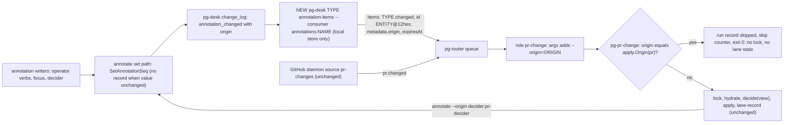

# Plan: run the decider when an entity's annotations change

Status: DRAFT v2 for operator review, 2026-11-02. v2 applies two independent reviews of v1
(completeness and correctness; observability and test coverage). Repos: `nix-agent-support` (code,
docs) and `nix-ziprecruiter` (deployment). The key words MUST, MUST NOT, SHOULD and MAY are as in
RFC 2119.

## 1. Problem

The PR decider runs when a PR changes on GitHub, but not when an operator changes one of the PR's
annotations (`hide`, `unhide`, `wip`, `annotate`, `suppress`, `feedback set`, `force-review`). The
annotation write already appends an `annotation_changed` record to pg-desk's `change_log`
(`packages/pg-desk/internal/store/annotation_kv.go`), and the decider already reads every
annotation on each run (`pg-desk pr show --json`; `decide(view)` is pure of the view, entity change
flow design 7.1). What is missing is a trigger: PR change detection moved to the pg-connector
GitHub daemon, and the retirement of `pg-desk pr changes` removed the local half of the PR change
feed with it. The daemon cannot see pg-desk-owned data, so annotation changes reach nobody. Today
`pg-desk pr hide` papers over this by printing `next: run pg-pr-change apply <id>`.

## 2. Goals and non-goals

- G1. A change to any annotation of a PR MUST cause one decider run for that PR, with no manual step.
- G2. The feed MUST be entity-type generic (registered for every type); only `pr` is wired now.
- G3. A decider's own annotation writes MUST NOT cause re-triggered decider runs; loop prevention
  MUST live in the decider, not in the feed.
- G4. An annotation write that does not change the stored value MUST NOT produce a change record.
- Non-goal: what the decider does for a hidden PR. S15 / precedence step 1 is unchanged.
- Non-goal: wiring `issue` (its `issue changes` feed already delivers `annotation_changed`; wiring
  both would double-deliver) or `thread` (`thread changes` refuses on every call,
  `cmd/pg-desk/changes.go:105-108`, so thread annotation changes reach nobody today; wiring it is a
  later, separate decision).

## 3. Design overview

The feed is an Adapter from pg-desk's change log to pg-router's item format, implemented as a
pg-desk verb that prints router items directly (the shape `pg-desk heartbeat-item` uses,
`cmd/pg-desk/heartbeat_item.go:40`). The existing adapter `pg-router-source-pg-desk` is NOT reused:
it merges records per entity, builds ids `<id>@<seq>` and sets `metadata.seq`
(`pg-router-source-pg-desk/cmd/pg-router-source-pg-desk/changes.go:45-100`), all three wrong here.
The loop guard is a Guard Clause in the decider's composed command, ahead of the lock, so
`decide(view)` stays pure.

## 4. Changes

### 4.1 pg-desk: no record for an unchanged annotation (nix-agent-support)

- `cmd/pg-desk/annotate.go` `kvWrite.set` (:158) MUST call `store.SetAnnotationSeq` instead of
  `store.SetAnnotation`. Every caller uses only the error (`annotate.go:124`, `force_review.go:91`,
  `suppress.go:64`, `typed_annotation.go:119/159/283`), so the extra return values are discarded.
- Amend INV-ANNOTATE-1 (`docs/behavior/pg-desk/annotate.md:69`) and the annotation section of
  `docs/behavior/pg-desk/store-schema.md` (:212): a write that changes the value, or a removal of an
  existing key, MUST append exactly one `annotation_changed` record in the same transaction; a
  write of the value the key already holds MUST write nothing (the stored `origin`, `set_by` and
  `set_at` keep their earlier values).
- `force-review` help and doc: re-running it at the same head while the flag is still set writes
  nothing and triggers nothing.

### 4.2 pg-desk: generic annotation feed (nix-agent-support)

- New verb registered for every entity type: `pg-desk <type> annotation-items --consumer NAME
[--retry-window DUR] [--limit N]` (name provisional).
- Local store only: MUST NOT call pg-connector or hydrate.
- Scan: read `change_log` rows of `<type>` after the cursor in ascending seq, `--limit` counting
  SCANNED rows (`store/changelog.go:356` `ListChangesAfter` limits before any kind filter); emit
  only `annotation_changed` rows; the cursor MUST advance to the last seq SCANNED, not the last item
  emitted, so a page of non-annotation rows (refresh hydrations) cannot stall the feed.
- Output: a JSON array of router items in ascending seq, one per record (no merging): `type`
  `<type>.changed`; `id` `<entity_id>@<12 hex>`, the hex a digest of (type, entity id, seq, origin)
  using the helper shape of `pg-router-source-pg-connector/cmd/pg-router-source-pg-connector/changes.go:159-173`;
  a digest of `000000000000` MUST be avoided (it reads as "no key", `prchange/key.go:44`), e.g. by
  remapping it to `000000000001`; `metadata.entity_id`, `metadata.origin`, `metadata.kinds`
  = `["annotation_changed"]`; NO `metadata.seq` (a pg-desk seq would share the delivery-key space
  with the GitHub daemon's seq, `prchange/key.go:11-30`); `expiresAt` = now + `--retry-window` when
  given. An empty poll prints `[]`.
- pr entity ids are already canonical: `Remote + "#" + n` (`desk.go:206`), which `NormalizeID`
  accepts (`prchange/id.go:10`).
- Consumer cursor: the consumer table is keyed `(name, type)` with no kind column
  (`store/cursor.go:47-58`). The verb MUST require consumer names with the reserved prefix
  `annotations:`, and `<type> changes` MUST refuse that prefix, so the two feeds can never share a
  cursor. Add `RegisterConsumerAtMax`: one `INSERT ... SELECT COALESCE(MAX(seq),0)` for the type,
  used on first registration only. `RegisterConsumer` (start at 0) is unchanged for `<type> changes`.
  The consumer's type stays the entity type so `PruneChangeLog` and `<type> consumer list` keep
  working; a live consumer holds back pruning of that type's rows until it goes 7 days unseen
  (`cursor.go:31`, `:192-232`).
- Old-schema store: the verb MUST refuse like `<type> changes`. (Annotation writes on an old-schema
  store already error, `annotation_kv.go:178`.)
- Verb registration: one `safe-verbs.txt` line per registered type, regenerated from
  `cmd/pg-desk/verbs_schema2_test.go:114,216`; the verb-class entry needs non-destructive args (the
  verb has no peek flag).
- Docs: new `docs/behavior/pg-desk/annotation-items.md`; carve-outs in
  `docs/behavior/pg-desk/changes.md` ("Who owns change detection": the daemon owns remote change
  detection for `pr`; pg-desk still owns its local annotation changes), `consumer.md:10`, and the
  README verb list / INV-CHANGES-13 (`README.md:33,150`); `TestChangesIsNotRegisteredUnderThePRGroup`
  stays (this is a different verb).

### 4.3 Decider: own-origin skip (nix-agent-support)

- Export the origin builder in `pg-decider/internal/apply/pgdesk.go:19` (`origin` to `Origin`,
  value `decider:<type>-decider`); every decider write and the guard MUST use it.
- `pg-pr-change <mode> <id> [<seq>]` gains `--origin=<text>`. Texts that mean "absent" (empty,
  whitespace, `<no value>`, `<nil>`, `null`, as `absentSeqTexts`, `prchange/key.go:52`) mean
  unknown. Update usage and the positional error text (`cmd/pg-pr-change/main.go:118`).
- Guard (section 5): when the origin equals `apply.Origin("pr")`, the command MUST, after
  `startRecord` and before `AcquireLock` (`prchange/run.go:143-146`): write the run record with the
  new members `skipped: true`, `skip_reason: "own-origin"`, `origin` (additive, allowed by
  `record.go:26`); bump the skip counter (4.3.1); exit 0. It MUST NOT go through `finish()` (which
  calls `recordLane`), hydrate, decide, apply, or write per-PR lane state. Its lane result MUST be a
  new value (e.g. `not_run`), not `skipped`, which already means "ended at the lock"
  (`record.go:186-187`).
- 4.3.1 Skip counter: the `pg-desk pr lane-record` input gains a `skip_reason` member with a
  closed vocabulary (`own-origin`). With it, `Validate` (`lanestate.go:102-108`) still requires `pr`
  and `mode`, and `Record` MUST return right after one `IncrMeta` (a single UPSERT,
  `store/meta.go:90-100`) of a lane-level counter exported as `pg_desk_pr_lane_skips_total{reason}`
  (`internal/metrics/prlane_state.go`), without writing `last_run_at` (`lanestate.go:205`), PRState
  (`lanestate.go:92`, holds `last_outcome`) or `pg_desk_pr_lane_runs_total`. Lane-record takes no
  lock of its own, so this is lock-free. An older pg-desk refuses the unknown member
  (`cmd/pg-desk/lane.go:76-77`); a failure to record the skip MUST NOT fail the command.
- The skip path does `finish()`'s bookkeeping itself (`prchange/lane.go:185-200`: `ExitCode`,
  `FinishedAt`, append the record) without `recordLane`'s normal document, and records
  `skip_counter: recorded|failed` in the run record.
- Backfill: add a `skipped` member to the backfill `Record` struct (`backfill/record.go:38-65`);
  `Latest` (`:211`) MUST ignore skip records, so a skip after a real run cannot hide that run's
  residual from the first-apply summary (`backfill/summary.go:66`).
- Docs: the pg-pr-change behavior doc and the decider work-item doc gain section 5's rules and
  INV-SKIP-1.

### 4.4 Deployment (nix-ziprecruiter)

- `modules/zm/default.nix`: new query (name e.g. `desk-pr-annotations`; MUST NOT be
  `desk-pr-changes`) emitting `pr.changed`, argv `pg-desk pr annotation-items --consumer
annotations:pr-lane --retry-window <retryWindow>` (the same `retryWindow` as `pr-changes`),
  `non_blocking_gates = [ "LOW_DISK_USAGE" ]`, `strict_base_env = deskHeartbeatStrictEnv`, period
  60s. It runs `pg-desk` by store path and execs nothing, so it goes in `queryNoSpec` (with its
  reason, like `desk-heartbeat`), not `queryWrapSpecOf`/`q-desk` (`default.nix:869-930`).
- `pr-change` role argv adds the single token
  `--origin={{with index .Item.Metadata "origin"}}{{.}}{{end}}`. The id stays `{{.Item.ID}}`.
- Flake checks (`flake.nix`):
  (Line numbers as of 2026-11-03; re-locate by check name.)
  - `pg-router-issue-change-flow-wiring`: the single-`pr.changed`-emitter assertion (:3798-3801),
    the `desk-pr-changes` ban (keep it) and the 6-element `pr-change` argv pin.
  - `pg-router-pr-change-wiring` (:3898-4077): the retry-window equality across `pr.changed`
    sources (:3928/:3980) and argv pins.
  - `pg-router-queries-wrap` (:5821-5893): needs only the new `queryNoSpec` entry.
  - `pg-router-desk-low-disk-nonblocking-pairs` (:2687): the new query's opt-out pairing.
  - `pg-desk-verb-guard` (:8104): scans queries, so the new verb must be a safe verb (4.2).

### 4.5 CLI text (nix-agent-support)

- Remove the `next: run pg-pr-change ...` hint from `pr hide`, `pr unhide` and `pr force-review`
  (`printComposedCommand`, `typed_annotation.go`, `force_review.go:99`), but KEEP the
  "the pr lane is off (pr_lane.mode) ..." line when the lane mode is `off`
  (`pr_lane_line.go:115-118`), since then nothing will act. Keep `beads already open for a hidden
PR stay open and claimable` on hide. Amend INV-HIDE-1 and the force-review doc.

## 5. Skip and run rules (loop prevention)

`decide(view)` MUST NOT branch on why it was woken (design 7.1); that rule is unchanged. The guard
is a delivery filter in the composed command, the same layer as the per-PR lock, and keys on WHO
wrote the triggering change, not on its kind.

- RUN when the event has no origin (every GitHub daemon event) or an absent-meaning text.
- RUN when the origin is anything other than the decider's own (`pg-desk` for operator verbs and
  focus; any other free text; another type's decider).
- SKIP only when the origin equals `apply.Origin("pr")` exactly.

Why skipping is safe: an own-origin record is the output of a run that already read the complete
view, so a re-run computes the same actions (idempotence, design G6) apart from failure-counter
writes, which change on every failing run and would otherwise re-trigger it until `escalate_after`.
The feed emits one item per record, so a skip cannot hide an operator change bundled into the same
item. The decider does READ its own earlier writes on later runs (failure state,
`failure/failure.go:83`; ready_to_land, `rules/landready.go:39`), but no rule needs to be WOKEN by
them: each is read on the next run, whatever triggers it.

- INV-SKIP-1: No decider rule may require being re-woken by an annotation the decider itself wrote.
  A rule that needs that MUST compute the result in the same run, or the guard MUST be revisited.

## 6. Observability

- Run record (JSONL, `$XDG_STATE_HOME/pg-pr-change/pr-change-runs.jsonl`, log source
  `pg-pr-change-runs`): skips carry `skipped`, `skip_reason`, `origin`. No alert reads the JSONL
  (`record.go:24-25`); it is for investigation.
- Metric: `pg_desk_pr_lane_skips_total{reason}` (4.3.1). A skip rate far above the run rate
  signals a loop or an impersonated origin.
- Feed health: the pg-router source alerts (`pg-router/grafana/alerting/alerts.yaml`:
  source-failure-rate :1177, source-backoff :1220, source-persistent-failure :1298) catch a failing
  query but treat an empty `[]` poll as success. A stuck feed shows only as consumer lag:
  `pg_desk_consumer_lag` (max seq of the type minus the cursor, per consumer,
  `changeflow.go:38`), which today alerts only for issue (`pg-desk/grafana/alerting/alerts.yaml:819`).
  Add a lag alert on `pg_desk_consumer_lag{type="pr",consumer="annotations:pr-lane"}` (label set at
  `changeflow.go:342`) that does not fire while a gate such as `SYSTEM_PAUSE` blocks the query (lag
  grows on purpose then; follow the issue lag alert's gate handling), and document the 4.2
  scanned-seq advance as the reason lag stays near 0 even when most pr rows are hydrations.
- The hydrate-dead alert (alerts.yaml:1305) counts dispatches as throughput; skips are dispatches
  without hydration. This holds today because each skip follows a run that hydrated; note it in
  that alert's doc.
- `pg-router-pr-dispatch-failed` is unaffected (skips exit 0). No new service is registered, so the
  service-daemon checklist does not apply.

## 7. Tests

Harnesses: per-verb pg-desk cases go in `pg-desk/cmd/pg-desk/annotation_verbs_test.go` (helpers
`newStoreAt` :17, `wantOneAnnotationChange` :35); round-trip and guard cases use the prchange rig
(`newRig`, `pg-decider/internal/prchange/rig_test.go`); end-to-end lane cases use the lane-fake suite, which runs the real
pg-desk, pg-decider and pg-pr-change with `fakebd` (`pg-decider/internal/prchange/lane_fake_test.go:11-28`;
update `lane-fake-scenarios.txt`, `minLaneFakeScenarios` and the nix check's count). All are unit
tests (fast, single process tree, no daemon).

- 4.1, per verb (a store-level test would not catch a revert, since `SetAnnotationSeq` already
  behaves this way): for each of `hide`, `wip`, `suppress`, `feedback set`, `force-review` and
  `annotate`, a same-value re-run appends no record and leaves origin/set_by/set_at; a changed
  value appends exactly one. Removal of an existing key appends one, of a missing key none. Two
  concurrent same-value writes produce exactly one record.
- 4.2: only `annotation_changed` of the type after the cursor; ascending seq; one item per record;
  origin carried; digest stable per record and distinct across records; the zero digest is
  remapped; no `metadata.seq`; `expiresAt` only with `--retry-window`; first registration starts at
  the current max (pre-existing records not replayed); the cursor advances past a full page of
  non-annotation rows (lag 0 afterwards); empty poll prints `[]`; the `annotations:` prefix is
  required here and refused by `<type> changes`; existing `<type> changes` consumers still start at
  0; old-schema refusal; verb registered for every type; stale-consumer pruning unaffected.
- Round trip: an id printed by the verb from a real store goes through `NormalizeID` to the
  canonical PR id and through `ResolveKey` to source `id-suffix`; a router retry of the same item
  yields the same key, so `escalate_after` counts once.
- 4.3 guard: own-origin skips with no lock (negative control: the PR lock held by another process,
  the skip returns at once, not at the lock timeout), no hydrate, decide or lane-state write, one run
  record with `skipped/own-origin`, the skip counter bumped, exit 0. `pg-desk` origin runs; empty,
  whitespace, `<no value>` and `null` run; another type's decider origin runs.
- Backfill: `Latest` ignores a skip that lands after a real run; the summary still shows the real
  run's residual.
- Loop test (lane-fake): an apply-mode run whose decide writes an annotation; the resulting change
  record, fed back through the verb's item shape to `pg-pr-change`, is skipped, and the loop ends
  after one skip.
- Deployment: the amended flake checks pass, and negative cases fail them: a third `pr.changed`
  emitter, a query named `desk-pr-changes`, the new query's argv without `--consumer`.
- CLI: hide, unhide and force-review no longer print the hint when the lane is `plan` or `apply`,
  and still print the lane-off line when it is `off`; hide still prints the bead note.

## 8. Rollout and rollback

1. Land nix-agent-support (4.1, 4.2, 4.3, 4.5) first; with no source configured nothing new runs.
2. Land nix-ziprecruiter (4.4); the operator applies. The consumer registers at the current max.
3. Verify after apply (a verify bead gated on the apply): `pg-desk pr hide`/`unhide` on a test PR
   produces one `pr-change` run with origin `pg-desk`; the decider's own writes appear as skips in
   the run record and in `pg_desk_pr_lane_skips_total`; the new consumer's lag stays near 0.

- Rollback: disable the new query in nix-ziprecruiter; the decider guard and the annotate change are
  harmless without it.

## 9. Risks and open points

- Verb name (`annotation-items`) and consumer prefix (`annotations:`) are provisional.
- At-least-once: the verb advances its cursor on print, like `<type> changes`; a router failure
  between print and enqueue loses that record's trigger (same as the existing feeds).
- Two quick operator writes produce two runs; the second waits on the per-PR lock (15s) and is
  otherwise retried via `expiresAt`.
- Free-text `annotate --origin` could impersonate the decider's origin; no caller does today. The
  skip metric makes an impersonation visible.
