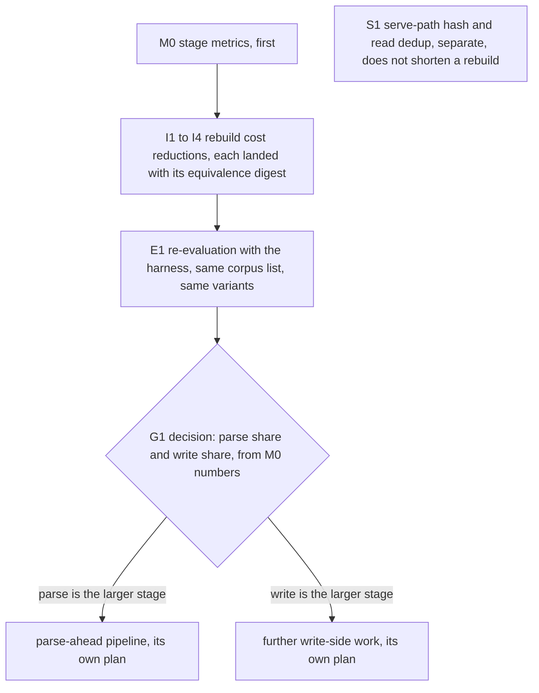

# Plan: pg-claude-code-recorder rebuild speed and per-stage duration metrics

Repo root: `/Volumes/gitrepos/phillipg/nix-agent-support` (public repo: no employer-specific detail). Package:
`packages/pg-claude-code-recorder`. Paths are relative to the package unless they start with `docs/` or `grafana/`.
Earlier plans in this directory: phases 0 to 6 (`2026-11-03-...`, `2026-11-04-...`). Measurement harness and the
study this plan builds on: `docs/ablation/README.md` and `docs/ablation/2026-11-05-insert-cost-results.md`.

## Why

A schema bump makes the old index unreadable, and the operator-run `rebuild` is then the only recovery. The
2026-11-05 rebuild (88,839 files, 17,261,197 records, 12.9 GB index) took 3,065.6 s with the daemon down and nothing
recorded. The operator accepts a rebuild phase after a schema bump; the requirement is that it is much shorter.

What the measurements say, and what they do not:

- The write side is not slow per statement. At 172 microseconds per record (2,969.6 s / 17,261,197) and about 8
  statements per record, the writer spends roughly 12 microseconds per statement.
- On a 180,459-record corpus the largest single write-side cost is the sub-journal of the per-file `SAVEPOINT
bulk_write`, a temp-file `pwrite`: 4.88 s of 23.53 s of CPU samples (21 percent) in the baseline.
- `source.Parse` scans every line about 7 times (validate, decode, a second validate plus map decode inside
  `UnknownKeys`, then again for the content array and each block). The study puts `json.Unmarshal` at 18 percent of
  the baseline's CPU, plus about 14 percent for `checkValid` and `stateInString` frames.
- The two measurements disagree on the parse share: a 30 s thread sample of the real rebuild classified about 28
  percent as parse, while the harness's parse-only variant took 63 percent of the baseline's wall time (57 percent
  best-case). Nothing in the code today can settle this at production scale.
- No metric times the stages of a file's journey (read, parse, insert, commit). The existing rebuild profile has only
  `parse_sec` (everything), `batch_commit_sec`, `fts_optimize_sec`, `index_build_sec` and `checkpoint_sec`.

## Scope

In scope: stage duration metrics (M0); three rebuild cost reductions (I1 to I4); a re-evaluation with the harness
(E1); a decision gate for parallel parsing (G1); and, in a separate section, serve-path duplicate hashing (S1), which
does not shorten a rebuild. Out of scope: an in-place schema migration (the operator accepts a rebuild phase), a
second index file or a swap of old and new while serving, and any change of `SchemaVersion`. No packet MAY change the
schema version or require a rebuild to deploy.

## M0 Stage duration metrics (size M)

The goal is to answer "where does a file's time go" from the daemon's own output, on every rebuild and on the live
path, without a profiler. The stages nest in the code, so the metric is defined as a partition of the time inside
`ParseAll`:

| Step        | What it times                                                                                             | Where it is accumulated                          |
| ----------- | --------------------------------------------------------------------------------------------------------- | ------------------------------------------------ |
| `read`      | `fh.ReadAt` of a chunk (up to 8 MiB) from the copy or archive                                             | parser, in `chunk`                               |
| `parse`     | `src.Parse` for one line: decode, unknown-key detection, field extraction                                 | parser, per line                                 |
| `insert`    | the whole `Parser.insert` for one record, including its statements and the lookups it runs                | parser, per record                               |
| `savepoint` | `SAVEPOINT` plus `RELEASE` of the per-file write (the two `tx.Exec` calls in `bulkWriteLocked`)           | store, under `s.mu`                              |
| `commit`    | the batch commit (today's `batch_commit_sec`)                                                             | store                                            |
| `other`     | the remainder of `ParseAll`: session flush, session stats, bad-line and unknown-key writes, the file loop | computed: `parse_sec` minus the five steps above |

Inside `insert`, a second counter splits the statements by `table` (`records`, `fields`, `texts`, `fts`, `sessions`,
`ext`, `other`): the call sites label their statements (`pstx.Exec` takes only a query string today, so the label is
a new argument, not SQL parsing), and the per-statement clock is sampled for 1 record in 16 and scaled, so the
split is an estimate while `insert` itself is exact.

The label is named `step`, not `stage`, because `stage` already labels `conversations_by_stage` in the metrics
catalogue with different values.

Emission:

1. Counters `step_seconds_total{step}`, `step_calls_total{step}` and `insert_table_seconds_total{table}` as `M*`
   constants in `internal/obs/obs.go` (so `grafana/check-signals-registration.sh` rule R1 sees them), zero-registered
   in `RegisterStandard` with help text in `internal/obs/help.go` (so `TestEveryStandardMetricHasHelp` covers them).
   The enumerated `step` and `table` values are added to the header of `grafana/pg_claude_code_recorder_metrics.txt`.
   Counters, not per-record histograms: a histogram per record costs more than the step it times. The live path adds
   one histogram, `parse_file_duration_seconds`, observed once per file per parse call.
2. Per-step seconds flow through `store.RebuildProfile` (`internal/store/rebuildprofile.go`) and the `rebuildSample`
   in `cmd/pg-claude-code-recorder/feed.go`. `rebuild_progress` prints the delta since the previous sample, and
   `rebuild_profile` the totals, plus `bytes_read`, `lines`, `records` and the rows written per table.
3. `rebuild_profile` lists the five slowest files by total step time (a hash of the path and the size, never the
   path text), so a pathological file shows up without a profiler.
4. A panel in `grafana/pg-claude-code-recorder.json` shows the step split (the dashboard checks, rule R4, require
   every dashboard metric to be catalogued). No new alert: the numbers are for diagnosis, and an alert needs a
   baseline first. ("Claude Agents" is the alert folder, not a dashboard folder.)

Cost rule: timers MUST be a monotonic clock read at step entry and exit, accumulated in a per-worker struct and added
to the registry once per chunk, not once per record. The planning arithmetic: `parse` and `insert` are timed per
record (4 clock reads), the statement split is sampled 1 in 16 (8 statements x 2 reads / 16 = 1 read on average), so
about 5 reads per record. 17,261,197 records x 5 reads x about 40 ns = 3.45 s, or 0.12 percent of the 2,969.6 s parse
phase (3.45 / 2,969.6). The 40 ns is an assumption, so E1 measures it. Acceptance: the harness baseline with timers
on is within 1 percent of the baseline with them off.

Acceptance criteria: a fixture rebuild logs per-step seconds whose sum, with `other`, equals `parse_sec` (by
construction) and whose `other` is under 15 percent on the fixture; the counters appear in `/metrics`; the catalogue
check, the help test and the dashboard check pass; a unit test drives a fake clock through each step.

## I1 `temp_store=MEMORY` for the rebuild's write phase (size S)

Set `PRAGMA temp_store=MEMORY` on the writer connection after `beginRebuild` (as the plan does for `synchronous`), and
reset it to `DEFAULT` before `buildIndexesLocked` in `FinishRebuild`. The reset matters: the writer pool is one
connection (`MaxOpenConns(1)`), and the deferred index builds sort about 17 million `records` rows, which `cache_size`
does not bound. The bulk pragmas apply to the writer connection only (`bulkDSNPragmas` in `internal/store/bulk.go`
feeds `wdsn`), so the live path, the read pool and the checkpoint connection are unaffected.

Planning gain: 6 to 8 percent of wall time (the study's figure: the sub-journal frame fell from 4.9 s to about 0.2 s
and the wall gain was 1.7 to 2.1 s of about 24 to 28 s), which is 184 to 245 s of 3,065.6 s. The harness medians
suggested up to 18 percent but with 3 runs under load; the study says to discount them. Acceptance: E1 reproduces a
gain of at least 4 percent, and reports the rebuild's peak resident size with the reset in place. It does not change
the schema or the file format.

## I2 Decode each record once (size M)

In `internal/source/claudetranscript/transcript.go` and `internal/source/source.go`: one pass per line and per block
that decodes the fields and records unknown keys together, with a small hand key scanner for unknown-key detection
(stdlib `encoding/json` cannot report unknown keys without a second decode or a map copy of large values). Also:
`flatten` checks the first byte (`"` or `[`) before decoding; `ParseTail` drops its `json.Valid` pre-check (safe for
the transcript source because `Unmarshal` errors on invalid JSON and `ParseTail` already returns `false, nil` on a
parse error; the packet MUST confirm each other source does the same before dropping it); `SavedTo` is guarded by
`strings.Contains(body, "/tool-results/")` (equivalent, because the regexp contains that literal). Behavior that
MUST be kept, each pinned by a new fixture line:

- keys match the struct case-insensitively, but unknown-key reporting is exact, so "Type" fills the field and is also
  reported unknown today;
- duplicate keys: a struct decode merges into a nested `message` object, a map decode is last-wins;
- unknown keys are reported as sorted dotted paths, `[]` for arrays, one entry per distinct path;
- a type mismatch makes the line a bad line, while unknown-key detection tolerates null and shape mismatches;
- invalid JSON makes unknown-key detection return nothing.

Planning gain: the study measured `json.Unmarshal` at 18 percent of the baseline's CPU. If a single pass removes 40
to 50 percent of the JSON time, that is 0.18 x 0.40 = 7.2 to 0.18 x 0.50 = 9.0 percent of baseline CPU (the 40 to 50
percent is an estimate; E1 measures it). Existing guards in the unit tier: `TestParseMatchesGolden`,
`TestUnknownKeys*`, `TestBulkRebuildFillsUnknownKeysTotal`. New: a fixture with a duplicate `message` key, a very
large `tool_result`, a null block and a mixed-case key.

## I3 No repeated work per file (size S)

The operator rule: the same query MUST NOT run twice for one unit of work. The safe part is narrow. `ParseAll`
does not query `Generations` itself: `reparseStale` and `parseFiles` do, and `reparseStale` can call `ReparseGen`,
which advances `ParseOffset`. A `Generation` fetched before that is stale, and `parseFiles` gates on
`g.ParseOffset >= g.CopyOffset`, so a cached value would re-parse bytes already parsed. In bulk mode that yields
`records_ident` duplicates, reported only at `FinishRebuild` as `DuplicateRecordsError` with the marker left set.
Therefore this packet MUST:

- pass the `File` that `AllFiles` already returned instead of re-fetching it in `ParseFile`;
- compute `relPath` (a `CurrentPaths` query) and `CopyCommits` once per file, not once per generation;
- stop `parseTombstones` from re-reading a snapshot that `parseVersion` just read;
- keep `Generations` re-read after any `ReparseGen`, and document that `reparseStale` and `parseSnapshots` read
  `parse_state` through `Store.Read()`, which sees committed state only and is blind to the open bulk batch.

The saving is about 3 point queries per file; no gain figure is claimed, and E1 reports it from the `other` step.
Acceptance: a test with a counting store shows one `CurrentPaths` and one `CopyCommits` call per file per
`ParseAll`, and a test where `reparseStale` advances an offset shows no duplicate record.

## I4 Batch the `fields` rows (size S to M)

Insert the `fields` rows of a record (about 6.3 per record: 1,132,782 rows for 180,459 records) with multi-row
statements, up to 500 rows per statement, instead of one prepared statement per row. The harness measured 1.6 to 2.2
microseconds per row prepared against 0.94 to 1.31 with 500 rows per statement: 0.75 to 1.03 s on the corpus, about 3
percent of wall time, or 82 to 113 s of the production run. The current statement is
`ON CONFLICT(rec_id, name_id) DO UPDATE` with last-wins for a repeated name, so a multi-row statement MUST keep
last-wins, MUST keep row order within a record (so `fields` rowids and `name_id` assignment do not change), and the
fixtures MUST include a record with a repeated field name. Acceptance: row-for-row identical tables (E1's digest).

## E1 Re-evaluation with the harness (size S)

After M0 and I1 to I4 land, rerun the harness as `docs/ablation/README.md` describes: the same corpus list (kept
outside the repo, since it names paths under a personal state directory; files may have grown, so the study MUST
re-record the record count), the same variants V0, V1, V2, V6, V9, at least 3 runs each, and the load average. The
study adds a step table from the M0 counters and a before-and-after table for the baseline. It is a dated file in
`docs/ablation/` and a new row in that README's study table.

Output-equivalence digest (a deterministic check, so it lives in the repo as a test): a content digest per table,
computed by natural key, not by allocation order. Raw `records.id`, `texts.id`, `fields.rec_id`, `name_id`,
`session_ref` and the `lk_*` ids are allocation-order artifacts, so the digest keys rows by `(file_id, gen, off,
item)` and joins `field_names`, `sessions` and `lk_*` to their text values. It covers `records`, `fields`, `texts`,
`ext_assistant_usage`, `unknown_keys` and `unknown_keys_total` (I2 changes unknown-key detection). It excludes the
rebuild timestamp, `meta` and `parse_state`, and the fixture uses a fixed journal so `time_ns` is deterministic.
Rows of `ext_*` and `unknown_keys` are digested sorted, because map iteration changes only their rowid order.

- The baseline digest is a committed golden value produced from the pre-change commit, over the small fixture
  (`internal/source/claudetranscript/testdata/lines.jsonl` plus the new I2 and I4 fixture lines). That test is in
  the unit tier: it is fast, single-process and real-tool.
- The larger corpus digest (before against after, over the harness corpus) is an `ablation`-tagged test, run on
  demand and MUST be run before I2 and I4 land, then once more in E1. It is not in the unit gate, so in normal
  builds I2 is protected by the unit-tier digest, `TestParseMatchesGolden` and `TestUnknownKeys*`.

## G1 Decision gate for a parse-ahead pipeline (no code)

The step metrics settle the open question (parse share 28 percent or 57 to 63 percent). If parse is the larger stage,
a single parse goroutine feeding the single writer helps only up to the writer's share; if the writer is the larger
stage, a pipeline is capped at 1 / (write share). Whichever it is, the pipeline MUST hold the parse lock for the
whole `ParseAll` (or revalidate offsets at insert time), add barriers for `reparseStale` and snapshot files, bound
memory by decoded records, and have a differential test of serial against pipelined output with `Drain` injected
mid-rebuild. It gets its own plan after E1.

## S1 Serve-path hash and read dedup (size S to M, does not shorten a rebuild)

The operator rule: a file MUST NOT be hashed more than once within one chunk of work. These findings are from the
audit and are NOT yet verified line by line (for example, `settle.go` already reuses a stored hash at one branch and
hashes only when it is missing), so the packet starts by re-auditing with a counting `Hasher` and `Reader` seam, then
fixes what the counts confirm:

- `internal/settle/settle.go` and `remove.go`: the copy's hash in `checkAppend`, `manifest`, `settleClone` and the
  removal path;
- `internal/settle/doctor.go` and `doctor_rolling.go`: up to three hashes of the copy and the original per file per
  pass, and the journal read three times and decoded twice per run (`FreezeJournal`, `JournalDelta`, `ReplayDump`,
  which is confirmed);
- `internal/copier/copier.go`: the previous snapshot re-read in `InferMissed` and the tail re-read after the bytes
  were just written.

Acceptance: one hash per file per settle and one read per ingest, shown by the counting seam.

## Constraints

- No packet changes `SchemaVersion` or needs a rebuild to deploy. The operator applies the result (an agent MUST NOT
  run `pn workspace apply`).
- The harness and every long test stay out of the unit gate; no mutation testing in any packet.
- Public repo: no employer-specific names, no person's name in code, tests or docs; no tracker ids in the repo.
- Work in a worktree of the repo, never on the canonical clone's primary branch.

## What this plan could not establish

- The production-scale effect of each packet: the harness corpus (542 MB, 180,459 records, largest file 12 MB) never
  spills the page cache, never checkpoints the WAL and has no concurrent readers.
- Run-to-run noise on a loaded host is up to 25 percent; differences under about 5 percent are not resolved.
- Whether the machine's free disk (95 percent used on 2026-11-05) leaves room for a rebuild's temporary growth.
