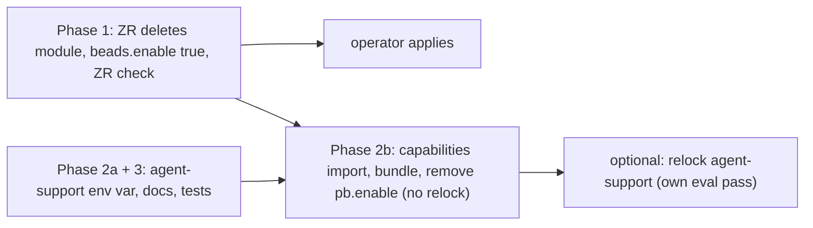

# Plan (v2): one beads switch turns on the beads tool, its plugins and skills, on darwin and NixOS

Status: v3, REVIEWED (three independent passes, no open blocking items), awaiting operator
approval. Date: 2026-11-09.
Repos: nix-agent-support, nix-ziprecruiter, nix-repo-base, nix-personal.

The key words MUST, MUST NOT, SHOULD and MAY are used as in RFC 2119.

## Problem

After the 2026-11-09 02:09 apply on `phillipg-mbp-02`, `~/.claude/settings.json` has
`enabledPlugins` set to `false` for `beads-lifecycle`, `session-wrapup`, `wayfinder-beads`,
`beads-dolt-doctor`, `bead-grooming` and `plan-decompose`. The plugins are installed but
disabled, so a session reports `Unknown skill: beads-lifecycle`.

Mechanism: `nix-agent-support/home/programs/claude-marketplaces/default.nix` (`requiresMet`,
`resolveEnabled`) enables a plugin only when every feature in its manifest `requires` reads
`config.phillipgreenii.programs.<f>.enable or false`. These plugins require `beads`.
`phillipgreenii.programs.beads.enable` is false on the machine because nix-ziprecruiter installs
`bd` and `dolt` through its own `home/programs/beads` module and leaves agent-support's copy
disabled. The gate is correct and stays.

## Decisions (operator, 2026-11-09)

1. `beads.enable` stays its own switch. It does NOT default from `claude-code.enable`. A machine
   turns it on directly or through the `agent-support` bundle.
2. The common wiring (both platforms) is in scope.
3. Listing skill plugins in the beads bundle table (`docs/mod-bundles.json`) is out of scope
   (operator ruling 2026-11-07: skill-only plugins are evaluated in a different session).

Target behavior: Claude Code on AND `beads` on means every beads-family plugin is on.

Opt-out, documented in `CLAUDE.md` (step 8):

- Veto the bundle member: `capabilities.beads.enable = false` (the idiomatic veto).
- Or set `programs.beads.enable = false` (an explicit setting beats the bundle's `mkDefault`).
- Either one also turns off the `pb` plugin and pgd's beads component, and `overrides` cannot turn
  them back on (the gate in `claude-marketplaces/default.nix`).
- Turn off one plugin only: `claude-code.marketplaces.overrides."<plugin>" = false`.
- On a new machine, beads stays OFF unless enabled (decision 1).

## Facts the plan relies on (verified by two reads unless noted)

- nix-ziprecruiter overlays `llm-agentsPkgs.beads` to its v1.3.1 recipe in `machines/default.nix`;
  the common module reads `pkgs.llm-agentsPkgs.beads` and gets that build.
- The ZR `bd` wrapper bakes `BD_BACKUP_ENABLED=0` (`pkgs/beads/package.nix:210`). The common
  module's packages (`llm-agentsPkgs.beads`, `unstable.dolt`) and bash and zsh completions equal the
  ZR module's. Nothing is lost by deleting the ZR module.
- The only machine and only HM importer of the ZR module is `phillipg-mbp-02`, via
  `home/default.nix:7`. ZR has no NixOS machines.
- `homeModules` in agent-support is a plain attrset, not per-system (`flake.nix:19396`); the
  `capabilities` export already exists in the current lock `c2feadc` (unverified here: confirm with
  `git show c2feadc:flake.nix` during implementation). nix-personal's capabilities already evaluate
  on darwin (`darwin/system/default.nix:63`).
- `pb.enable` and pgd `components.beads` default from `beads.enable` only in commit `c9a86343b`,
  which is NOT in `c2feadc`. The bump to current agent-support main pulls 23 commits.
- `session-wrapup` requires `session-mode`, `handoff-create` and `beads`; the first two default from
  `claude-code.enable`, so on the real machine only `beads` is missing.
- CETA and pg-ccaudit are enabled with machine settings in
  `nix-ziprecruiter/home/ziprecruiter/packages/default.nix` (about line 307). They stay explicit.
- `pg-router-drains-wrap` in ZR `flake.nix` reads `darwinConfigurations.phillipg-mbp-02`; it does
  not prove `bd` is in the HM package set, so it is not the acceptance for Phase 1.

## What the bundle turns on that the machine does not set today

`bundles.agent-support.enable = true` (Phase 2) adds, under `account.isHuman = true`:

| Added by                      | Result                                                                                                                                                                                        |
| ----------------------------- | --------------------------------------------------------------------------------------------------------------------------------------------------------------------------------------------- |
| `beads` leaf, `humanFeatures` | `perles` (a beads TUI package)                                                                                                                                                                |
| `worktree-tools` leaf         | `wtnew` (new), plus `wtdone`, `wtaudit` (already set by hand)                                                                                                                                 |
| `claude-code` leaf            | CETA at `mkDefault`; the explicit block in `packages/default.nix` wins                                                                                                                        |
| `pn-workspace` leaf           | `phillipgreenii.pn.enable` at `mkDefault`; confirm the machine's existing `pn` block (about line 1593) sets the same option, else `pnwf`, `wsplan` and the `pn-workspace-rules` plugin appear |
| `pb` leaf                     | `pb` (already set by hand)                                                                                                                                                                    |

Phase 2 MUST produce a before and after list of HM package and plugin names and the operator
reviews the diff before apply. Any unwanted addition is vetoed with `capabilities.<x>.enable =
false` plus a comment.

## Phase 1: fix the outage (nix-ziprecruiter only; no lock bump)

Work in a worktree of nix-ziprecruiter (rule R-4). One commit.

1. Delete `home/programs/beads/default.nix`; remove its import (`home/default.nix:7`).
2. In `machines/phillipg-mbp-02/default.nix` set `phillipgreenii.programs.beads.enable = true`,
   with a comment: the common module owns `bd` and `dolt`, and beads stays off on a machine that
   does not set it.
3. Rewrite stale text: the pg-disk-reclaimer note (about lines 330 to 340), the "machine's own
   wrapped bd" comment (about line 4016), and `docs/beads-ecosystem.md:19` ("Installed via
   `home/programs/beads/default.nix`"). Historical docs under `docs/plans` and `docs/superpowers`
   stay.
4. Keep the `llm-agentsPkgs.beads` overlay and `pkgs/beads`.
5. Keep `pb.enable = true` (removed in Phase 2b, step 12, when the bundle takes over).
6. Add the ZR check `test-agent-skill-plugins-enabled` in THIS phase (it has no lock dependency):
   it reads `darwinConfigurations.phillipg-mbp-02.config.home-manager.users.<user>.phillipgreenii.programs`
   and fails unless
   - `beads.enable == true` and `pb.enable == true` (a missing attribute throws, so it cannot pass
     vacuously);
   - `claude-code.settings.enabledPlugins` has exactly-keyed entries
     `"<plugin>@phillipgreenii-nix-agent-support-marketplace-local"` equal to `true` for all six
     plugins: `beads-lifecycle`, `session-wrapup`, `wayfinder-beads`, `beads-dolt-doctor`,
     `bead-grooming`, `plan-decompose`;
   - liveness: the six exact keys exist, at least six keys end in the agent-support marketplace
     suffix, and `"findev@ziprecruiter"` (set explicitly to `false` in
     `home/ziprecruiter/packages/default.nix`, merged into the same `enabledPlugins`) reads `false`,
     which proves the read is the real merged attrset. No hard-coded total count (it breaks when plugins are added).
     It evaluates the whole darwin system: a pure eval, heavier than a unit test, and covers only this
     one machine (no NixOS or claude-code-off coverage in ZR; stated, accepted).

Acceptance before apply:

- Baseline recorded first: with the module still present, the same eval shows the six plugins
  `false` and `beads.enable` false (this proves the check can fail).
- After the change the check passes, and an eval of
  `home-manager.users.<user>.home.packages` contains `llm-agentsPkgs.beads` and `dolt`.
- Hooks pass on the changed files (`pg-hooks run pre-commit <files>`).
- Build the one check with `nix build .#checks.<system>.test-agent-skill-plugins-enabled` through
  `bgrun` (timeout 600000 on the wait); never a full `nix flake check`.

Operator steps (U-5, operator only): run `pn workspace apply`; start a new Claude session (plugins
load at session start); then `bd --version` resolves and the six plugins are `true` in
`~/.claude/settings.json`.

## Phase 2: common wiring on both platforms

### 2a. nix-agent-support (worktree, one commit)

7. `home/programs/beads/default.nix`: also set `BD_BACKUP_ENABLED = "0"` in
   `home.sessionVariables` beside `BD_JSON_ENVELOPE`, with a comment naming why. Optional
   hardening for machines without the ZR wrapper.
8. `CLAUDE.md` "Fail-closed `requires`": replace "A machine MUST set the feature enables directly
   (the `cetaCutover`-style block)" with: a machine SHOULD enable the `agent-support` bundle or the
   leaf, and explicit feature enables are for features no bundle covers. Add the opt-out and
   cascade rules from the Decisions section above.
9. Fix the stale "capabilities layer is NixOS-only / inert on darwin" wording in
   `home/capabilities/default.nix` (the codeburn comment, about line 44): the framework is HM-based
   and runs on darwin; only the NixOS accounts module that feeds `account.isHuman` is NixOS-only.
10. Tests: see Phase 3 (they land in this same commit).

(The earlier step about confirming `homeModules.capabilities` is exported for darwin is dropped:
`homeModules` is a plain attrset and the export exists.)

### 2b. nix-ziprecruiter

Nothing in this phase needs a relock: the `pb` leaf and the bundle's `pb` membership are already in
the locked revision `c2feadc` (`home/capabilities/default.nix` lines 104 and 132, verified). The
relock (step 14) is an independent, optional, deferrable commit.

11. `darwin/system/default.nix`: import `inputs.phillipgreenii-agent-support.homeModules.capabilities`
    next to the personal one. Confirm at eval that the `capability-framework` path import dedupes
    (both import it by path) and that the flake `follows` graph is consistent.
12. Machine: set `phillipgreenii.bundles.agent-support.enable = true`. Remove the hand enables
    the bundle covers and that do not need the relock: `wtdone.enable`, `wtaudit.enable` and the
    explicit `beads.enable` from Phase 1 and `pb.enable = true` (the bundle sets both at
    `mkDefault`). Apply the before/after name diff and veto what the operator does not want (see
    the table).
13. The Phase 1 ZR check (step 6) stays unchanged and is the guard for the `pb.enable` removal: it
    reads the evaluated `pb.enable`, which the bundle's `pb` leaf sets at `mkDefault`.
14. Optional, independent commit: relock with `nix flake update phillipgreenii-agent-support` (a
    plain `nix flake lock` does NOT bump an already-locked input), or the repo's pn bump flow. The
    bump pulls 23 commits, so it gets its own eval and acceptance pass (re-run
    `test-agent-skill-plugins-enabled` and `pg-router-drains-wrap`). It also brings pgd's
    `components.beads` default; with `beads.enable` true that stays on. Per the operator's standing
    preference the relock MAY be deferred.
15. Update the stale NixOS-only comments in the machine file (about lines 3474, 3528, 3535) and
    `home/default.nix:65` ("the accounts/capabilities model is NixOS-only") to say the capability
    layer is HM-based and works on darwin.

Acceptance: same checks pass; `beads`, `pb`, `wtdone`, `wtaudit` evaluate `enable = true`; no
evaluation conflict between the bundle's `mkDefault true` and explicit settings; the name diff is
reviewed.

## Phase 3: tests (nix-agent-support, same commit as 2a)

16. `tests/bundle-beads-switch.nix` (run by `test-bundle-beads-switch`). The stub currently declares
    only `beads`, `session-mode` and `claude-code` and has only the `pb` plugin; `claude-code.enable`
    is hard-coded true (about line 85). Change it to:
    - build the stub marketplace's plugin list from the REAL `claude-marketplace/*/.claude-plugin/plugin.json`
      files (`builtins.fromJSON (builtins.readFile ...)` over the flake source), carrying `name`,
      `version`, `defaultEnabled`, `requires` into `passthru.plugins`, so `requires` cannot drift.
      Restrict the list to the six beads-family plugins plus `pb` and `session-mode`, or declare
      every feature of all 21 plugins, so an undeclared feature cannot hide a wrong `true`;
    - declare every feature those plugins require (add `handoff-create`; `session-mode` exists),
      with the real defaults from `claude-code.enable` where the real modules have them;
    - parameterise `claude-code.enable`;
    - re-run the existing `pb` cases against the real manifest as a regression.
17. New cases:
    - (a) claude-code on and beads on: the six beads-family plugins resolve `true`;
    - (b) beads off: the six resolve `false`, while a plugin with no `beads` requirement
      (`session-mode`) stays `true`;
    - (c) beads on and `overrides."beads-lifecycle@..." = false`: only that one is `false` (the
      selective negative control);
    - (d) claude-code off: `enabledPlugins == { }` and `home.file == { }`;
    - (e) the chain. This case needs a different harness shape, like `tests/capabilities-eval.nix`:
      the test function takes `mkCapability`, `mkBundle` and `framework` (from nix-repo-base) in
      addition to `{ lib, pkgs }`, and `flake.nix` (the `test-bundle-beads-switch` wiring, about
      line 17594) passes them. It imports `home/capabilities` and sets
      `bundles.agent-support.enable = true` together with the marketplaces module. Every feature the
      leaves set needs ONE declared `enable` option (`claude-code`,
      `claude-extended-tool-approver`, `beads`, `perles`, `wtnew`, `wtdone`, `wtaudit`, `pb`, plus
      `phillipgreenii.pn.enable`); declare each once and do not reuse the `attrsOf submodule` stub
      from `capabilities-eval.nix` where the real `pb` or `pgd` modules or this harness already
      declare `enable`. The six plugins resolve `true`;
    - (f) veto: bundle on and `capabilities.beads.enable = false`: the six resolve `false`. The
      `pb` plugin stays `true` here, because the bundle's separate `pb` leaf still sets
      `pb.enable`; state this in the case so (f) is not read as "pb is off".
      In (e) and (f) the `session-mode` and `handoff-create` stubs MUST default from
      `claude-code.enable` (as the real modules do) so `session-wrapup` resolves `true`; neither case
      needs `account.isHuman` (only `perles` uses it).
      Cases (a), (b), (d) are on/off pairs, not mutation checks; (c) and (f) are the selective
      controls. The harness has no self-test of its own, so add one deliberate-failure case (an
      expected value that must NOT match) that the harness reports, to show failures are caught.
18. These are pure evals and run in seconds (V-4: unit gate). The ZR check in step 6 is heavier and
    runs as a named check only.

## Out of scope

- Skill plugins in `docs/mod-bundles.json` (decision 3).
- System-level modules (`services.beads-dolt-server`, `pg-connector-issue-beads`); a NixOS versus
  darwin parity inventory is follow-up work (file a bead in nix-agent-support).
- CETA and pg-ccaudit enablement.
- A note in `2026-07-24-beads-dolt-no-autostart-design.md` (N1 calls the ZR module "the live one"):
  historical, MAY get a one-line "superseded" note.
- `pn workspace apply` (operator only, U-5).

## Rollback

Phase 1: revert one commit. Phase 2: revert the machine commit and the relock; agent-support
changes are additive.

## Order

## Risks

- No `bd` on PATH if the ZR module is removed without `beads.enable = true`: one commit.
- Bundle side effects (perles, wtnew, pn tools): the name diff and veto path.
- The relock pulls 23 commits: its own acceptance pass, and it MAY be deferred; nothing in the plan
  depends on it.
- Next relock turns off pgd's beads component if `beads.enable` is false: Phase 1 lands first.
