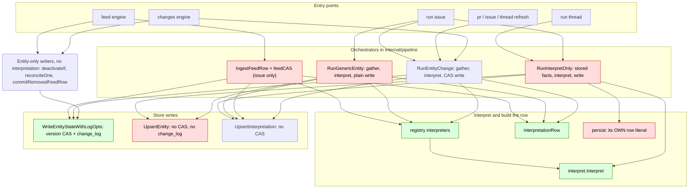
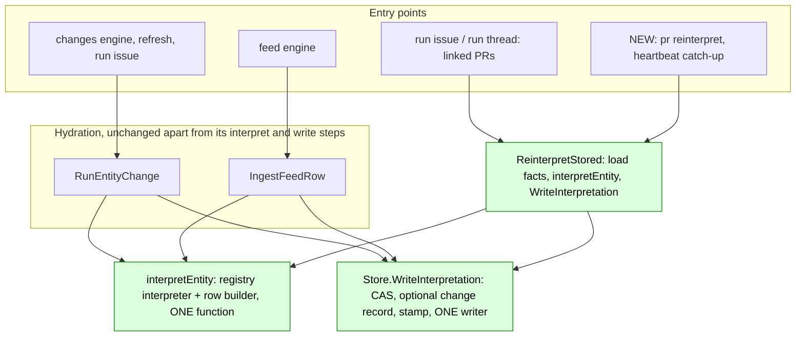

# Plan: one interpretation path for pg-desk, `pg-desk pr reinterpret` and a stamped catch-up

Status: v7, the UNIFIED shape (operator decision, 2026-11-09) with the operator's rulings on the
config digest, the change record and schema 1 folded in. The interpretation write guards on
facts identity, not entity version (an independent review of v5 found that blocking defect).
Supersedes v4, which added a second stored-facts re-interpret path beside the existing one. The
schema-1 removal and the `RunGenericEntity` retirement were independently reviewed (two small
blocking issues, fixed in this version: the retirement's acceptance criterion and the
`run thread` partial write). The regression and coverage plan was reviewed twice (the second
pass found no blocking defects; its text fixes are folded in). Awaiting operator approval.
Date: 2026-11-09.
Repo: `nix-agent-support`, package `packages/pg-desk`.

The key words MUST, MUST NOT, SHOULD and MAY are used as in RFC 2119.

## Problem

pg-desk stores an interpretation row for every entity (who owes the next step, the panel, the
reason). It recomputes a PR's row only when the PR's facts change, because a hydration of an
unchanged PR writes nothing. When a rule in `internal/interpret` changes, the facts of a quiet PR
do not, so its row keeps the answer of the old rule until something else touches the PR.

Observed on 2026-11-09 in one operator store: a rule landed on 2026-11-06 (an open review thread
of the operator's that the author has not answered keeps a team PR with the author). A team PR
with such a thread still showed as waiting on the operator, with an interpretation written on
2026-11-04. Of 112 open PRs, 77 still held interpretations written before the rule. A
`pr refresh` fixed the one PR it was run on only because that PR's facts had also changed.

Nothing in the build, the apply or the daemon tells the store that the rules changed.

## Existing flows and the duplication in them

Reading the code for this plan found that interpretation is already built and written in several
places, and that a stored-facts re-interpretation already exists (`RunInterpretOnly`, used by
`run issue` and `run thread` for linked PRs). Adding a second one would have deepened the
problem. The current shape, traced from the code (how the PR lane's daemon-driven refreshes reach
these entry points was not traced):

| #   | Duplication                                                                                                                                                                                                                                                                                                                                                                                       | In scope                                                                    |
| --- | ------------------------------------------------------------------------------------------------------------------------------------------------------------------------------------------------------------------------------------------------------------------------------------------------------------------------------------------------------------------------------------------------- | --------------------------------------------------------------------------- |
| 1   | Two ways to re-interpret stored facts (`RunInterpretOnly`, and the one v4 added)                                                                                                                                                                                                                                                                                                                  | Yes                                                                         |
| 2   | Two interpretation-row builders (`interpretationRow`, and the literal in `persist`)                                                                                                                                                                                                                                                                                                               | Yes                                                                         |
| 3   | Two ways to call `Interpret` (the registry, and a direct call in `RunInterpretOnly`)                                                                                                                                                                                                                                                                                                              | Yes                                                                         |
| 4   | Three call sites of `UpsertInterpretation`, none version-checked                                                                                                                                                                                                                                                                                                                                  | Yes                                                                         |
| 5   | Two kinds of entity writer: the version-checked `WriteEntityStateWithLogOpts` and `WriteEntityStateWithLog` (called from `entity_change.go`, `feed_row.go` twice, `poll.go` twice) and the unchecked `UpsertEntity` (from `persist` and `persistRaw`). The entity-only callers bump the version without writing an interpretation, which is why the interpretation write guards on facts identity | Yes: `persist`, `persistRaw` and `UpsertEntity` all go (decision 9)         |
| 6   | Two or three hydration orchestrators (`RunEntityChange`, `RunGenericEntity`, the issue feed's `feedCAS` loop)                                                                                                                                                                                                                                                                                     | `RunGenericEntity` goes (decision 9); the feed's commit loop is follow-up B |

## Decisions (operator, 2026-11-09)

1. Re-interpretation recomputes from the facts already stored. It MUST NOT re-pull facts from
   pg-connector or GitHub. A fact change already triggers interpretation, so a re-pull is never
   the way to catch up on a rule change.
2. Only open PRs are re-interpreted. A closed or merged PR keeps its interpretation content and
   only has its stamp updated (so it is not examined again); if it reopens, its facts change
   and the normal path interprets it.
3. The trigger is a stamp on each interpretation row, derived from the build version. The
   version is `main.Version`, a content digest of the package (`0.0.0-<8 hex>`).
4. The command is `pg-desk pr reinterpret`, scoped to `pr`. There is no entity-agnostic
   `pg-desk reinterpret` verb yet.
5. A re-interpretation that changes nothing triggers nothing: no change record. Debug logging of
   re-interpretation is allowed and wanted.
6. **There MUST be one way to hydrate an entity and one way to re-interpret it, with no
   duplicated code.** A detected change runs both (hydrate, then interpret); the new capability
   runs only the re-interpretation. The duplication found above is removed as part of this work
   (operator, in session: "it shouldn't have gotten to this, but we can fix it while doing this
   work"). The one exception is a test-only reference implementation of the pre-refactor row
   builder (see "Regression protection and coverage", technique 2): it lives in a `_test.go`
   file as a measuring stick and is not production code.

7. **The stamp is the build version plus a digest of the loaded config** (see "Stamp").
   Interpretation also depends on configuration that lives outside the package source, and
   (operator, in session) "changing config is a reason to trigger a rerun".
8. A re-interpretation of a `pr` that changes `waiting_on` or `panel` appends one
   `interpretation_changed` change record. It is history only (see "Change record"). (Operator,
   in session: "do it".)
9. **Schema 1 is removed.** (Operator, in session: "migrate everything to schema-2, schema-1
   should be removed.") Every store is migrated to schema 2 with `pg-desk migrate --cutover`
   BEFORE the apply that ships this change (an operator step; see "Rollout"). This change
   writes no schema-1 code path and removes the schema-1 branches of the code it touches: the
   dual interpretation SQL, the unconditional write mode, the schema-1 fallbacks in
   `run issue`, and `RunGenericEntity` with `persistRaw` and `UpsertEntity`. A command that
   needs the new schema refuses a schema-1 store with the existing cutover message. Schema-dual
   code this change does NOT touch stays until follow-up C: `UpsertXref`,
   `pr_annotation_state.go`, `typed_annotation.go`, `GetEntity` and the version-1 ladder
   itself. `status`, `doctor` and `migrate --cutover` keep opening a schema-1 store. Collapsing
   the ladder is follow-up C.

10. **The catch-up runs inside `pg-desk heartbeat`, as a trial, bounded so it cannot cause a
    missed heartbeat.** (Operator, 2026-11-10: "we can try it as part of the heartbeat, but it
    think we need to ensure there is some kind of limit so that heartbeats aren't missed.") The
    limits are in "Catch-up in the heartbeat". The manual `pg-desk pr reinterpret --open` stays
    the unbounded path.

## Non-goals

- An entity-agnostic reinterpret VERB (the shared function is entity-typed, only the command is
  scoped to `pr`).
- Interpreting on read (decoding every PR's facts on every read; one PR's facts can exceed
  100 KB).
- Re-interpreting the content of closed, merged or inactive PRs (their stamp is updated, their
  interpretation is not).
- Any network call, and any change to facts, `hydrated_at`, `list_fp` or the entity version.
- Waking a decider when a re-interpretation flips an owner. The change record is history only.
- A Prometheus counter in this change (see "Observability").
- Merging the issue feed's commit loop with `RunEntityChange`'s (follow-up B) and collapsing the
  schema ladder and the cutover verb (follow-up C).
- Mutation testing (it is an operator-started activity, not a step of this work).

## Design

### The unified interpretation path

Three functions, in `internal/pipeline` and `internal/store`, replace the five ways of
interpreting and the three write sites. Every flow uses them.

1. **`interpretEntity(repo, cfg, clock, entityType, entityID, result gather.GatherResult)`**
   runs the registry interpreter for the entity type and builds the `store.Interpretation` row
   (today's `interpretationRow`, made a function of its arguments instead of a `Pipeline`
   method). It takes the whole `gather.GatherResult` because the interpreters read its
   `Payload`, `AsOf`, `Degraded` and `RemovedState` (`internal/interpret/entity.go`).
   Hydration passes the gathered result; re-interpretation passes
   `GatherResult{Payload: entity.Facts, AsOf: entity.AsOf}`. It is the only caller of
   `interpret.Interpret` and the only builder of an interpretation row. For a PR with a
   non-empty payload it decodes `gather.Facts` exactly as `RunInterpretOnly` does today, so the
   rows are identical.
2. **`Store.WriteInterpretation(row, opts)`** is the only code that writes an interpretation
   row. `opts` carries the expected facts hash (`content_hash`), whether to record a
   change, whether a stamp is required, and the time and origin for the record. It returns
   whether the row was written, skipped (different facts were committed since) and whether the
   decision pair (`approvals.waiting_on`, `panel`) changed.
   - **The guard is facts identity, not entity version.** Several writers bump
     `entity.version` while keeping the same facts and writing no interpretation: a
     deactivation (`internal/changes/poll.go`, `deactivateIf`), a local reconcile
     (`reconcileOne`) and a removed feed row (`commitRemovedFeedRow`). A version check would
     skip a hydration's interpretation write whenever one of them landed between the entity
     commit and the interpretation write, and the row would stay stale: its stamp may already
     be current, so the catch-up would never select it. So the transaction compares
     `entity.content_hash` with the expected hash and skips only when they differ, meaning a
     different set of facts was committed. Identical facts at a higher version are written,
     which is correct. A late, older hydration (hash A) is still skipped once a newer one
     (hash B) has committed, so the race the plan closes stays closed.
   - It runs one transaction: it takes the write
     lock first with a no-op `UPDATE entity SET version = version` (the technique in
     `annotation_kv.go`; a deferred read-then-write transaction otherwise fails at once with
     `SQLITE_BUSY`), returns `ErrNoEntity` if the entity row is missing, skips when the stored
     `content_hash` differs from the expected one, reads the old interpretation row with
     `tx.QueryRow` (never `GetInterpretation`: it uses `s.sql`, and the pool holds ONE
     connection, so using it inside the transaction deadlocks), upserts the new row with the
     handle's stamp, and, when asked and the pair changed, appends one `interpretation_changed`
     record at the entity's current version with `AppendChangeLogTx` (it does not bump the
     entity version).
   - `RequireNewSchema` is called BEFORE `Begin` and fails on a schema-1 store with the
     cutover message. There is one mode and one SQL form: schema 1 is removed (decision 9),
     so there is no unconditional mode and no `sync_error` branch.
   - A sibling `Store.StampInterpretation(id, expectedHash)` updates only the stamp, under the
     same lock-and-check, for rows that are not open. A third small method,
     `Store.MarkInterpretationFailed(id, stamp)`, writes the failed marker (see "Failures")
     WITHOUT an entity check, because it must work when the entity row is gone.
   - It is the only caller of the SQL upsert; `UpsertInterpretation` is no longer called from
     production code outside it.
3. **`ReinterpretStored(ctx, store, cfg, clock, entityType, entityID, opts)`** loads the entity
   row (facts, `content_hash`, `as_of`), calls `interpretEntity` on the stored facts, and calls
   `WriteInterpretation` with the hash it read and the stamp required. It is a free function in
   `internal/pipeline` (not a `Pipeline` method: `pipeline.New` builds a `gather.Gatherer`, and
   the re-interpret path must stay free of any connector dependency). It requires schema 2.

How the existing flows change:

- **`RunEntityChange` and the issue feed row** keep their gather, classify and entity commit.
  They call `interpretEntity` instead of building the row inline, and their post-commit write
  (`finishEntityChange`) calls `WriteInterpretation` with the `content_hash` they just wrote
  (`postCommit` gains the field; the hydration already holds it as `newSnap.ContentHash`, and
  `feedCAS` as the row's hash) and no change record (hydration already records its own kinds).
  If a hydration with different facts committed in between, the late write is skipped, which
  closes a race that exists today; a version bump with the same facts does not skip it. A
  hydration does not require the stamp: a handle without one writes NULL and warns.
- **`RunGenericEntity`, `persistRaw` and `UpsertEntity` are retired** (decision 9). `run issue`'s
  hydration of a Jira issue (`hydrateJiraIssue` in `cmd/pg-desk/run.go`) calls
  `RunGenericEntity` in three places: when no owning backend is configured, on a schema-1 store
  (that one disappears with schema 1), and for a backend that keeps no store. The two
  remaining cases move to `RunEntityChange` with `SnapshotOnly: true`, the call the owning
  case already makes (a snapshot write, no change record, no local record). Task 6 does the
  move behind characterization tests, because `RunGenericEntity` and `RunEntityChange` are not
  byte-for-byte equivalent (see the open question).
- **`RunInterpretOnly`** keeps its argument check, its not-found no-op, its run log and its
  verbose timeline, and its body becomes a call to `ReinterpretStored`. `Pipeline.persist` is
  deleted, so the second row literal, the direct `interpret.Interpret` call and the rewrite of
  the entity row from re-marshaled facts all go.
- **`pr reinterpret` and the heartbeat catch-up** call `ReinterpretStored` (and
  `StampInterpretation` for rows that are not open) in a loop.

Behavior changes, all intended and to be stated in the behavior docs:

1. `run issue` and `run thread` stop rewriting the linked PR's `entity` row (facts, `as_of`) when
   they re-interpret it. Open question 1 asks the implementer to confirm nothing depends on that
   rewrite.
2. A re-interpretation of a `pr` appends an `interpretation_changed` record when the decision
   pair changes. This includes the re-interpretation of a linked PR that `run issue` and `run
thread` request (all three of their `RunInterpretOnly` call sites pass `pr`), so a Jira
   event for a linked PR can now leave an `interpretation_changed` row in that PR's history;
   `run-issue.md` documents it. For `issue` and `thread` entities `ReinterpretStored` records
   nothing, because their consumers read their change log and an unknown kind could be
   misread. No current caller reinterprets those types through it; the generality is kept, and
   the "records only for `pr`" test guards it.
3. A hydration's interpretation write is skipped when different facts were committed since
   (a different `content_hash`), never merely because the entity version moved.
4. Every interpretation row carries the stamp.
5. `run issue` (and every command that writes interpretations) refuses a schema-1 store with the
   cutover message instead of falling back to an unversioned hydration.

### Stamp

The stamp is the string `<main.Version>/<config digest>`.

- The version changes when anything under `packages/pg-desk` or `packages/pg-connector`
  changes (that is the fileset the package hashes), so it over-triggers on a README or test
  edit. That is harmless: a re-run takes seconds and writes no change records when nothing
  differs.
- The config digest covers what `interpret.Interpret` reads from the config. That config is
  rendered outside the package source, so the version alone would miss a config change (for
  example `team_members`) and reproduce the stale-row bug. The digest is the first 8 hex
  characters of a SHA-256 over the canonical JSON of a dedicated PROJECTION struct, not of the
  whole `config.Config`:
  - The projection holds exactly the fields the `interpret` package reads (`SelfLogin`,
    `TeamMembers`, `WatchLabels`, `ApproverAllowlist`, `Urgency`, `CheckInterpreters`,
    `ReviewExemptChecks`, `VerdictGenerations`, `SelfIssueOwner`, `Jira`, `CategoryVocabulary`,
    `DoneStatuses`, `InProgressStatuses`, `Thresholds`, `Keywords` and the nested labels; the
    implementer derives the exact set from the code).
  - It MUST exclude `Config.Path` (the discovered file path, which differs between the
    heartbeat, a router role and the operator's shell and would make the stamp flap on every
    heartbeat) and every field `interpret` does not read, so an unrelated config edit does not
    re-run everything.
  - A guard test type-checks the `interpret` package (`go/types`, through
    `golang.org/x/tools/go/packages`) and collects every selector whose receiver has type
    `*config.Config`, whatever the variable is called (the package copies fields into locals
    and passes sub-structs under other names, so a name-based scan would miss reads). It fails
    when a selected field is missing from the projection, and when a METHOD of `config.Config`
    is called that is not on an allowlist. A stronger alternative the implementer MAY take
    instead: change `Interpret` to take the projection struct itself, with `InterpretPR`
    building it from `*config.Config`, so the compiler enforces the set and the guard test is
    not needed.
- A binary whose version is `dev` (`go run`, a test build) stamps `dev/<digest>`.
- One helper, `Stamp(version, cfg)`, in the package that owns the projection, computes it. The
  version is the package variable `main.Version`, passed in.

### Store

- The `interpretation` table gains a nullable `interp_version TEXT` column. A NULL stamp means
  "written before stamping" and differs from every stamp.
- The store is on schema version 2 and the migration ladder stops at version 1, so the column is
  added by an idempotent ensure-column step run from `Open`, guarded by `pragma table_info`
  (precedent: `ensureIssueFeedStorage` in `internal/store/issue_feed_storage.go`). It MUST NOT
  be a ladder rung (a rung would mis-stamp `user_version`; see `ensureLedgerSettleColumns`). The
  cutover only drops `sync_error` from `interpretation` and does not rebuild it, so the column
  survives it.
- **Readers that never run `Open`.** `OpenReadOnly` and `OpenRaw` do not migrate, and the
  attention plugin, `status`, `doctor`, `freshness`, `links`, `attention` and the focus verbs
  use them. After an apply one of them can run before any `Open` of the new binary. So
  `interpretationSelectList` MUST be guarded the way `issueFeedSelect` is: it selects `NULL`
  when the column is absent, decided from `tableColumns("interpretation")` before the query.
  The new "rows behind" query and the status line follow the same rule. On a store without the
  column, `status` reports `interpretations behind: unknown (column not yet added)`, not 0.
- **Stamping is done by the store, not by each writer.** `Store` gains `SetInterpStamp(string)`
  (held in an `atomic.Pointer`, like `gateScope`, because the handle is shared) and
  `InterpStamp()`. `WriteInterpretation` always writes the handle's stamp; with the unified
  path there is one writer to cover, so no builder can miss it. A handle with no stamp set
  writes NULL, which is correct for read-only tools and tests.
- **Where the stamp is set.** The store-open helpers cannot compute it: `openDeskStore` and
  `openNewSchemaStore` take no config (`openGatedStore` installs its gate with a nil config on
  purpose), and only `openRunStore(cfg)` has one. The stamp is set where the config and the
  store meet: a `pipeline.WithStamp` option (applied by `pipeline.New`, which every production
  writer goes through at `changes.go`, `run.go` and `refresh.go`; in `refresh.go` it belongs
  inside `newRefreshHydrator`, the test seam) calls `SetInterpStamp`, and `heartbeat` and
  `pr reinterpret` set it explicitly after loading the config. In non-test code, a `Pipeline`
  that writes through a handle with no stamp logs one warning per process, to stderr or
  `slog`, never to the pipeline's output writer (which carries structured run-log lines).
- **One source for the stamp.** The behind query, `ReinterpretStored` and `WriteInterpretation`
  all use the handle's stamp, so the stamp compared against and the stamp written cannot
  diverge. The catch-up loop and `ReinterpretStored` pass the `RequireStamp` option, and
  `WriteInterpretation` returns an error when it is set and the handle's stamp is empty,
  because otherwise every row would stay behind and every heartbeat would repeat the work.
  Hydration does not set it: a handle without a stamp writes NULL there
  and the one-per-process warning fires, so a forgotten `WithStamp` is visible without
  failing every hydration.
- **Mixed versions.** An old binary's upsert does not touch the new column, so during a
  rollback or a process that outlived the apply a row can carry old-rule content with a new
  stamp. The residue is documented, and `pr reinterpret <pr>` is the fix for one PR.

### Behind query and the open test

A store method returns the `pr` interpretation rows of the configured repo whose stamp differs
from the handle's stamp (`interp_version IS NOT ?`, so NULL counts as behind), and which are not
marked failed under that stamp (see "Failures"), on a schema-2 store only. The filter and the
repo and type keys (`interpretation` is keyed on repo, entity type and entity id) come from the
small `interpretation` table; the query never selects or filters on `entity.facts`, so a query
that finds nothing costs almost nothing, and there is no `json_extract` over facts in SQL.

**Order and bound.** After an apply the behind set is every `pr` row, and whether a row is open
is known only after its facts (up to 100 KB) are read. To reach the open PRs first, the query
joins `entity` WITHOUT selecting facts and orders by `entity.active DESC, entity.hydrated_at
DESC`. The caller streams one row at a time (it never holds every row's facts at once), and the
heartbeat caps a pass at a fixed number of rows (for example 200) so a pass cannot run out its
timeout inside closed rows; each committed row keeps its progress, so later heartbeats finish.

The open test runs in Go on each returned row, after the row's facts are read, using the same
logic as `classify.prStateOf` (state lower-cased and trimmed, and the `merged` flag folded in;
export or share that function). It does not rely on `entity.active`, which is not a terminal
filter now that the daemon owns PR change detection. Hidden PRs are included (hiding is an
annotation, not part of the interpretation).

A row that is NOT open is not re-interpreted. It gets a stamp-only update through
`StampInterpretation` (no change to its content, no change record), which records "checked at
this stamp". That is what makes the steady state cheap: after one pass at a new stamp, every row
carries it, so the behind set is empty and the next runs read no facts. A closed PR that later
reopens changes its facts, and the normal hydration interprets it. The one exception is
`pr reinterpret <pr>` on a closed PR: the operator asked for that PR explicitly, so it is
re-interpreted in full.

### Failures

A row that fails (its facts do not decode, or its entity is gone) keeps its content and gets the
stamp `<stamp>!failed`, written by `MarkInterpretationFailed`, which checks no entity (the
entity row may be the thing that is gone). That differs from the running stamp, so it is not
stamped as current,
but the behind query skips rows marked failed under the running stamp, so the heartbeat does not
re-read the row every minute. A change of stamp makes it eligible again, and `pr reinterpret
<pr>` retries it at any time. `status` reports the failed count next to the behind count.

### Command

`pg-desk pr reinterpret <pr>` or `pg-desk pr reinterpret --open`. It is a loop over
`ReinterpretStored` and `StampInterpretation`; it contains no interpretation logic of its own.

- Registration follows `head-check` and `force-review`: `typeGroup(entityTypePR).AddCommand(...)`
  from `init()`. `<pr>` resolves through `resolveTypedRef(cfg, "pr", ref)` as `refresh` does.
  Cobra rejects `<pr>` together with `--open`, and neither.
- It requires the new schema (`openNewSchemaStore`) and refuses a schema-1 store with the
  cutover message.
- It MUST be classified in `verbs_schema2_test.go` and listed in
  `share/pg-desk/safe-verbs.txt` (regenerate with `PG_DESK_UPDATE_SAFE_VERBS=1`), or an
  existing test fails.
- Exit codes use `newExitError`: 0 when nothing failed, 1 otherwise.
- `--open` selects the `pr` rows whose stamp differs from the running stamp, re-interprets the
  open ones and stamps the rest. `<pr>` re-interprets that one PR whatever its stamp (so the
  operator can force one), including a closed one.
- `--dry-run` computes and prints what would change and writes nothing, stamps nothing.
- `--verbose` prints one line per PR: old and new `waiting_on`, panel and reason.
- Output: `reinterpreted N open PRs: C changed, U unchanged; M not open (stamped only), S
skipped, F failed`.
- The result counts selected, changed, unchanged, stamped-only, skipped and failed. The
  persisted last-run counts in `meta` are written only when a pass selected at least one row, so
  an idle heartbeat writes nothing.

### Catch-up in the heartbeat

`pg-desk heartbeat` stamps liveness first and treats later steps as best-effort. After those
steps it runs the same loop over the rows behind the running stamp, open PRs first and capped per
pass. Rules:

- It loads the config itself (the heartbeat loads none today; the repo key is the first
  configured repo's remote, as in `pipeline.go`). A config-load failure, an unreadable store or
  a schema-1 store skips the catch-up silently or with one stderr line, and never fails the
  heartbeat.
- It skips when the version is `dev`.
- **The catch-up MUST NOT make a heartbeat late or missed** (operator, 2026-11-10: "we can try it
  as part of the heartbeat, but it think we need to ensure there is some kind of limit so that
  heartbeats aren't missed"). Three limits enforce it, and each is a named constant with a test:
  - **Time budget.** The catch-up runs under a context deadline, `CatchUpBudget`, that MUST be
    well under the `desk-heartbeat` role's cadence (the implementer reads the cadence from the
    deployment repo and sets the default to at most a third of it, recording both numbers in the
    constant's comment). The loop checks the context between rows and stops at the deadline; a
    row in flight finishes or rolls back, never half-writes.
  - **Row cap.** At most `CatchUpMaxRows` rows per pass, open PRs first, so one pass has a known
    ceiling even when the clock is fast. Later heartbeats continue from where it stopped, because
    each committed row carries the new stamp and drops out of the "behind" set.
  - **Order of steps.** Liveness is stamped BEFORE the catch-up and the source-fetch record is
    written AFTER it with the catch-up's error swallowed, so a slow or failing catch-up cannot
    prevent either. The catch-up holds no write lock across rows (one short transaction per row),
    so a concurrent heartbeat or command is not blocked behind it.
  - **Overlap.** If a previous catch-up is still running (a second heartbeat starts while the
    first has not returned), the new one skips the catch-up rather than queueing behind it.
  - **Visibility.** When a pass stops at a limit with rows still behind, it writes the last-run
    counts (including `remaining`) so `pg-desk status` shows the backlog draining.
    The manual `pg-desk pr reinterpret --open` has no row cap and no budget, so it always finishes
    the job.
- When nothing is behind, it costs one query over the small `interpretation` table and reads no
  facts; after one pass at a new stamp, closed and merged rows carry the stamp too, so the
  steady state stays empty.
- **Dependency.** The `desk-heartbeat` role that runs the heartbeat lives in the deployment
  repo, and it has been gated or blocked before. So "no operator step" holds only while that
  role runs. `pr reinterpret --open` is the guaranteed path.

### Change record

`interpretation_changed` is a store-level constant beside `ChangeKindAnnotationChanged`. Checked
against the code: the delivery gate withholds only `issue` rows, `change_log` has no uniqueness
beyond `seq`, no code validates kinds against the classifier catalogue, and `pr history` and
metrics print kinds verbatim. The only `pr` consumer, `annotation-items`, prints only
`annotation_changed` rows and advances past the rest. So the record wakes nothing and is read by
`pr history`. If an owner flip should trigger work, that is a separate decision and needs its own
design. It is appended for `pr` only (see "The unified interpretation path").

### Observability

- Debug logging: one structured debug line per re-interpreted PR (id, old and new `waiting_on`,
  panel, reason, changed or not), off by default.
- `pg-desk status` prints `interpretations behind: N (stamp differs from <stamp>)`, the failed
  count, and the last catch-up's counts and time, persisted in `meta` (heartbeat and CLI
  processes are short-lived and emit no metrics; only `serve` does). A catch-up that keeps
  failing therefore shows up as a number that does not fall.
- No Prometheus counter in this change. If wanted later, it follows the persisted-counter pattern
  `serve` already uses for hydrations (`internal/metrics/changeflow.go`) and needs the metrics
  catalog and its test updated.

## Follow-ups (separate work, not in this change)

- **B. One commit loop for hydration.** The issue feed's `feedCAS` loop and `RunEntityChange`'s
  compare-and-set loop are two implementations of one idea. Evaluate merging them. This removes
  the rest of duplication 6.
- **C. Collapse the schema ladder and the cutover verb.** Once every store is on schema 2 (the
  operator step in "Rollout"), delete the version-1 ladder, create a fresh store directly at
  schema 2, and retire `pg-desk migrate --cutover` and the old-schema branches of `status` and
  `doctor`. Until C lands, a freshly created store starts at schema 1 and needs
  `migrate --cutover` before any writing command runs; this change does not make that worse
  (the writing commands already require schema 2 or refuse), but C should follow promptly.

(The earlier follow-up A, retiring `RunGenericEntity` and `UpsertEntity`, is now part of this
change: decision 9 and task 6.)

## Tasks

Sizes are S, M, L. Each task depends on the one above unless noted. Every code task's
definition of done includes the coverage and regression rules in "Regression protection and
coverage" (coverage report attached, golden files unchanged unless the task names them,
negative controls run, race detector clean).

1. **Behavior docs first (L, about a dozen documents).** In `docs/behavior/pg-desk/`: add `reinterpret.md` (command,
   catch-up, the single interpretation path, invariants in RFC 2119 with the repo's invariant id
   and uuid conventions); update `store-schema.md` (the column, schema 2 as the only supported
   schema, the new kind), `operator-commands.md` (the verb, and the heartbeat contract and exit codes),
   `changes.md` and `consumer.md` (both call `annotation_changed` the one local record kind for
   `pr`; that is no longer true), `history.md`, `interpret.md` (an interpretation is recomputed
   when its facts change or its stamp differs), `freshness.md` if it describes the heartbeat
   steps, `run-issue.md`, `run-thread.md` and `pipeline-run.md` (the linked-PR re-interpretation
   no longer rewrites the entity row and appends a record), `annotation-items.md` if it states
   the kinds, `status` documentation, and the `README.md` index and observability section.
2. **Characterize, then extract `interpretEntity` (three sub-tasks, each L at most).** Follow
   "Regression protection and coverage". The order is fixed:
   - **2a. Seams and coverage raise (L).** Add the behavior-neutral task-2 test seams in their
     own commit (nil by default), then raise the weak SURVIVING functions to 95% or more on
     the statements that remain after tasks 4 to 6, with behavior-asserting tests.
   - **2b. Corpus, goldens, reference (L).** Build the golden corpus (about 25 fixtures for
     the reason tables alone, plus approval, CI, stack, state, degraded, issue, thread and
     legacy cases, each a full `gather.Facts` payload) and capture the byte-exact goldens from
     the unchanged code in the first commit after the seam commit and before any
     behavior-changing commit; add the test-only reference implementation, its differential
     test, the serve-payload and attention goldens, and the tests that pin today's behavior
     for each path (hydration, `RunGenericEntity` in each of its three `run issue` cases, the
     feed row, `RunInterpretOnly`).
   - **2c. Extraction (M).** Extract `interpretEntity` and switch the four callers to it;
     `RunInterpretOnly` temporarily keeps `persist` but builds its row with `interpretEntity`.
     Behavior-preserving; existing tests and every golden stay green and byte-identical.
3. **Store: column, stamp, guarded readers, behind query (L, after 2).** The ensure-column step;
   `SetInterpStamp` and `InterpStamp`, with the existing `UpsertInterpretation` writing the
   handle's stamp (so the row goldens gain the stamp column in THIS task, and
   `WriteInterpretation` later inherits it); the guarded `interpretationSelectList`; the
   behind query; the `Stamp(version, cfg)` helper with its config projection and guard test;
   `pipeline.WithStamp`.
4. **`Store.WriteInterpretation`, `StampInterpretation`, `MarkInterpretationFailed` (L, after
   3).** The lock-first transaction, the facts-hash guard, the in-transaction old-row read, the
   optional change record and the `RequireStamp` option (one mode, schema 2 only). Write the
   deactivation, local-reconcile and removed-row tests FIRST (each must still write the row),
   then switch `finishEntityChange` (adding the hash to `postCommit`) to it, and add the test
   that only it reaches the SQL upsert, and the "every command stamps" test. Both remaining
   direct writers switch in this task, so the allowlist test is true from here on:
   `Pipeline.persist` (it knows `contentHash(factsJSON)`, so it passes the expected hash) and
   `persistRaw` (it passes the hash it just wrote); both therefore require schema 2, which
   makes the version-1 cases of the task 2 characterization tests fail here, so drop or
   re-pin them in this task, not in task 6. Add the test-only seeding helpers (see "Test
   migration" under Tests) in this task, because the many tests that seed with
   `UpsertInterpretation` on a version-1 `OpenForTest` store need them.
5. **`ReinterpretStored`; rewrite `RunInterpretOnly` onto it; delete `persist` (L, after 4).**
   Update the `run issue` and `run thread` tests for the behavior changes. Gate at the top of
   `runRun`, right after `openRunStore(cfg)` (`run.go` ~166-170), with `st.RequireNewSchema()`,
   before any entity-type switch: `run thread` writes permalink and ticket-key xrefs (through
   the still schema-dual `UpsertXref`) BEFORE its final re-interpretation loop, so without the
   early gate a schema-1 store would get xref rows and then an error. Add the refusal test for
   BOTH `run issue` and `run thread`, asserting nothing was written.
6. **Retire `RunGenericEntity`, `persistRaw` and `UpsertEntity` (L plus the test migration,
   after 5).** Move `hydrateJiraIssue`'s two remaining `RunGenericEntity` cases (no owning
   backend, and a backend that keeps no store) to `RunEntityChange` with `SnapshotOnly: true`.
   The two paths are NOT equivalent, so the acceptance criterion is the explicit list below,
   each item decided as a fix or a regression and documented in `run-issue.md`, not "same
   entity row":
   - **`hydrated_at`, `version`, `active`.** `persistRaw` goes through `UpsertEntity`, which
     updates only `facts`, `as_of`, `stale`, `content_hash` and `head_sha`, so a new row stays
     at version 0 with no `hydrated_at`. `RunEntityChange` bumps the version, sets
     `hydrated_at` and forces `active` true. Decide whether a held-but-deactivated issue should
     stay inactive (preserve the stored `active` by passing it) or be reactivated by a
     Jira-keyed `run issue` event; the plan's default is to PRESERVE it, because an event for a
     deactivated issue should not resurrect it. A row at version 0 with no `hydrated_at` is
     treated as never observed by a later hydration; after the move the row is observed, and
     the next hydration classifies a change instead of a first observation. Document it.
   - **Removal.** With `change == removed` and the issue `not_found`, `RunGenericEntity`
     writes the empty facts, an empty interpretation and cleared links;
     `RunEntityChange` returns `NotFound` and writes nothing. Decide whether the stale
     snapshot and links may stay (the entity is deactivated by the changes engine's own removal
     path) and test it.
   - **Degraded.** `RunGenericEntity` writes a degraded row; `RunEntityChange` returns early
     with `res.Degraded` and writes nothing. The two moved call sites MUST handle `res.NotFound`
     and `res.Degraded` as the owning-backend branch already does (`run.go` ~322-325 turns
     `Degraded` into an error); a naive swap would report success with nothing written.
   - **`watched` and `content_hash`.** `RunEntityChange` passes `WriteOptions{Watched:
result.Watched}` (a no-op for backends that state nothing; pin it) and hashes the
     normalized issue payload where `persistRaw` hashed the raw one.
   - **Unchanged, verify only.** Derived links (`extractAndReplace` is `deriveLinks` plus
     `ReplaceDerivedXrefs`), the backend column write afterwards (`run.go` ~306-310), the
     unpinned `GatherEntity` read, no change record and no local record under `SnapshotOnly`.
     Then delete the schema-1 fallback in `hydrateJiraIssue`, the dual interpretation SQL and the
     `sync_error` column read, and the now-unused `UpsertEntity`. Removing
     `Interpretation.SyncError` is not only a store edit: `internal/httpapi/server.go` (~128 and
     ~318-323, the `Errors` panel and `RunsFailed24h`) reads it and `internal/pipeline/entity.go`
     (~169) sets it, so update `serve.md` and the panel. The schema-dual code that is NOT removed
     and stays until follow-up C: `UpsertXref`, `pr_annotation_state.go`, `typed_annotation.go`,
     `GetEntity`.
7. **`pr reinterpret` command (S, after 5).** With the safe-verbs classification and file.
8. **Heartbeat catch-up (S, after 5).** With the time budget, row cap, overlap skip and
   `remaining` count of decision 10, each with its test.
9. **Status line and persisted last-run counts (S, after 3; parallel with 7 and 8).**
10. **File the follow-ups (S).** Beads for follow-ups B and C in the `agent-support` tracker.
11. **Operator precondition, before the apply (S, operator-only).** Confirm every pg-desk store
    on every machine is on schema 2 (`pg-desk status` prints `schema_version`), and run
    `pg-desk migrate --cutover` on any that is not. The plan cannot verify other machines.
12. **Verify bead after apply (S, after the change is applied).** A post-deploy bead gated on
    the change being applied (the `pb-gate-lifecycle` skill), for the one thing a test cannot
    prove: on the operator's machine `pg-desk status` reports 0 behind and a stale PR moved. It
    MUST cite the tests below as the evidence for the logic and MUST NOT re-test the logic. The
    shadow comparison (technique 11) runs BEFORE the apply and its result is cited here.

## Tests

Hermetic Go tests against a real SQLite store in a temp directory (not a mock of the store).
Each is a unit test, so they run in the unit gate. The list below is the functional set; the
coverage floors, the golden corpus, the differential and model-based tests, fault injection,
fuzz seeds and the negative-control table are in "Regression protection and coverage".

- **Test migration (tasks 4 and 6):** about 39 test files open a version-1 store through
  `OpenForTest`, 37 of them seed entities with `UpsertEntity` (61 call sites) and many seed
  interpretations with `UpsertInterpretation` (68 call sites); retiring `UpsertEntity` and the
  dual SQL breaks all of them. Add test-only seeding helpers in `internal/store` (an
  `export_test`-style or `*ForTest` method) that seed an entity and an interpretation row on a
  cut-over store, make `OpenForTest` default to a cut-over store, and add an
  `OpenSchema1ForTest` for the few tests that need version 1 (`cutover_test.go`, the
  dual-schema test, `oldschema_test.go`; the cutover stays until follow-up C and needs a
  version-1 interpretation writer to seed `sync_error`). Size tasks 4, 5 and 6 as L plus this
  migration.
- **Characterization (task 2b):** see technique 1 of "Regression protection and coverage". The
  version-1 case is dropped or re-pinned in task 4, and the `RunGenericEntity` cases are
  re-pinned against `RunEntityChange` in task 6 with the expected-differences list.
- **One path (MUST):** for one fixture PR, the interpretation row written by hydration,
  `run issue`'s linked-PR re-interpretation (`RunInterpretOnly`), `ReinterpretStored` and
  `pr reinterpret` are identical apart from the stamp. After task 6 the Jira-issue path
  (`hydrateJiraIssue` through `RunEntityChange`) joins the comparison for an issue fixture.
- **One writer:** an allowlist test over production code fails when anything other than
  `WriteInterpretation` calls the SQL upsert (tests may use `UpsertInterpretation` directly);
  another fails when `interpret.Interpret` is called from outside `interpretEntity`, and when a
  second `store.Interpretation` row builder appears.
- **`RunInterpretOnly` leaves facts alone:** after it runs, the linked PR's `entity.facts`,
  `as_of` and version are byte-identical to before.
- **Late hydration write is skipped only for different facts:** a hydration whose facts are
  overtaken by a hydration with different facts (a different `content_hash`) before its
  interpretation write is skipped, and the newer row stays (a real second `Store` handle on the
  same path, with an explicit seam like the unexported `beforeWrite` in `entity_change.go`).
- **Version bumps with the same facts still write (MUST):** a deactivation (`deactivateIf`), a
  local reconcile (`reconcileOne`) and a removed feed row (`commitRemovedFeedRow`) that land
  between a hydration's entity commit and its interpretation write each leave the
  interpretation write in effect, and the row is current afterwards. Written before task 4
  switches `finishEntityChange`.
- **Column ensure:** a schema-2 store without the column gets it once; a second `Open` is a
  no-op; the cutover test's interpretation-row comparison still passes with the column present.
- **Readers without the column:** `OpenReadOnly` and `OpenRaw` readers (`ListInterpretations`,
  `GetInterpretation`, the status query, the attention projection) work on a store that lacks
  the column, and `status` reports the behind count as unknown (not 0) there.
- **Schema 1 is refused:** on a schema-1 store `run issue`, `pr reinterpret` and every other
  writing command fail with the cutover message and write nothing; `status`, `doctor` and
  `migrate --cutover` still open it; the heartbeat still stamps liveness and skips the
  catch-up.
- **Every command stamps:** a table test builds the `Pipeline` the way each command does
  (`changes`, `run`, `refresh`, `heartbeat`, `pr reinterpret`) and asserts the store handle
  carries the stamp and that a write through it stamps.
- **Hydration equivalence (MUST):** re-interpreting a freshly hydrated PR from its stored facts
  yields a row identical to the hydration's row, apart from the stamp.
- **Catch-up changes a stale row:** seed an open team PR whose facts carry an operator-started
  thread the author has not answered and whose row carries the OLD decision and a different
  stamp; `pr reinterpret` flips `waiting_on` to the author, updates the panel, stamps, and
  appends exactly one `interpretation_changed` record with the entity version unchanged.
- **Unchanged is silent:** a stale-stamp row whose decision does not change is written and
  stamped and appends no change record; a second run selects nothing. A row whose pair is
  unchanged but whose other columns changed is written and stamped, with no record.
- **Records only for `pr`:** re-interpreting an `issue` or `thread` entity appends no record.
- **Open predicate:** an `OPEN` or padded state is included; a row with state open and
  `merged` true is not open; a closed or merged PR keeps its interpretation content and gets
  only its stamp updated; `pr reinterpret <pr>` on a closed PR re-interprets it in full; a
  hidden open PR is included; a row of another repo is excluded.
- **Compare-and-set with a real second handle:** a second `Store` hydrates the PR between the
  read and the write; the PR is skipped and counted, its row is not overwritten, and the
  lock-first step never returns `SQLITE_BUSY`.
- **No deadlock, in-transaction reads:** `WriteInterpretation` runs under the real
  one-connection handle with the seam hook without deadlocking, reads the old row inside the
  transaction, returns `ErrNoEntity` for a missing entity and calls `RequireNewSchema` before
  `Begin`.
- **Failure isolation:** a PR whose facts do not decode keeps its old content, is marked failed
  under the stamp, is counted failed, the others are processed, and the command exits 1. A
  second pass skips it and reads none of its facts; `pr reinterpret <pr>` retries it; a new
  stamp makes it eligible again; `status` reports the failed count.
- **Steady state:** with many closed and merged rows behind a stamp, one pass stamps them
  without re-interpreting; a second run selects nothing and reads no facts (assert through a
  query counter or a facts-read seam).
- **Open PRs first, bounded passes:** with many closed rows and a few open ones all behind, one
  capped pass reaches the open PRs first, rows are streamed one at a time, and repeated passes
  converge.
- **Heartbeat limits (decision 10):** with a backlog larger than `CatchUpMaxRows` the pass stops at
  the cap; with an injected slow row the pass stops at `CatchUpBudget` and the heartbeat still
  stamps liveness and records source fetches; a second concurrent catch-up skips; the manual
  command ignores both limits.
- **Empty stamp:** with `RequireStamp` (the catch-up loop, `ReinterpretStored`)
  `WriteInterpretation` returns an error on a handle with no stamp; a hydration through such a
  handle still writes (a NULL stamp) and warns once per process.
- **Failed marker without an entity:** a row whose entity row is gone is marked failed under the
  stamp (no entity check) and is not selected again by the next pass.
- **Stamp trigger:** rows stamped A are touched at stamp B and not at A; a changed config digest
  changes the stamp; `dev` is skipped by the heartbeat and not by `--open`.
- **Digest stability:** two loads of identical YAML from different file paths give the same
  digest; a change to a field `interpret` does not read leaves it unchanged; a change to one it
  reads changes it; the `go/types` guard test fails when `interpret` reads a config field, or
  calls a non-allowlisted `config.Config` method, outside the projection (including through a
  differently named variable).
- **Dry run:** `--open --dry-run` writes nothing and stamps nothing, and selects and counts the
  same set as a real run.
- **Command shape:** `<pr>` with `--open` and neither are rejected; a schema-1 store is refused
  with the cutover message; `pr reinterpret` is classified in `verbs_schema2_test.go` and
  present in the regenerated `safe-verbs.txt`.
- **No network:** the command works with no `pg-connector` on `PATH`, and `ReinterpretStored`'s
  package dependencies include no connector or gatherer path.
- **Heartbeat:** a failing catch-up, an unreadable store, a missing config and a schema-1 store
  each still stamp liveness and exit 0, and the timeout bounds the catch-up.
- **Status line and last-run line:** they render, read through `OpenReadOnly` on a store that
  lacks the `meta` keys without error, and an idle pass writes no `meta` row.
- **Negative controls:** technique 10 of "Regression protection and coverage" lists the
  hand-applied mutants and the test each must fail.

## Regression protection and coverage

The refactor changes how every interpretation is built and written, so the test plan is a
protection plan: a regression MUST fail a test before it reaches the operator. Everything below
is a unit-tier test (fast, hermetic, a real SQLite store; operator-data checks are the one
manual exception, item 11). It follows the repo's rules: tests live in the repo, a mutation tool
is never part of this work (a hand-applied mutant as a negative control is fine), and a test
that spans processes or a daemon stays out of the unit gate.

### Baseline, measured 2026-11-09

`go test -cover` at the plan's base (the worktree's branch point), statement coverage:

| Package              | Coverage |
| -------------------- | -------- |
| `internal/pipeline`  | 82.4%    |
| `internal/store`     | 79.0%    |
| `internal/interpret` | 97.8%    |
| `internal/changes`   | 86.6%    |
| `internal/classify`  | 95.4%    |
| `internal/httpapi`   | 86.7%    |
| `cmd/pg-desk`        | 87.1%    |

The functions this change rewrites or moves are the weakest ones, which is the regression risk:

| Function                                      | Coverage     |
| --------------------------------------------- | ------------ |
| `finishEntityChange`                          | 62.5%        |
| `reconcileOne` (`changes/poll.go`)            | 61.5%        |
| `GetInterpretation`                           | 63.6%        |
| `feedCAS`                                     | 64.7%        |
| `commitRemovedFeedRow`                        | 66.7%        |
| `sweep`, `reconcileLocal` (`changes/poll.go`) | 66.7%, 68.8% |
| `persist`                                     | 67.9%        |
| `RunInterpretOnly`                            | 70.6%        |
| `persistRaw`                                  | 72.7%        |
| `runThread`                                   | 72.7%        |
| `interpretationRow`                           | 73.9%        |
| `hydrateJiraIssue`                            | 75.0%        |
| `deactivateIf`                                | 75.0%        |
| `UpsertInterpretation`                        | 81.8%        |
| `RunGenericEntity`                            | 83.3%        |

### Rules

1. **Raise before you refactor (MUST).** Before any behavior-changing commit, each function in
   the table above that SURVIVES the change reaches at least 95% statement coverage through
   characterization tests that assert behavior, not just execution. The target is measured on
   the statements that REMAIN after tasks 4 to 6 (`go tool cover -func` on the function with
   its to-be-deleted branches excluded), so no test is written for behavior decision 9
   removes. Each function has one disposition:

   | Function                                                                                             | Disposition                                                                                                                                                                     |
   | ---------------------------------------------------------------------------------------------------- | ------------------------------------------------------------------------------------------------------------------------------------------------------------------------------- |
   | `finishEntityChange`, `reconcileOne`, `deactivateIf`, `commitRemovedFeedRow`, `feedCAS`, `runThread` | survives: 95% before                                                                                                                                                            |
   | `RunInterpretOnly`                                                                                   | survives as a wrapper: 95% before, including its store-failure branch (needs a seam); its error branches then move into `ReinterpretStored`                                     |
   | `hydrateJiraIssue`                                                                                   | heavily changed survivor: 95% before on every branch except the old-schema fallback (the owning-backend, no-store-backend, no-owning-backend, resolve-error and degraded paths) |
   | `UpsertInterpretation`, `GetInterpretation`                                                          | survive without their schema-1 branches: 95% on the v2 statements                                                                                                               |
   | `interpretationRow`                                                                                  | replaced by `interpretEntity`: pinned by the goldens and the differential, no number                                                                                            |
   | `persist`, `persistRaw`, `RunGenericEntity`                                                          | deleted: pinned by the goldens and the differential, no number                                                                                                                  |
   | `sweep`, `reconcileLocal`                                                                            | not touched by this change: out of scope, no raise                                                                                                                              |

   Some floors need a minimal test seam (for example `finishEntityChange`'s
   `appendLocalRecords` failure, and a store-write failure in `RunInterpretOnly`); add the
   seams that exist in today's code in a separate behavior-neutral commit first (task 2a),
   named as test seams (nil by default). The seams for the NEW functions ship with the tasks
   that create them (technique 6).

2. **Coverage floor (MUST).** Each new function in production code reaches 100% statement
   coverage, using the fault seams in technique 6 for error branches. The only exception is an
   error return of a call that cannot fail for the types passed (`json.Marshal` of the fixed
   interpretation structs in `interpretEntity`, for example); each is listed in the task
   report. Each changed surviving function ends at 95% or more. For each touched package, the
   number of covered statements in the code that survives MUST NOT decrease (a package
   percentage can fall merely because well-covered code is deleted, so the percentage in the
   baseline table is a reference, not the gate). Every task's report attaches `go test -cover`
   for the touched packages before and after, and `go tool cover -func` for the new and
   changed functions.
3. **No weakened tests (MUST).** The test migration changes seeding only. A removed or loosened
   assertion in an existing test is a defect unless the plan lists the behavior change that
   justifies it (the "Behavior changes" list); the reviewer checks the test diff for removed
   assertions.
4. **Goldens change only where a task names them (MUST).** Task 2 is entirely
   behavior-preserving. Tasks 4 to 6 each contain behavior-preserving moves AND the behavior
   changes in the "Behavior changes" list; the moves keep every golden byte-identical, and each
   task updates only the goldens in this table:

   | Task    | Goldens it MAY update                                                                                                                                |
   | ------- | ---------------------------------------------------------------------------------------------------------------------------------------------------- |
   | 2       | none (2b creates them from unchanged code)                                                                                                           |
   | 3       | the interpretation-row goldens gain the stamp column (the existing upsert writes the handle's stamp); the serve payload golden gains nothing visible |
   | 4       | none: its one behavior change (a late write skipped only for different facts) and the schema-2 requirement are covered by tests, not goldens         |
   | 5       | the `run issue` and `run thread` goldens (no entity-row rewrite, the new record for `pr`)                                                            |
   | 6       | the Jira-case goldens, only for the differences the task lists; the serve payload and its `Errors` panel golden (`sync_error` removed)               |
   | 7, 8, 9 | the new command, heartbeat and status goldens they create                                                                                            |

   The row golden is a column-by-column rendering of the interpretation, not a dump of the Go
   struct, and it leaves out `SyncError` from task 2b on, so removing the field in task 6
   changes no row golden.

5. **Race detector, within the unit-tier budget (MUST).** `pg-desk-go-tests` already runs
   under `-race` (the builder's `enableRace` default), and that gate is already slow, so the
   plan's added cost is bounded and measured: the default size of every new randomized or
   concurrent test is small (the model-based test runs 20 to 50 seeds, the goroutine stress
   test about 100 operations), a larger sweep is on demand through an environment variable
   (`PG_DESK_MODEL_SEEDS`), and every task report states how many seconds the new tests add to
   each package under `-race`. A package test timeout MUST NOT be raised to fit them. Locally,
   run `nice -n 10 go test -p 4 -race` for `internal/pipeline`, `internal/store`,
   `internal/changes` and `cmd/pg-desk` in the background with an explicit timeout.

### Techniques

1. **Golden corpus.** A committed corpus of synthetic facts under `testdata`: one fixture for
   every reason code in `OwnReasons` and `TeamReasons`, and for every approval state, CI state,
   draft, conflict, stack parent, stale review, in-progress review, unanswered thread, bot
   verdict, hidden or wip annotation, open, closed and merged state, a degraded read, an issue
   and a thread, plus rows in the legacy shape (an `approvals` blob without `waiting_on`, a
   NULL stamp). This is NEW work, not reuse: `internal/interpret/waiting_test.go` already
   reflects over `OwnReasons` and `TeamReasons`, but it builds internal inputs for
   `decideWaitingOn`, and there is no `testdata` in `internal/interpret` or
   `internal/pipeline`; the corpus needs a full `gather.Facts` payload per reason, run through
   `Interpret`, and is sized into task 2. Reuse `cmd/pg-desk/testdata` and
   `internal/store/testdata/pre-cutover-store.sqlite` where they fit. A test reflects over the
   two reason tables and fails when a reason code has no fixture, so adding a rule requires
   adding a fixture. Identifiers in the fixtures MUST come from the allowlist the
   `identifier-allowlist` hook enforces (`scripts/identifier-allowlists/pg-desk.txt`; today
   `teammate`, `review-bot`, `alice-dev` and the operator's identity), or each new placeholder
   gets one safe line added to that file. Every golden test uses `interpret.FixedClock` and
   `pipeline.WithClock`.
   - **Byte-exact goldens.** The golden file holds the complete `store.Interpretation` row for
     each fixture and path, compared as exact bytes (field order, whitespace, no map-order
     dependence). The module's existing `assertGolden` (`cmd/pg-desk/show_typed_test.go`,
     refreshed with `PG_DESK_UPDATE_GOLDEN=1`) compares DECODED JSON and cannot see key order,
     so the row goldens use a byte-exact helper and reuse the same update variable.
   - **`waiting_on_me`.** The legacy `approvals.waiting_on_me` boolean (set from `facts.Deps`) is
     still serialized and reaches the served rows; keep a fixture with `Deps` so its removal or
     reordering is caught.
   - Captured from the unchanged code in the first commit that follows task 2a's seam commit
     and precedes any behavior-changing commit, and reviewed. The row rendering is
     column-by-column (see rule 4), excluding `SyncError`.
2. **Differential test against a test-only reference.** A reference implementation of the
   pre-refactor decode step and row builder lives in a `_test.go` file, with a comment saying
   why it exists. It returns its own LOCAL struct of column strings (not
   `store.Interpretation`), and the test compares that with the new row column by column over
   the whole corpus, so later changes to the store struct (the stamp field, the removal of
   `SyncError`) need no edit to the reference. The production-code scans in the one-writer
   test (the SQL-upsert caller scan, the `interpret.Interpret` call scan and the second
   row-builder scan) MUST skip every `_test.go` file, including external `_test` packages and
   `testdata`, or the reference would fail all three. No old code stays in production
   (decision 6); the byte-exact goldens are the durable guard after the refactor.
3. **Path-equivalence matrix.** Corpus times path: hydration, the feed row, `RunInterpretOnly`,
   `ReinterpretStored`, `pr reinterpret` and, after task 6, `hydrateJiraIssue`, each asserted
   identical to the golden row. `Interpretation.AsOf` comes from the injected clock while
   `entity.as_of` comes from the facts, so a re-interpretation legitimately produces a
   different `interpretation.as_of` than a hydration; the matrix holds the clock fixed and a
   separate assertion states that a re-interpretation changes `interpretation.as_of` and never
   `entity.as_of`.
4. **Model-based invariant test.** Seeded random interleavings (25 seeds from a fixed seed
   list by default, so a failure reproduces, the failing seed printed; `PG_DESK_MODEL_SEEDS`
   raises it to 500 or more for an on-demand sweep, read as the module's other `PG_DESK_*`
   test variables are, with an unset variable falling back to the default) of hydrate with
   facts A or B, deactivate, local
   reconcile, removed feed row, reinterpret, catch-up, stamp change and config change, over a
   few PRs on a real store. At quiescence, for every PR: the interpretation row equals
   `interpretEntity` over the stored facts, the stamp is current after a catch-up, reinterpret
   never changed `entity.facts` or the entity version, and `change_log` holds an
   `interpretation_changed` row exactly where the decision pair changed. This is the test that
   would have caught the stale-row bug the review found.
5. **Fuzz targets.** `FuzzInterpretEntityFacts` (arbitrary bytes as stored facts: no panic, and
   on an error no write) and `FuzzStamp` (a reordered or whitespace-different config gives the
   same digest). Go runs the seed corpus as ordinary tests, so they sit in the unit gate;
   a longer fuzz run is a manual step, not a gate.
6. **Fault injection, with new seams.** The existing seams do not reach the new code:
   `SetBetweenBumpAndAppendHook` fires only inside `writeEntity`, `annotationTx` has its own
   hook, and the pipeline's unexported `beforeWrite` sits before the entity write, so it cannot
   place a competing write between the entity commit and the interpretation write. The plan
   therefore adds NEW seams, each nil by default and named as a test seam. The seams for
   today's code (`finishEntityChange` and its `appendLocalRecords` call, the gap between the
   entity commit and `finishEntityChange`, and `RunInterpretOnly`'s store write) ship in task
   2a; the seams for the new functions ship with tasks 4 and 5. They are: a store-level hook at
   each step of `WriteInterpretation`, `StampInterpretation` and `MarkInterpretationFailed`
   (begin, lock, read old row, upsert, append record, commit), a pipeline seam between the
   entity commit and `finishEntityChange` (and inside it), and one between the facts read and
   the write in `ReinterpretStored`, plus injected failures for the entity read, the
   interpret step, context cancel and the heartbeat timeout. After an injected failure at any
   step, a full dump of every table equals the dump from before the call (nothing
   half-written), and the loop reports the failure and continues.
7. **Legacy store.** A schema-2 legacy store (rows with `approvals` lacking `waiting_on` and
   NULL stamps) does not exist and is GENERATED: a committed SQL script, run at test time into
   a temp database, written to mirror what the pre-change code stored. The existing
   `internal/store/testdata/pre-cutover-store.sqlite` (a binary version-1 file) serves the
   schema-1 refusal cases. The generated store is loaded into a temp database: it opens, the
   column is added, every reader (`status`, `show`, `serve`'s handler, the attention
   projection, `pr history`) works on a legacy row, and the catch-up converts the legacy rows.
8. **CLI contract goldens.** The text, `--json`, `--verbose` and `--dry-run` output of `pr
reinterpret`, the `status` lines (including "unknown" and the failed count) and the
   heartbeat stderr lines are golden files (the existing `assertGolden` and
   `PG_DESK_UPDATE_GOLDEN` pattern), and the commands run in process the way the existing
   command tests do (`rootCmd.SetArgs` plus `ExecuteContext` with the `deskConfigLoad` and
   `deskStoreOpen` seams) over a real store, with no connector.
9. **Docs-to-tests conformance.** Each invariant id in the new `reinterpret.md` appears in at
   least one test name or comment, and a test enumerates the ids in that document and fails
   when one has no test.
10. **Hand-applied negative controls.** For each mutant below, apply it by hand, run the named
    test, confirm it fails, revert. Record the results in the task report. This is NOT a
    mutation-tool run.

    | Mutant                                                               | Test that must fail                                 |
    | -------------------------------------------------------------------- | --------------------------------------------------- |
    | Guard the interpretation write on entity version, not `content_hash` | version bumps with the same facts still write       |
    | A hydration skips stamping                                           | every command stamps; every path stamps             |
    | Compare only `panel` for the changed decision                        | catch-up changes a stale row                        |
    | Append the record for an `issue` entity                              | records only for `pr`                               |
    | Drop the facts-hash check                                            | late hydration write is skipped for different facts |
    | `StampInterpretation` also rewrites content                          | closed and merged keep content                      |
    | Reinterpret bumps the entity version                                 | model-based invariant                               |
    | The behind query selects rows marked failed                          | failure isolation, steady state                     |
    | The config digest includes `Config.Path`                             | digest stability                                    |
    | `RequireNewSchema` after `Begin`                                     | no deadlock, schema 1 refused                       |
    | A closed PR re-interpreted in full by `--open`                       | open predicate                                      |
    | `RunInterpretOnly` rewrites the entity row again                     | `RunInterpretOnly` leaves facts alone               |

11. **Shadow comparison on a copy of the operator's real store (manual, before the apply).**
    Copy the store file, run the new binary's `pr reinterpret --open --dry-run --verbose`
    against the copy, and classify every row it would change against the rule changes since the
    row was written: zero unexplained differences. A second pass compares the new binary's
    interpretation of each stored PR with the old binary's stored row for the rows written after
    the last rule change; they MUST match. It uses the operator's data, so it is not committed
    and not in the unit gate; the post-deploy verify bead cites it.
12. **Serve payload golden.** `internal/httpapi/server.go` merges the whole `Approvals` JSON into
    each served row and builds the `Errors` panel from `sync_error`. A golden of the served
    payload for every corpus row, taken before and compared after each task, catches a change
    to a served field; task 6 updates it only for the removed `sync_error`.
13. **Clock guard.** A test fails when any code under `internal/interpret` calls `time.Now`
    other than through `SystemClock`, so a golden cannot become time-dependent.
14. **Contention across handles.** Besides the sequential model-based test: a variant that
    alternates two `Store` handles on one file and injects the competing hydration INSIDE
    `ReinterpretStored` between the facts read and the write, at random points (the new seam);
    and a small goroutine stress test (two handles, about 100 operations) under `-race`
    asserting no `SQLITE_BUSY` surfaces (the busy timeout is 5 seconds). A heartbeat running
    during a hydration in another process is this case. The goroutines join before any
    assertion, and `SetSynchronousForTests` (a package global with no locking) is set once
    before they start; `OpenForTest` is not called concurrently.
15. **New change kind in other readers.** Smoke tests that `pr history`, `doctor`, the changes
    envelope and the change-flow metrics (which label by kind) render a store holding
    `interpretation_changed` rows.
16. **Attention and focus over the corpus.** An `attention list` and `attention explain` golden
    over the corpus rows, including a legacy `approvals` blob without `waiting_on` (the
    `Approvals.WaitingOn == ""` fallback in `internal/attention/project.go`).
17. **Config changes show in rows.** Two different `interpret`-read configs over the same
    fixtures give two different goldens, so a config regression shows in a row and not only in
    the stamp.
18. **Mixed versions.** A test that an old-style upsert (no stamp column written) over a row
    stamped by the new binary leaves it detectable and fixable: `pr reinterpret <pr>` restamps
    it. The plan documents this residue; this tests the documented fix.

### Which task creates which technique

A technique can only exist once the code it exercises does, so each has an owner:

| Technique                                                                                                                                            | Created in                                                             |
| ---------------------------------------------------------------------------------------------------------------------------------------------------- | ---------------------------------------------------------------------- |
| 1 golden corpus, byte-exact goldens; 2 reference and differential; 12 serve golden; 13 clock guard; 16 attention goldens; `FuzzInterpretEntityFacts` | 2b                                                                     |
| 6 seams for today's code (`finishEntityChange`, `RunInterpretOnly` store write)                                                                      | 2a                                                                     |
| 9 docs-to-tests conformance                                                                                                                          | after task 1, enforced from the first task that adds an invariant test |
| `FuzzStamp`; 17 config changes show in rows                                                                                                          | 3                                                                      |
| 6 seams for `WriteInterpretation`, `StampInterpretation`, `MarkInterpretationFailed`; 15 other readers render the new kind; 7 legacy store           | 4                                                                      |
| 3 path-equivalence matrix; 4 model-based test; 14 contention; 6 seams for `ReinterpretStored`; 18 mixed versions                                     | 5                                                                      |
| 8 CLI contract goldens                                                                                                                               | 7, 8 and 9 (one per command)                                           |
| 10 negative controls                                                                                                                                 | each task runs the rows whose code it creates                          |
| 11 shadow comparison                                                                                                                                 | after task 9, before the apply                                         |

## Rollout

**Before the apply (operator, task 11):** every pg-desk store must be on schema 2. `pg-desk
status` prints `schema_version`; run `pg-desk migrate --cutover` on any store that is not. After
this change a binary refuses a schema-1 store for every writing command. Until follow-up C
lands, `Open` still creates a fresh store at schema 1, so the first writing command on a new
machine refuses until `migrate --cutover` has run.

The change lands through the normal flow. On the first heartbeat after the apply, the daemon
re-interprets the open PRs behind the new stamp, with no operator step, as long as the
`desk-heartbeat` role runs. `pg-desk pr reinterpret --open` is the manual path, and `--dry-run`
shows what a rule change would do before an apply.

Rule authors need no step: a change to the pg-desk source or to the interpretation-relevant
config changes the stamp, so the next catch-up runs. An unrelated change costs one extra
re-interpretation of the open PRs, which writes no change records when nothing differs.

## Open questions

1. **Resolved by review, to re-confirm at task 5:** deleting `persist`'s entity rewrite changes
   nothing a reader depends on. `persist` re-marshals the decoded `gather.Facts` into
   `entity.facts`, sets `as_of` and `content_hash` from it, and never touches `version`,
   `hydrated_at`, `active`, `list_fp` or `first_seen_at`. The readers of `entity.facts` and
   `as_of` (`show_typed.go`, `open.go`, `open_typed.go`, `history.go`, `doctor_changeflow.go`,
   `attention/project.go`) read facts, not the hash. The rewrite also left `content_hash`
   disagreeing with the raw payload the hydration stored, so removing it removes spurious
   differences.
2. **Implementer, at task 6:** `RunGenericEntity` and `RunEntityChange` differ in the ways
   task 6 lists (`hydrated_at`, `version`, `active`, removal, degraded results, `watched`,
   `content_hash`). Pin each `hydrateJiraIssue` case with a characterization test first, and
   decide each difference as a fix or a regression. The plan's default for `active` is to
   preserve the stored value.

Decided by the operator on 2026-11-09 and no longer open: the config digest is in the stamp
(decision 7), the `interpretation_changed` record is kept (decision 8), and schema 1 is removed
(decision 9).
