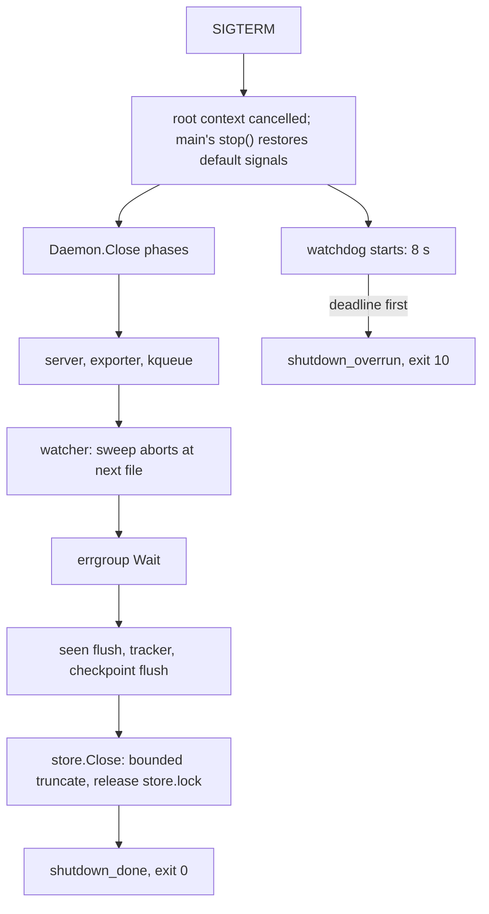
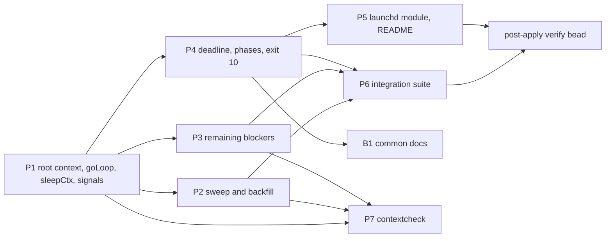

# Plan: bounded shutdown for pg-claude-code-recorder

Roots (absolute): `/Volumes/gitrepos/phillipg/nix-agent-support` (the recorder; package root
`/Volumes/gitrepos/phillipg/nix-agent-support/packages/pg-claude-code-recorder`, called PKG; paths are relative to PKG
unless they start with a repo name) and `/Volumes/gitrepos/phillipg/nix-repo-base` (docs, lint config). Public repos: no
employer-specific detail, no bead ids in any file this plan produces.

This is the final plan after five drafts and three review rounds (see "Review record"). Scope that served no goal was
cut; correctness errors found by review were fixed.

Operator rulings (Phillip, 2026-11-09, verbatim):

- "i don't want to hold up the apply process by adding a multiminute wait process, lets focus on getting shutdown to work
  faster."
- "if there are tools and libraries which are best practices for this capability, then add them. i don't want to maintain
  code which is better suited by a common library. the sweeper shouldn't be taking that long, but that can be handled in
  another session, lets focus on this proper shutdown now."
- "i don't care the phasing or ordering, implementing this will be a top priority, only split on phases if there is a
  benefit of doing a partial apply for some kind of e2e testing."; on the replay gap: "i'm not worried about the resume,
  i'm worried it is taking so long to run the sweep, but that is a for another session"; on tooling: "if their tools are
  good, we should use them for any go app."

## Why

A `pn workspace apply` that changes the recorder's job restarts it; the new instance fails with `state directory is held
by another recorder instance` and crash-loops, so the apply reports `✗ com.phillipg.pg-claude-code-recorder (final
state=spawn)` (2026-11-07, 2026-11-09).

Measured 2026-11-09 in `~/.local/state/pg-claude-code-recorder-launchd/launchd-stderr.log`: SIGTERM arrived about 14:41:57;
launchd SIGKILLed the wrapper shell at 5 s (`ExitTimeOut` default); the orphaned daemon logged `sweep_done` at
14:44:46.218 (`duration_ms` 295400, ingested 28431) and released `store.lock`; the new instance started 14:44:48.09. Close
took about 14:44:46.3 - 14:41:57 = 169 s, nearly all of it the sweep. Sweeps run 289 to 600 s on a 15-minute cycle
(`SweepInterval`, `internal/config/config.go:293`), so the daemon is mid-sweep 290/900 = 32 percent to 600/900 = 67 percent
of the time. Cause: `Watcher.Close` blocks on `<-w.done`, `loop` is inside `sweepLogged()`, and `sweepPass` never receives
a context. Why a sweep re-ingests about 28,500 files every time is a separate session.

## Goals and non-goals

- G1. With a sweep in flight, `Daemon.Close` returns well under launchd's `ExitTimeOut`.
- G2. A shutdown that overruns is bounded by a deadline, logged with what was in flight, and ends in a hard exit that the
  next start recovers from without losing user data. This covers any blocker not fixed here, including a SIGTERM during
  the roughly 9 s of start-up recovery (`copier_recover` about 6.8 s, `settle_recover` about 2.2 s): that ends in exit 10
  at the deadline, which is expected and crash-safe, and launchd restarts the job.
- G3. Shutdown is visible afterwards in the log file.
- G4. The pattern is written into the common docs.
- N1 no startup wait on `store.lock`; N2 no multi-minute `ExitTimeOut`; N3 no schema change; N4 no mutation testing; N5 no
  sweep-speed work; N6 no fix for the replay/degraded-status gap (D5); N7 no alerts and no lock-holder or pid plumbing
  (see "Cut in v5").

## Tooling

| Need                    | Choice                                                                                                                                                                                                                        |
| ----------------------- | ----------------------------------------------------------------------------------------------------------------------------------------------------------------------------------------------------------------------------- |
| Signal to cancellation  | one `signal.NotifyContext` per process (existing at `cmd/pg-claude-code-recorder/main.go:90`); `serve` calls main's `stop` through `context.AfterFunc(ctx, stop)` after the first signal so a second SIGTERM kills by default |
| One cancellation source | a root context on `Daemon`, made in `Open`; `d.stop` stays a read-only alias of `ctx.Done()`                                                                                                                                  |
| Goroutine lifecycle     | `golang.org/x/sync/errgroup` (plain `new(errgroup.Group)`) behind `d.goLoop(name, fn)`, plus a mutex and `closing` flag that `Close` sets before `Wait` (an errgroup alone does not close the `Add`-versus-`Wait` race)       |
| Deadline watchdog       | `context.AfterFunc` plus `time.AfterFunc` plus `os.Exit`, recorder-local (`internal/shutdown`)                                                                                                                                |
| Cancellable wait        | one helper `sleepCtx(ctx, clk, d) bool` in `internal/clock` (`select` on `clk.After(d)` and `ctx.Done()`), created in P1 and used by P2 and P3                                                                                |
| Child process           | `exec.CommandContext` with `cmd.WaitDelay`                                                                                                                                                                                    |
| Leak checks             | `go.uber.org/goleak`, `IgnoreCurrent()` at test start                                                                                                                                                                         |
| Dropped contexts        | `golangci-lint` `contextcheck` in its own packet P7 (see there); `noctx` later (329 findings). The recorder's shutdown-path `context.Background()` wrappers are fixed by hand in P1 to P3 either way                          |
| Test time               | `testing/synctest` MAY be used for a bare-seam test with `clock.Real{}`; otherwise a real clock with millisecond timeouts                                                                                                     |

`errgroup` and `goleak` are new dependencies: `go.mod`, `go.sum`, `gomod2nix.toml` via the package's `update-deps.sh
--with-deps`; confirm with one background `nix build .#checks.<system>.pg-claude-code-recorder-go-tests` (a cold goleak
compile is slow, not a failure). Fallback if either breaks under nix: stdlib `sync.WaitGroup.Go` and a plain `Close`
timeout assertion. Known `context.Background()` wrappers on the shutdown path: `settle/where.go:38,103`,
`serve/ops.go:30,59`, `store/reader.go:83`, `lifecycle/engine.go:123`, `lifecycle/tracker.go:324,351`, `daemon.go:979`,
`internal/server/server.go:385`, `exporter.go:165`, `watcher.go:166`, `store/store.go:682,975,1101,1155`,
`bulk.go:72,151,217`; handlers move to the existing `*Ctx` variants. Threading a context into `sweepPass` touches
`Settler.Timer` (`daemon.go:265`), `SweepTimer: d.timeSweep` (`:293`) and their tests.

## Contract (written into `docs/go-daemons.md`, RFC 2119)

A Go daemon MUST: hold one root context handed to every goroutine, loop, child process and server (S1); check it at
natural boundaries inside a loop and leave consistent state on early stop (S2); use `exec.CommandContext` for children
(S3); release its lock last, with only a bounded checkpoint between "stop" and "released" (S4); bound shutdown with a
deadline after which it logs what was in flight and exits non-zero, with deadline + 7 s at most launchd's 60 s
`ExitTimeOut` cap (S5); make the hard exit crash-safe (S6); and log `shutdown_started`, per-step `shutdown_phase`,
`shutdown_done` and `shutdown_overrun` (S7). Tests SHOULD use `synctest` or short real timeouts and `goleak`, and a test of a
cancellable wait MUST fail when its fix is reverted (S8). A stateless exporter that exits on default SIGTERM within the
bound conforms.

## Blockers fixed in this change

| id      | location                                                                                                                                                                       | fix                                                                                                                                                                                                                                                                                |
| ------- | ------------------------------------------------------------------------------------------------------------------------------------------------------------------------------ | ---------------------------------------------------------------------------------------------------------------------------------------------------------------------------------------------------------------------------------------------------------------------------------- |
| K1, K11 | `internal/watcher/watcher.go` `sweepPass`; `serve/sweep_ops.go` `runForcedSweep`; `serve/daemon.go:398,472-525,511,515` pacer, backfill, copy throttle                         | context into sweep, pacer, backfill (check between files)                                                                                                                                                                                                                          |
| K7      | `main.go:90`                                                                                                                                                                   | `stop` called via `AfterFunc` after the first signal                                                                                                                                                                                                                               |
| K9      | `serve/sweep_ops.go:41`                                                                                                                                                        | mutex plus `closing` flag                                                                                                                                                                                                                                                          |
| K3      | `internal/settle` `Tick`, `Wake`, `DoctorTick`, `settleLoopEvent` start-up reconcile (measured 0.36 to 2.7 s)                                                                  | context, checked between candidates, never inside one (S6)                                                                                                                                                                                                                         |
| K2      | `internal/settle/holders.go:33`                                                                                                                                                | `CommandContext` plus `WaitDelay`                                                                                                                                                                                                                                                  |
| K6      | `internal/lifecycle/tracker.go:301,343,873-878`                                                                                                                                | `sleepCtx`; mutex around `wg.Add`                                                                                                                                                                                                                                                  |
| K8      | `internal/exporter/exporter.go:164-167` (already `Shutdown` with a 1 s timeout; only the fallback to `Close` is new); `internal/proc/real_darwin.go:52,59`, `real_other.go:75` | add the `Close` fallback; `proc.Real` gets a `Close` that stops the kqueue loop, called by `Daemon.Close` through an optional `io.Closer` check on the `Procs` value (`Open` defaults `opt.Procs` to `proc.NewReal()`), so goleak sees no kqueue goroutine                         |
| K12     | `internal/store/store.go:1206-1218`                                                                                                                                            | context-bounded truncate, skipped on timeout (the WAL recovers on open); `Store.Close` holds `s.mu` across the truncate, so take the lock with a bounded wait too; also bound `closeDBs()`, whose implicit last-connection checkpoint can wait the 5 s `busy_timeout` (UNVERIFIED) |

Not fixed here, watchdog-bounded, follow-up bead if a `shutdown_phase` event over 1 s names them: K4 `parser.go:196`
`Drain`, K5 `RebuildLag` scan, K13 passive checkpoint and gauge passes. `serve --rebuild` runs inside `Open`; an 8 s
deadline hard-exits it (exit 10 is expected there; whether it resumes is UNVERIFIED and checked in P4).

## Decisions

- D1. Deadline is a constant 8 s (`internal/shutdown`), not a config key. The module sets `ExitTimeOut = 15` literal with
  a comment tying it to the constant (8 + 7 margin, under launchd's silent 60 s clamp, precedent
  `nix-agent-support/darwin/modules/pg-router/default.nix`; do not copy the bead id in its comment).
- D2. Hard exit on overrun is exit code 10 (next after 9 in `exitTable`, `help.go:106-116`, and `wire.Exit*`). The shell
  wrapper turns only exit 8 into 0, so exit 10 restarts the job.
- D3. Keep the shell wrapper. `serve` keeps returning non-zero on a `Close` error (`serve.go:72-75`); confirm
  `ErrSweepAborted` is never joined into `Close`'s error, so a clean abort exits 0.
- D4. Armed before `Open`: the watchdog starts in `serve.go` with the plain logger and atomic-pointer providers for
  in-flight loops and phase; `Open` registers them once the loop tracker exists (the tracker and `Obs` are built inside
  `Open`). The overrun line is written through the raw unbuffered JSON handler with a lock-free snapshot, so no mutex held
  by a stuck goroutine (`Obs.Event` takes `o.mu`, `obs.go:600-612`) can block it. Skipped on the hard-exit path: `stopPprof`
  (the stale socket is replaced by `pprofserver`) and the log-file close (harmless for an append file).
- D5. Known and not fixed: an aborted sweep still stamps `LastSweep` and saves the checkpoint (`watcher.go:363-366`);
  `Decide` (`plan.go:39-52`) does not read it, so no data is lost. A restart within 10 minutes (`MaxReplayGap`,
  `watcher.go:19`) skips the first sweep, so `backfillDone` (set once, `daemon.go:525`) stays false and status reads
  degraded for up to 15 minutes; this already happens after every ordinary restart. A SIGKILL, OOM or panic leaves no
  shutdown line: a `startup_complete` with no preceding `shutdown_done` or `shutdown_overrun` in the log is an unclean
  previous run. Filed as follow-ups.

## Work packets (one change set in nix-agent-support, one docs change in nix-repo-base)

Sizes S/M/L. Signature changes are additive: keep `Start()`, `Rescan()`, `Drain()`, `RebuildLag()` as wrappers (about 50
test references). Test tier: `cmd/pg-claude-code-recorder/unit_tier_guard_test.go` (lines 36, 47-79) forbids an untagged
test in `internal/serve`, `cmd/pg-claude-code-recorder` or `client` that starts a whole daemon (it flags zero-arg
`.Start()` and the `liveDaemon`/`RunRow`/`start`/`clienttest.Start` helpers), so unit tests call bare seams (`goLoop`,
`opSweep`, `backfill`, `Watch`, a bare `Watcher`) with `clock.Real{}`; an `Open`-only daemon (`e.open`,
`serve_test.go:64`) is allowed, `Start`/`Run` are not; tests that need a started daemon are `//go:build integration`.
Existing tests build `&Daemon{...}` literals with a nil `ctx` (`runtick_test.go:23`, `filterfields_test.go`,
`nospace_test.go`, `runtimemetrics_test.go`): new `d.ctx` use in `runLoop` and `goLoop` MUST tolerate nil, or those tests
are updated in the same packet.

P1. Root context, goLoop, signals (K7, K9). L.

- Root context in `Open`; `d.stop` alias (users: `daemon.go:492,610,617,622,650,684,708,725,842,857,921,973,982`,
  `statuscache.go:96`, `removal_ops.go:179,210`, `walcheckpoint.go:36,115`); `Close` cancels it.
- `goLoop` replaces `refreshing.Add(9)`, the bare `go d.xLoop()` (`daemon.go:567-575`) and the eleven
  `defer d.refreshing.Done()` sites (`daemon.go:609,645,682,833,852,916,967`, `sweep_ops.go:52`, `statuscache.go:89`,
  `removal_ops.go:159`, `walcheckpoint.go:33`); `settleLoop` branches to `settleLoopEvent` before its own `defer Done`
  (`daemon.go:641-645`), migrate with care; rename the test helper `goLoop` (`loops_wiring_test.go:73`); `fileFactsLoop`'s
  bridge goroutine (`daemon.go:978-987`) becomes `context.WithCancel(d.ctx)`. `goLoop` itself records each loop's name
  and start time (atomics or a copy-on-write map, read without `lt.mu`) and `inFlight()` reads that, because the existing
  `loopTracker` (`loops.go:80-100`) sees only `runLoop` passes while K3, K6 and K13 block outside `runLoop`. `opSweep`
  (`sweep_ops.go:41-43`) takes `forceMu` first and then the `goLoop` mutex (one lock order, documented), refuses when
  `closing`.
- Create `sleepCtx` in `internal/clock` (used by P2 and P3).
- `serve.go` wires main's `stop` through `AfterFunc`: add an `app.stop` field (default no-op; cmd tests build `app` with
  `context.Background()`, `main_test.go:16`, and `serve` today sees only `a.ctx`); `Run` (`daemon.go:1063-1069`) returns at
  once on a cancelled context. Start-up is not made interruptible (G2).
- Tests (unit): `TestGoLoopStopsLoopsAndNamesInFlight` (one test: cancel, every loop returns, names and ages visible
  while running, including a loop blocked outside `runLoop`), `TestOpSweepRefusedWhileClosing`,
  `TestSignalStopCalledAfterFirstSignal` (via a small `armSignals(notify, ...)` seam; the real two-SIGTERM proof is the
  integration scenario), goleak around `Close`.

P2. Cancellable sweep and backfill (K1, K11). L.

- `Watcher.StartContext(ctx)` (`Start()` wraps it, `watcher.go:166`), `RescanContext(ctx)` (`Rescan()` wraps it,
  `watcher.go:196`); `walkLocked` checks between roots, `sweepPass` before each `Sink`; abort returns `ErrSweepAborted`,
  passed through `sweepLogged`, `timeSweep`, `runLoop` without a failure log and recorded in `loop_runs` as outcome
  `aborted` (if the label set is closed, as `ok`; never `error`; `runLoop` is `loops.go:124-133`); `timeSweep` logs
  `sweep_aborted` (walked, skipped, ingested, elapsed) and clears `sweepActive` so no skipped-ratio is recorded;
  `runForcedSweep` reports `aborted by shutdown`; `Daemon.Close` passes `d.ctx` into `StartContext`/`RescanContext`.
- `sleepCtx` replaces the pacer wait, the `CopyThrottle` sleep (`daemon.go:515`) and `backfill`'s pacing (`daemon.go:511`);
  `backfill` checks between files in a batch; `IngestBatch` (at most 64 files) is not interruptible.
- `clock.Fake.Sleep` advances and never blocks (`pacer_test.go:14-60`), so a wait test on it passes with the fix
  reverted. Rewrite those pacer tests on `clock.Real{}` and keep one test that the pacer still releases at its cap.
- Tests (unit, `clock.Real{}`, bare `Watcher` with `Config.Ticker`, `DisableEvents`, a channel-blocked `Sink` and a fake
  backend as in `watcher_test.go:128`): `TestSweepAbortsOnClose` (reverting it makes `Close` block on `<-w.done`,
  `watcher.go:182`); `TestDaemonCloseAbortsSweepInFlight` in `internal/serve` (the G1 acceptance test: `Open` only, no
  `Start`, drive `d.w.StartContext(d.ctx)` with a channel-blocked sink, call `d.Close()`, assert it returns within a bound;
  it fails if the daemon wiring of `d.ctx` is reverted); `TestWaitsWakeOnCancel` (table: pacer, copy throttle, backfill
  pacing),
  `TestBackfillStopsBetweenFiles`, `TestForcedSweepAbortedReportsError`, `TestSweepAbortThenNextSweepIngestsEverything`
  (final store equals the uninterrupted corpus).

P3. Remaining blockers (K3, K2, K6, K8, K12). L.

- As in the blocker table; uses `sleepCtx` from P1. One unit test per fix that fails on revert, using a bare seam and
  `clock.Real{}`; K12 gets tests that a blocked checkpoint, and separately a held `s.mu`, followed by `Close` return within a
  bound.

P4. Deadline, phases, exit code. M.

- `internal/shutdown.Watch(ctx, Options{Deadline, Log, InFlight, Phase, Exit})` per D1 and D4; a `sync.Once` makes the
  watchdog and a finishing `Close` mutually exclusive.
- `Daemon.Close` logs `shutdown_started` (reason), `shutdown_phase` (`phase`, `duration_ms`) per step, `shutdown_done`
  (`total_ms`); the overrun line adds `phase`, `phase_elapsed_ms`, `in_flight` (`name:age_ms`) and the sweep counters.
  Constants in `internal/obs/obs.go` (pattern `EvStartupPhase`: `startup.go:21-45`, `obs.go:92-102`); no new metrics.
- Exit 10 in `exitTable` and `wire.Exit*`, with a `serve` note. Check whether `--rebuild` is resumable and say so in the
  README.
- Tests (unit): `TestWatchdogOverrunLogsInFlightAndExits10` (injected `Exit`, log order checked inside it),
  `TestCloseFinishingFirstDisarmsWatchdog` (both orders forced), `TestShutdownPhasesLoggedInOrder`,
  `TestCloseTwiceAndWithoutStart`.

P5. Launchd module and README. S.

- `nix-agent-support/home/programs/pg-claude-code-recorder/default.nix`: `serviceConfig.ExitTimeOut = 15` with the D1
  comment; it passes through `restConfig` (`nix-personal/lib/launchd-wrapper.nix:272-281`). Extend
  `tests/pg-claude-code-recorder-hm-launchd.nix`: the exact-key-set assertion (lines 295-300) gains `ExitTimeOut`, pinned
  to 15.
- README "Shutdown" section: the contract in brief, the events, exit 10, how to read a slow shutdown, the unclean-run
  inference (D5), the rebuild note, and the one-time rollout step: the first apply after this lands still runs the OLD
  binary's 169 s shutdown under a 5 s `ExitTimeOut` and shows the same `final state=spawn` failure once; the operator MAY
  end the orphan (`ps` with parent 1 and the old store path) or `launchctl kickstart -k` the job, then the next apply is
  clean (S6 makes this crash-safe). `help.go` exit 10 text; one line in `nix-agent-support/CLAUDE.md`.

P6. Integration suite and rehearsal. M.

- `//go:build integration`, own check `pg-claude-code-recorder-integration-tests` (`flake.nix:6917`, `-race`, 60 m) and
  `-gating` (`:7065`), never in the unit gate; a bead gated on deploy runs it against `main`. Harness exists
  (`integration_test.go`: `recorderBinary` `:62-79`, `daemonEnv`, `launch`, `stop()` `:237`, SIGKILL tests `:282,343`).
  Added: a block action in `faults/env.go` (`PG_CLAUDE_CODE_RECORDER_FAULT_BLOCK=<point>`, today only `os.Exit(137)`),
  one named point `faults.At("shutdown.block")` placed in a goLoop iteration that then ignores stop (compiled only with
  `-tags faults`, like the existing `remove.*` points at `internal/settle/remove.go:413-690`), and a large-corpus
  generator (pacing is already unlimited: `max_files_per_second = 0` in `daemonEnv`, `:97-101`).
- Scenario 1: SIGTERM mid-sweep exits 0 within the deadline with `store.lock` free and a second instance starting at once;
  read the logged `shutdown_phase` durations as the rehearsal (the real non-overrun worst case).
- Scenario 2: a daemon whose blocker ignores stop exits 10 at the deadline with `shutdown_overrun`, the next start recovers
  with the corpus intact, and a second SIGTERM sent earlier kills it at once (the A1 proof).
- The existing `remove.after-quarantined` crash-point test stays the removal-safety proof.

P7. Enable `contextcheck` (own packet, after P1 to P3). S.

- Step 1, a decision: `/Volumes/gitrepos/phillipg/nix-agent-support/.golangci.yml` is one root config shared by 20+ Go
  modules, each with its own `<module>-golangci` check, mirrored in `nix-repo-base` ("keep in sync"). Run `golangci-lint`
  with only `contextcheck` over every module and count findings per module. If any other module has findings, do NOT
  enable it globally and do NOT add a path exclude (workspace rule); file the burn-down with the `noctx` follow-up and
  close this packet with the counts. If only the recorder has findings (about 16 non-test), fix them and enable it. The
  `nix-repo-base` edit lands first if `nix-agent-support` consumes it through a flake input.

B1. Common docs in `nix-repo-base`. S. After P4 so the final event and exit names are cited.

- `docs/go-daemons.md`: a "Shutdown requirements" section (the contract above, the tooling table, the flowchart, the
  exporter note, `ExitTimeOut` greater than the deadline and at most 60 s citing the clamp and pg-router, and that a
  backgrounding wrapper MUST forward TERM and wait); fix the lead paragraph and Overview, which describe a pprof-only
  scope; one line in `CLAUDE.md`'s "Go daemons" section (about lines 106-111). Check is treefmt (prettier over `*.md`,
  `flake-modules/treefmt.nix:33-39`); mermaid and links are read by eye (no hook exists).

## Follow-up beads (filed after the change lands)

One bead: audit every Go launchd daemon against the new `go-daemons.md` section, with the review's pre-triage as a hint
(unverified): `pg-checkout-pool`, `pg-task-focus`, `pg-desk`, `beads-exporter`, `docker-state-exporter` shut down in 5 s,
equal to the default `ExitTimeOut`; `pa-monitor` has an unbounded `Emitter.Shutdown`; `host-activity` an unbounded
`sup.Wait()`; `pg-osx-notifier`, `pg-osx-bridge-api`, `display-class`, `pg-router-disk-watchdog` unchecked. One bead each
for: K4/K5/K13 (trigger above); `noctx` burn-down; the sweeper duration (separate session); an overrun alert, with its
downstream probe-uid registration; the replay/degraded status and checkpoint stamp (D5); `x/daemonstop` extraction once
a second daemon needs the helper; `status.go:33` running `launchctl` outside the command-runner rule. One post-apply
verify bead gated with `pb:pb-gate-lifecycle` on this change's patch-id: installed plist has `ExitTimeOut = 15`, and the
first real shutdown logged `shutdown_done` and the process exited by its own exit code, not by signal (UNVERIFIED risk:
if launchd also signals the process group, the daemon would receive two TERMs and die by default handling; the old
daemon's swallowed second signal hid this). Logic is covered by tests (V-3).

## Order

P2 and P3 run in parallel after P1; P4 stubs P3's K8 and K12 phases if it lands first.

## Landing and validation

Two worktrees (nix-agent-support, nix-repo-base) through the `integrate-branch` skill; agents do not run `pn workspace
update` or `apply`. Go: `nice -n 10 go test -p 4 ./...` in the package through `bgrun` with an explicit timeout, `-race`
for P1, P3, P4; the `go-tests` check in the background; `golangci-lint run`; `pg-hooks run
pre-commit <files>` after `git add`; `pg-hooks run pre-land`. Nix: `nix build
.#checks.<system>.test-pg-claude-code-recorder-hm-launchd` in the background.

## Acceptance

1. With a sweep in flight, `Close` returns promptly in the unit suite, and `TestSweepAbortsOnClose` fails when the fix is
   reverted.
2. With the real binary: mid-sweep SIGTERM exits 0 within the deadline, lock free; a blocked-stop daemon exits 10 at the
   deadline with `shutdown_overrun`, recovers, and dies at once on a second SIGTERM.
3. The apply after the one that installs this fix reports the job running with no `open_failed` lines (verify bead).
4. `docs/go-daemons.md` has the shutdown section; the follow-up beads exist.

## Cut in v5, with the reason (so a later session does not re-add them without cause)

- Two Loki alerts, the lock-holder file write and `store_lock_held`, `pid` on every line, `shutdown_phase_begin`, the
  unclean-run LogQL: G3 asks for logs, `daemon-down` already covers a prolonged crash loop, the alerts needed a downstream
  probe-uid change in another repository, and `dirlock.go:30-43` does not write a pid today (v4 assumed it did).
- The `shutdown.deadline` config key and its validation and module assertion (v4's two bounds disagreed: module 53, daemon
  50), the inner second timer, the `startup_aborted` event, and interruptible `Start`.
- ADR, runbook section and grep recipes; `x/daemonstop` phases B2 to B4 and the guard script; the per-daemon pre-triage
  list as separate beads; the AST guard and the unit-tier-guard extension; the wrapper stub-daemon test; about twelve
  overlapping tests merged.

## Review record

v3 review (feasibility, observability): findings A1 to D6, all folded or consciously cut above. v4 reviews: completeness
(probe-uid registration, `dirlock` pid premise, watchdog inputs before `Open`, startup signal versus the 8 s deadline,
test-tier contradictions, deadline bound mismatch, unclean-run inference, first-rollout UX, K12 `closeDBs`, `--rebuild`,
`ErrSweepAborted` in `Close`, pacer-test rewrite) and subtractive (the cuts above). v5 review (against the code): core
design verified; fixes folded: `contextcheck` moved to its own packet P7 because the lint config is shared by 20+ modules,
`sleepCtx` home, goLoop-owned in-flight tracking, a named fault-injection point, a daemon-wiring G1 test, `app.stop`,
the `Procs` closer, loop outcome `aborted`, K12 lock wait, `opSweep` lock order, nil-ctx test literals, and citation
fixes (`Rescan` at `watcher.go:196`, eleven `Done` sites, `internal/server/server.go:385`). Findings that conflicted
with an operator ruling were not taken: `errgroup` and `goleak` stay.
