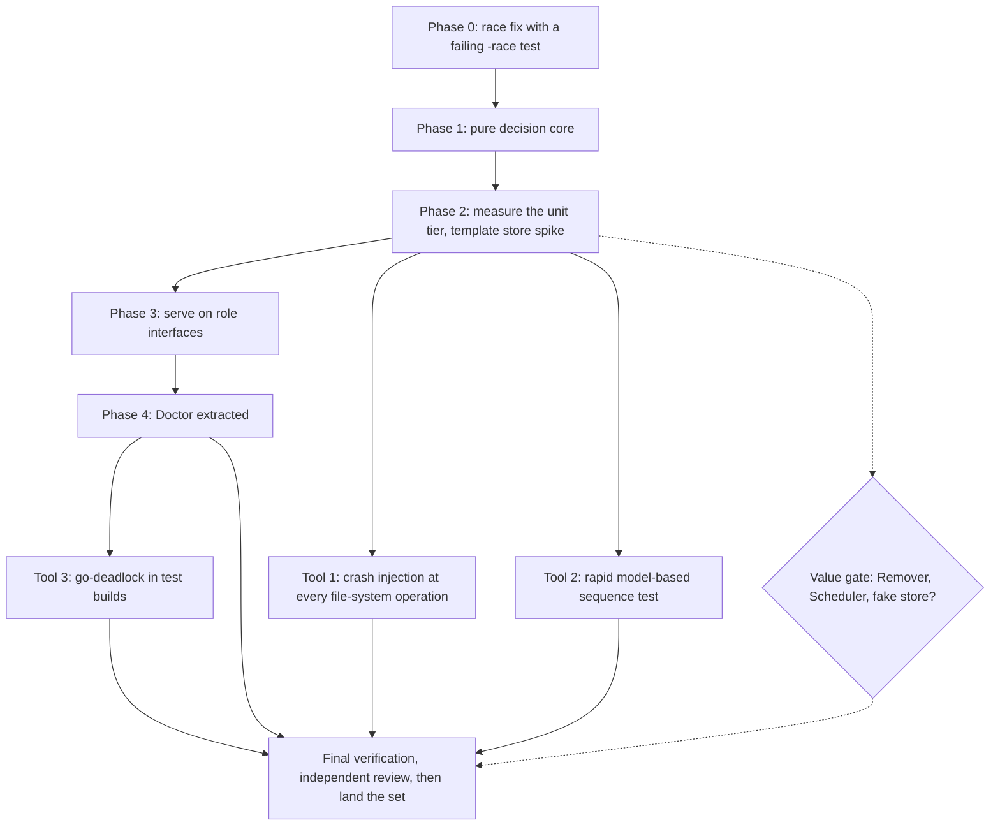

# Splitting the recorder's settle package, and proving it with crash injection

Status: approved by the operator for execution on 2026-11-10. Package:
`packages/pg-claude-code-recorder/internal/settle`.

## Why

`settle` is one `Settler` type (about 5,750 non-test lines, 25 exported methods, a `Config` of about
30 fields) doing seven jobs: stage machine (A), removal (B), doctor (C), extract (D), scheduling and
events (E), reporting (F) and shared helpers (G). Its core collaborators `*store.Store` and
`*copier.Copier` are concrete, so about 140 of its 153 tests build a real SQLite store, and about 130
also run `invariants.Check` at cleanup. The daemon (`serve/daemon.go`) holds the concrete type and is
the only production consumer.

A suspected defect turned out to be real: `doctorOne` (`doctor_rolling.go`) and `doctorFull`
(`doctor.go`) call `lastSeen`, which reads the `seen` map without the run lock while `Tick` writes
it, so the doctor loop can race the settle loop.

## Goals

- The package MUST keep its behavior and every crash-safety ordering, except for the one defect fix
  in phase 0, which is a deliberate behavior change in its own commit.
- The daemon SHOULD depend on narrow role interfaces, not on `*settle.Settler`.
- Decisions SHOULD be testable as plain functions without a store.
- The failure points MUST be tested systematically, not only at the 15 named `faults.At` points.
- The unit tier SHOULD get faster, and the speedup MUST be measured, not assumed.

## Patterns

Functional Core with an Imperative Shell for the decisions; Ports and Adapters, declared consumer-side
as `settle.Parser` and `settle.FreeSpace` already are; Facade (`Settler` stays as the wiring facade);
Interface Segregation for the daemon; Dependency Inversion for the one edge that needs it
(`Recover` into removal recovery); a Test Double only when a contract suite passes against it and
against the real store.

## Phases

Phase order is by value. Each phase is a commit group on the one feature branch; none lands on its
own. The whole set lands once, after final verification (see "Landing").

- **Phase 0, race fix.** A test that fails today under `-race` (the doctor loop reading last-seen
  while `Tick` writes it). The fix gives the doctor path a last-seen read that does not touch
  `s.seen` (it reads through `ReadTx`). Doctor MUST NOT take the run lock, because that would change
  the lock graph.
- **Phase 1, pure core.** Extract decisions as functions over plain values: `schedule`, `Wake`'s work
  set, removal rate limits, `cycleDue`, `doctorMissingBytes` classification, and the `checkAppend`
  and `evaluate` predicates. The I/O and commits stay where they are. Table tests, no store.
  `HeldAlertAfter` is unused and goes here.
- **Phase 2, measure.** Profile the unit tier by test, `store.Open` and `invariants.Check`, on a
  quiet host, and spike a template store (a pre-initialised store file copied per test). Record the
  numbers; decide from them.
- **Phase 3, daemon on role interfaces.** `LoopDriver`, `DirtySink`, `OpsPort`, `DoctorPort` declared
  in `serve`; `*Settler` satisfies them implicitly. `runTick` and `runLoop` already take function
  values, so the serve tests that fake a tick keep working.
- **Phase 4, Doctor.** An own type with its own mutex; its one dependency on removal becomes a
  callback that marks the removal gauges dirty.
- **Value gate.** Extracting the Remover, Scheduler and Reporter and a fake store are decided from
  the phase 2 numbers and the remaining pain, not by default. They would be separate follow-up
  work if chosen.

## Tools

- **Crash injection at every file-system operation** (build tag `crashsweep`, its own nix check, not
  in the unit gate). Run a scenario once under `fsx.Recorder` to count its N operations. For each i
  in 1 to N, rerun it, stop the process after operation i, reopen the store, run `Recover`, run
  `invariants.Check`. A second variant discards writes that were not synced, to model power loss.
  Scenarios: settle in clone mode and byte mode, removal (including abort and restore), extract,
  doctor repair. Existing `faults.At` points stay.
- **`pgregory.net/rapid` model-based test.** A state machine over `Tick`, `Wake`, `Remove`,
  `Extract`, `Doctor`, `Dirty`, a crash and a reopen, checking `invariants.Check` after each step,
  shrinking a failure to a minimal sequence. It joins the unit tier only if it runs in seconds;
  otherwise it sits behind the same tag.
- **`github.com/sasha-s/go-deadlock` in test builds only**, wrapping the run lock and the copier
  lock, with a test that fails on an inversion of "run lock, then copier lock" and on `Dirty` or
  `LiveChanged` taking the run lock.
- `go.uber.org/goleak` is already a dependency and is used in the new tests. `-race` runs in every
  phase's validation.
- New third-party modules need `go.mod`, `go.sum` and `gomod2nix.toml` refreshed through
  `packages/pg-claude-code-recorder/update-deps.sh`.

## Invariants every phase MUST preserve

- Byte mode: manifest, segment file, `CommitFull` settled, fault `settle.after-commit`,
  `BeforeDelete`, reclaim (fault `settle.partial-delete`). Clone mode: clone to temporary, verify
  size and hash, fsync file then directory, `ReplaceCopyLocked` before the settled commit.
- `Recover` runs under the run lock: remove `.tmp` and `.seg` files beyond the settled sequence,
  reclaim every archived file under the copier lock, then recover removal.
- Lock order is run lock, then copier lock. `Dirty` and `LiveChanged` MUST NOT take the run lock
  (`Dirty` is called inside the copier lock through `SetOnFileChange`). The `New` side effects
  (`SetOnFileChange`, seeding `last` and `removedAt`) stay in `New`.
- Removal order: check, optional `settleBytes`, full-hash compare, durability barrier, then per file
  quarantine rename, sync, lsof, rehash, flush, size and mtime recheck, unlink, sync, commit
  unlinked; final `CommitFull` removed. `stopping()` is only checked between candidates.
- The six `Hooks` and the 15 `faults.At` points stay reachable by tests.
- Moves are mechanical (cut and paste). Test edits that a field move forces go in a separate commit
  from the move, and the commit message says so. The 14 test files that call unexported methods and
  the two that build `&Settler{...}` keep working through forwarding methods and unchanged field
  names where possible.

## Validation per phase

From `packages/pg-claude-code-recorder`, niced and in the background:
`go test -p 4 ./internal/settle/... ./internal/serve/...`, the same with `-race`, `go vet ./...`,
`go vet -tags integration ./...`, and the tagged tiers (`faults`, `crashsweep`) once they exist.
Pre-commit hooks pass on the changed files.

## Landing

The whole set stays on one feature branch in one worktree until the final verification passes: all
unit tiers, `-race`, the crash-injection tier, the measurements recorded, and an independent
review of the complete diff. Only then does the set land, once, through `integrate-branch`. Nothing
lands earlier.

## Out of scope

Moving the exported types that `serve` and `cmd` import (`HeldRow`, `WhereInfo`, `TickStats` and
others) into an api package; changing the store or copier internals; the Remover, Scheduler and fake
store unless the value gate approves them.

## Decision record

Landing this set adds an ADR in `docs/adr` for the split and for the rule "a fake store MUST pass a
contract suite also run against the real store", and updates the `settle` package comment.
