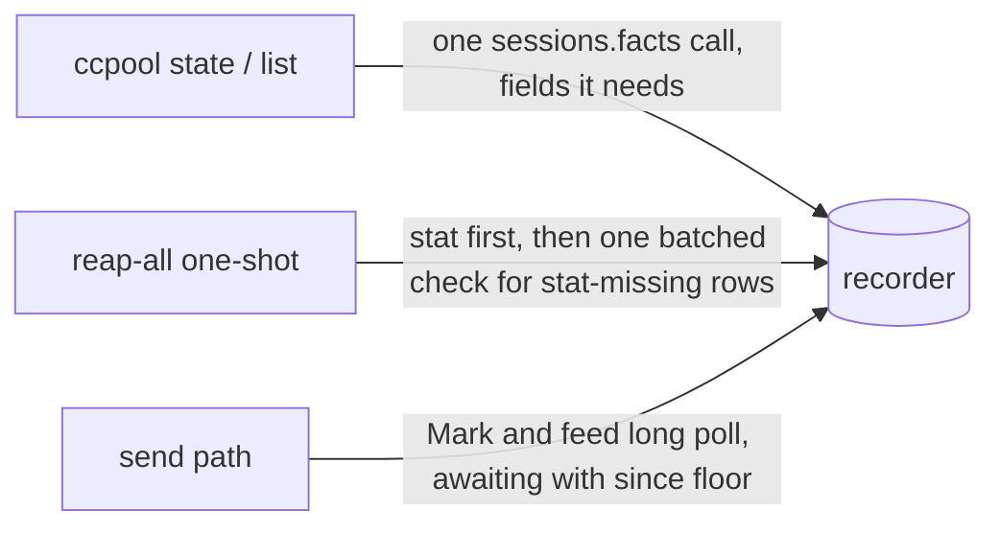

# Plan: ccpool recorder-load reduction (bounded direct reads and one batched facts op)

Status: APPROVED DIRECTION. The operator answered the open questions on 2026-11-17 (Phillip); the answers are folded into the body below and listed in "Operator rulings". Drafted 2026-11-10 by a planning subagent from a read-only review, then amended after an independent critique and the operator answers.
Tags: [V] verified from source by the planner, [I] inferred. Paths are under /Volumes/gitrepos/phillipg/nix-agent-support/packages.

Operator constraints (Phillip, 2026-11-10): fetch only what the tool needs; query a batch periodically instead of ad hoc N+1; state the time context of every request.

## Operator rulings (Phillip, 2026-11-17)

These override anything older in this plan.

- **Recorder owns derived reads.** "the recorder owns the derived reads": ccpool holds NO client-side copy of recorder facts (no persisted fact table in `store.db`, no snapshotter). The extended `process.list` and the extra `sessions.facts` fields are the client-facing work.
- **ccpool state reads directly, staleness 0.** Each `ccpool state` call asks the recorder for what it needs and uses the answer; nothing is cached across invocations.
- **ccpool stays one-shot.** There is no long-lived ccpool refresher; ccpool remains a short-lived CLI plus a timer-driven one-shot reaper, with direct bounded reads.

## Amendments from the independent critique (still in force)

1. The ccpool recorder op is named `sessions.facts` (per-id facts). The pa-monitor live-session list is served by the extended `process.list` (see the pa-monitor plan). Requests are `{session_ids (at most 500, required), fields[], since}`; add a per-call time budget and a `truncated` flag with partial results (each Engine.Show or List does several queries per conversation, engine.go:527-560, so 500 ids with awaiting and tokens could exceed the 30 s timeout). Add capability detection from hello with fallback to the old calls, update the capability-list tests (serve/daemon_integration_test.go:491, client/contract_integration_test.go:31), cancel_ops_test.go, README, and a query-plan guard test like TestLoadQueryPlansUseTheSourceIndex (engine.go:117-119) for each new query (awaiting_input and output_tokens on the 9.9M-record session are the risky ones; the missing sqlite_stat1 and the unary-plus issue can pick a wrong index).
2. Interim slice 2 (`session_ids` filter on conversation.list): the id filter MUST go inside `evidenceMatch`, BEFORE `transcriptFacts`. Engine.List runs transcriptFacts (cwd query, file-facts query, CurrentPaths, an exists check per file) for every conversation passing evidenceMatch, before the since and cwd filters (engine.go:611-619); an id filter added after would not reduce the work.
3. Slice 1 (stat-first, per-pass breaker, one WARN, 5 s timeout, 24 h positive TTL) is the best first change and needs no recorder change; land it first. Two additions: (a) the probe runs inside the per-id lock (reap.go:461-480, resumableForReap under withLock), so a batch result gathered before the lock MUST be re-verified under the lock before any delete; (b) behavior change to state: a transcript on disk that the recorder has not ingested is ErrNotFound today ("not resumable", row pruned, facts.go:315-337); with stat-first the row is kept. Benign, but call it out in the test fixtures.
4. Awaiting-input drives pg-router's needs_input edge detection and lease-release guards (executor/ccpool.go:1638, 2148); a stale awaiting answer could release a lease or worktree under a session waiting for input. Awaiting is read directly (bounded, since-floor, limit 50) for `state`, `list`, control paths and post-send, until `sessions.facts` exists; afterwards via its `awaiting_input` field (still a live read, staleness 0). A `degraded` answer never drives a "not resumable" or a prune.
5. `ccpool state` is per session (cmd/ccpool/state.go:40-60): it fetches only the fields the one session needs; it MUST NOT request a pool-wide fact set.
6. Cheapest-first order: slices 1 and 3 first (both need no recorder change; 2 is the prerequisite for the clean form of 1), then 2, then 4 (recorder `sessions.facts`), then 5 (the ccpool switch).

## 1. Current state

All reads go through ccpool/internal/facts/facts.go (Reader) [V].

| Request                                                                                                        | Cadence / N                                                                                                                                      | Time context                                        | Rows returned vs used                                                                                                              |
| -------------------------------------------------------------------------------------------------------------- | ------------------------------------------------------------------------------------------------------------------------------------------------ | --------------------------------------------------- | ---------------------------------------------------------------------------------------------------------------------------------- |
| Mark: Select[type] Limit 1, no where (facts.go Mark; send.go:64-68)                                            | 1 per confirmed send, plus 1 probe after a not-ingested window (send.go ~140)                                                                    | the instant "now"                                   | 1 row, only AsOf used                                                                                                              |
| feed long poll, session + main + user/assistant, after=mark, wait_ms up to 30000 (WaitMessage)                 | 1 per confirmed send, looping per page of at most 30 s                                                                                           | this live session, cursor-bounded                   | 0..1 entry, existence only                                                                                                         |
| conversation.show per dead row (OriginalsPresent; reap.go reapDeadRow -> resumableForReap, session.go:598-619) | every 300 s sweep (home/programs/ccpool/default.nix reap.intervalSeconds=300) x each dead row not positively cached for 1 h; errors never cached | one session, all history                            | a full Conversation (recorder engine.go:527-562: cwd query, file facts, CurrentPaths and an exists check per file) for one boolean |
| MessageActivity (newest user/assistant, limit 1)                                                               | per `ccpool state` on a live session (registry.go:96-100)                                                                                        | this session, no time floor                         | 1 row, 1 field                                                                                                                     |
| LastAssistantText (raw, limit 1)                                                                               | per `ccpool state` for idle or error, and per Idle send result (send.go:308)                                                                     | this session, no floor                              | 1 raw line                                                                                                                         |
| IsAwaitingInput: tool_use AskUserQuestion limit 1000, then ALL tool_results limit 10000                        | per `ccpool state` on a live session, plus every send timeout (send.go:294)                                                                      | this session, whole history                         | up to 11000 rows for one boolean                                                                                                   |
| OutputTokens: distinct-sum over message.id                                                                     | once per ended run (delete.go:76-95)                                                                                                             | whole session, then a stored snapshot is subtracted | 1 row, but a whole-session scan                                                                                                    |
| ProcessAlive (process.show); hello                                                                             | per `ccpool state`; hello once per process (PingOnce) plus the capacity gate                                                                     | now                                                 | 1 row                                                                                                                              |

Process shape [V]: ccpool is a one-shot CLI and reap-all is a timer-driven one-shot process, so there is no long-lived ccpool process; in-process caches (Reader.pinged, the Reader connection) die with each run. The only cross-process memory is the per-pool SQLite store.db, whose existing recorder-derived cache, `originals_probe` (migration 012, internal/store/originals_probe.go, keyed by external_id and transcript_path with a positive-only 1 h TTL), is kept, with its positive TTL raised from 1 h to 24 h (slice 1). The reap probe is serial per dead row with a 30 s timeout; each failure becomes `reap dead row %s: check resumable` in rowErrs, which explains the 1950 "check resumable" ERROR lines [V for the code path, I for the volume].

Where the failures come from [I]: a slow recorder scan (the session-pinned plan issue, fixed elsewhere) holds one of 8 query connections for 30 s; serial dead-row probes then queue behind it, one ERROR per row.

## 2. Target design

Pattern: ccpool is a thin, stateless client (one-shot) of a recorder that owns the derived reads. Each caller issues the smallest bounded request that answers its question and states its time context; nothing is persisted or cached between invocations except the existing positive-only `originals_probe` rows.



Staleness by caller (all answers are live reads):

| Caller                                        | Source                                                                                                                                                            | Staleness           |
| --------------------------------------------- | ----------------------------------------------------------------------------------------------------------------------------------------------------------------- | ------------------- |
| `ccpool state` alive, awaiting, last activity | direct: bounded reads now, one `sessions.facts` call (the fields that one session needs) once the recorder op exists                                              | 0                   |
| `ccpool state` last_reply                     | `sessions.facts` returns the record ref; one raw fetch of that record only when state is idle or error                                                            | 0                   |
| reap-all originals check                      | local stat first, then one batched recorder check for the stat-missing rows                                                                                       | 0 plus positive TTL |
| ended-run output tokens                       | one `sessions.facts` `output_tokens` read (`since`-bounded, from the recorder's per-message usage table); existing per-run output-token baseline subtraction kept | exact at run end    |
| pool-metrics, janitor, router (via the CLI)   | whatever `ccpool state` or `list` read                                                                                                                            | 0                   |

Reads that MUST be fresh and bounded:

- Send confirmation. The Mark taken before delivery and the feed after=mark long poll (session, main, user/assistant filter, project [type], cursor-bounded) are unchanged: Mark stays one Select[type] Limit 1; the not-ingested liveness probe stays (already limited to the not-ingested window).
- Awaiting-input everywhere it is read (`state`, `list`, control paths, the resolveOutcome timeout at send.go:294): a direct bounded call, the newest unanswered AskUserQuestion for one session, with a `time >= sentAt` or since floor and limit 50 on each of the two queries until the recorder op exists.

## 3. Recorder-side requirements

New op `sessions.facts` (per-id facts; distinct from the extended `process.list` that serves pa-monitor).

Request:

```json
{
  "session_ids": ["..."],
  "fields": [
    "alive",
    "originals_exist",
    "awaiting_input",
    "last_message_time",
    "last_write",
    "last_assistant_ref",
    "output_tokens"
  ],
  "since": "RFC3339",
  "budget_ms": 10000
}
```

(`session_ids` required, at most 500; `since` is the floor for last_message, awaiting and token sums; `budget_ms` is the per-call time budget.)

Response:

```json
{
  "as_of": "...",
  "degraded": false,
  "truncated": false,
  "sessions": {
    "<id>": {
      "found": true,
      "alive": true,
      "originals_exist": true,
      "awaiting_input": { "open": false, "tool_use_id": "", "asked_at": 0 },
      "last_message_time": 0,
      "last_write": 0,
      "last_assistant_ref": { "seq": 0, "time": 0 },
      "output_tokens": { "since": 0, "total": 0 }
    }
  }
}
```

Each field is independently requestable so a caller pays only for the fields it names. `found:false` is an explicit answer for ids the recorder has never seen (today ErrNotFound, which ccpool maps to "not resumable"). `degraded:true` means the recorder is behind; ccpool MUST NOT read negatives from a degraded answer. `truncated:true` means the budget ran out and the answer is partial; ids and fields not answered are absent, not negative.

Cost [I; confirm against the store schema]:

- Cheap from the lifecycle model (loadCtx keyed on ModelInputSeq, engine.go:164): alive, last_write, the segment data.
- originals_exist needs CurrentPaths plus a stat per file: add a per-file `exists` memo inside the recorder invalidated on a model-seq change only, with no time-based TTL, so the answer is never stale (file facts are the existing fileFactsQueryRef). This is a recorder-side cache, per the operator ruling.
- New indexed reads: last_message_time (limit-1 descending read per session on records_session_ref_source_time filtered on type; the batch resolves session_ref once and does N sessions in one request on one connection); awaiting_input (an incremental per-session "open AskUserQuestion tool_use_id" set updated on ingest, or an anti-join of tool_use name=AskUserQuestion against tool_result by tool_use_id bounded by `since`; the largest new piece); output_tokens (read from the recorder's per-message usage table described in the usage plan, so ccpool and pa-monitor agree (under global dedupe a message copied into a resumed or forked session counts only toward the session of its earliest copy, so a resumed session's total can be lower than today's per-file sum and the parity fixtures MUST expect that); the whole-session distinct scan is the expensive read today); last_assistant_ref (a limit-1 read returning the record ref only; text then comes through the existing `raw` op).

Minimum useful interim, no new op: add a `session_ids` filter to `conversation.list` (a type change in ConversationFilter, types.go:178). One call then returns OriginalsExist, LastWrite and State for N dead rows. It is a small, separate recorder change that covers the reap-all fix alone.

## 4. Call-site changes

- internal/session/session.go:598-619 resumableForReap, reap.go:111-121, reap.go:460 reapDeadRow:
  1. Stat row.TranscriptPath locally. If it exists the row is resumable with no recorder call; write the positive result to originals_probe.
  2. Collect only the stat-missing rows and send ONE batched check for them (conversation.list{session_ids} as the interim, then `sessions.facts`). A stat-missing row is almost always a phantom deleted in the same pass. A batch result gathered before the per-id lock MUST be re-verified under the lock before any delete.
  3. One availability decision per pass: on the first ErrDaemonOffline or timeout, stop probing, keep every unresolved row, log ONE WARN with the count. No per-row ERROR lines (rowErrs no longer appended for probe failures).
  4. Probe timeout from 30 s to 5 s. Positive TTL from 1 h to 24 h because the local stat now backs it.
  5. Negatives are not cached (a not-resumable dead row is deleted in the same pass).
- internal/facts/facts.go OriginalsPresent (~290): gains `OriginalsPresentBatch(ids) (map[string]bool, error)`; Conversation() per id remains only as a fallback.
- cmd/ccpool/registry.go:36-44 registryFacts and cmd/ccpool/state.go:64-80: until the recorder op exists, the awaiting and last-activity reads stay direct but bounded (since floors, limit 50); afterwards they become one `sessions.facts` call naming only the fields that one session needs (3 to 5 requests per `ccpool state` become 1 `sessions.facts` call, plus 1 raw fetch for idle or error only). The lastText closure fetches one raw record by ref.
- internal/session/send.go:294: direct, bounded (since floor, limit 50 each).
- internal/session/send.go:308: LastAssistantText after an Idle result stays direct (limit 1) with a `time >= sentAt` floor.
- internal/session/delete.go:76-95 attributeRunTokens: OutputTokens becomes one `sessions.facts` `output_tokens` read, `since`-bounded, with since = run.StartedAt minus slack, keeping the existing per-run output-token baseline subtraction in RecordRunOutputTokens (not the dropped fact snapshot) as the correctness guard. Do not drop the subtraction until a fixture test shows parity apart from the intended global-dedupe reduction.
- facts.go Mark and WaitMessage: unchanged. Optional recorder nicety: a feed `after:"head"` token so Mark and the first feed page are one request.
- Gate (facts_wiring.go:83, capacity.go:45): PingOnce stays; capability detection from hello selects `sessions.facts` or the bounded direct reads.
- No change to the store.db schema: no new migration.

## 5. Slices

1. S, no recorder change. Reap-all: local stat first, a per-pass circuit breaker, one WARN, 5 s probe timeout, 24 h TTL, re-verification under the lock. Tests with a stub recorder that counts requests: N dead rows with existing paths cause 0 requests; N dead rows with missing paths cause at most N requests the first time, then at most 1 via the breaker when the stub hangs; a hung recorder yields 0 per-row ERROR lines and 1 WARN; fixture parity: a phantom is still pruned when the recorder answers "missing"; a transcript on disk the recorder has not ingested now keeps its row.
2. S, recorder: `session_ids` filter on conversation.list, inside `evidenceMatch` before `transcriptFacts`. Recorder tests: 3 ids requested, 3 rows returned, OriginalsExist correct, the model read once. Then a ccpool follow-up with a request-count assertion: N dead rows with missing paths cause exactly 1 request.
3. M, no recorder change. Bound the direct reads: since floors and smaller limits for the awaiting check (`state`, `list`, send timeout), the post-send LastAssistantText and the MessageActivity fallback. Tests assert the request shape (`where` contains the time floor, limit 50) and that confirmation tests still pass.
4. L, recorder change. `sessions.facts`: alive, originals_exist and last_write first, then awaiting_input, last_message_time, last_assistant_ref and output_tokens; time budget and `truncated`; capability, cancel-ops, README and query-plan guard tests. Recorder tests: shape, degraded, truncated, found:false, field selection, and cost when nothing changed (model seq unchanged so no store read).
5. M, depends on 4. Switch ccpool to `sessions.facts` (registryFacts, state.go, token attribution), keeping the existing per-run output-token baseline subtraction. Tests: `ccpool state` makes at most 1 `sessions.facts` call plus 1 raw fetch (idle or error only) for the facts it needs, not 3 to 5; a hung recorder makes `state` fail with the recorder error as today (no cache to fall back to, no ERROR spam from reap); token totals on fixtures with resumed or forked sessions equal the global-dedupe expectation (a copied message counts only toward the session of its earliest copy, so totals can be lower than the old per-file sum) and equal the old sum where no message is copied.
6. S, optional. feed `after:"head"` so Mark plus the first poll is one request.

Order: 1 and 3 can land first against the existing recorder; 2 is a prerequisite for the clean form of 1; 4 gates 5. 4 follows the serial plumbing order in the usage plan (bound the registry query, then the usage op, then the extended `process.list`, then `sessions.facts`).

## 6. Post-apply verification

- Recorder request log, per minute and per client `ccpool`, by op: conversation.show from the reaper falls from N per sweep to roughly 0; `query` count per `ccpool state` falls from about 5 to at most 1 (one `sessions.facts`).
- reap.err.log growth over 24 h: approximately 0 "check resumable" lines; during a deliberate slow-recorder window at most 1 WARN per sweep.
- Recorder query-connection use (max 8): no 30 s queueing (`wait_ms` about 30000 with `exec_ms` 0 no longer appears).
- Parity spot-check: compare `ccpool state --json` before and after on the same live sessions.

## 7. Risks

- Stat versus recorder disagreement [V definition, I impact]: the recorder's resumable test is "any file of the conversation exists" (up to 50 files); stat checks only the row's TranscriptPath. The stat-first shortcut is positive-only, so it cannot cause a wrongful prune; a path moved while another file survives falls through to the recorder check, so it is safe.
- Awaiting-input semantics [V]: the facts.go docstring says "asked after the last assistant record that is not a question", but the code only diffs tool_use against tool_result. The recorder's awaiting_input is defined as "newest AskUserQuestion with no tool_result" (to be confirmed by the recorder tests).
- The token floor approach could shift attribution at run boundaries; keep the existing per-run output-token baseline subtraction until parity is shown apart from the intended global-dedupe reduction.
- The recorder fix for session-pinned query plans is handled elsewhere; these slices assume it but do not depend on it.
- `sessions.facts` field naming and the 500-id cap are fixed here; the pa-monitor plan uses the extended `process.list` and shares no op name with it.

Critical files: ccpool/internal/facts/facts.go, ccpool/internal/session/session.go, ccpool/internal/session/reap.go, ccpool/cmd/ccpool/registry.go, pg-claude-code-recorder/internal/lifecycle/engine.go.
