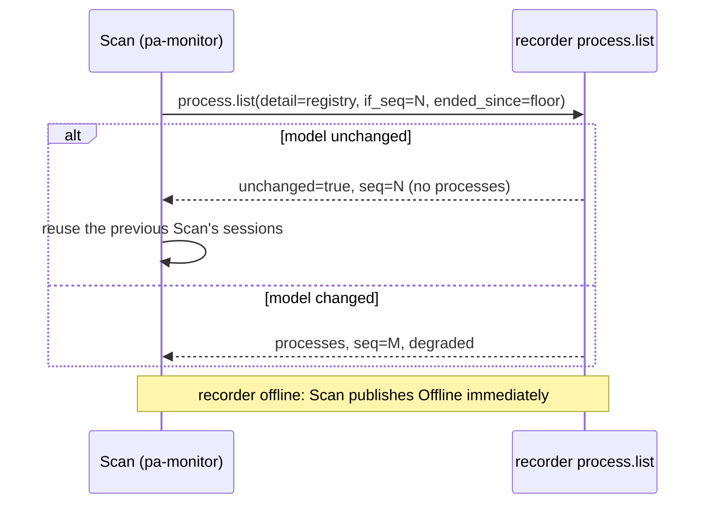

# Plan: bounded, batched discovery reads for pa-monitor-daemon

Status: APPROVED DIRECTION. The operator answered the open questions on 2026-11-17 (Phillip); the answers are folded into the body below and listed in "Operator rulings". Drafted 2026-11-10 by a planning subagent from a read-only review, then amended after an independent critique and the operator answers.
Tags: [V] verified from source by the planner, [I] inferred. Paths are under /Volumes/gitrepos/phillipg/nix-agent-support/packages.

Operator constraints (Phillip, 2026-11-10): fetch only what the tool needs; query a batch periodically instead of ad hoc N+1; state the time context of every request.

## Operator rulings (Phillip, 2026-11-17)

These override anything older in this plan.

- **Recorder owns derived reads.** "the recorder owns the derived reads": there is NO client-side copy of recorder state in pa-monitor (no `SnapshotSource`, no in-app discovery snapshot, no heartbeat or back-off machinery), with ONE deliberate exception: the single `if_seq` conditional token and the previous answer's session list, reused only while the recorder answers `unchanged` for that same `seq`. Because the operator kept the extended `process.list` (answer 3, which includes `if_seq`), this is a conditional-GET cache validator, not a replicated copy of recorder state: the recorder decides validity and the client never answers a question on its own. The recorder answers a cheap, bounded, cached read; pa-monitor asks it once per Scan.
- **Offline is shown immediately.** When the recorder is offline, pa-monitor MUST publish the existing Offline state at once; there is no 60 s stale-serving window.
- **No long-lived-refresher question.** The ccpool refresher question is moot (see the ccpool plan); it does not affect this plan.

## Amendments from the independent critique (still in force)

1. GC `keepIDs` MUST NOT shrink. `keepIDs` today is every session the recorder knows (alive or dead, dead capped at 500: daemon/gc.go:107-117, recorderfacts/facts.go:26,126); `MarkSessionsDeleted(keepIDs)` soft-deletes every pa-monitor row NOT in it and a hard delete follows 24 h later (gc.go:42-56). GC keeps reading the full known-id set (ids only, a cheap form of the extended `process.list`) and MUST NOT act on a `degraded` answer or on an error. [critique, verified at file:line]
2. No new op for the live-session list. Extend `process.list`: add `if_seq` and `ended_since` to ProcessFilter, plus an opt-in `detail:"registry"` adding kind, entrypoint, waiting_for, status_updated_at; the response is `{processes, degraded, seq, unchanged}` with no processes when unchanged. Per-id facts for ccpool are a separate op (`sessions.facts`, see the ccpool plan). Capability detection from hello with a fallback to the old calls, so a new pa-monitor still works on an older recorder; update the capability-list tests (serve/daemon_integration_test.go:491, client/contract_integration_test.go:31), cancel_ops_test.go (19-39) and README.md (process.list at lines 633, 661). No protocol-version bump (wire.ProtocolVersion=1 is additive).
3. `entrypoint` is a records column (`store:"record:entrypoint_id"`), not necessarily a `fields` row, so the extended registry query MUST join entrypoint_id; kind and status_updated_at are stored fields [verified, source/sessionregistry/registry.go:20-41].
4. "Unchanged when nothing committed" needs care: ModelInputSeq moves on every committed session-registry record, every history or control-end record, every TProc/TStage/TSettle/TTorn journal record and every row-clearing write (parser.go:1057-1059, 787; store.go:773-783, 1170-1179), and each miss re-reads EVERY registry version ever stored (registryQuery, engine.go:129-135, no time bound). Measured on a clone of the live store: 17,005 registry versions for 885 processes took 1.83 s to read, and only 166 arrived in the last hour. The recorder MUST bound `registryQuery` (live and recently ended processes only) or load incrementally; without that, batching three client calls into one does not remove the reload cost. This recorder change is slice R, ahead of the op change.
5. The file inventory is NOT the current source of load. A recorder doc of 2026-11-09 (docs/investigations/2026-11-09-op-query-slow-and-cancelled.md) names the FilesInventory bootstrap as dominant, but the live log shows that group-by shape stopped on 2026-11-09 at about 15:00 EST after commit 1aa480161 (files.inventory: 7 requests, 0.9 s total since the restart), while the registry-in-list query kept running (565 slow requests, mean 14.9 s, to 2026-11-10 15:00). Still add the bootstrap-convergence check (keep partial progress, bound the window) as a small slice, because the doc describes a failure that can return.
6. Best first slice: add an id restriction (live ids only) and a time floor to the 5000-row records query, and fix nothing in GC.
7. Control and nudge actions resolve their target live; a `degraded` answer never drives GC or deletion.

## 1. Current state (per Scan)

Scan runs at max(RefreshInterval, 5 s) [V: pa-monitor/internal/core/poller/changesource.go:10,28]. RefreshInterval defaults to 1 s [V: config/config.go:242]. Scan order is Discover, sync, folds [V: core/corpus/monitor.go:~105-130].

| Request                                                                                          | Where                      | Cadence                              | Time context                     | Rows returned vs used                                                                                             |
| ------------------------------------------------------------------------------------------------ | -------------------------- | ------------------------------------ | -------------------------------- | ----------------------------------------------------------------------------------------------------------------- |
| process.list alive=true, limit 1000                                                              | recorderfacts/facts.go:122 | every Scan                           | live now                         | N live vs N used                                                                                                  |
| process.list alive=false, limit 500                                                              | facts.go:126               | every Scan                           | all history, capped at 500       | up to 500 vs 0 new; already persisted until the 24 h GC [V: daemon/gc.go]                                         |
| query records, source=session-registry, session IN (live + dead ids), time desc, raw, limit 5000 | facts.go:156-171           | every Scan                           | all history, no time bound       | up to 5000 raw rows vs 1 per live session; a busy session can crowd out others and the cap truncates silently [V] |
| FeedPage (transcript + status), page 1000                                                        | core/corpus/reader.go:300  | every Scan                           | since cursor                     | the delta                                                                                                         |
| readLines (file, item=-1, offset > next)                                                         | reader.go:369              | per dirty file                       | since offset                     | the delta                                                                                                         |
| FilesInventory                                                                                   | reader.go:239, 268         | bootstrap, plus once per new session | bounded by cutoff or session ids | bounded                                                                                                           |
| GC Registrations                                                                                 | daemon/gc.go:115           | hourly                               | same as above                    | a second full copy of the three discovery queries [V]                                                             |

Other facts [V]: Discover has a 20 s timeout and an error fails the whole Scan (monitor.go:111-114). Producer.Assemble publishes an empty "Offline" state on ErrDaemonOffline (producer.go:~198). process.list carries no kind, entrypoint, waitingFor or statusUpdatedAt; the recorder's registryQuery (internal/lifecycle/engine.go:129) also omits kind, entrypoint and status_updated_at. process.list is served from loadCtx, which caches the whole model on ModelInputSeq (engine.go:164-175), so the two process.list calls are cheap when nothing changed; the records query is the expensive one.

## 2. Target design

Pattern: the recorder is the single owner of derived discovery state (a server-side cached read model, keyed on ModelInputSeq); pa-monitor is a stateless client of it. Discovery is a Query Object with a conditional-read token (`if_seq`), not a replicated cache.



- One request per Scan replaces the two `process.list` calls and the 5000-row registry query. The request states its time context: live now plus processes ended since `ended_since` (a bounded tail, default 24 h to match GC), never "all history".
- The conditional token carries the only client-side state: the previous `seq` and the previous answer's session list held only while the recorder keeps answering `unchanged` for that same `seq`, and replaced or dropped on any changed, degraded or failed answer, so an `unchanged` answer is reused. This is the response to an `if_seq` the recorder issued, not an independent cache; a failed or `degraded` answer is never reused.
- Errors: a failed request fails the Scan exactly as today (monitor.go:111-114); `ErrDaemonOffline` publishes the Offline state immediately. There is no stale-serving period, no back-off and no heartbeat.
- A `degraded` answer (the recorder is still backfilling) MUST NOT drive GC, deletion or a "session ended" decision; the Scan treats it as a read that carries no negatives.
- Stays event-driven: FeedPage drain, readLines by offset, FilesInventory. The Scan fold phase still runs every tick.
- Cadence is unchanged (max(RefreshInterval, 5 s)). Because an unchanged answer is tiny and the recorder serves it from the cached model, no separate refresh interval is added.

## 3. Recorder-side requirements

Extend the existing `process.list` (served from Engine.loadCtx, free when the model is unchanged). No new op name; a different op already named `snapshot` (feed state at a cursor, daemon.go:582) exists and MUST NOT be reused.

Request additions to ProcessFilter:

```json
{
  "alive": true,
  "ended_since": "RFC3339",
  "limit": 1000,
  "if_seq": 12345,
  "detail": "registry"
}
```

(`alive` is true, false or null for both; `ended_since` omitted means no dead tail, except that the GC form below returns dead rows; `if_seq` comes from the previous answer; `detail` is opt-in and absent keeps today's shape.)

Response when `detail` is `registry`:

```json
{
  "seq": 12345,
  "unchanged": false,
  "degraded": false,
  "processes": [
    {
      "pid": 0,
      "proc_start": "",
      "session_id": "",
      "name": "",
      "status": "",
      "cwd": "",
      "started_at": 0,
      "alive": true,
      "host": "",
      "kind": "",
      "entrypoint": "",
      "waiting_for": "",
      "status_updated_at": 0,
      "last_seen_alive": 0,
      "exit_time": 0
    }
  ]
}
```

Recorder changes:

- Bound `registryQuery` (engine.go:129) to live and recently ended processes, or load incrementally (slice R; amendment 4).
- Extend registryQuery and regRow (engine.go:79) with kind, entrypoint (joined from `entrypoint_id`) and status_updated_at; kind is [I] a stored field and MUST be verified. The new fields appear only when `detail` is `registry`; the default `process.list` and `process.show` shapes do not change.
- Return `degraded` while `!d.backfillDone`, as opProcessList does today.
- Cancel-ops audit entry, capability and README updates (amendment 2); `Client.ProcessList` gains the new request fields in client/lifecycle.go.

## 4. Call-site changes

- recorderfacts/facts.go:116-195 `Registrations`: one `process.list` call with `detail=registry` and `if_seq`; delete the `done` map loop and the unbounded 5000-row records query once slice 4 lands (removal is slice 5; the bounded slice-1 form stays as the older-recorder fallback, and registryExtra stays only if that fallback uses it).
- facts.go:122,126: the per-Scan dead read is replaced by `ended_since`; slice 1 keeps only the alive call on an old recorder.
- facts.go:156-166: slice 1 restricts ids to live sessions and adds a time floor of now minus 24 h (bounded interim for an old recorder).
- core/session/discovery.go:51-70 `Discover`: reads the one answer; env reads stay, cached per (sid, pid) [I].
- core/corpus/monitor.go:111: unchanged error handling (an error fails the Scan; Offline is published immediately).
- daemon/gc.go:115 `keepIDs`: reads the full known-id set with an explicit request: `alive:null`, no `detail`, `limit` covering the live set plus the 500-row dead cap (today's 1000 live plus 500 dead), so the dead rows up to the cap are returned and the set does not shrink; a degraded or failed answer skips this GC pass entirely.
- core/corpus/reader.go:300: unchanged.
- Capability detection from hello selects the extended `process.list` or the slice 1 fallback (amendment 2); slice 5 keeps that fallback code for an older recorder.

## 5. Slices (sizes S/M/L/XL)

All tests use a real recorder with a recording proxy; base: the recordingProxy helper at recorderfacts/sessions_test.go:126 and the corpustest.Env harness.

1. S: stop re-reading dead and old data (old recorder; lands first). Drop the per-Scan dead read, restrict registry ids to live, add a 24 h floor. Tests: per Scan exactly 1 `process.list` (alive) and 1 records query, the `session IN` set holds only live ids, a session dying mid-run still persists as dead with its DB row unchanged, GC still sees the full known-id set.
2. S: bootstrap-convergence check for FilesInventory (keep partial progress, bound the window). Test: an interrupted bootstrap resumes from its partial progress.
3. M, recorder: slice R, bound `registryQuery` (live and recently ended only, or incremental). Tests: a store with many old registry versions reads in time proportional to the live set; results equal the unbounded query for live processes.
4. L, recorder: extended `process.list` (`if_seq`, `ended_since`, `detail=registry`). Recorder tests: new fields from the newest version including entrypoint from the records column, `unchanged` when nothing committed, `degraded` while backfilling, cancel-op audit, capability lists, README. pa-monitor tests: per Scan exactly 1 `process.list`, 0 `query`; an equivalence test against the old three-call answer before deleting old code; capability fallback to slice 1 on an older recorder.
5. S: cleanup. Remove the dead per-Scan Registrations code that nothing reaches any more, and the tests of that code. KEEP the slice-1-shaped capability fallback (live-only ids, 24 h floor, one records query) so a new pa-monitor still works against an older recorder.

Order: 1 and 2 land first against the existing recorder; 3 then 4 need recorder changes and follow the serial plumbing order in the usage plan (R, usage op, extended `process.list`, then `sessions.facts`); 5 follows 4.

## 6. Post-apply verification

- Recorder log, client pa-monitor-daemon, requests per minute by op. Before: about 12 Scans per minute x 3 discovery calls plus the feed. After: 1 `process.list` per Scan, `unchanged` when the machine is idle.
- No slow_request lines for the records-by-session query; no discoverTimeout cancellations; no wait_ms over 1 s with exec_ms 0.
- Kill a test claude and see it dead on the next Scan; stop the recorder and see the Offline state on the next Scan (no stale window); dead sessions in the DB at startup unchanged.

## 7. Risks and where delay is not acceptable

Risks: kind as a stored registry field is not yet verified; an `unchanged` answer on a busy machine may be rare (registry status flips move ModelInputSeq [I]), in which case the saving is one call instead of three, not zero; slice 1 on an old recorder keeps one records query per Scan until slice 4 lands.

Delay NOT acceptable: control and nudge actions through pg-claude-control (resolve the target live and re-check one process.show before acting); GC deletion decisions (only on a complete, non-degraded answer); the Offline state when the recorder is really down (shown at once); authoritative cost and limits come from the recorder's `usage.totals` and the grouped `claude-status` `query` read (usage plan), not from a client fold.

Critical files: pa-monitor/internal/recorderfacts/facts.go, pa-monitor/internal/core/session/discovery.go, pa-monitor/internal/core/corpus/monitor.go, pg-claude-code-recorder/internal/lifecycle/engine.go, pg-claude-code-recorder/internal/serve/lifecycle_ops.go.
